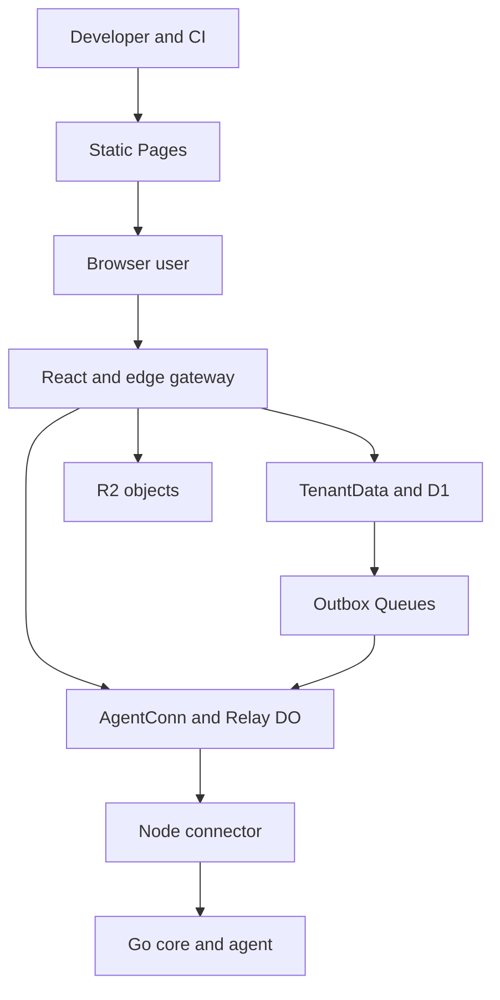

# AngelFleet PRD 威胁模型

## Executive summary

当前仓库是 Node.js/Markdown 静态文档站；Workers、Durable Objects、D1、Queues、R2、connector 和 Go 执行栈是 PRD 描述的目标系统，尚未由本仓库实现。因此本模型把“当前公开发布链”和“目标多租户控制面”分开。目标系统最高风险集中在跨租户授权、节点特权操作、票据/命令重放、R2 对象越权和控制面与本地 Go 入口之间的写入边界。

## Scope and assumptions

- 当前站点范围：`docs/`、`scripts/`、`src/`、`.github/workflows/` 生成并发布 GitHub Pages 静态站点。
- 目标运行范围：XC React、Cloudflare Workers、TenantData/D1、AgentConn/TerminalRelay DO、Queues、R2、connector、本地 journal 与原 Go core/agent。
- 目标部署假设：公网多租户 SaaS；浏览器使用同域会话，节点通过主动 WSS 连接；控制面和节点均需做服务端授权。
- 数据敏感度假设：节点凭据、终端内容、备份、配置和审计属于高敏感资产；终端输出和日志默认脱敏。
- 真实代码、真实节点、Cloudflare 账号配置、WAF/Pages Header 和容量测试不在当前仓库证据内。

未决问题：最终认证提供方和 Cookie 部署域名、生产区域/数据驻留、企业私有 provider 的真实边界、每租户节点上限与保留策略，都会改变风险等级和控制配置。

## System model

### Primary components

- 静态发布链：Markdown → `scripts/build.mjs` → `dist/` → GitHub Actions → GitHub Pages。
- 公网控制面：XC React 与入口 Worker，负责会话、租户、权限、命令意图和审计。
- 状态与异步：TenantData/D1 保存租户权威状态；AgentConn/Relay DO 协调连接、租约和顺序；Queues 只做持久补偿。
- 节点执行：connector 主动 WSS → operation adapter → 本地 journal → 原 Go core/agent；Go 执行主机特权操作。
- 制品与日志：R2 保存备份、安装包、导出和归档；D1 保存索引、摘要和审计。

### Data flows and trust boundaries

- Internet → React/入口 Worker：会话、租户上下文、命令、文件元数据；HTTPS、Cookie/CSRF/Origin、服务端 RBAC 和输入 schema 必须同时生效。
- 入口 Worker → TenantData/D1：授权后的租户状态、命令意图、审计和 outbox；只允许预定义领域方法，不接受客户端 SQL 或任意 binding。
- TenantData/Queues → AgentConn/Relay DO：事件、代次、租约和结果引用；按 tenant/node/terminal 绑定，使用 eventId、revision 和幂等收据去重。
- DO → connector：WSS 控制消息和角色票据；节点证明身份、核验 epoch、绝对租约和 capability 后才接收。
- connector → Go/core/agent：本机 Unix socket 或受控适配入口；操作 registry、资源锁、路径边界和本地 journal 约束特权动作。
- Browser/connector → R2：预签名 multipart 和下载；URL 绑定租户、artifact、动作和有效期，完成后校验 SHA-256。
- Developer → CI → GitHub Pages：源文档、依赖、构建产物；分支保护、锁文件、构建检查和产物一致性是发布边界。

#### Diagram

## Assets and security objectives

| Asset | Why it matters | Security objective (C/I/A) |
|---|---|---|
| Tenant membership and authorization versions | Determines who can control which node | C/I |
| Enrollment, role and connection tickets | Grants node or terminal access | C/I |
| Command intent, idempotency receipts and journal | Prevents duplicate or unknown host actions | I/A |
| Host credentials, private keys and API keys | Can grant direct infrastructure access | C |
| Terminal input/output, logs and backups | May contain secrets and customer data | C/I |
| R2 artifacts and manifests | Can install or restore software/data | C/I/A |
| Audit, outbox and deployment artifacts | Required for investigation and safe recovery | I/A |

## Attacker model

### Capabilities

- Remote authenticated tenant member attempting privilege escalation or cross-tenant access.
- Unauthenticated internet client probing enrollment, login, WSS, upload and download surfaces.
- Compromised or replaying browser session, stale node credential, delayed queue message or forged event.
- Malicious or compromised node process able to submit malformed results through its connector identity.
- Developer or dependency compromise affecting the public build or GitHub Actions artifact.

### Non-capabilities

- No assumption that an attacker already has production account, Cloudflare account, GitHub owner, or host root access.
- No claim that the public static site itself executes control-plane operations; it only publishes design artifacts.
- A root operator on a managed node can bypass a local fence; this remains an explicit trust-boundary limitation.

## Entry points and attack surfaces

| Surface | How reached | Trust boundary | Notes | Evidence |
|---|---|---|---|---|
| Login/session and deep links | Browser HTTPS | Internet → edge → tenant data | Cookie, CSRF, Origin and tenant checks | `docs/technical-plan.md` §10, §13.1 |
| Command API | React mutation | Edge → D1/DO → node | Idempotency, resourceVersion, capability and operation schema | `docs/technical-plan.md` §8, A.5, C.2 |
| Enrollment and WSS | Installer/connector | Internet → DO → node | Ticket binding, epoch, lease and replay protection | `docs/technical-plan.md` A.2, A.7, A.8 |
| File upload/download | Browser or connector | Edge → R2 → node | Presigned URL scope, path boundary and SHA-256 | `docs/technical-plan.md` §11, A.10 |
| Local Go adapters | Unix socket or local service | Connector → host privilege | Shell/path/host-key and resource-lock boundary | `docs/technical-plan.md` §8, §9, B.5.3 |
| CI and Pages artifact | Git push | Developer → CI → public site | Dependency, source and generated artifact integrity | `.github/workflows/deploy.yml`, `scripts/check.mjs` |

## Top abuse paths

1. A tenant member changes `tenantId` or `nodeId` in a command request → gateway trusts client context → command reaches another tenant’s node → privileged host action occurs.
2. An attacker obtains a stale enrollment or terminal ticket → replays it through WSS → missing role/epoch/expiry check accepts the connection → terminal or node control is exposed.
3. A file operation accepts `..`, a symlink, or an alternate mount → adapter resolves outside the authorized root → attacker reads or overwrites host files.
4. A script or cron parameter reaches a shell string → schema does not constrain argv → command injection executes with the connector’s host privileges.
5. A presigned URL is reused after completion or changed to another artifact → R2 path is not bound to tenant and action → backup or installation data is disclosed or replaced.
6. A Queue/outbox event is delivered twice or out of order → consumer lacks event/revision CAS → an old result overwrites a newer command state or repeats a destructive action.
7. A cookie-authenticated request or WSS upgrade arrives from an untrusted Origin → CSRF/Origin checks are missing or applied after upgrade → a victim’s session performs a privileged action.
8. A secret, ticket, terminal input, or backup URL is logged → logs are exported to a broader audience → infrastructure credentials or customer data leak.

## Threat model table

| Threat ID | Threat source | Prerequisites | Threat action | Impact | Impacted assets | Existing controls (evidence) | Gaps | Recommended mitigations | Detection ideas | Likelihood | Impact severity | Priority |
|---|---|---|---|---|---|---|---|---|---|---|---|---|
| TM-001 | Tenant member | Valid session; cross-tenant identifiers accepted | Submit command or read result for another tenant | Cross-tenant control/data access | Membership, commands, host state | Server-side tenant/node checks in §10, A.4 | Runtime implementation absent | Derive tenant from verified principal; reject client binding names; add cross-tenant negative tests | Alert on repeated 403/404 probing and tenant mismatch | medium | critical | critical |
| TM-002 | Remote attacker | Ticket leakage or weak replay guard | Reuse enrollment/role ticket or stale epoch | Node or terminal takeover | Tickets, host access | One-time tickets, role binding, epoch and lease in A.2/A.7/A.8 | No deployed verifier evidence | Hash tickets, bind tenant/node/incarnation/role, atomic consume, absolute expiry, rate limit | Track ticket failures, replay count and old-epoch rejects | medium | critical | high |
| TM-003 | Authenticated operator or hostile input | File/script operation reaches privileged adapter | Use traversal, symlink, shell metacharacters or arbitrary method/path | Host file overwrite or RCE | Host state, credentials | Operation registry and A.12 security cases | Go adapter changes not implemented | Canonicalize and constrain roots; parameterized argv; allowlisted operation schema; fail closed | Audit rejected paths/argv and process markers | medium | critical | high |
| TM-004 | Browser attacker | Cookie session; missing CSRF/Origin gate | Forge state-changing HTTP or WSS request | Unauthorized task/terminal action | Session, commands, terminal | §10 and A.12 require CSRF/Origin checks | Edge runtime headers not deployed | Same-site cookie, CSRF token, Origin allowlist before upgrade, frame-ancestors | Log Origin mismatch and CSRF failures | medium | high | high |
| TM-005 | URL holder or another tenant | Presigned URL not scoped to artifact/action | Download, replace or replay R2 object | Backup/install data disclosure or tampering | R2 artifacts | A.10 and A.12 bind URL and SHA-256 | R2 policy/config not present | Server-generated keys, short expiry, one-purpose method, completion revocation and object ACL checks | Record artifact, tenant, method, expiry and result | medium | high | high |
| TM-006 | Queue/event attacker or duplicate delivery | Consumer lacks CAS/idempotency | Replay or reorder command/result event | Duplicate side effect or state corruption | Commands, journal, audit | eventId, revision, intentHash and outbox design in A.5/C.1 | Runtime consumer not implemented | Enforce event uniqueness, CAS merge, command tombstone and conflict review | Metrics for duplicate, conflict and late event rates | medium | high | high |
| TM-007 | Log reader or compromised exporter | Secrets reach logs | Read tickets, keys, terminal input or URLs | Credential/data disclosure | Secrets, logs, backups | Redaction requirements in §10, A.10, A.12 | No log pipeline evidence | Structured allowlist, redaction tests, restricted retention and access | Secret-pattern scanner and audit access logs | medium | high | high |
| TM-008 | Developer/dependency attacker | CI token or dependency compromise | Alter generated site or workflow artifact | Public integrity loss, misleading design or supply-chain foothold | Source, Pages artifact | Lockfile, build/check and Pages workflow | Branch/review controls external to repo | Pin actions, protect main, review lockfile changes, verify artifact hash | Workflow audit, dependency alerts, artifact digest | low | medium | medium |

## Criticality calibration

- **Critical**: cross-tenant or host-privilege compromise that can execute or disclose customer operations; example TM-001.
- **High**: ticket/command/file/terminal abuse that can affect a node or sensitive artifact but requires a narrower precondition; examples TM-002–TM-007.
- **Medium**: public documentation or CI integrity loss without direct host access, or availability impact with bounded blast radius; example TM-008.
- **Low**: metadata leakage or noisy rejection telemetry that does not cross tenant or host boundaries.

## Focus paths for security review

| Path | Why it matters | Related Threat IDs |
|---|---|---|
| `docs/technical-plan.md` §8, §10, A.2, A.5, A.7, A.10 | Defines auth, tickets, command and file contracts | TM-001–TM-007 |
| `docs/command-state.json` | Machine-readable state transitions and late-event behavior | TM-006 |
| `docs/acceptance-ids.json` | Ensures security and capacity gates cannot disappear from traceability | TM-001–TM-007 |
| `scripts/build.mjs` and `scripts/check.mjs` | Generates and validates public artifacts | TM-008 |
| `.github/workflows/deploy.yml` | Controls dependency install and Pages publication | TM-008 |
| `docs/operation-ledger.md` | Maps privileged operations to Go entrypoints and recovery evidence | TM-003, TM-006 |

## Notes on use

This is a design-time model. It does not prove that the target Workers, DO, D1, R2, connector or Go controls exist in production. Re-run the model after P0 freezes the deployment model and after P2/P3 provide real node and runtime evidence. The public static site is reviewed separately from the future control plane.

## Static publication security baseline

The current site is a generated static artifact. Its JavaScript uses escaped search data and Mermaid strict mode, but those code properties do not establish the response-header policy of the hosting platform. The target publication must verify, with an HTTP response test, a restrictive Content-Security-Policy, `frame-ancestors` protection, `X-Content-Type-Options: nosniff`, and an explicit `Referrer-Policy`; source maps and build-time secrets must not be published. The current GitHub Pages workflow verifies build, manifest and HTTP availability, but does not claim these headers are present. Header verification remains a publication gate when the hosting target is selected.
