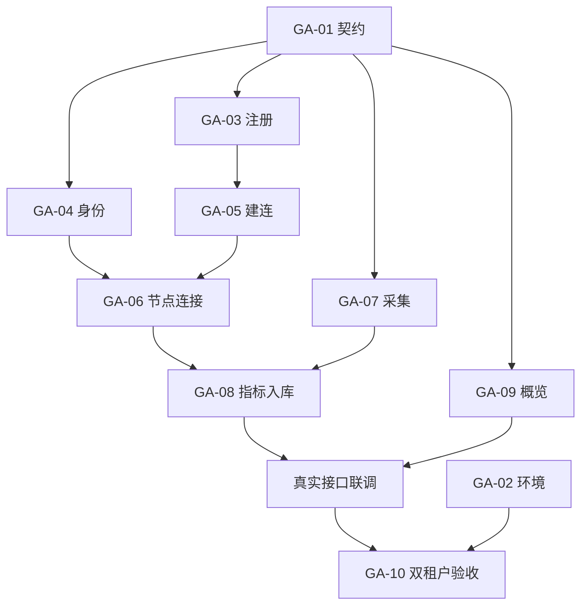

# AngelFleet 研发计划

**当前先交付 M1 节点只读概览。** 测试准备两套租户环境，控制面做注册与授权，Go 做节点身份，前端按契约样例做节点页，四项可在同一天开工。首个共同交付是在全新浏览器会话中读回两个真实节点各自的 CPU、内存、采样时间和来源，并验证跨租户拒绝。

截至 2026-11-19，GA-01 已通过公开样例、Go 与本地 workerd 的交叉验签。GA-10 双租户真机、GA-11 可靠写入、CORE-04 独立容器重启、OPS-02 MySQL 隔离恢复及 CAP-01 单租户万节点均待实测。[产品范围](product-prd.md) · [技术方案](technical-design.md) · [实测记录](spaces/implementation-review.md#实测记录)

## M1 排期与交接

**剩余 22–38 人日。基准计划在第 4 周评审，工时上限情景在第 5 周评审。** D1 是 Go、控制面、前端、测试各 1 人可投入，且测试节点与云资源可分配后的第一个工作日。下表和甘特图采用 [D18 基准排期](#基准排期与上限情景)。GA-02 在 D2 交付环境核对结果。环境缺项时，测试列出缺少的资源、权限和受阻用例，各实现方可继续使用样例。

| 工作日 | 工单、主责与人日 | 开工／联调条件 | 交给下一位的结果 |
|---|---|---|---|
| 开工基线 · 已完成 | GA-01 契约 · 技术负责人 2–3 | 无前置 | 冻结注册、握手、首次采样及错误样例。各端用同一契约对接，运行 `npm run check:ga01` 可复核 |
| D1–D2 | GA-02 环境 · 测试／环境 1–2 | 可立即准备 | 两租户各一台 Ubuntu 24.04 LTS / amd64 社区版主节点。核对 core/agent 构建、服务身份、socket 读权限、原始读数及测试 Worker/D1/DO 绑定 |
| D1–D4 | GA-03 注册授权 · 控制面 3–5 | GA-01 | 接入同源会话和 CSRF、节点范围、预登记和票据。原设备按确认后的规则取回绑定，并发产生一次消费及唯一成功审计。向 Go 和测试交付恢复截止、错误响应和审计判据 |
| D1–D4 | GA-04 节点身份 · Go 3–5 | GA-01 | 交付 connector 服务、设备密钥和本地注册记录。以服务身份连通 agent socket，重启沿用原绑定。联调前与控制面确认 [ADR-09](technical-design.md#adr-09--注册响应丢失后的恢复截止点) 和超窗引导，日志隐去私钥和票据 |
| D1–D2、D15 | GA-09 节点页 · 前端 2–3 | GA-01 起做样例，GA-08 后接真实 GET | 新会话逐项显示值、时间、状态与命令来源。节点切换时丢弃迟到响应，撤权后清除旧数据 |
| D5–D8 | GA-05 建连入口 · 控制面 3–5 | GA-01 可开发，联调需 GA-03 | 发放连接票据、接入 WSS 和 AgentConn DO。真实 Worker 上新连接完成 ready 才接收业务，旧代次迟到不能获投递 |
| D5–D7 | GA-07 采集适配 · Go 2–4 | GA-01 | 在 `dashboard.go` 的 `LoadCurrentInfoForNode` 与 `LoadCurrentInfo` 返回 CPU、内存各自的有效性、时间、单位与错误。核对有效零值、首采无值及单项失败，原 Dashboard 仍可读 |
| D8–D10 | GA-06 连接与 journal · Go 2–4 | GA-04，联调需 GA-05 | 持久化连接代次再发 ready，记录命令和待确认结果。旧代次拒绝，同一已完成命令重投可取原结果，账本丢失进入可信恢复 |
| D9–D14 | GA-08 入库与读取 · 控制面 4–7 | GA-01 可按样例开发，联调需 GA-03、GA-05、GA-06、GA-07 | D1 在受理事务确定采样顺序并保存命令、收据、审计与 outbox，逐项更新最后有效值。查询在顺序、逆序及重复合并下返回正确来源 |
| D16–D18 | GA-10 双租户验收 · 测试 2–3 | GA-02 至 GA-09 齐备 | 两租户分别执行注册、重连、采样、授权与故障用例，关联节点、云端和浏览器三份实测；失败项以新 runId 复测 |

D2 核对两台节点、云资源和角色可用工时，各实现方复核 GA-03／04 的注册恢复决策及工单估算。基准计划在 D10 核对重连与原始采样，D15 核对真实 API 与页面，D18 按[双租户真机条件](#ga-10-如何判断通过)评审 M1。开工日期和实名负责人待资源确认后填写。Go 在 `AngelFleetAgent/connector/` 及原 Go 采集服务交付，控制面在 `AngelFleetConsole/cloudflare/api/src/` 交付，前端在同仓的 `src/lib/api/` 和节点页接入。每方登记实际构建与补丁。[本页甘特图](#m1-排期与甘特图) · [节点接口与字段](go-agent-interface-contract.md#2-地址身份与共同字段) · [完整联调样例](examples/go-agent-first-sample.json)

### 基准排期与上限情景

每人每天按 1 人日核算。基准排期分配 32 人日，要求每项工单落在甘特图窗口内。按 38 人日估算上限安排时，控制面需要 17 人日，基准窗口为 14 日。Go 需要 13 人日，基准窗口为 10 日。前端和测试可在前期独立准备，真实接口联调和真机签收按依赖顺延。

| 角色 | 基准工时／窗口 | 估算上限情景 |
|---|---|---|
| 控制面 | 10–17 人日／14 日 | GA-03 D1–D5，GA-05 D6–D10，GA-08 D11–D17。GA-08 先按样例实现，D15 起接入真实链路。 |
| Go | 7–13 人日／10 日 | GA-04 D1–D5，GA-07 D6–D9，GA-06 D11–D14。GA-05 交接后验证真实连接。 |
| 前端 | 2–3 人日／3 日 | GA-09 D1–D2 完成样例接入，D18 接真实 API。 |
| 测试 | 3–5 人日／5 日 | GA-02 D1–D2 核对环境，GA-10 D19–D21 执行真机验收及评审，D22–D25 用于回归或复测。 |

D2 发现工单预计超出基准窗口、角色投入不足或环境未就绪时，在排期里记录责任人、解除条件和更新后的评审点。D10 复核 GA-06／07 交接和 GA-08 剩余工时。D21 情景以环境可用、GA-08 样例实现能提前完成且三日内完成真实链路联调为前提。前提变化时按受影响依赖更新交接和评审日期。[试点放行条件](product-prd.md#m1-试点放行)

## M1 排期与甘特图

D1 起四个角色并行。下图展示 D18 基准评审，D19–D20 留作回归。达到估算上限时使用上表的第 5 周评审安排。

| 工单 / 主责 | 第 1 周 | 第 2 周 | 第 3 周 | 第 4 周 | 第 5 周 |
|---|---|---|---|---|---|
| GA-02 环境核对 · 测试 | **D1–D2** | — | — | — | — |
| GA-03 注册授权 · 控制面 | **D1–D4** | — | — | — | — |
| GA-04 节点身份 · Go | **D1–D4** | — | — | — | — |
| GA-05 建连 · 控制面 | **D5** | **D6–D8** | — | — | — |
| GA-07 采集 · Go | **D5** | **D6–D7** | — | — | — |
| GA-06 连接与账本 · Go | — | **D8–D10** | — | — | — |
| GA-08 入库与读取 · 控制面 | — | **D9–D10** | **D11–D14** | — | — |
| GA-09 概览与联调 · 前端 | **D1–D2** | — | **D15** | — | — |
| GA-10 双租户验收 · 测试 | — | — | — | **D16–D18** | — |
| 回归或复测 | — | — | — | **D19–D20** | *按需启用* |
| 验收里程碑 | **D2** | **D10** | **D15** | **D18** | — |

### M1 开工与联调顺序

箭头表示联调前应交接的结果。GA-02 自 D1 准备环境；GA-07、GA-09 可先按 GA-01 样例开发。

## GA-10 如何判断通过

在 A、B 两个租户各准备一台节点和一个仅可访问本租户的账号，另用一个获准切换两个租户的账号检验上下文切换。一次运行关联节点、云端和浏览器三端记录。

| 测试场景 | 怎样触发及判断通过 | 核对的原始证据 |
|---|---|---|
| 注册、恢复与并发 · DEV01/02、NET-REG、FI-AUTH | 未消费票据过期后不绑定，成功审计为 0。绑定成功后丢响应，原设备在恢复窗口内用原 requestId 签新挑战取回同一绑定，换请求标识或公钥报 `409 ENROLLMENT_CONFLICT`。另测截止前取挑战、截止后提交证明，以及窗口内原绑定已吊销。以 GA-03／04 定案的响应和交接为准，并发始终只有一次消费和一条成功审计 | 票据、挑战和证明到达时刻，公钥指纹、绑定、处置记录及审计计数 |
| 连接切换与持久化 · DEV03、NET-AGENT、FI-CMD | 分别在 epoch 提交前、落盘后发 ready 前停止服务，重启上报最后持久化水位。新连接 ready 后才投递。节点详情和 `metrics/latest` 均验证，旧代次的关闭无法盖掉当前上线状态，同代次的迟到激活或心跳无法盖掉关闭。仅有连接事件时，指标值、来源、时间及投影版本均保持原值。journal 丢失进入可信恢复 | 两端 epoch、journal 水位、事件送达顺序、各连接投递数及两个 GET |
| 空历史与单项失败 · AC-HOST、FI-HOST、AC-UI | 首采前只发心跳，连接在线而指标无数据。采样 S1 的 CPU 和内存均成功，S2 仅令内存探针报 `COLLECTION_FAILED`，命令仍为 `SUCCEEDED`，失败项当次值和时间为空。另测两项均失败为 `FAILED`、合法零值显示 0 | 两份 Go 原样本、指标有效性和时刻、最终命令状态及页面 |
| 重投与迟到结果 · AC-CMD、FI-HOST | 同键同意图取得原 commandId，已落盘的命令重投新增 Go 采样 0 次。D1 合并前仅收 `result.received`；合并后重报仍确认同一 appliedRevision。另用新绑定先合并 S2，内存为空；放行迟到的 S1 后内存取 S1、仍提示 S2 失败，CPU 来源保持 S2。重复合并不得递增投影版本 | 受理和合并顺序、事件摘要、入口计数、两级确认及 projectionRevision |
| 两次采样后清空缓存 · AC-HOST、FI-HOST、AC-UI | 等待 S2 提交，暂停主动采样；用空白浏览器会话重新登录，禁用缓存，再从详情读当前 incarnation 的指标。GET 返回 200 和 `private, no-store`。CPU 的值、时刻和命令取 S2，内存取 S1 且提示 S2 失败。按时区和显示精度逐项核对后刷新，新增采样命令为 0 | S1/S2 实际值、命令 ID、毫秒时刻、D1 投影、GET 的 X-Trace-Id 与页面。[填写逐项观察](spaces/implementation-review.md#两次采样后的无缓存验收) |
| 越权、重装与撤销 · AC-AUTH、FI-AUTH、AC-UI | B 读 A 返回 403，获权账户用重装前 incarnation 读新绑定返回 409，拒绝响应均无样本。新绑定仅有自己的历史；撤销访问后刷新深链接不显示旧值。先展示 B 再交付 A 的迟到响应仍显示 B | 两种身份、授权变更、请求顺序、错误码、页面与来源 |
| 审计可见范围 · AC-AUTH、AC-UI | 对获准节点采样，再以缺少节点权限的账号访问。仅有审计授权的账号可查允许和拒绝记录，读节点或主动采样均被拒。仅有节点权限的账号查不到租户审计，跨租户查询也被拒 | 操作者、租户、原目标、traceId、commandId、权限集和审计查询结果 |
| 断线、服务故障与恢复 · FI-HOST、AC-UI | 断线保留各项最后有效值并标过期。重连只发心跳不能清除过期标记，新代次各自采到才更新。逐指标 GET 返回 503 时隐藏旧值、时间、来源；重试重新鉴权，已撤权时继续隐藏，读取期间新增命令为 0 | 心跳与采样时刻、503 错误及恢复响应、权限、命令计数、前后页面 |

**怎样签收。** 界面样例用 `pnpm test:e2e` 验证；本地 API 与 SQLite 用 `pnpm dev:local` 配合 `pnpm test:e2e:local`。GA-10 由测试在真实 Worker、WSS、connector 与 Go 链路执行。同一 runId 关联时间、实际构建、租户、节点、权限、traceId、commandId 和脱敏证据。正常、拒绝及选入的故障场景均达到相应验证层级后记「通过」；权限或操作未登记记「前置未就绪」，缺少环境或证据记「待核对」，实测不符记「失败」。复测使用新 runId 并引用原记录。[实测登记](spaces/implementation-review.md#按工单提交验收) · [逐指标样例](examples/node-metric-read.v1.json)

## 后续工作包与估算

产品选定本批动作、对象和适用环境后，研发按相应依赖领单。只读功能可并行。涉及节点副作用的工单复用 GA-11，首个真实写操作选 CORE-04 的独立容器重启。各包分别验收本域的权限、执行入口和真实资源结果。

| 工作包 | Go 人日 | 控制台人日 | 测试人日 | 合计人日 | 放行条件 |
|---|---:|---:|---:|---:|---|
| [首批剩余 · GA-02 至 GA-10](#m1-排期与交接) | 7–13 | 12–20 | 3–5 | 22–38 | 双租户真实节点通过首次采样、部分失败、无缓存和隔离用例 |
| [通用写命令 · GA-11](#ga-11-可靠写入) | 3–5 | 5–8 | 3–5 | 11–18 | 可计数执行器通过重复投递、改绑、撤权、掉电及结果未知演练 |
| [首批扩展 · FOLLOW-01 至 FOLLOW-07](#首批扩展的七项工单) | 15–25 | 20–36 | 14–25 | 49–86 | 逐项核对指标、日志、账户策略、凭据及维护结果 |
| [核心运维 · CORE-01 至 CORE-08](#核心运维的八项工单) | 63–103 | 59–97 | 39–64 | 161–264 | 按资源验收主机、文件、容器、终端和数据库 |
| [运行保障 · OPS-01 至 OPS-09](#运行保障的九项工单) | 52–89 | 37–61 | 36–59 | 125–209 | 分形态回读恢复结果，核对调度、告警与工具的实际效果 |
| **剩余合计** | **140–235** | **133–222** | **95–158** | **368–615** | 全部选入时的开发、自测、评审及所列联调 |

控制台人日合并控制面与前端。已完成的 GA-01 另计技术负责人 2–3 人日，M1 含 GA-01 共 24–41 人日。共用协议计一次；GA-11 的授权、掉电和证据交接方案冻结后复核估算。后续日期取决于选包与人员。资源采购与等待、额外备份目标或通知渠道、KVM、万节点压测、core 退役另估。[已移出的 GA-12 至 GA-19](go-agent-development-plan.md#已移出的历史工单)

### GA-11 可靠写入

| GA-11 主责 | 人日 | 前置 | 交付物 |
|---|---:|---|---|
| 控制面（牵头） | 5–8 | GA-08 的命令存储、收据和 outbox | 主库启动授权、取消、到期与补偿 |
| Go | 3–5 | GA-06 的节点 journal | 资源锁内复核身份、资源版本和短期授权，保留执行标记和只读对账入口 |
| 测试 | 3–5 | GA-10 真实环境 | 以原 commandId 关联授权时序、节点账本与实际执行次数 |

- 重提同一键和意图须返回原命令；重复投递后业务调用合计 1 次。主库批准启动前撤权、节点发现目标改绑或授权已过期，调用 0 次。
- 分别注入进程退出、服务重启与目标存储掉电，记录存储配置、恢复水位和入口计数。动作可能已执行时，按原命令只读核对，新增调用 0 次；证据不足保留 `UNCERTAIN`。
- 冲突需人工接管时，保留原事件、核对结论及证据交接记录。达到归档与保留条件后才回收临时记录。[写入实测表](spaces/implementation-review.md#现行写入与恢复验收)

### 首批扩展的七项工单

每项工单列出总人日和最低授权范围。新权限由控制台登记，Go 在本机复核身份、目标与版本，测试覆盖允许和拒绝后开放。Go 负责节点采集、执行和原始证据；控制台负责授权、数据、API 和页面；测试以正常、拒绝及指定故障样本签收。纯控制台的会话和偏好两单由控制台与测试交付。

| 交付主题 | 工单 · 人日 | 开发入口 | 做到什么可以签收 | 权限与目标 |
|---|---|---|---|---|
| 指标与进程排行 | FOLLOW-01 · 8–13 | GA-10，扩展 GA-07、GA-08 的采集和查询 | 磁盘、网卡速率可用两次原计数和时间差复算，换设备或计数回退重建基线；Top 受限字段按权限返回 | Viewer 限本节点及 incarnation，沿用 `node.read`。Top 详情字段和附加授权待登记。 |
| 节点和任务日志 | FOLLOW-02 · 8–14 | GA-10 的认证与任务标识 | 按节点、时间、原 taskId 分页读行。对照首尾行、轮转缺口和跨节点拒绝，响应完成脱敏 | Viewer 按节点、日志类别和任务获授读取；审计查询另行授权。 |
| 日志清理 | FOLLOW-03 · 6–10 | FOLLOW-02、GA-11 | Admin 按节点、类别和保留期清理，给出清理前后计数；重复投递新增清理为零，保留云端审计 | Admin 按节点和日志类别获授清理，云端租户审计始终保留。 |
| 会话、MFA、Passkey | FOLLOW-04 · 6–11 | GA-03；确认目标认证服务、旧账号兼容规则，以 GA-10 回归 | 本人登记或恢复验证器，Admin 管策略；超时或撤销的会话读不到节点。用两租户核对登录与拒绝审计 | 本人管理验证器，租户 Admin 管策略与恢复，两者分别登记。新源站重新登记 Passkey。 |
| 显示偏好与备忘 | FOLLOW-05 · 3–6 | GA-03；确定启用字段，以 GA-10 回归 | 按账号／租户保存，重新登录可读回；切租户、打开深链接核对现有 API 授权，共享编辑另授权 | 用户写本人偏好。租户共享备忘的编辑须另授，可见菜单仍逐次校验 API 权限。 |
| TLS 与凭据轮换 | FOLLOW-06 · 8–15 | GA-10、GA-11、隔离域名与证书、回退窗口 | 用新凭据重连原绑定，撤销旧凭据后新请求被拒；无效 TLS 配置回退后恢复访问，保留版本与连接回执 | Admin 的凭据管理与节点配置写分别登记，只回显标识、指纹和状态。 |
| 重启、升级与救援 | FOLLOW-07 · 10–17 | GA-10、GA-11、安装包、回滚包与可还原快照 | 按进程或 boot identity 证明指定服务或主机重启；升级中断后从 CLI 救援，核对版本、健康、原身份和未决任务 | Admin 在维护窗操作；主机重启用 `host.reboot`，面板重启和升级回滚另登记，CLI 救援需本地维护身份。 |

#### 首批扩展分工

| 工单 | Go · 人日与交付物 | 控制台 · 人日与交付物 | 测试 · 人日与交付物 |
|---|---|---|---|
| FOLLOW-01 | **3–5** · 采集选择器、累计读写字节、收发字节、时间和可用性；适配 CPU/内存 Top。 | **3–5** · 按节点/磁盘/网卡保存基线，以增量除时间差；呈现系统信息和排行。 | **2–3** · 两次采样比对原值，测计数回退、切对象、时钟倒退及同值。 |
| FOLLOW-02 | **3–5** · 对允许的日志源、原 taskId 做分页或按行读取、游标和脱敏。 | **3–5** · 提供定位时间段、节点/任务及续页；云端保留来源引用。 | **2–4** · 对照原日志行，切换节点、滚动日志文件和撤权后重新查询。 |
| FOLLOW-03 | **2–3** · 按日志类别和保留时间清理已登记的本地日志源，返回计数和留存边界。 | **2–4** · 展示清理范围、预计影响、任务结果和独立操作审计。 | **2–3** · 验证边界前后样本、重复提交、无权请求及审计留存。 |
| FOLLOW-04 | **0** · 沿用节点身份协议，由控制台负责验证器与会话变更。 | **4–7** · 实现会话超时、变更后撤销、本人验证器登记/移除与恢复；按目标源站验证 Passkey。 | **2–4** · 两租户测试过期会话、撤销、第二因素登记、移除和恢复。 |
| FOLLOW-05 | **0** · 使用控制台账户级配置，无节点改造。 | **2–4** · 保存用户或租户上下文的偏好；兼容原账号默认值，更新菜单仍服从服务端授权。 | **1–2** · 验证重新登录、切租户、隐藏/显示菜单和深链接。 |
| FOLLOW-06 | **3–5** · 校验节点身份与证书配置，持久化启用版本和回退点，支持轮换后重新建连。 | **3–6** · 配置变更按租户/节点受理；区分 API 凭据与设备身份，提供 API 凭据签发/撤销、节点连接恢复状态和审计。 | **2–4** · 隔离域名实测轮换、旧凭据撤销、配置失败回退和重连。 |
| FOLLOW-07 | **4–7** · 区分主机、core/agent 重启和升级；保留身份、journal、回退水位及救援 CLI。 | **3–5** · 提供版本与目标确认、进度和恢复后核对；关联同一任务与审计。 | **3–5** · 在隔离节点分别重启目标服务、重启主机、升级并注入中断回退，核对版本、数据和连接。 |

### 核心运维的八项工单

| 交付主题 | 工单 · 人日 | 开发入口 | 做到什么可以签收 | 权限与目标 |
|---|---|---|---|---|
| 主机只读盘点 | CORE-01 · 12–20 | GA-10；准备两租户同名目录和进程 | 列文件、进程、监听端口和挂载，下载摘要匹配节点原件；越界或无权读取返回 0 字节 | Viewer 限节点与根目录；文件内容／下载、进程详情与磁盘读取分别登记。 |
| 文件与主机变更 | CORE-02 · 28–45 | CORE-01、GA-11、测试 R2、隔离节点与可丢弃磁盘 | 交付制品上传、校验、原子落盘、回收/恢复，分开授权进程、防火墙和磁盘动作。核对字节、权限、撤销与重复投递计数 | Operator 限目录与进程，`file.install`／`file.write` 适用于校验后落盘。防火墙、挂载与磁盘分别授 Admin；格式化另需 `disk.destructive`。 |
| Docker 与 Compose 盘点 | CORE-03 · 13–21 | GA-10，准备共享卷及普通 Compose 项目 | 用节点和稳定 ID 列容器、镜像、网络、卷、编排及日志。两节点同名项目能区分，共享卷依赖可核对 | Viewer 按节点与资源获授资产、日志和配置读取，敏感设置脱敏。 |
| 容器与编排变更 | CORE-04 · 29–48 | CORE-03、GA-11 | 先验原容器重启一次、重复或改绑零增量，再逐动作验容器生命周期、镜像、编排、网络卷和 daemon 配置 | Operator 限获准容器／项目，清理共享资源和修改 daemon 限 Admin。`container.ensure`／`container.manage` 对应目标配置，独立重启等新动作逐项登记。 |
| SSH 配置和常用命令 | CORE-05 · 13–22 | GA-10；节点写接 GA-11；备独立 SSH 目标和断网救援入口 | 交付连接记录、指纹、SSH 服务配置和命令目录。密钥失配停止连接，失败配置可回退；凭指纹、配置读回和脱敏导出签收 | Operator 管获授连接与命令库，Admin 改节点 SSH 服务。分别授予资料管理和配置权，导出脱敏。 |
| 本机、SSH、容器终端 | CORE-06 · 24–38 | GA-10、CORE-03、CORE-05；配置独立 Relay DO 与配额 | 每类会话关联唯一 terminalId。撤销通知送达立即关闭，通知丢失最迟在绝对租约到期关闭。核对 Relay 停止和节点 PTY 关闭时间 | Operator 具备 `terminal.open` 及目标节点、SSH 实际账户或容器 ID 授权。创建和续租均核验。 |
| 已有与远端数据库 | CORE-07 · 16–27 | GA-10、两类实例记录与各引擎测试连接；登记／同步写接 GA-11 | 分引擎回读版本和能力，区分错误凭据与不支持；保留托管和远端来源、脱敏能力清单与跨租户拒绝 | Viewer 读获授实例，Operator 登记或同步；分别登记权限，云端与引擎账号同时授权。 |
| 数据库受控变更 | CORE-08 · 26–43 | CORE-07、GA-11、隔离库和回退样本；交互 CLI 另接 CORE-06 | 按引擎开放库、用户权限、配置等动作。凭原实例前后值及命令核对，越权、改绑和重复投递无额外写入 | Operator 限获授权的库。Admin 管引擎账户、远程访问及实例配置。CLI 另核身份和租约。 |

#### 核心运维分工

| 工单 | Go · 人日与交付物 | 控制台 · 人日与交付物 | 测试 · 人日与交付物 |
|---|---|---|---|
| CORE-01 | **5–8** · 对接受限根目录的浏览、元数据、预览与下载；返回进程身份、监听端口、磁盘分区与挂载清单。 | **4–7** · 实现节点文件、进程和磁盘视图；大文件按授权流式读取，切换节点取消旧请求。 | **3–5** · 实机比对文件摘要、进程身份和挂载信息，覆盖链接越界、撤权及跨节点迟到响应。 |
| CORE-02 | **12–19** · 接入传输、摘要校验与原子落盘、编辑、归档、权限/归属、收藏、回收站和分享；进程停止核对 PID 与启动身份；防火墙、分区和挂载按能力分别适配。 | **9–15** · 接入 R2 分片上传、完成校验、取消清理及文件动作，实现到期分享与撤销；进程、防火墙及磁盘变更分开授权，展示命令和结果；挂载设备按稳定 ID 确认。 | **7–11** · 实测上传/恢复摘要、分享过期、进程身份变化、规则回读及隔离盘回挂；注入丢回执。 |
| CORE-03 | **5–8** · 复用 Docker 查询，按稳定 ID 归集容器、镜像、registry、网络、卷、Compose 项目/模板；接日志、监控与 daemon 设置只读视图。 | **5–8** · 展示资产依赖、日志与监控，隔离节点缓存；registry 凭据仅显示授权引用。 | **3–5** · 与节点端 Docker 清单、日志及卷挂载比对；在另一节点部署同名项目复测。 |
| CORE-04 | **12–20** · 绑定容器 ID、版本及执行标记，补只读对账；按独立动作接入容器生命周期、镜像构建/传输、registry、Compose、网络卷与 daemon 配置。 | **10–16** · 实现目标确认、影响资源清单、命令跟踪和配置回读；Docker 清理、共享卷删除与 daemon 变更单列受限操作。 | **7–12** · 在隔离 daemon 验证正常、已改绑、回执丢失、共享卷被占用及配置恢复；留前后清单。 |
| CORE-05 | **5–8** · 对接连接记录、分组及凭据引用、主机密钥核验；适配 SSH 服务状态、配置校验/回滚、登录及会话信息。 | **5–9** · 实现连接管理和常用命令的编辑、分组及 CSV 导入导出；区分连接管理、节点 SSH 配置与实际开终端。 | **3–5** · 验证主机密钥变化、凭据脱敏、导入往返及配置失败后的可达性。 |
| CORE-06 | **8–13** · 接入本机 PTY、登记 SSH 目标和容器 exec；实施角色票据、租约、关闭与流控，连接不明的输入不重放。 | **10–16** · 实现会话授权、Relay、隔离终端与审计关联；建立、续租、到期、撤权和主动关闭分开显示。 | **6–9** · 三类终端各做建立、撤权、丢撤销通知及慢消费者测试，核对 Relay 与 PTY 的关闭时刻。 |
| CORE-07 | **6–10** · 区分托管实例的安装元数据和远端连接，按 MySQL、PostgreSQL、MongoDB、Redis 探测版本与可用功能，核对远端记录与节点内的凭据引用。 | **6–10** · 接实例目录、登记/同步、状态与能力视图；按节点、实例、库及绑定版本显示，远端数据留原实例。 | **4–7** · 覆盖本地存量、远端同名、凭据失效、撤权与无商店环境，记录各引擎支持项。 |
| CORE-08 | **10–17** · 按引擎接入所支持的库/用户与权限、配置/远程访问、诊断日志或 Redis 持久化；写前复核实例身份、目标库与版本，写后按原目标回读。 | **10–16** · 按能力渲染动作，建立分别授权的库管理、用户授权、引擎配置与 CLI 入口；记录变更范围、命令与结果。 | **6–10** · 按引擎准备适用/不适用对照，测权限不足、目标改绑、执行后响应丢失及回滚。 |

### 运行保障的九项工单

| 交付主题 | 工单 · 人日 | 开发入口 | 做到什么可以签收 | 权限与目标 |
|---|---|---|---|---|
| 备份目标与记录 | OPS-01 · 11–18 | GA-10、GA-11 | 本地与一个选定的 S3 兼容目标均可回读同一文件。留对象版本／本地引用、摘要和拒绝记录，检查凭据脱敏 | Viewer 读获授记录，Admin 配目标，制品读写单授并限租户、节点、桶前缀。 |
| MySQL 单库恢复 | OPS-02 · 14–24 | OPS-01、CORE-07 的实例清单，备隔离库与回滚点 | 从指定归档恢复应读回 A，中断并回滚应读回 B；重复回执新增顶层恢复 0 次。记录实际托管／远端形态；远端缺少匹配客户端时返回可诊断错误 | Operator 的创建权与操作待登记。Admin 的 `backup.restore` 另核归档归属、引擎和目标版本。 |
| 其他引擎恢复 | OPS-03 · 18–31 | OPS-02、CORE-07 已登记相应引擎 | PostgreSQL、MongoDB、Redis 分引擎和部署形态演练，分别提交原始样本、恢复回读和中断记录 | Operator 创建、Admin 恢复，按引擎登记；Redis 限已验证实例范围。 |
| 目录归档与恢复 | OPS-04 · 11–19 | OPS-01、CORE-01 的受限目录清单 | 在隔离目录还原后逐项核对清单、摘要；越界或改绑的请求写入 0 次，留拒绝审计 | Operator 创建、Admin 恢复。分别核验源目录读取、备份创建、目标目录写入。 |
| 面板快照与恢复 | OPS-05 · 17–28 | OPS-01、GA-11、隔离整节点与救援入口 | 核对快照组件、版本、健康和数据；失败能回滚至已记录状态，旧快照不能复活已吊销身份 | Viewer 可读获授清单，Admin 执行整节点创建、导入、恢复、回滚；逐动作登记并核对维护窗口与独占锁。 |
| 调度与脚本 | OPS-06 · 15–24 | GA-11；各类备份作业另等 OPS-02、OPS-03 或 OPS-04 对应类型通过 | 同一触发标识仅一条执行结果，停用后无新启动，漏跑有记录；旧网站／应用作业列待处置 | Viewer 读记录，Operator 编辑或执行指定类型；另需目标动作权限，绑定节点及脚本版本。 |
| 告警与渠道 | OPS-07 · 11–19 | GA-10、GA-11、受控邮箱与 Webhook 接收端 | 用实际事件触发，两个渠道分别出示真实收件凭据；核对发送尝试、重试和明确的失败状态 | Viewer 读本范围记录，Operator 管获授规则，Admin 配渠道及投递测试；各项按租户、节点、渠道登记。 |
| 工具箱能力发现 | OPS-08 · 9–16 | GA-10、CORE-01 | 在两种节点核对组件可用性和只读配置；查询新增变更为 0，未获权节点无内容 | Viewer 按节点、组件获授只读权限，响应隐藏系统与 FTP 凭据。 |
| 工具箱受控维护 | OPS-09 · 19–30 | OPS-08、GA-11；清理另接 CORE-01 目录清单 | 按能力处理 DNS/Hosts、时区、Swap、服务、扫描与清理。逐动作核对前后值，清理结果匹配预览，越权或缺组件执行 0 次 | Operator 限获授服务，系统凭据、清理和主机配置限 Admin；按动作、节点和范围分别登记。 |

#### 运行保障分工

| 工单 | Go · 人日与交付物 | 控制台 · 人日与交付物 | 测试 · 人日与交付物 |
|---|---|---|---|
| OPS-01 | **4–7** · 接入 core/agent 备份账号及节点记录；验证本地目标和一个选定的 S3 兼容目标，用获准凭据访问备份目标。 | **4–6** · 实现租户凭据保管、目标、桶/前缀与记录页；只返回脱敏配置、对象引用、摘要和任务状态。 | **3–5** · 验本地与对象存储各一次写入、回读、摘要复核；模拟失权、传输中断。 |
| OPS-02 | **6–10** · 适配 `MysqlBackup/MysqlRecover`，绑定已登记实例、库、归档摘要、原任务和恢复前回滚点；定义中断水位。 | **4–7** · 提交备份与恢复两种意图，呈现源归档、目标库、恢复窗口和分步结果。 | **4–7** · 同一隔离库执行 A→备份→改 B→恢复；验证中断、回滚及重复上报；本地托管和登记远端分别取证。 |
| OPS-03 | **8–14** · 分别适配 PostgreSQL、MongoDB、Redis 的现有服务，固定支持的部署形态、归档组织和一致性边界。 | **4–7** · 按引擎显示归档、实例/库及可恢复范围；对不支持的目标拒绝提交。 | **6–10** · 三个引擎分别在隔离实例恢复表、集合、键样本，校验失败回退和权限。 |
| OPS-04 | **5–9** · 复用 `cronjob_backup.go` 的目录归档；增加受限目录恢复、路径边界、覆盖前保护和中断核验。 | **3–5** · 选择已授权源目录、归档、目标目录和覆盖策略，显示原任务与恢复结果。 | **3–5** · 用文件清单、摘要及适用权限比对还原；测损坏归档、越界成员和目标改绑。 |
| OPS-05 | **7–12** · 复用快照创建、恢复、回滚服务；生成组件清单，锁定节点，在维护窗持久记录恢复点与进度。 | **5–8** · 快照/导入页显示包含项、版本兼容、历史站点或商店依赖及风险；跟踪节点重启后原任务。 | **5–8** · 在可还原节点测试创建、导入、还原及回滚；核对面板库、配置、归档所含样本和重连身份。 |
| OPS-06 | **6–10** · 复用 Cron、脚本目录、记录及导入导出；按策略版本、节点及计划触发时点去重，落盘离线窗口与漏跑决定。 | **5–8** · 规则、分组、启停、手工触发、导入预检、历史执行/日志；显示节点已应用版本及退出任务类型。 | **4–6** · 重复投递、离线重连、停用与并发修改；验证非网站日志任务、脚本、已接入的备份类型。 |
| OPS-07 | **4–7** · 接入告警规则、触发记录、投递重试；验证邮件和社区自定义 Webhook 的实际发送结果。 | **4–7** · 规则启停、阈值、渠道配置/测试和真实事件投递状态；渠道秘密只写不回显。 | **3–5** · 模拟触发与恢复，核对接收端真实消息；检查重复通知、渠道失败及跨租户隔离。 |
| OPS-08 | **4–7** · 探测 DNS/Hosts、主机名、时区/NTP、Swap、Supervisor、ClamAV、Fail2Ban、FTP 与清理候选；统一组件状态和查询结果。 | **3–5** · 按节点展示可用状态、只读配置/运行摘要与缺项原因；Supervisor 与主机页共用同一查询。 | **2–4** · 在具备与缺少组件的测试节点比较状态、可见字段与访问权限。 |
| OPS-09 | **8–13** · 按组件实现白名单操作和锁，覆盖DNS/主机名/Hosts、时区/NTP、Swap、系统凭据变更、Supervisor 及已选服务、扫描与清理；保留回读或可核验执行记录。 | **5–8** · 按能力和风险分开展示变更、预览、确认、任务追踪及失败恢复；Supervisor 仅一处管理入口。 | **6–9** · 逐组件验证正常、无权限与受限环境；用专用样本验证扫描、清理及服务变更，核对凭据脱敏。 |

### 首个真实写入与恢复怎样验收

| 工单 | 交给测试的材料 | 签收后归档 |
|---|---|---|
| CORE-04 · 独立容器重启 | 控制面提交操作及权限登记。Go 提交原容器身份、版本和执行标记。测试准备独立容器、同名替换容器及撤权用例。 | 测试关联原 commandId、Docker 事件和调用计数，领域负责人签收该容器动作。 |
| OPS-02 · MySQL 单库备份及隔离恢复 | 数据库人员提供测试实例、隔离库、样本和回滚点。控制面交付区分备份创建与恢复的测试账号，Go 提交归档摘要与本地任务标识。 | 测试关联原任务、前后查询、拒绝审计和恢复记录，注明实测引擎及部署形态。 |

按[操作主文的判据](operation-ledger.md#工单与操作登记)执行，将 runId 和现场观察填入[联调实测记录](spaces/implementation-review.md#现行写入与恢复验收)。操作或权限尚未登记时先补齐前置。

### 速率、终端和制品的专项验收

| 工单与场景 | 故障注入与通过条件 | 核对证据 |
|---|---|---|
| FOLLOW-01 · 磁盘和网卡速率 | 固定设备，2 秒内发送增加 4,096 B、磁盘读取增加 4 MiB，读数应为 2 KiB/s、2 MiB/s。有效计数持平才显示零。更换设备、计数回退或时钟未前进时重建基线；采集失败保留上次有效时刻并标过期 | 选择器、成对累计计数与时刻、速率及页面 |
| CORE-06 · 活动终端 | 分别在撤销通知送达和丢失时撤权，送达后关闭 Relay 和 PTY，丢失时最迟在绝对租约到期时关闭，旧授权版本不能续租 | 原 terminalId、主库撤权提交、Relay 停止收发及 PTY 关闭时刻 |
| CORE-02 · R2 制品 | 完成多分片后丢失响应，原 artifactId 与清单重复完成只得到原对象版本。整件大小与 SHA-256 均通过才置 `READY`；摘要冲突时安装数为 0 | uploadId、artifactId、分片清单、对象版本、复核摘要及投递数 |

## 整版路线与发布条件

| 阶段 | 开始与退出条件 |
|---|---|
| P0 · 固定范围与环境 | 产品、客户和运维确认试点租户、节点、地区，以及命令、审计、诊断日志和制品的驻留要求；确定租户审计保留期和导出权。研发冻结选入动作、源码版本、契约、适用环境与取证方式 |
| P1 / P2 · 控制台与节点 | 控制面与前端交付身份、上下文和真实 API，Go 接入 connector 与原 core/agent。GA-03／04 联调前由控制面与 Go 确定已消费票据过期后的恢复窗口、拒绝响应及审计规则，以丢回包和并发重试验证。首个共同放行点为 GA-10 |
| P3 · 共用协议 | GA-11 验证启动授权、可靠写入与只读对账。选入文件时核对分片、大小、整件摘要及重复完成；选入终端时分别核对撤销通知与绝对租约到期 |
| P4 · 逐域交付 | 按本页工单的进入条件选入交付。每个动作、引擎、节点形态分别提交成功、拒绝和恢复证据，产品据此列明可试点范围 |
| P5 · 发布评审 | 发布、平台、运维与测试提交真实 Cloudflare 部署、区域链路、跨存储对账、权限、签名升级／回滚及灾备演练报告，记录开放范围、缺项与实际发布决定 |
| P6 · 单独评审 core 退役 | 后续版本在无 core 环境验证安装、启动、升级、快照恢复和单一写入入口，记录逐节点切换与回退演练，按 P6-AC 单独评审 |

**容量承诺。** 压测前冻结负载、尾延迟、错误率、资源水位和积压清空阈值。CAP-01 须在单租户 10,000 节点连续运行 72 小时混合负载；CAP-02 另测 100 租户 × 100 节点对照，CAP-03/04 分别测重连撤权、限流与恢复。记录实际 D1 调用、批内 SQL、行数与排队时间。功能试点、容量结论、生产发布决定分别留证。[容量实验与发布门禁](technical-plan.md#151-单租户容量与证据门禁)

**放量与回退。** 发布前固定目标快照、并发、观察窗口、失败阈值及恢复条件，建议按内部节点、1%、10%、全量逐批评审。不可逆操作出现 `UNCERTAIN` 时暂停未启动任务，接收在途结果，按原命令和目标侧实际状态核对。恢复控制面先冻结新写，恢复权威数据、重建 DO，对账 D1/outbox、Queues/DLQ、R2 清单与节点 journal，记录最后一致水位和实测恢复时间。确认单一写入方、更新策略版本并记录审计后恢复投递；节点已发生的副作用按该动作的回退或人工核验流程处理。[技术方案](technical-design.md) · [验收编号](acceptance-ids.json) · [填写实测结果](spaces/implementation-review.md#按工单提交验收)
