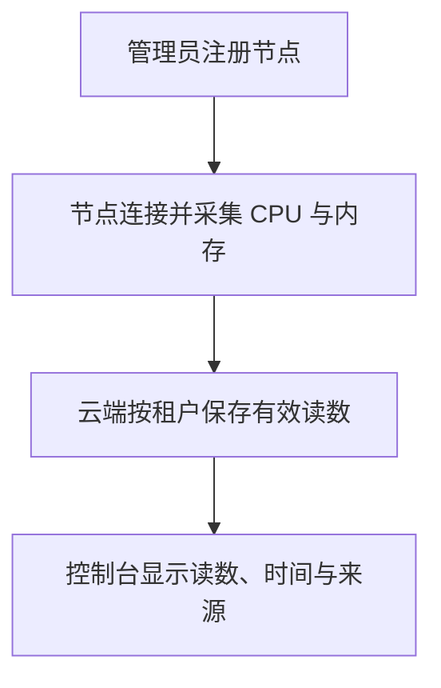

# AngelFleet 产品 PRD

**目标是让已有 1Panel 的运维团队在 AngelFleetConsole 按租户集中查看 Linux 节点，并逐批开放常用的远程运维操作。** 首批先解决「节点接进来后，谁能看、数据从哪里来、断线后还能看到什么」三个问题。

## 首批做什么

首批 M1 用两个租户、两台 Linux 测试节点验收。租户管理员给本租户注册节点，运维人员查看获授权节点的在线状态、CPU、内存和采样时间，审计人员能追查登录、授权和采样结果。重启服务、改配置和管理文件在后续工作包验收后才开放。

| 用户操作 | 页面应显示什么 |
|---|---|
| 打开节点详情或刷新 | 读取已保存的指标。刷新不会触发新的采样 |
| 主动发起采样 | 显示任务编号，收到结果后按指标更新 |
| 本次 CPU 成功、内存失败 | 显示本次 CPU 和上一次有效的内存，各自保留原采样时间和来源，并提示内存本次未取到 |
| 节点离线或从未采到 | 离线时显示最后已知值和时间。从未采到时显示无数据，实际读到 0 时显示 0 |
| 无权限或权限已撤销 | 拒绝读取，审计人员可核对拒绝记录 |

[逐指标读取契约](go-agent-interface-contract.md#53-逐指标读取与冷启动展示) · [首批验收场景](spaces/implementation-review.md#两次采样后的无缓存验收)

## 哪些 1Panel 功能分批迁移

从 [1Panel 功能导图](1panel-feature-map.md)查看上游功能、各阶段迁移范围及对应工单。

| 批次 | 选定能力 | 可以开放的条件 |
|---|---|---|
| 首批 M1 | 节点接入、CPU 与内存概览、节点权限和基础审计 | GA-10 用两个租户的真机核对采样来源、页面结果、重连和撤权 |
| 后续核心 | 主机文件和进程、终端、Docker/Compose、已有及远端数据库 | 先核对资源清单和读取范围。写入先通过共用写任务验证，再由 CORE-04 在隔离容器上验证重启 |
| 后续保障 | 数据库和目录备份、面板快照、计划任务、告警和工具箱 | 逐项核对实际结果。恢复要回读数据，告警要确认真实送达 |

详细指标、长日志、账户安全和节点维护列为首批能力的扩展，按需求和依赖排期。网站管理、OpenResty 专用操作、应用商店、GPU/AI、MCP 在本轮范围之外。虚拟机需满足 KVM 等环境条件后单独选入。[迁移清单与退出边界](technical-plan.md#137-本轮非-ai-功能迁移清单)

## 原 1Panel 怎么用

原 1Panel 继续管理未纳管功能。节点保留现有 Go 业务服务和原地数据。AngelFleetConsole 提供界面、授权、任务和审计，节点上的连接程序把已授权操作交给 Go。改动集中在接口适配、执行权限、任务关联和失败恢复。

两端涉及同一资源时，先统一 Go 写入口的互斥，或保留单一写入入口。发生断线时查原任务和现场证据。结果仍不明时交人工核对，避免重复执行。

## 当前验收状态

GA-01 接口契约和样例已验证。GA-10 真机验收待执行。单租户 10,000 节点另做持续混合负载验收。

[查看 M1 排期与甘特图](go-agent-development-plan.md#m1-排期与甘特图) · [查看三批派工](go-agent-development-plan.md#三批派工总览) · [看技术方案](technical-plan.md) · [看已取得的验收证据](spaces/implementation-review.md#实测记录)
