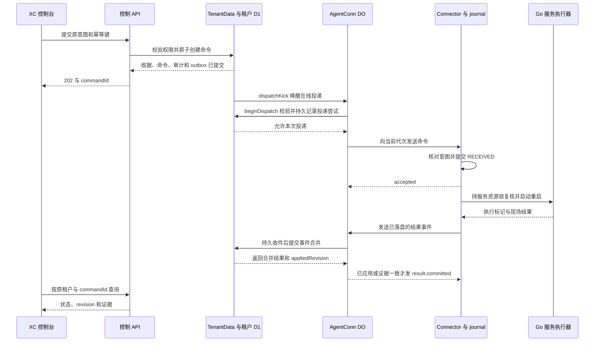
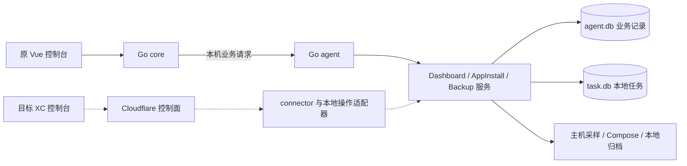

# 技术详细设计

操作员在 AngelFleetConsole（文中简称 XC 控制台）重启一个已安装的 OpenResty 实例，浏览器随即断线。恢复连接后，任务中心怎样找到原命令，又能凭什么证据判断该实例确实重启过？本页以控制台已有的身份、审计接口和 1Panel 的 Go 执行入口为依据。节点注册、控制连接、云端命令、本地 journal 及其联合验收均属待实施范围。[Go Agent 研发计划](go-agent-development-plan.md)

# 1. 从服务详情页提交重启

1Panel 的网站页把应用键 `openresty` 交给状态组件。组件查询已安装应用，取回 `appInstallId`。用户确认重启后，组件以该安装 ID 和操作名 `restart` 提交请求。由此可定位到本节点的一个安装实例。[网站页](https://github.com/1Panel-dev/1Panel/blob/aaba86d0ef71a31ee319e74998ffe83c64abf4b6/frontend/src/views/website/website/index.vue#L13-L20) · [实例查询与确认操作](https://github.com/1Panel-dev/1Panel/blob/aaba86d0ef71a31ee319e74998ffe83c64abf4b6/frontend/src/components/app-status/index.vue#L139-L175)

在 XC 设计中，`payload.service` 是受管服务别名。示例里的 `website-proxy` 在租户 `tenant-a` 的节点 `node-a` 上绑定到一个 `appKey=openresty` 的 `installId`。确认时，页面提交服务别名、不透明的 `resourceVersion` 和本次意图的 `Idempotency-Key`。控制面核验节点归属、`service.manage` 权限和节点能力，再按该版本解析绑定，把租户、节点 incarnation、安装 ID 与版本一起固化到命令意图。别名改绑、配置变更或应用重装时必须生成新资源版本。已受理的命令始终指向原实例。

```http
POST /v1/tenants/tenant-a/nodes/node-a/commands HTTP/1.1
Content-Type: application/json
Idempotency-Key: restart-example-01

{
  "operation": "service.restart",
  "resourceVersion": "17",
  "payload": { "service": "website-proxy" }
}
```

首次受理时，`202` 表示控制面已持久保存命令意图。客户端记下返回的 `commandId` 和绝对 `expiresAt`，后续按命令 ID 查询进度。

```http
HTTP/1.1 202 Accepted
Content-Type: application/json

{
  "commandId": "cmd-example-01",
  "expiresAt": 1794471300000,
  "idempotencyReplay": false
}
```

客户端在首次发送前保存租户、节点、原始请求体和 key。即使首个响应在返回 `commandId` 之前丢失，也可用同一请求找回任务。服务端先核验当前授权，再按 `(tenantId, idempotencyKey)` 查收据。并发请求由收据唯一约束选出一次创建，其余请求读取已提交收据。

| 收据判定顺序 | 服务端结果 | XC 后续动作 |
|---|---|---|
| 仅余 key guard | `410 IDEMPOTENCY_KEY_EXPIRED` | 停止重试，先从原节点任务记录核对历史结果 |
| 正文存在，`requestFingerprint` 不同 | `409 IDEMPOTENCY_REQUEST_MISMATCH` | 找回原请求。若用户确实变更了操作意图，重新展示目标供确认 |
| 指纹相同，`intentHash` 不同 | `409 IDEMPOTENCY_INTENT_MISMATCH` | 保留原命令，核对资源版本、原业务期限和规范化输入 |
| 两个摘要均一致 | 返回原 `commandId` 和 `expiresAt`，`idempotencyReplay=true` | 打开原任务详情，查看受理时绑定的安装 ID 和执行进度 |

回放时按首次受理的安装 ID、资源版本和绝对期限核对意图。即使 `website-proxy` 已经改绑，原请求仍定位到原实例的命令。操作员确认要重启新实例时，页面读取新版本并使用新 key。Queue 重投携带原 `eventId` 和 `commandId` 唤醒投递。Compose 一旦可能已启动，节点只读核对现场。[主方案 A.4 数据模型与对外 API](technical-plan.md#a4-数据模型与对外-api) · [C.3 统一错误与可观测字段](technical-plan.md#c3-统一错误与可观测字段)

# 2. 按持久化边界推进任务

一次在线重启经历三次独立确认。租户 D1 先接受操作意图，节点 journal 随后保存接收记录，最后由租户 D1 合并执行结果。



| 边界 | 此处必须写入的事实 | 中断后由谁接手 |
|---|---|---|
| TenantData 提交创建事务 | 同一租户 D1 一次写入 `commands`、幂等收据、初始审计和 outbox。事务提交后才返回 `commandId` | 在线唤醒失败时 dispatcher 经 Queues 再次唤醒同一 AgentConn。通知携带原事件、命令和版本 |
| AgentConn 首次投递 | `beginDispatch` 核对有效期、取消意图和当前 `fenceVersion`，以 CAS 把 `QUEUED` 推进到 `DISPATCHED` 并记录尝试。DO 保存投递记录后才发送 | 已有投递历史但缺少确认时，AgentConn 在有效连接上向 journal 核对。D1 不可写时暂停新的首次投递 |
| Connector 与 Go 启动 | journal 持久保存 `commandId` 和 `intentHash` 后回复 `accepted`。执行器持有该服务资源锁，复核 incarnation、epoch、写入代次、授权、期限和资源版本，关联 `cloudCommandId` 与 `operationMarker` | 已存在相同命令时从 journal 返回进度。若 Go 已启动但任务映射尚未落盘，按标记和现场证据核对 |
| TenantData 合并结果 | DO 保存事件后可回复 `result.received`。TenantData 按事件标识去重，以命令 `revision` 做 CAS，将合并结果和 `appliedRevision` 持久化 | `PENDING` 保留待处理，`CONFLICT` 触发核对。仅 `APPLIED` 或证据一致的 `CONSISTENT_NOOP` 可回 `result.committed`。节点收到后才开始计算结果正文保留期，去重记录独立保留并覆盖允许重投的窗口 |

常规 OpenResty 安装实例由 `AppInstallService.Operate` 按 `installId` 查本地记录，取该实例的 Compose 路径，执行 `compose.Restart` 并同步安装状态。本分支同步返回，处理器只回成功或错误，不会为本次动作创建可按云端命令查询的持久任务。原前端的操作请求超时为 40 秒，Compose 重启执行器的超时为 20 分钟；浏览器放弃等待时，节点可能仍在执行。[安装实例执行分支](https://github.com/1Panel-dev/1Panel/blob/aaba86d0ef71a31ee319e74998ffe83c64abf4b6/agent/app/service/app_install.go#L294-L321) · [前端请求](https://github.com/1Panel-dev/1Panel/blob/aaba86d0ef71a31ee319e74998ffe83c64abf4b6/frontend/src/api/modules/app.ts#L80-L82) · [Compose 执行期限](https://github.com/1Panel-dev/1Panel/blob/aaba86d0ef71a31ee319e74998ffe83c64abf4b6/agent/utils/compose/compose.go#L242-L250)

实施时在实际变更入口持有节点内的安装实例锁，复核命令中的安装 ID、应用键和资源版本，再持久写入 `cloudCommandId`、`operationMarker` 和启动前证据。证书操作、升级与本地管理入口如涉及同一实例，也遵循此锁。锁与标记分别保护并发修改和故障后的核对。启动证据与外部 Compose 操作仍有崩溃窗口，恢复时只能依据现场收敛结论。[Go 操作改造台账](operation-ledger.md)

# 3. 在断线、取消与撤权时裁决结果

对账先按原 `commandId` 读取 journal 中的安装 ID、操作标记与启动前容器快照。恢复后按该安装 ID 核验应用键、版本和容器归属，再对照预期容器集合、各容器身份和重启前后的 `StartedAt`、当前运行状态。原 agent 的 `GetAppInstallInfo` 可提供 ID、应用键、版本、容器名和安装状态；启动时间需由适配器对本机容器另行采样，只回传核验所需字段。若其他任务或人工操作也能解释这些变化，保留 `UNCERTAIN`。[安装实例查询](https://github.com/1Panel-dev/1Panel/blob/aaba86d0ef71a31ee319e74998ffe83c64abf4b6/agent/app/service/app_install.go#L1322-L1349)

| 联调断点 | 恢复动作 | 可对外显示的结论 |
|---|---|---|
| WSS 已发送，接收确认超时 | 同一 incarnation 重连时先持久化更高 epoch 并完成 ready 握手，再按原命令查询 journal。旧 epoch 的帧只结束该次投递，已运行的动作继续按原命令核对 | 进入 `RECONCILING` 并保留最后可信执行状态。已有投递历史时，只有取得未启动且已过期的证据才可记为 `EXPIRED` |
| Compose 已被调用，connector 退出或安装状态刷新失败 | 保留执行阶段与原始错误，按原 `operationMarker` 只读补采原安装实例、容器集合和启动记录 | 证据能归因且满足重启条件时记为 `SUCCEEDED`。能证明本次操作失败时记为 `FAILED`。无法判断已发生的动作时记为 `UNCERTAIN`，继续只读核对 |
| 取消与首次投递或重启完成竞争 | `QUEUED` 且无投递历史时，取消与 `beginDispatch` 争同一 revision。取消胜出即结束排队。投递胜出后，记录操作者和取消意图，进入 `CANCEL_REQUESTED`，按节点证据核对 | 确认未启动且取消生效为 `CANCELLED`、`sideEffectExtent=NONE`。若重启已完成则为 `SUCCEEDED`，置 `cancelIneffective=true` 并保留原取消意图。矛盾证据无法裁决时进入 `REVIEW_REQUIRED` |
| 操作员的节点授权被撤销 | 重试提交和详情查询均重新校验当前权限。节点按已获知的撤销信息拒绝新启动。尚可信的节点身份可继续回传已执行任务的受限结果 | 已撤权的操作员看到访问被拒。仍有权限的审计人员能核对原任务、提交人和结果 |
| 合并结果的回执丢失，或人工结论之后收到矛盾结果 | 重送同一事件。TenantData 比对事件标识、序号、摘要和当前结论，一致时回复已合并的 revision，矛盾时保留冲突证据 | 人工结论保留，冲突追加到审计。`CONFLICT` 属于事件处理结果，任务中心继续显示已裁决的命令状态 |

原 Go 实现先调用 `compose.Restart`，成功后才调用 `syncAppInstallStatus`。后者在连接 Docker 或读取容器列表时仍可能返回错误。因此，状态刷新报错后应保留 Compose 的执行记录，按原命令核对现场。已知 journal 丢失的节点走身份恢复流程，换用新密钥和 incarnation，原命令保留待核对。[重启与状态同步调用顺序](https://github.com/1Panel-dev/1Panel/blob/aaba86d0ef71a31ee319e74998ffe83c64abf4b6/agent/app/service/app_install.go#L316-L321) · [容器状态读取错误](https://github.com/1Panel-dev/1Panel/blob/aaba86d0ef71a31ee319e74998ffe83c64abf4b6/agent/app/service/app_install.go#L1199-L1216)

进入 `REVIEW_REQUIRED` 后，由具备处置权限的人员记录证据、时间和结论。仍缺证据时继续保留该状态。另行批准重新执行时，创建关联原任务的新命令并复核目标版本。[主方案 §7.2 断线后的任务对账](technical-plan.md#72-断线后的任务对账) · [命令状态与允许转移](command-state.json)

# 4. 在 XC 还原用户看到的进度

## 4.1 AngelFleetConsole 的现有入口与接入点

2026 年 11 月 19 日核对了本地 `main@df715b3` 的控制台源码。Worker 的 `routeRequest` 挂载健康检查、认证、权限目录、组织、角色、账号、租户和审计，现有业务接口使用 `/api/v1`。GA-01 已冻结同源 `/v1/agents/*` 和 `/v1/tenants/{tenantId}/*` 的路径及鉴权，环境域名与云端资源由 GA-02 配置，接口由 GA-03、05、08 实现。[接口契约与样例](go-agent-interface-contract.md) · [当前 API 路由](https://github.com/XCAngelWatch/AngelFleetConsole/blob/df715b38d174b2bdad7a5ab58150c05ead6c5d36/cloudflare/api/src/router.ts#L17)

| 接入位置 | 当前实现 | 节点接入要补的部分 |
|---|---|---|
| 页面与授权 | `dashboardPages` 登记现有后台页面，`PERMISSION_CATALOG` 定义菜单和动作，`withPermission` 在提交前刷新服务端身份 | 登记节点详情和任务中心，加入读节点、管理服务等权限。API 对每次查询、提交和重试复核成员、动作与节点归属。[页面](https://github.com/XCAngelWatch/AngelFleetConsole/blob/df715b38d174b2bdad7a5ab58150c05ead6c5d36/src/lib/navigation/dashboard-pages.ts#L10) · [权限目录](https://github.com/XCAngelWatch/AngelFleetConsole/blob/df715b38d174b2bdad7a5ab58150c05ead6c5d36/src/lib/auth/permission-policy.ts#L12) · [提交前复核](https://github.com/XCAngelWatch/AngelFleetConsole/blob/df715b38d174b2bdad7a5ab58150c05ead6c5d36/src/lib/utils/authorized-mutation.ts#L15) |
| 注册与连接 | Worker 的 `Env` 声明数据库 `DB` 和可选限流 KV，普通 HTTP 响应由 `withCors` 重建 | 接入预登记、注册、连接票据和 AgentConn。WSS Upgrade 须在普通响应包装前分流，用真实 connector 完成 ready 握手。[Worker 环境](https://github.com/XCAngelWatch/AngelFleetConsole/blob/df715b38d174b2bdad7a5ab58150c05ead6c5d36/cloudflare/api/src/env.ts#L34) · [HTTP 响应包装](https://github.com/XCAngelWatch/AngelFleetConsole/blob/df715b38d174b2bdad7a5ab58150c05ead6c5d36/cloudflare/api/src/lib/http.ts#L133) |
| 命令与审计 | `writeAudit` 先写审计日志再更新日汇总，`buildAuditScopeFilter` 按当前机构筛选 | 命令受理在租户库内原子写入意图、收据、初始审计与 outbox。任务和证据查询另行校验租户与节点范围，以 `commandId` 关联原意图和执行结果。[审计写入](https://github.com/XCAngelWatch/AngelFleetConsole/blob/df715b38d174b2bdad7a5ab58150c05ead6c5d36/cloudflare/api/src/lib/audit.ts#L144) · [审计查询范围](https://github.com/XCAngelWatch/AngelFleetConsole/blob/df715b38d174b2bdad7a5ab58150c05ead6c5d36/cloudflare/api/src/routes/audit.ts#L38) |

## 4.2 目标页面与任务查询

服务详情页和任务中心用不同的键读取数据。详情页查询键包含 `tenantId`、`nodeId`、服务别名和查询参数。任务详情在原租户上下文调用 `GET /v1/tenants/{tenantId}/commands/{commandId}`，展示受理时的节点、服务别名与安装实例；别名后续改绑，同一任务仍可查到原安装 ID。切换节点时取消旧查询和订阅，在回调中再次匹配上下文，防止旧节点的迟到结果覆盖当前详情。

| 用户动作或观测 | 页面行为 |
|---|---|
| 提交后收到 `202`，随后切换到另一节点 | 在原目标下建立任务入口。新节点独立加载同名服务，任务中心仍可追踪原命令 |
| 先后收到同一任务的两个版本 | 以较高 `revision` 更新投影。到达较晚的旧版本不能把已完成任务退回执行中 |
| 用户关闭页面后从深链接返回 | 重新校验会话、租户与资源权限，再读命令详情。显示最后可信执行进度、取消意图及可用操作 |
| 任务进入 `UNCERTAIN` | 同屏展示最后可信状态、目标节点及已有证据，提供核对入口。仅有处置权限的用户能提交人工结论 |

命令详情的 `revision` 标识任务记录的当前版本。服务的 `resourceVersion` 用来检查操作员提交时看到的配置是否仍然有效。[主方案 §13.1 XC 公共前端基础](technical-plan.md#131-xc-公共前端基础)

# 5. 节点接入、终端与文件传输

## 5.1 节点注册后恢复原身份

节点在本地生成密钥，通过 `POST /v1/agents/enroll` 提交一次性注册凭据并证明持有私钥。TenantData 在同一租户 D1 事务中消费凭据、绑定预登记节点与公钥并写入审计。若注册响应丢失，节点提供原 `requestId` 和原公钥，用对应的私钥签署新的一次性挑战。服务端核对签名与原消费记录后返回同一节点身份。建链时再申请 `connect-ticket` 并主动连接 AgentConn，只有节点持久化新 epoch 且 `ready` 被接受后才可投递命令。[主方案 §7.1 节点注册与身份建立](technical-plan.md#71-节点注册与身份建立)

## 5.2 由终端执行器关停会话

租户内 `POST /nodes/{nodeId}/terminals` 创建会话。D1 保存会话归属及授权版本，Relay 分别为浏览器和节点签发一次性角色票据，Go 执行器持有实际 PTY。调用 `DELETE /terminals/{terminalId}` 后，TenantData 持久提升 `authorizationVersion` 并发布撤销事件。Relay 收到事件即停止收发，Go 收到撤销即关闭 PTY。若通知丢失，执行器按最近有效 grant 的绝对 `leaseUntil` 在本地关停。重建会话须再次授权，旧连接上送达情况未知的键盘输入不重放。[主方案 §7.3 终端授权撤销](technical-plan.md#73-终端授权撤销)

## 5.3 按制品标识恢复分片上传

租户内 `POST /artifacts/uploads` 创建上传会话，D1 保存 `artifactId`、对象归属和预期摘要，R2 保存分片与对象。`POST /artifacts/{artifactId}/complete` 核对大小和分片清单后进入 `VERIFYING`。若完成响应丢失，客户端复用原 `artifactId` 提交同一清单，服务端核对 `uploadId`、分片及对象条件版本并返回已有进度。验证节点用整份文件的 SHA-256 比对预期摘要，通过后才标记 `READY`。安装或恢复节点使用前独立复核同一摘要。

# 6. 联调场景与交付证据

准备两个租户和两台预登记的 Linux 测试节点。先完成注册，再在两台节点分别准备可重启的 OpenResty 安装实例，均使用别名 `website-proxy`。记录各自的节点 incarnation、安装 ID、资源版本、预期容器集合和启动时间。至少一个操作员可管理原目标并能切换到另一个合法上下文。终端测试需要可检查关闭状态的 PTY，文件测试使用已知整文件摘要的多分片制品。以下场景均待执行。

| 验收项 | 操作与故障时点 | 通过条件 |
|---|---|---|
| AC-CMD、NET-CMD | 重启原节点的 OpenResty 安装实例，查询到终态 | 一条命令对应一次 Compose 重启动作。原实例的预期容器启动时间改变，版本及运行状态符合预期，另一节点实例保持原状。D1 事件、journal 与现场证据可按同一命令串联 |
| FI-CMD | 在 D1 提交后丢弃 HTTP 响应，以同 key 和原请求重发。另用同 key 更换服务名重发 | 第一次重试回放同一 `commandId`，第二次重试得到请求指纹冲突。核对收据与实际启动记录，均只对应一次原始操作 |
| FI-CMD、AC-CMD | 在 Compose 已启动、结果尚未落盘时停止测试 connector，恢复后分别提供完整和缺失的容器证据 | 完整证据可还原实际结果。缺失证据进入未知或人工核对。两组都保留原 `commandId`，恢复后均无第二次启动记录 |
| FI-CMD | 丢弃首次受理响应。执行器尚未启动时，将别名改绑到同节点的另一实例。以原版本、请求体和 key 重试 | 回放原 `commandId`、期限与安装绑定。执行器持锁复核后记录目标变更和未启动证据，原命令进入 `REJECTED`，两个实例的重启次数均为零 |
| FI-APP、FI-CMD | 用测试适配器让 Compose 完成一次重启，再让随后的容器状态查询返回错误。分别用证据完整和故意缺少启动证据的样本对账 | 完整样本保留原始错误，以操作标记、原容器集合和启动时间核实后可记为 `SUCCEEDED`。缺证样本须查到原 `commandId`，实测状态为 `UNCERTAIN`。两组均须核实原命令的 Compose 重启入口在对账前后各累计调用一次，增量为零。漏采计数时填「待核对」 |
| AC-CMD、FI-CMD | 两次独立运行分别让取消先于 `beginDispatch` 胜出、让重启先于取消生效但延后上报结果 | 第一组为 `CANCELLED`，无投递和重启记录。第二组保留取消记录。收到可核实的完成事件后为 `SUCCEEDED`、`cancelIneffective=true`，只有一次重启 |
| AC-AUTH、FI-AUTH | 完成一次提交后撤销操作员对该节点的访问，重新打开详情并用原 key 重试 | 两次访问均被拒。授权审计人仍能核验原命令与执行结果，没有新增命令 |
| AC-UI | 在原节点提交后切换到另一合法节点，延迟交付旧查询响应，再刷新原任务深链接 | 目标节点的同名服务保持自身数据，原任务在重新鉴权后可见，状态按 revision 单调更新 |
| DEV02、NET-REG | 在注册事务提交后丢弃响应，用原请求标识、公钥和新挑战的签名恢复 | 返回原 `nodeId` 与 incarnation，节点绑定及成功消费审计各一份。随后以该身份完成连接与 `ready` 握手 |
| AC-TERM、FI-LEASE | 撤销活动终端，分别在通知可达和丢失时记录 D1 提交、Relay 停止收发和本地 PTY 关闭时间 | 收到撤销的端点立即关停。未获通知的端点按绝对租约到期关停。旧授权版本无法续租，两种情况下均可核验 PTY 已关闭 |
| AC-FILE、FI-FILE | 完成多分片上传后丢弃响应，按同一 `artifactId` 和清单重提。另用预期摘要不匹配的制品复测 | 重试指向同一制品及对象版本。只有整文件摘要核验通过的制品可进入 `READY`，失败样本不会分发安装命令 |

每次运行把代码与构建版本、节点环境、原始断点、期望与实际结果写入同一 `runId`。用 `traceId` 串联请求及链路日志，用 `commandId` 串联租户命令、节点 journal 和 Go 执行证据。单独标明直连投递或 outbox 补偿。单租户 10,000 节点、连续 72 小时的混合负载按 CAP-01 独立执行。[验收编号注册表](acceptance-ids.json) · [主方案 §15.1 单租户容量与证据门禁](technical-plan.md#151-单租户容量与证据门禁)

# 7. 1Panel 源码与适配位置

本次核对的上游是 2026 年 11 月 18 日的 `dev-v2` 提交 `aaba86d`。它比主方案附录 B 的全量迁移基线 `cedb8dd` 前进 38 个提交。以下结论覆盖启动与数据归属、仪表盘采样、已安装 OpenResty 重启及网站备份。其他路由组仍按附录 B 的基线追踪。[本次源码树](https://github.com/1Panel-dev/1Panel/tree/aaba86d0ef71a31ee319e74998ffe83c64abf4b6) · [两个基线之间的变更](https://github.com/1Panel-dev/1Panel/compare/cedb8ddda9254bdef0fddba96b7fa59c6ab8c633...aaba86d0ef71a31ee319e74998ffe83c64abf4b6)

## 7.1 进程、路由与本地数据

原 Vue 控制台向 core 提交带节点上下文的请求。core 处理本机非 core 业务路由时转发给 agent，其他节点可进入多节点 provider 分支。主节点的 agent 使用 Unix socket，其他部署分支使用 TLS。首版沿用 Go 服务、数据库初始化和执行环境；XC 改用租户领域 API，由 connector 在节点上调用明确登记的业务操作。[core 启动](https://github.com/1Panel-dev/1Panel/blob/aaba86d0ef71a31ee319e74998ffe83c64abf4b6/core/server/server.go#L40) · [core 路由分流](https://github.com/1Panel-dev/1Panel/blob/aaba86d0ef71a31ee319e74998ffe83c64abf4b6/core/init/router/proxy.go#L134-L143) · [agent 监听](https://github.com/1Panel-dev/1Panel/blob/aaba86d0ef71a31ee319e74998ffe83c64abf4b6/agent/server/server.go#L128-L177)



实线表示上游已存在的本机业务路径，虚线表示目标集成。core 与 agent 都会打开 `agent.db` 和 `task.db`。备份业务记录和执行任务分处两库，文件系统又拥有归档实体。租户 D1 保存云端意图、收据与合并状态；节点适配器通过领域方法查询本地事实，不能用跨库事务假设恢复任务。[core 数据库初始化](https://github.com/1Panel-dev/1Panel/blob/aaba86d0ef71a31ee319e74998ffe83c64abf4b6/core/init/db/db.go#L10) · [agent 数据库初始化](https://github.com/1Panel-dev/1Panel/blob/aaba86d0ef71a31ee319e74998ffe83c64abf4b6/agent/init/db/db.go#L11)

## 7.2 节点采样怎样进入 XC 仪表盘

节点概览调用 `GET /api/v2/dashboard/current/node`。`LoadCurrentInfoForNode` 返回 `NodeCurrent`，字段覆盖 CPU、负载、内存和交换空间，适配器需在采样点补时间。Vue 首页的速率曲线调用 `GET /api/v2/dashboard/current/:ioOption/:netOption`。磁盘和网卡选择器经 `LoadDashboardCurrentInfo` 传给 `DashboardService.LoadCurrentInfo`，返回的 `DashboardCurrent` 含 `shotTime`、`netBytesSent`、`netBytesRecv`、`ioReadBytes` 和 `ioWriteBytes`。四个字节字段均为累计计数。主机信息读取失败时，即使带有 `shotTime`，这些计数也可能保留零值。[两条 agent 路由](https://github.com/1Panel-dev/1Panel/blob/aaba86d0ef71a31ee319e74998ffe83c64abf4b6/agent/router/ro_dashboard.go#L25-L26) · [两类返回字段](https://github.com/1Panel-dev/1Panel/blob/aaba86d0ef71a31ee319e74998ffe83c64abf4b6/agent/app/dto/dashboard.go#L79-L151) · [首页请求](https://github.com/1Panel-dev/1Panel/blob/aaba86d0ef71a31ee319e74998ffe83c64abf4b6/frontend/src/api/modules/dashboard.ts#L32-L36) · [速率采样服务](https://github.com/1Panel-dev/1Panel/blob/aaba86d0ef71a31ee319e74998ffe83c64abf4b6/agent/app/service/dashboard.go#L188-L196)

`node.inspect` 适配器需从采集点取得每类指标的有效性。XC 按租户、节点、incarnation 和所选网卡或磁盘保存基线。首次有效采样、更换选择器、计数回退或时间不递增时，页面显示「等待下一次采样」。同一基线上的两份有效样本计数相等时，速率才是零。迟到的响应只能更新其所属节点和选择器。

对仪表盘采集成功的指标，用 `shotTime` 更新最后有效的 `sampledAt`。FI-HOST 注入采集失败后，核对该指标保留原值与时间并标记 `stale`，从未成功则显示「暂无数据」。连接心跳单独更新 `lastSeenAt`。AC-UI 核对切换节点后迟到样本的归属。AC-HOST 可回放相隔 2 秒的两个有效样本，发送字节增加 4096 B、磁盘读取增加 4 MiB 时，页面应分别显示 2 KiB/s 和 2 MiB/s。[原首页的时间差与单位换算](https://github.com/1Panel-dev/1Panel/blob/aaba86d0ef71a31ee319e74998ffe83c64abf4b6/frontend/src/views/home/index.vue#L1082-L1126)

## 7.3 控制面意图如何映射到安装实例

| 关键字段 | 传递与校验 |
|---|---|
| `payload.service` 和 `resourceVersion` | 控制面将别名按版本解析为节点上的安装实例。节点持锁后再次读取绑定；若原实例已卸载，即使同名实例已上线，也须拒绝尚未启动的旧命令 |
| `installId` 和 `operate` | 本机操作适配器构造 `AppInstalledOperate`，只给本操作赋值 `restart`。Go 服务从安装记录确定 Compose 项目路径。执行中保留该实例的标记及启动前后证据 |
| `commandId` 和 `taskID` | 云端命令在租户内追踪；原 DTO 的任务 ID 只在特定执行分支有对应任务。常规分支以操作标记对账，有本地任务时再记录其 ID |

工程联调须在结果中记录实际分支。常规 OpenResty 重启调用 Compose 后同步安装状态，启用生命周期脚本等条件会改走任务路径。[请求 DTO](https://github.com/1Panel-dev/1Panel/blob/aaba86d0ef71a31ee319e74998ffe83c64abf4b6/agent/app/dto/request/app.go#L92-L109) · [实例查找](https://github.com/1Panel-dev/1Panel/blob/aaba86d0ef71a31ee319e74998ffe83c64abf4b6/agent/app/service/app_install.go#L265-L269) · [执行分支](https://github.com/1Panel-dev/1Panel/blob/aaba86d0ef71a31ee319e74998ffe83c64abf4b6/agent/app/service/app_install.go#L294-L321)

## 7.4 网站备份如何留下三份证据

前端 `backup()` 生成 UUID，把 `type`、站点别名 `detailName` 和 `taskID` 交给备份 API，随后用相同任务标识打开日志。agent 中的 `WebsiteBackup` 按别名解析站点，在 `agent.db` 创建带文件名和任务 ID 的 Waiting 记录。独立备份由 goroutine 执行，`Task.Execute` 向 `task.db` 保存任务并推进步骤，工作函数写出本地归档，调用方再更新备份记录。[前端提交](https://github.com/1Panel-dev/1Panel/blob/aaba86d0ef71a31ee319e74998ffe83c64abf4b6/frontend/src/components/backup/index.vue#L339-L356) · [受理与记录创建](https://github.com/1Panel-dev/1Panel/blob/aaba86d0ef71a31ee319e74998ffe83c64abf4b6/agent/app/service/backup_website.go#L29-L59) · [异步执行](https://github.com/1Panel-dev/1Panel/blob/aaba86d0ef71a31ee319e74998ffe83c64abf4b6/agent/app/service/backup_website.go#L222-L246) · [任务持久化](https://github.com/1Panel-dev/1Panel/blob/aaba86d0ef71a31ee319e74998ffe83c64abf4b6/agent/app/task/task.go#L317-L360)

任务库和业务库分别写回。任务终态更新和独立备份成功回写的错误均未向上层返回。因此，即使没有进程中断，也可能看到任务为 Success、备份记录仍为 Waiting。部分 Executing 任务在重启后还会被记为 Failed/Interrupted。原版备份记录保存文件位置，缺少整文件摘要及长度。[任务状态写入](https://github.com/1Panel-dev/1Panel/blob/aaba86d0ef71a31ee319e74998ffe83c64abf4b6/agent/app/task/task.go#L291-L293) · [业务记录写回](https://github.com/1Panel-dev/1Panel/blob/aaba86d0ef71a31ee319e74998ffe83c64abf4b6/agent/app/service/backup_website.go#L238-L246) · [中断处理](https://github.com/1Panel-dev/1Panel/blob/aaba86d0ef71a31ee319e74998ffe83c64abf4b6/agent/app/service/task.go#L126-L131) · [备份记录字段](https://github.com/1Panel-dev/1Panel/blob/aaba86d0ef71a31ee319e74998ffe83c64abf4b6/agent/app/model/backup.go#L17-L35)

网站备份创建的云端 operation 名称和权限尚待登记。当前可用测试适配器提供 `commandId`，把本地 Go 调用、任务、业务记录和归档串起来，验证下表的本地对账条件。云端创建、鉴权和投递需在创建操作完成登记后另行联调。还原使用独立的 `backup.restore` 契约。[主方案 C.2 操作注册表](technical-plan.md#c2-operation-registry-初始示例)

目标适配在执行前固定命令、站点、`localTaskId` 和预期成员。对两个 runtime 验收样本，都应包含网站配置、站点数据和已关联数据库。本地 PHP 跳过受管 runtime 子包，受管样本应包含它。归档关闭后，节点需持久记录关联的 `backupRecordId`、文件位置、长度、SHA-256 及采集时间，供独立复算。[归档成员及写入顺序](https://github.com/1Panel-dev/1Panel/blob/aaba86d0ef71a31ee319e74998ffe83c64abf4b6/agent/app/service/backup_website.go#L261-L317)

| 恢复后观察到的证据 | 对原命令的处理 |
|---|---|
| 业务记录 Waiting，任务 Success。原命令、任务、备份记录和文件一一对应，预期成员齐全，复算的长度与摘要均匹配归档关闭时的凭据 | 按原命令和当前 revision 合并本地完成结果，记录两库差异与依据。重复执行对账时复用同一结果 |
| 文件存在，但缺少原命令绑定或关闭时的凭据，成员、长度或摘要冲突，或任务中断后尚无法归因 | 保留原记录并进入 `UNCERTAIN`，只读补证。事后对同一文件计算两次摘要仍无法证明它属于原命令 |
| 本地归档已核实，R2 制品仍在上传或校验中 | 分别记录本地完成和云端进度。云端交付以原 `artifactId` 达到 `READY` 为准 |

**恢复另行验收。** `BackupService.WebsiteRecover` 按别名定位目标站点，对 `handleWebsiteRecover` 返回的错误只写日志。独立恢复由后台任务执行，涉及回滚备份、站点配置、数据解包和服务重载。P5 在隔离目标上记录恢复前状态、制品摘要和任务 ID，再通过控制台按原 `commandId` 核对任务、恢复后的配置和文件样本、适用的数据库样本及站点可访问性。另在切换阶段中断，按 checkpoint 核对实际恢复或回滚的状态，证据不足时保留待核对。对应 AC-RECOVERY、FI-RECOVERY。[恢复入口与回滚备份](https://github.com/1Panel-dev/1Panel/blob/aaba86d0ef71a31ee319e74998ffe83c64abf4b6/agent/app/service/backup_website.go#L64-L99) · [恢复收尾与异步执行](https://github.com/1Panel-dev/1Panel/blob/aaba86d0ef71a31ee319e74998ffe83c64abf4b6/agent/app/service/backup_website.go#L180-L220)

# 8. 云端与节点的实施契约

## 8.1 把接口接到持久化边界

| 责任方 | 实施输入与写入点 | 并发和恢复判定 |
|---|---|---|
| XC 与控制 API | 提交租户、节点、业务意图、资源版本和幂等键。鉴权后由 TenantData 创建收据、命令、审计和 outbox | 返回相同收据时打开原命令。已撤权的请求停止在准入层 |
| 节点适配器 | 在 journal 用 `(nodeIncarnation, commandId)` 定位已接受的意图；比较 `intentHash`。重启绑定安装实例，备份绑定站点资源 | 相同意图复用原映射。开始操作前，在资源锁内复核目标版本、权限和有效期。重新安装导致实例变化时要求重新确认 |
| Go 重启入口 | 为常规 Compose 分支补可持久查询的 `operationMarker`。记录操作目标、启动前容器身份和时间，执行后读取新证据 | 找到标记但缺少可信结果时只读核对。证据不能归因时保留原命令并进入 `UNCERTAIN` |
| Go 备份入口 | 先固定 `localTaskId`。拟在业务库用本次命令的唯一关联与 `BackupRecord` 同事务写入，返回 `backupRecordId`；任务库继续按本地任务 ID 记录步骤 | connector 若在关联回写前退出，可按命令找到原业务记录，再核对任务及归档。结果合并前保留映射和现场清单 |
| 结果接收端 | 收集操作标记或备份记录 ID、任务 ID、制品大小和摘要等适用证据，将同一事件写入持久 inbox | 对重复事件按摘要与 revision 判定。只有结果已经合并才向节点确认；冲突保留双方证据 |

备份若要交付到 R2，还需将本地归档绑定到 `artifactId`，完成第 5.3 节的整件摘要核验后，才可对外声明云端制品可用。本地归档生成成功和云端制品就绪应记录各自的时间与证据。

## 8.2 实施工序与联调判定

1. **完成首次可信采样。** P0 固定 Go、Console、operation 映射和接口版本。到 P2，真实 Linux 节点须完成注册和 ready，由该节点的适配器调用第 7.2 节的 Go 入口，回传绑定节点身份、采样时间和有效性的 CPU、内存读数。测试人员用同一采样的原始字段核对控制台显示值，断开节点后再核对最后成功时间和 stale 标志。保留注册记录、连接代次、原始样本与页面读数，按 DEV02、AC-HOST、FI-HOST 验收。
2. **接入一次重启。** 用可追踪的测试实例复核成功路径，在启动已发生、回执未落盘的位置中断 connector。以本地操作标记和启动证据证明动作次数；无法归因时应保留未知状态。对应 AC-CMD、FI-CMD、AC-APP。
3. **验证一次本地网站备份。** 由测试适配器发起创建，按 AC-APP 核对本地 PHP 和受管 runtime 样本的预期成员。卡在任务成功、业务记录写回前，恢复时按 AC-FILE 复算归档长度与摘要。按 FI-CMD 比较对账前后同一命令发起备份的次数，应无新增调用。原任务内部重试单列。还原能力另取隔离目标按 AC-RECOVERY 实测。
4. **切换和回退。** 按节点与能力开启适配。回退时停止该能力的新命令，保留已受理任务的对账和撤权检查。将 journal、租户事件、资源版本和归档摘要归入同一次联调记录，容量验收沿用独立门禁。

Console 的 `pnpm test:e2e` 可用 Mock 验证页面状态、切换及迟到响应。`pnpm test:e2e:local` 连接本地 API 和磁盘 SQLite，现有用例核对账号权限、撤权和审计。节点接口实现后可在本地层补作用域与持久化回归。注册后的节点身份、WSS 连接、Go 调用次数、归档或还原后的数据需由真实 Linux 联调记录证明。[Mock 测试入口](https://github.com/XCAngelWatch/AngelFleetConsole/blob/df715b38d174b2bdad7a5ab58150c05ead6c5d36/tests/e2e/helpers/mock-api.ts) · [本地真实后端用例](https://github.com/XCAngelWatch/AngelFleetConsole/blob/df715b38d174b2bdad7a5ab58150c05ead6c5d36/tests/local/real-backend.spec.ts) · [工程实施与联调工作页](https://github.com/XCAngelWatch/AngelFleetPRD/blob/main/docs/spaces/implementation-review.md)
