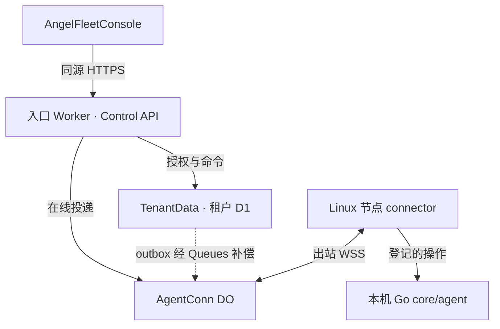
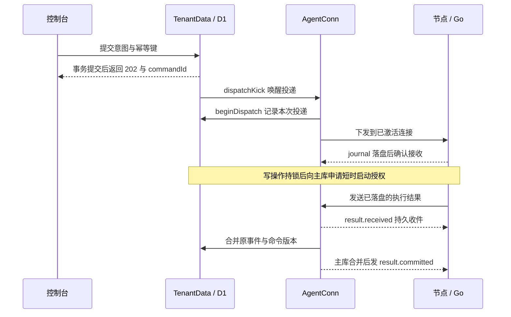

# AngelFleet 技术方案

首批要让有权用户在 AngelFleetConsole 注册 Linux 节点，发起一次 CPU 和内存采样，再从页面上的每个读数追溯到本机结果。云端负责授权、命令与审计，独立的 connector 主动连入云端，节点上的 1Panel Go core/agent 保留本地执行与数据。GA-01 已验证公开契约与样例，GA-10 的两租户真机联调、首次容器写入、数据库恢复及容量试验均待执行。[产品范围](product-prd.md) · [研发计划](engineering-roadmap.md)

## 系统架构与代码边界

M1 直接接入 Cloudflare。后续按选入的功能启用终端 Relay、R2 和 Workflows。以下路径均相对所属仓库。Console 的固定版本已在本地核对，匿名访问其源码链接返回 404。React Query 的查询和订阅键绑定租户、节点及资源；Zustand 的身份上下文随会话切换。节点路由在 `src/lib/navigation/dashboard-pages.ts` 注册，身份从 `src/lib/stores/auth-store.ts` 读取。[Console 路由基线 df715b3](https://github.com/XCAngelWatch/AngelFleetConsole/blob/df715b38d174b2bdad7a5ab58150c05ead6c5d36/cloudflare/api/src/router.ts) · [对外联调契约](go-agent-interface-contract.md)

| 实施位置 | 从哪里改起 | 交付物 |
|---|---|---|
| AngelFleetConsole · 前端 | `src/app/` 节点页、`src/lib/api/` 客户端、`src/lib/auth/permission-policy.ts` 权限目录 | 复用 React/Next.js 账户、导航和审计页面，接入同源会话、节点概览、命令详情及指标来源。 |
| AngelFleetConsole · 控制面 | `cloudflare/api/src/router.ts` 和同目录的环境绑定 | 保留 `/api/v1` 管理接口，将新 `/v1` 路由接到 TenantData、AgentConn。先分流 Upgrade，再对普通 HTTP 响应做包装。 |
| AngelFleetAgent · connector | 在下游仓新建 `connector/cmd/connector/`，由 `connector/internal/` 下的 `identity`、`protocol`、`connection`、`journal`、`adapter` 承担注册、报文、连接、落盘和本机调用 | 独立 Go 模块及 systemd 服务。首验 Ubuntu 24.04 LTS / amd64 社区版主节点。启动时核验 agent Unix socket 的类型、属主、权限，以核准的服务 UID 访问；密钥和 journal 落在受限的 `/var/lib/angelfleet-connector/`。 |
| AngelFleetAgent · 1Panel 执行器 | 下游保留上游 `aaba86d` 的 `core/`、`agent/`。GA-07 改 `agent/app/service/dashboard.go` 的采集点与 `agent/app/dto/` 对应应答 | 原 Go 维护本机数据库、调度器和资源操作，原 Vue 用于核对流程和 DTO。connector 只将已登记的 operation 和参数映射到固定入口。P6 退役 core 前另验独立升级、旧快照转换及共享数据解耦。[Go 模块与运行环境](go-agent-interface-contract.md#1-仓库进程与发行边界) |

### 云端部署与接口兼容

| 路径 | 组件与实现边界 |
|---|---|
| 浏览器 → 控制 API | `xc-console` 复用账号、组织、租户、角色和审计。`web-gateway` 清除公网身份头，再从会话重建主体。`control-api` 返回稳定的租户、节点及任务 ID。节点深链接、服务端分页和带游标的日志使用真实授权查询。切换节点或关闭页面后可以凭原 commandId 找回任务，数字资源 ID 必须与节点身份共同寻址。 |
| Worker → Worker／DO | 通过 Service Binding 调用租户数据 Worker，通过 namespace binding 访问 AgentConn 和每会话一个的 TerminalRelay。调用方等待 RPC 完成，接收方复核主体与动作，按 traceId 关联每一跳。先发布 provider，再迁移调用方。DO 以 `ctx.acceptWebSocket()` 接收连接，休眠恢复时读取附件、代次和待处理事件。 |
| 在线投递与后台处理 | `event-consumer` 处理队列通知与重试，`maintenance` 按游标修复 outbox、对账和清理。多阶段操作由 `orchestrator` 用同一命令编号及检查点推进。区域 Relay 及制品通道按选包启用。 |
| 旧 1Panel 调用 | 适配器解析 `CurrentNode/operateNode/local`，用已授权主体及稳定资源重新定位。需要兼容的同步 v2 接口保留成功 DTO，超时提供可查询的 operationId。原异步 taskId 与 cloudCommandId 持久关联，同时核对 HTTP 状态和业务 `code/message/data`。原 Vue 的拦截器与状态留在原面板。 |

固定 Console 基线 `df715b3` 的浏览器使用 sessionStorage 保存令牌，普通 CORS 包装会重建 Response。接入新会话及 Upgrade 时应回归原管理入口。首版节点写入需要 operation 对应的受控 Go 入口，后续无 core 的 managed-agent/updater 单独验证。[Console 令牌存储](https://github.com/XCAngelWatch/AngelFleetConsole/blob/df715b38d174b2bdad7a5ab58150c05ead6c5d36/src/lib/utils/token-storage.ts) · [HTTP 包装](https://github.com/XCAngelWatch/AngelFleetConsole/blob/df715b38d174b2bdad7a5ab58150c05ead6c5d36/cloudflare/api/src/lib/http.ts) · [Service Binding RPC](https://developers.cloudflare.com/workers/runtime-apis/bindings/service-bindings/) · [DO WebSocket](https://developers.cloudflare.com/durable-objects/best-practices/websockets/)

**逐端点交付。** 分别登记 method、provider、页面、权限、资源范围、操作、Go 入口、数据归属、恢复与证据。每个路由组须核对中间件、动态入口、后台调度和旧数据依赖。源码处置记录使用 REUSE、ADAPT、NEW、UNSUPPORTED、GAP_PRIVATE、RETIRED。实施状态单列 PLANNED、IN_PROGRESS、BLOCKED、IMPLEMENTED_UNVERIFIED、VERIFIED、ACCEPTED。阻塞写明原因与解除条件，正式接受须有验收记录。纳入的适用操作构成当期分母。[登记字段模板](technical-plan.md#136-逐功能迁移台账) · [本期范围](product-prd.md#哪些-1panel-功能分批迁移)

## 数据归属与租户隔离

| 事实 | 谁保存 | 读写规则 |
|---|---|---|
| 租户目录、数据分片与区域路由 | 目录库 | 依据已认证主体确定可访问租户，由服务端解析预部署的 binding；库内再核对租户及路由版本。 |
| 成员授权、节点登记、命令、指标读模型与审计 | TenantData 管理的租户 D1 | 通过预定义领域方法读写。Service Binding 的接收方再核验主体及范围。关键授权从主库取得，条件写在同一事务内复核授权与资源版本。 |
| 已激活的连接、投递进度、待合并事件 | 每节点的 AgentConn Durable Object | 按节点串行推进连接代次，结果先持久收件、再交 D1 合并。休眠或重连后恢复持久状态。 |
| 终端身份与回收 | 每会话的 TerminalRelay DO SQLite | 保存归属、角色票据摘要、撤销版本和绝对租约。区域中继仅保有短期连接状态。 |
| 本机动作、任务、业务数据及归档 | 节点 journal、原 Go 服务与实际资源；获准的对象制品存 R2 | journal 保存接收、启动与结果。文件、卷、库表留原资源侧。云端管策略版本，节点保存已应用版本并由本机调度器运行获准的 Cron、备份与告警计划。断网允许的计划绑定已签名版本，恢复后补报。 |

GA-03 需将现有浏览器 Bearer 客户端接到同源 `af_session` 会话。登录、刷新、退出与撤权均须验证；Cookie 设置 HttpOnly、Secure、SameSite，写请求核验 Origin 及服务端绑定的 `X-CSRF-Token`。列表、详情、重试、结果及来源链接均按当前租户、节点和动作重新授权。切换节点或退出时清除原上下文，迟到的响应按原请求归属丢弃。启用 D1 读副本时，关键检查使用新的 `first-primary` 会话，展示读取超出允许的新鲜度时回到主库。[权限与存储接口](technical-plan.md#a4-数据模型与对外-api) · [威胁模型](angelfleetprd-threat-model.md)

### 租户开通、迁移与归档

| 时点 | 实施与检查 |
|---|---|
| 开通 | 目录记录 tenantId、分片、bindingAlias、地区与主备入口、schemaVersion、routingVersion 和状态。供给服务按 REQUESTED → DB_CREATED → MIGRATED → BOUND → VERIFIED → ACTIVE 推进。BOUND 核实数据 Worker 到租户库、上游到数据 Worker 两层绑定。全路径读写探针成功后发布路由，失败留在当前步骤重试。管理 API 凭据只授予供给和发布服务。 |
| 迁库 | 冻结旧库写入，排空在途任务并核对 outbox。复制后比对行数、摘要和事件水位，切换目录，再启用新库写入代次。API、DO 结果回写、消费者和后台维护均在事务内检查 routingVersion 与 write-fence。旧缓存、旧 Worker 对原库的写入必须被拒。 |
| 扩容与删除 | 初始发布批次预算为每个数据 Worker 200 租户。用 1、200、1,000 绑定规模实测部署、切换、旧 Worker 排空和回滚，再扩大分片。P0 冻结账户与分片预算及每租户限额，大租户先归档事件历史。删除依次经过 QUIESCING → EXPORTED → UNBOUND → DELETED，目录保留墓碑，每层清理可查结果。 |

### 查询索引与事务

租户 D1 对 commandId、收据 key guard、事件 ID 和命令内事件序号去重，根据节点／状态／创建时间、待发布事件时间和终端会话状态建索引。用实际查询的 `rows_read/rows_written` 核对读写成本。关键授权使用新会话第一条主库查询，条件写在同一事务复核。条件 UPDATE 为零行也是成功 SQL，派生 INSERT 必须复查相同胜出标识。DO、队列和 R2 以持久事件和补偿衔接。[逻辑模型与 SQL 约束](technical-plan.md#a4-数据模型与对外-api) · [D1 批处理](https://developers.cloudflare.com/d1/worker-api/d1-database/) · [D1 读副本](https://developers.cloudflare.com/d1/best-practices/read-replication/)

### 策略版本与离线调度

节点保存脚本、Cron 和告警的已应用 `version/digest/appliedAt` 和可回退版本。获准计划只由本机调度器依据已签名策略运行，重连补报。云端维护配置与展示历史，退出范围的续证与商店同步留在原系统。

## 节点注册与可信采样

控制面先预登记租户和节点，节点证明持有本机密钥，AgentConn 再激活已持久化代次的连接。运维人员主动发起只读采样，Go 从本地采集器取得逐项有效性和采样时刻，D1 在一次合并中保存事件与读取模型。浏览器切换页面或刷新仅重新鉴权并读取已存结果。[请求顺序、字段及报文](go-agent-interface-contract.md)

**绑定事务。** 预登记行的身份代次与公钥指纹同时为空，首次绑定时同时写入。票据消费、节点绑定及唯一成功审计使用相同的胜出 requestId、公钥与绑定条件。条件更新为零行时，后续操作不得产生第二个绑定或成功审计。[签名与重试语义](go-agent-interface-contract.md#32-设备证明私钥持有权)

### ADR-09 · 注册响应丢失后的恢复截止点

**状态：提议。** GA-03 控制面与 GA-04 Go 在注册联调前确认。注册可能已提交，但节点未收到响应，自动重试需要找回首个绑定，并处理重试跨过票据有效期的情况。

建议 M1 以原票据 `expiresAt` 为自动恢复截止。控制面接收 `prove` 时取服务端时间，早于 `expiresAt` 才可在核对新挑战、原 requestId、公钥及当前绑定与撤销状态后返回原绑定。证明到达时已过期则进入超窗分支，建议沿用 `401 AUTH_EXPIRED`。connector 停止重试该票据，由有权租户管理员凭脱敏追踪号核对原登记和绑定。超窗后的身份变更按 DEV04／DEV06 的受控流程处理。

这个方案沿用票据时限，恢复时间取决于首次绑定时剩余的有效期。备选是以 `consumedAt` 起算独立的短期恢复窗口，可降低近到期丢包的人工处理成本，同时需维护额外截止点并验证吊销和并发。GA-03／04 测量首次绑定剩余时长及断网重试时长，若现场无法留出足够重试时间，则复审窗口。定案后由 GA-10 覆盖截止前后、先取挑战后过期、并发和吊销，核对原绑定及唯一成功审计。[产品放行条件](product-prd.md#m1-试点放行) · [注册验收](engineering-roadmap.md#ga-10-如何判断通过)

### 凭据轮换与连接恢复

凭据轮换时使用已绑定凭据批准新公钥，短暂重叠后撤销旧版。停用或吊销时提高版本、写 outbox，停止新投递与续租，关闭关联会话。具体有效期、续租周期与缓存上界由 P0 冻结。[初始参数与验证实验](technical-plan.md#1536-r7-go-操作台账r8-术语与-r9-参数冻结)

AgentConn 持久分配新 epoch；节点先写 journal 再确认就绪，入队和启动时均检查 incarnation／epoch。旧连接的迟到关闭不能影响新连接，已运行任务继续按原 commandId 核对。云端快照回退后，可信节点拒绝较小 epoch，双方恢复到高于原持久水位的代次。账本丢失、克隆或旧节点快照恢复须重新注册、换钥与身份代次，吊销旧身份并核对未决动作。完整克隆需独立运维证据辨认。

节点详情和 `metrics/latest` 使用同一租户主库连接摘要。按当前 incarnation 和 epoch 的整数顺序合并已激活连接的事件。较小 epoch 的事件直接丢弃；同一 epoch 的关闭状态优先于激活与心跳，即使关闭先送达；已关闭的 epoch 仅由更高的已激活 epoch 替换。心跳只为当前在线代次推进最近联系时间。连接变化可影响页面的新鲜度，指标来源和 `projectionRevision` 仍由采样投影决定。GA-10 同时核对两个读取入口。[连接状态的报文与判据](go-agent-interface-contract.md#4-连接票据与-wss-握手)

### 逐指标读取与乱序合并

命令详情保存本次尝试。概览按租户、节点与 incarnation 分组，为每项指标保存最近尝试和最后有效读数。[逐指标 GET、S1/S2 样例与错误响应](go-agent-interface-contract.md#53-逐指标读取与冷启动展示)

| 步骤 | 持久化原则 |
|---|---|
| 受理 | 同一分组内为采样命令分配递增 sampleOrder。有效终态结果与命令事件同事务合并，至少一项有效则命令成功，两项探测均失败则失败。 |
| 合并 | 最近尝试按受理顺序比较，最后好值按每项自己的来源顺序比较。晚到的旧成功结果仅补足较旧或缺失的好值，保留较新失败原因。投影有实际变化才递增 projectionRevision，重复事件保持原版本。 |
| 读取 | 同一主库快照中检查主体、目标授权与身份代次，逐项返回有效时刻、来源和新鲜度。最近探测失败、离线或没有当前连接的有效样本时标记过期，心跳只更新连接状态。 |
| 重建 | 沿原命令和事件水位重放，保留在途的受理水位，切换前追平并发事件。缺少顺序或有效性的旧数据保留命令历史，等新采样补齐。新身份启用空投影。浏览器按请求上下文和投影版本丢弃迟到响应，撤权立即清空旧值。 |

**采样与监控分流。** 除显式采样事务外，链路 ping、60 秒业务心跳和每 300 秒的错峰摘要覆盖写分别计量。AgentConn 在连接附件保存 lastSeenAt 和健康摘要，恢复休眠时重建，状态变化另记事件。只在页面有有效订阅时临时提高监控频率，关闭后降频。高频原始样本留在节点，长日志按上限与游标授权读取，批量历史可归档 R2。

## 命令投递、执行与对账

**受理与投递。** TenantData 在一笔租户事务里写入命令、幂等收据、初始审计和 outbox。响应丢失时，原请求按原键重新鉴权，取回同一 `commandId` 和绝对期限；同键改动请求或原意图时拒绝。在线通过 `dispatchKick` 唤醒，失败后由 outbox 经 Queues 至少一次补送。两条路径共用 `beginDispatch`，以 CAS 核对期限、取消和写入代次，持久记录投递尝试后才发帧。[可靠投递与补偿](technical-plan.md#a6-d1-outbox至少一次通知与跨服务一致性)

**执行与互斥。** 节点按 `(nodeIncarnation, commandId)` 查找唯一的本地记录。重复命令的 `intentHash` 一致时返回已有状态或结果，摘要冲突时拒绝并记审计。GA-11 的写操作取得资源锁后，向 TenantData 申请一次性短期 `startGrant`。主库事务复核当前操作者、原目标与资源版本、`fenceVersion`、取消和期限。Go 在有效窗口内将本地授权消费与启动标记持久记录，再调用业务入口。授权或本地提交结果无法确认时停止启动。原面板、Cron 和云端若均可修改同一资源，须在实际 Go 入口共享锁与代次，或保留单一写入入口。[启动与 journal 约束](technical-plan.md#a5-命令状态幂等与本地-journal)

**中断与裁决。** 节点可用原事件序号与摘要补报。DO 持久收件后回 `result.received`，D1 按命令 revision 合并；只有已应用或有一致证据的重复结果可回 `result.committed`。已有投递记录后发生断线、超时或取消竞争，先查原任务和现场证据。可能已启动且无法确认结果时记 `UNCERTAIN`，对账只读，证据矛盾转 `REVIEW_REQUIRED`。取消后已完成的动作记录实际结果及取消未生效；人工裁决后的冲突保留原证据并记录接管。[命令状态与允许转移](command-state.json) · [联调记录](spaces/implementation-review.md#实测记录)

### 跨入口互斥与维护切换

节点登记管理模式 `CLOUD_MANAGED / LOCAL_MAINTENANCE` 与维护状态 `NORMAL / QUIESCING / MAINTENANCE`。一次执行同时登记发起主体 `CLOUD_OPERATOR / LOCAL_OPERATOR / POLICY_SCHEDULER / RECOVERY_AUTOMATION`。已签名且仍有效的离线策略、定时任务、原面板及云端操作须在实际 Go 写入口使用同一资源锁和 fence。若某入口无法接入，由一个入口独占资源，其余入口只读。维护切换先排空在途动作或进入核对，再提高 fence，留下本机超时保护和恢复水位。

采纳写协议前，Go 与控制面共同冻结规范化测试向量。意图摘要固定租户、节点、身份代次、操作、参数、已解析资源、相关版本和绝对期限。将 cloudCommandId 与原 taskId／operationMarker、checkpoint 和结果摘要持久关联。分别验证调用前中断、已启动丢回执和结果未获云端确认。释放资源锁前须证实前次执行已结束，或下游可拒绝旧 fence。现场证据不足时隔离资源，避免新旧动作同时执行。[故障与恢复约束](technical-plan.md#a5-命令状态幂等与本地-journal)

### 从只读采样扩展到首个真实写入

GA-11 先在可计数执行器验证启动授权、持久化执行标记和只读对账。领域写入接入前，由控制面固定权限与目标，Go 在持锁的实际执行入口绑定版本和原任务，测试核对现场资源。当前首选独立容器重启与 MySQL 单库隔离恢复，二者均待实测。每个动作的执行前提、计数、证据和取消边界见[节点操作与权限](operation-ledger.md#操作登记与执行边界)。工单与试点签收见[研发计划](engineering-roadmap.md)。

## 终端、制品与长任务

| 能力 | 独立通道与完成判据 |
|---|---|
| 终端与 SSH | 每会话一个 Relay。浏览器和节点凭各自的一次性角色票据建立独立 WSS，执行器持有 PTY。撤权提升授权版本，Relay 停止收发，节点关闭 PTY；通知丢失按绝对租约关停。限制缓冲和未确认输出，重连丢弃送达情况未知的键盘输入。SSH 启用前固定校验目标 host key。[角色票据](technical-plan.md#a7-relay-角色票据与独立终端连接) · [租约与撤销](technical-plan.md#a8-全端租约撤销与续租) |
| 文件与备份 | D1 保存制品归属、manifest 与预期摘要，R2 存分片和对象。短期预签名 URL 在到期前可重复使用，按不可变对象键、版本和条件写保护内容。完成响应丢失时以原 artifactId 与清单核对；整件大小及 SHA-256 验证通过才标 `READY`。节点使用前复核摘要，恢复后回读已知数据。[R2 数据路径](technical-plan.md#a10-r2-数据路径区域与敏感数据) |
| 长任务与批处理 | 安装、升级、恢复等多步流程可用 Workflows 编排。每步保存原命令与检查点，大结果存对象引用，长期事实仍由 D1 和节点保存。跨节点批次有未知副作用时暂停后续启动，继续接收在途结果。[发布、故障演练与恢复](#发布故障演练与恢复) |

### 撤销与租约

缓存记录 verifiedAt、租户、节点、身份代次、凭据版本、授权版本和硬到期时刻。续租满足 `leaseUntil ≤ min(issuedAt + 90s, verifiedAt + maxAuthorizationStaleness, sessionExpiresAt, credentialExpiresAt, nodeAuthorizationExpiresAt)`。旧缓存命中不得滑动延长授权。设计初值为 90 秒租约、每 30 秒续租；在时钟不确定度 15 秒的假设下，通知丢失的候选上界为 105 秒。P0 冻结真实时钟误差及调度容差，重新核定上界。通知送达则立即停止，分别记录拒绝新授权、停止投递和关闭 PTY 的时刻。[租约字段与提交规则](technical-plan.md#a8-全端租约撤销与续租)

**终端身份。** local PTY、本机 SSH、跨主机 SSH 和容器 exec 分别绑定真实目标、主机账户与权限。SSH 密钥通过 accountRef 取用，P0 定义主机指纹登记、变更阻断与恢复流程，CORE-05 提交实测。流控、角色互斥与恢复窗口见[终端角色协议](technical-plan.md#a7-relay-角色票据与独立终端连接)。

**区域切换。** 选用中国大陆或海外 Relay 时，控制面下发 regionId 和主备入口。节点失联后按配置切换，重新取得 epoch。TLS 终止、mTLS、证书轮换、健康摘除、连接限流及国内外路径先按 P0/P1 做 PoC。若驻留要求涉及命令、日志等控制面数据，须另立双控制面 ADR 并定义数据权威和切换边界。DO 的 locationHint 仅作选址提示，D1／DO 的 jurisdiction 也只覆盖对应服务。逐项核对账户、套餐、接入许可与数据目的地。[DO 位置](https://developers.cloudflare.com/durable-objects/reference/data-location/) · [D1 位置](https://developers.cloudflare.com/d1/configuration/data-location/)

## 部署、容量与恢复

**预发与接入地区。** 隔离开发、预发和生产的资源与密钥。在预发用真实绑定验证 Worker、DO、D1、Queues 以及选入的 R2/Workflows。若引入区域 Relay，分别核对两地 WSS、包源和 R2 的可达性、主备切换与数据去向。Relay 的 mTLS 识别转发方，Gateway 从设备证明、连接票据和 epoch 校验节点身份与每帧归属。试点先确认命令、审计、诊断日志和制品的驻留要求，大陆 Relay 的覆盖范围由实测与实际套餐确定。

| 影响实现的约束 | 工程处理与验证 |
|---|---|
| Workers 与 D1 | 负载实验分别观测等待响应头的出站连接数、Worker-to-Worker 调用链深度、D1 批调用、实际 SQL 和读写行数。D1 `db.batch()` 减少配额计数，单库仍逐条执行。超出排队预算时记录 overloaded 和拒绝；实际套餐与配额留在[当日快照](platform-constraints.md)。 |
| DO 与 Queues | 按节点、按终端会话分配 DO，持久缓存有上限。D1 暂停写入或 DO 报 SQLITE_FULL 时优先保全未确认结果，高水位暂停普通任务，保留撤销、结果确认与对账。在线直达失败由 outbox 补送，命令队列候选配置 `max_batch_size=1`、`max_batch_timeout=0`，逐条确认。重复消费复用原 eventId 和 commandId，超过预算转 DLQ，按原意图审计重放。 |
| Workflows 与区域 WSS | 限制创建速率和并发，按 oldestQueuedAge 量积压。区域长连接独立实测心跳、重连及会话亲和性，路径设计避开与 WebSocket 不兼容的 Argo。 |
| 日志与审计 | 按账户 Customer Metadata Boundary 核对诊断日志的存储地域及导出去向，计入截断、采样对诊断证据的影响。长期审计和容量原始指标使用 OTel、Logpush 或 Tail 导出到获准存储，导出也要审计。 |

### 容量实验与放行

| 实验 | 负载与证据 |
|---|---|
| CAP-01 · 热租户 | 单租户 10,000 节点连续 72 小时。分散相位，按每节点 30 秒授权复核、60 秒心跳、300 秒摘要覆盖写建立基线，再叠加命令、列表、终端和制品混合负载。记录实际套餐、兼容日期、区域、运行编号、缓存命中、RPC、批调用／SQL、读写行数及排队。 |
| CAP-02 · 租户隔离 | 用 100 租户各 100 节点同负载连续 72 小时，对比授权、限额及延迟。CAP-01 与 CAP-02 分别出具报告。 |
| CAP-03 · 重连与撤权 | 同时测量万节点重连、凭据无效、撤销通知正常送达与丢失两条路径。记录新请求何时被拒、何时停止投递、PTY 何时关闭，以及旧代次拒绝率。 |
| CAP-04 · 背压与恢复 | 在 D1 不可写、消费减速与平台限流时记录水位、拒绝、新旧命令处置、孤儿和 DLQ。解除故障后核对关键结果及积压清空时间。 |

压测前冻结每秒命令和组成、突发量和持续时间、列表与终端并发、慢消费者比例、文件和分片大小，并冻结 p95/p99、错误率、资源水位及恢复阈值。云端 API p95 ≤ 300 ms、在线直达持久接收 p95 ≤ 2 s、95% 有效节点在 120 s 内重连均为待确认目标。直达、队列补偿、实际业务完成分别计时，保留超时样本，预期权限拒绝单列。参数调整走 ADR 并重测。[容量算量与官方依据](technical-plan.md#151-单租户容量与证据门禁) · [平台约束快照](platform-constraints.md)

以同一 runId 保存源码、补丁和构建、拓扑、负载摘要、命令及退出码、原始指标、脱敏日志、恢复件、失败与复测。区分模拟连接、真实 Cloudflare 和真实 Linux 节点。功能试点、万节点承诺、生产发布和上线后月度 SLO 各有独立记录。

### 发布、故障演练与恢复

预发与生产分别固定 compatibility_date/flags、binding、DO migrations、队列与 Workflow 配置、地区及预算。CI 核对依赖锁、schema、原接口回归、SBOM、签名与构建来源。依次做 Wrangler dry-run、实际绑定和命名空间 smoke、迁移前后探针及真机回归。先扩表和回填，再发布兼容当前版及上一版的消费者、服务端，最后灰度节点。DO 恢复可读取窗口内旧 attachment；D1 在旧实例和允许离线回归的节点均兼容后收缩。发布时冻结目标、观察时长、失败与回退门槛。出现不可逆动作结果未知时暂停后续启动，继续接收在途结果。

首版继续验证原 core/agent 快照与升级，另存 connector 身份、journal、命令和本机任务映射。登记各构建、schema、incarnation/epoch、每组件捕获时刻、事件水位、R2 manifest、恢复时间点及上次一致状态。升级包验签名、摘要、架构和降级保护。P6 的独立 updater 与 managed 快照另验磁盘空间、替换、健康探针、旧快照转换及失败回退。

| 预发注入或演练 | 必须看到的恢复结果 |
|---|---|
| 库、队列、DO 或 Workflow 故障 | D1 不可写时新变更明确失败，节点／DO 保留已有结果。DO 重连恢复代次与 journal。Queues 重投按原编号去重；核对 oldestPendingAge、DLQ 和积压清空。 |
| 节点掉电或磁盘逼近上限 | 保留未确认 journal，限制新任务、日志与输出。恢复后用原命令只读查现场。 |
| 区域中断、账号不可用或开支触限 | 验证主备 WSS、R2 与升级源分别恢复。按 D1、DO、Queues/DLQ、Workflows、R2 和节点 journal 冻结与实测 RPO/RTO，控制 API 与目录 60 分钟恢复仅为 PoC 建议值。 |
| 对象上传中断、凭据被撤 | 制品维持 UPLOADING，重新授权未完成分片，到期清理。撤销后拒绝新请求和续租，核对原有终端关闭时间及审计。 |

恢复顺序如下。

1. 冻结新写入，恢复权威数据、水位及最高已知身份/连接代次。
2. 重建 DO，核对 D1 command/outbox、队列和节点 journal，隔离证据不足的动作。只读回查已启动的外部动作；其回滚使用该操作登记的保护点和补偿。
3. 验证只读探针、未决命令和积压清空后逐批放量，记录实测恢复点、耗时与仍需处置的资源。[研发计划与证据入口](engineering-roadmap.md)

## 安全边界如何验收

| 边界 | 交付时必须看到的结果 |
|---|---|
| 用户到租户 | 用受限账户验证跨租户读取、深链接、变更和撤权后重试均被拒；错误中无业务数据。写请求核验同源 Cookie、Origin、CSRF，浏览器 WSS 在 Upgrade 前核验允许的 Origin。获准审计员可按租户、操作者、目标及 traceId 串起允许与拒绝。 |
| 设备、Relay 与会话 | 一次性票据原子消费，测试重复注册、过期票据、旧 epoch 与旧授权版本。终端由实际 PTY 执行器强制绝对租约；分别记录撤销通知送达时与丢失后停止收发、关闭 PTY 的时间。普通心跳或缓存命中均不能滑动延长授权。 |
| 本机高权限适配与文件 | 按 operation 固定方法、目标和参数 schema；文件路径解析后仍须位于获准根目录，覆盖符号链接和路径边界。校验 SSH host key；制品只用获准对象，核验整件摘要，冲突时安装数为 0。后台计划和本地维护与云端写入共用资源时，在实际写入口核对执行主体、锁和写入代次。 |
| 诊断、发行与公开资料 | 用脱敏样本回归日志导出，票据、私钥、预签名 URL 和终端输入不得写入诊断日志。connector 验证签名、密钥轮换、异常崩溃回退与前后版本共存。文档发布前核对锁文件、构建来源与产物完整性。站点维护者还须复核响应头：11 月 19 日线上首页可见 HSTS，CSP、防嵌入、内容类型探测与引用来源策略待确认。 |

**密钥与审计。** 主机私钥与执行所需凭据优先留节点。云端需要持有的备份或通知凭据使用带 keyVersion 的信封加密，由受控 secrets 持有 KEK。轮换按批次重包裹，记录取用主体、资源及用途，浏览器仅回显掩码。用户会话、成员、API Key 和节点撤销分别更新相应版本并通过 outbox 传播。终端录制、审计导出和保留按租户策略授权。

### 技术发布清单

P0 冻结端点和权限覆盖、SSH 主机指纹校验、日志脱敏、租户配额、导出与删除标准。P5 汇总各环境真实绑定、跨存储对账、connector 签名与密钥轮换、组件灾备演练以及本次承诺所需的容量证据。外部 SQL 或双控制面需要单独架构决定。

安全检查按实际选入的端点、部署与角色留证。P0 定义发布标准，GA-10 验收首批只读链路，P5 汇总生产就绪证据。[威胁模型](angelfleetprd-threat-model.md) · [失败处理矩阵](technical-plan.md#a12-验证门槛与失败处理矩阵)
