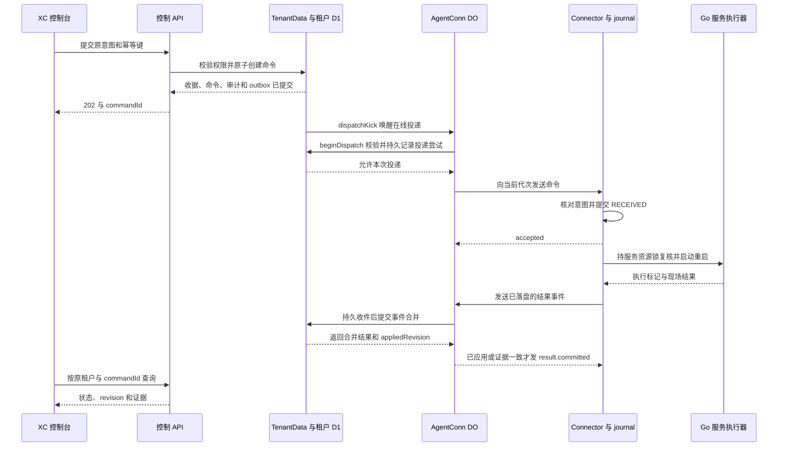
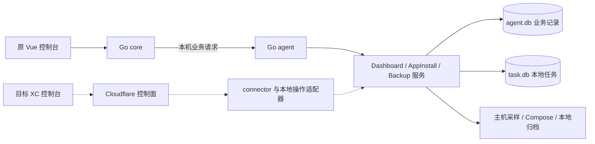

# 技术详细设计

以一次 OpenResty 重启为例，从服务详情页跟到租户收据、节点 journal、Go 执行和结果对账。当前 AngelFleetConsole 已有身份与审计，1Panel 已有本机执行入口。两端之间的注册、控制连接与命令链路待实施。开发首次节点接入直接查 GA-01 的接口和消息，复核代码位置查操作台账。[GA-01 联调契约](go-agent-interface-contract.md) · [Go 操作台账](operation-ledger.md)

# 1. 从服务详情页提交重启

1Panel 的网站页把应用键 `openresty` 交给状态组件。组件查询已安装应用，取回 `appInstallId`。用户确认重启后，组件以该安装 ID 和操作名 `restart` 提交请求。由此可定位到本节点的一个安装实例。[网站页](https://github.com/1Panel-dev/1Panel/blob/aaba86d0ef71a31ee319e74998ffe83c64abf4b6/frontend/src/views/website/website/index.vue#L13-L20) · [实例查询与确认操作](https://github.com/1Panel-dev/1Panel/blob/aaba86d0ef71a31ee319e74998ffe83c64abf4b6/frontend/src/components/app-status/index.vue#L139-L175)

在 XC 设计中，`payload.service` 是受管服务别名。示例里的 `website-proxy` 在租户 `tenant-a` 的节点 `node-a` 上绑定到一个 `appKey=openresty` 的 `installId`。确认时，页面提交服务别名、不透明的 `resourceVersion` 和本次意图的 `Idempotency-Key`。控制面核验节点归属、`service.manage` 权限和节点能力，再按该版本解析绑定，把租户、节点 incarnation、安装 ID 与版本一起固化到命令意图。别名改绑、配置变更或应用重装时必须生成新资源版本。已受理的命令始终指向原实例。

```http
POST /v1/tenants/tenant-a/nodes/node-a/commands HTTP/1.1
Content-Type: application/json
Idempotency-Key: restart-example-01

{
  "operation": "service.restart",
  "resourceVersion": "17",
  "payload": { "service": "website-proxy" }
}
```

首次受理时，`202` 表示控制面已持久保存命令意图。客户端记下返回的 `commandId` 和绝对 `expiresAt`，后续按命令 ID 查询进度。

```http
HTTP/1.1 202 Accepted
Content-Type: application/json

{
  "commandId": "cmd-example-01",
  "expiresAt": 1794471300000,
  "idempotencyReplay": false
}
```

客户端在首次发送前保存租户、节点、原始请求体和 key。即使首个响应在返回 `commandId` 之前丢失，也可用同一请求找回任务。服务端先核验当前授权，再按 `(tenantId, idempotencyKey)` 查收据。并发请求由收据唯一约束选出一次创建，其余请求读取已提交收据。

| 收据判定顺序 | 服务端结果 | XC 后续动作 |
|---|---|---|
| 仅余 key guard | `410 IDEMPOTENCY_KEY_EXPIRED` | 停止重试，先从原节点任务记录核对历史结果 |
| 正文存在，`requestFingerprint` 不同 | `409 IDEMPOTENCY_REQUEST_MISMATCH` | 找回原请求。若用户确实变更了操作意图，重新展示目标供确认 |
| 指纹相同，`intentHash` 不同 | `409 IDEMPOTENCY_INTENT_MISMATCH` | 保留原命令，核对资源版本、原业务期限和规范化输入 |
| 两个摘要均一致 | 返回原 `commandId` 和 `expiresAt`，`idempotencyReplay=true` | 打开原任务详情，查看受理时绑定的安装 ID 和执行进度 |

回放时按首次受理的安装 ID、资源版本和绝对期限核对意图。即使 `website-proxy` 已经改绑，原请求仍定位到原实例的命令。操作员确认要重启新实例时，页面读取新版本并使用新 key。Queue 重投携带原 `eventId` 和 `commandId` 唤醒投递。Compose 一旦可能已启动，节点只读核对现场。[主方案 A.4 数据模型与对外 API](technical-plan.md#a4-数据模型与对外-api) · [C.3 统一错误与可观测字段](technical-plan.md#c3-统一错误与可观测字段)

# 2. 按持久化边界推进任务

一次在线重启经历三次独立确认。租户 D1 先接受操作意图，节点 journal 随后保存接收记录，最后由租户 D1 合并执行结果。



| 边界 | 此处必须写入的事实 | 中断后由谁接手 |
|---|---|---|
| TenantData 提交创建事务 | 同一租户 D1 一次写入 `commands`、幂等收据、初始审计和 outbox。事务提交后才返回 `commandId` | 在线唤醒失败时 dispatcher 经 Queues 再次唤醒同一 AgentConn。通知携带原事件、命令和版本 |
| AgentConn 首次投递 | `beginDispatch` 核对有效期、取消意图和当前 `fenceVersion`，以 CAS 把 `QUEUED` 推进到 `DISPATCHED` 并记录尝试。DO 保存投递记录后才发送 | 已有投递历史但缺少确认时，AgentConn 在有效连接上向 journal 核对。D1 不可写时暂停新的首次投递 |
| Connector 与 Go 启动 | journal 持久保存 `commandId` 和 `intentHash` 后回复 `accepted`。执行器持有该服务资源锁，复核 incarnation、epoch、写入代次、授权、期限和资源版本，关联 `cloudCommandId` 与 `operationMarker` | 已存在相同命令时从 journal 返回进度。若 Go 已启动但任务映射尚未落盘，按标记和现场证据核对 |
| TenantData 合并结果 | DO 保存事件后可回复 `result.received`。TenantData 按事件标识去重，以命令 `revision` 做 CAS，将合并结果和 `appliedRevision` 持久化 | `PENDING` 保留待处理，`CONFLICT` 触发核对。仅 `APPLIED` 或证据一致的 `CONSISTENT_NOOP` 可回 `result.committed`。节点收到后才开始计算结果正文保留期，去重记录独立保留并覆盖允许重投的窗口 |

常规 OpenResty 安装实例由 `AppInstallService.Operate` 按 `installId` 查本地记录，取该实例的 Compose 路径，执行 `compose.Restart` 并同步安装状态。本分支同步返回，处理器只回成功或错误，不会为本次动作创建可按云端命令查询的持久任务。原前端的操作请求超时为 40 秒，Compose 重启执行器的超时为 20 分钟；浏览器放弃等待时，节点可能仍在执行。[安装实例执行分支](https://github.com/1Panel-dev/1Panel/blob/aaba86d0ef71a31ee319e74998ffe83c64abf4b6/agent/app/service/app_install.go#L294-L321) · [前端请求](https://github.com/1Panel-dev/1Panel/blob/aaba86d0ef71a31ee319e74998ffe83c64abf4b6/frontend/src/api/modules/app.ts#L80-L82) · [Compose 执行期限](https://github.com/1Panel-dev/1Panel/blob/aaba86d0ef71a31ee319e74998ffe83c64abf4b6/agent/utils/compose/compose.go#L242-L250)

实施时在实际变更入口持有节点内的安装实例锁，复核命令中的安装 ID、应用键和资源版本，再持久写入 `cloudCommandId`、`operationMarker` 和启动前证据。证书操作、升级与本地管理入口如涉及同一实例，也遵循此锁。锁与标记分别保护并发修改和故障后的核对。启动证据与外部 Compose 操作仍有崩溃窗口，恢复时只能依据现场收敛结论。[Go 操作改造台账](operation-ledger.md)

# 3. 在断线、取消与撤权时裁决结果

对账先按原 `commandId` 读取 journal 中的安装 ID、操作标记与启动前容器快照。恢复后按该安装 ID 核验应用键、版本和容器归属，再对照预期容器集合、各容器身份和重启前后的 `StartedAt`、当前运行状态。原 agent 的 `GetAppInstallInfo` 可提供 ID、应用键、版本、容器名和安装状态；启动时间需由适配器对本机容器另行采样，只回传核验所需字段。若其他任务或人工操作也能解释这些变化，保留 `UNCERTAIN`。[安装实例查询](https://github.com/1Panel-dev/1Panel/blob/aaba86d0ef71a31ee319e74998ffe83c64abf4b6/agent/app/service/app_install.go#L1322-L1349)

| 联调断点 | 恢复动作 | 可对外显示的结论 |
|---|---|---|
| WSS 已发送，接收确认超时 | 同一 incarnation 重连时先持久化更高 epoch 并完成 ready 握手，再按原命令查询 journal。旧 epoch 的帧只结束该次投递，已运行的动作继续按原命令核对 | 进入 `RECONCILING` 并保留最后可信执行状态。已有投递历史时，只有取得未启动且已过期的证据才可记为 `EXPIRED` |
| Compose 已被调用，connector 退出或安装状态刷新失败 | 保留执行阶段与原始错误，按原 `operationMarker` 只读补采原安装实例、容器集合和启动记录 | 证据能归因且满足重启条件时记为 `SUCCEEDED`。能证明本次操作失败时记为 `FAILED`。无法判断已发生的动作时记为 `UNCERTAIN`，继续只读核对 |
| 取消与首次投递或重启完成竞争 | `QUEUED` 且无投递历史时，取消与 `beginDispatch` 争同一 revision。取消胜出即结束排队。投递胜出后，记录操作者和取消意图，进入 `CANCEL_REQUESTED`，按节点证据核对 | 确认未启动且取消生效为 `CANCELLED`、`sideEffectExtent=NONE`。若重启已完成则为 `SUCCEEDED`，置 `cancelIneffective=true` 并保留原取消意图。矛盾证据无法裁决时进入 `REVIEW_REQUIRED` |
| 操作员的节点授权被撤销 | 重试提交和详情查询均重新校验当前权限。节点按已获知的撤销信息拒绝新启动。尚可信的节点身份可继续回传已执行任务的受限结果 | 已撤权的操作员看到访问被拒。仍有权限的审计人员能核对原任务、提交人和结果 |
| 合并结果的回执丢失，或人工结论之后收到矛盾结果 | 重送同一事件。TenantData 比对事件标识、序号、摘要和当前结论，一致时回复已合并的 revision，矛盾时保留冲突证据 | 人工结论保留，冲突追加到审计。`CONFLICT` 属于事件处理结果，任务中心继续显示已裁决的命令状态 |

`syncAppInstallStatus` 在 Compose 重启后读取容器状态，该查询仍可能报错。journal 丢失时，节点通过身份恢复换用新密钥和 incarnation，原命令保留待核对。[重启与状态同步调用顺序](https://github.com/1Panel-dev/1Panel/blob/aaba86d0ef71a31ee319e74998ffe83c64abf4b6/agent/app/service/app_install.go#L316-L321) · [容器状态读取错误](https://github.com/1Panel-dev/1Panel/blob/aaba86d0ef71a31ee319e74998ffe83c64abf4b6/agent/app/service/app_install.go#L1199-L1216)

进入 `REVIEW_REQUIRED` 后，由具备处置权限的人员记录证据、时间和结论。仍缺证据时继续保留该状态。另行批准重新执行时，创建关联原任务的新命令并复核目标版本。[主方案 §7.2 断线后的任务对账](technical-plan.md#72-断线后的任务对账) · [命令状态与允许转移](command-state.json)

# 4. 在 XC 还原用户看到的进度

## 4.1 AngelFleetConsole 的现有入口与接入点

2026 年 11 月 19 日核对了本地 `main@df715b3` 的控制台源码。Worker 的 `routeRequest` 挂载健康检查、认证、权限目录、组织、角色、账号、租户和审计，现有业务接口使用 `/api/v1`。GA-01 已冻结同源 `/v1/agents/*` 和 `/v1/tenants/{tenantId}/*` 的路径及鉴权，环境域名与云端资源由 GA-02 配置，接口由 GA-03、05、08 实现。[接口契约与样例](go-agent-interface-contract.md) · [当前 API 路由](https://github.com/XCAngelWatch/AngelFleetConsole/blob/df715b38d174b2bdad7a5ab58150c05ead6c5d36/cloudflare/api/src/router.ts#L17)

| 接入位置 | 当前实现 | 节点接入要补的部分 |
|---|---|---|
| 页面与授权 | `dashboardPages` 登记现有后台页面，`PERMISSION_CATALOG` 定义菜单和动作，`withPermission` 在提交前刷新服务端身份 | 登记节点详情和任务中心，加入读节点、管理服务等权限。API 对每次查询、提交和重试复核成员、动作与节点归属。[页面](https://github.com/XCAngelWatch/AngelFleetConsole/blob/df715b38d174b2bdad7a5ab58150c05ead6c5d36/src/lib/navigation/dashboard-pages.ts#L10) · [权限目录](https://github.com/XCAngelWatch/AngelFleetConsole/blob/df715b38d174b2bdad7a5ab58150c05ead6c5d36/src/lib/auth/permission-policy.ts#L12) · [提交前复核](https://github.com/XCAngelWatch/AngelFleetConsole/blob/df715b38d174b2bdad7a5ab58150c05ead6c5d36/src/lib/utils/authorized-mutation.ts#L15) |
| 注册与连接 | Worker 的 `Env` 声明数据库 `DB` 和可选限流 KV，普通 HTTP 响应由 `withCors` 重建 | 接入预登记、注册、连接票据和 AgentConn。WSS Upgrade 须在普通响应包装前分流，用真实 connector 完成 ready 握手。[Worker 环境](https://github.com/XCAngelWatch/AngelFleetConsole/blob/df715b38d174b2bdad7a5ab58150c05ead6c5d36/cloudflare/api/src/env.ts#L34) · [HTTP 响应包装](https://github.com/XCAngelWatch/AngelFleetConsole/blob/df715b38d174b2bdad7a5ab58150c05ead6c5d36/cloudflare/api/src/lib/http.ts#L133) |
| 命令与审计 | `writeAudit` 先写审计日志再更新日汇总，`buildAuditScopeFilter` 按当前机构筛选 | 命令受理在租户库内原子写入意图、收据、初始审计与 outbox。任务和证据查询另行校验租户与节点范围，以 `commandId` 关联原意图和执行结果。[审计写入](https://github.com/XCAngelWatch/AngelFleetConsole/blob/df715b38d174b2bdad7a5ab58150c05ead6c5d36/cloudflare/api/src/lib/audit.ts#L144) · [审计查询范围](https://github.com/XCAngelWatch/AngelFleetConsole/blob/df715b38d174b2bdad7a5ab58150c05ead6c5d36/cloudflare/api/src/routes/audit.ts#L38) |

## 4.2 目标页面与任务查询

服务详情页和任务中心用不同的键读取数据。详情页查询键包含 `tenantId`、`nodeId`、服务别名和查询参数。任务详情在原租户上下文调用 `GET /v1/tenants/{tenantId}/commands/{commandId}`，展示受理时的节点、服务别名与安装实例；别名后续改绑，同一任务仍可查到原安装 ID。切换节点时取消旧查询和订阅，在回调中再次匹配上下文，防止旧节点的迟到结果覆盖当前详情。

| 用户动作或观测 | 页面行为 |
|---|---|
| 提交后收到 `202`，随后切换到另一节点 | 在原目标下建立任务入口。新节点独立加载同名服务，任务中心仍可追踪原命令 |
| 先后收到同一任务的两个版本 | 以较高 `revision` 更新投影。到达较晚的旧版本不能把已完成任务退回执行中 |
| 用户关闭页面后从深链接返回 | 重新校验会话、租户与资源权限，再读命令详情。显示最后可信执行进度、取消意图及可用操作 |
| 任务进入 `UNCERTAIN` | 同屏展示最后可信状态、目标节点及已有证据，提供核对入口。仅有处置权限的用户能提交人工结论 |

命令详情的 `revision` 标识任务记录的当前版本。服务的 `resourceVersion` 用来检查操作员提交时看到的配置是否仍然有效。[主方案 §13.1 XC 公共前端基础](technical-plan.md#131-xc-公共前端基础)

# 5. 节点接入、终端与文件传输

## 5.1 节点注册后恢复原身份

TenantData 在一个租户事务中消费一次性票据、绑定预登记节点与设备公钥、写入成功审计。提交后丢失响应时，原设备保留 `requestId`，用原私钥签署新挑战以找回原身份。随后按 `connect-ticket → hello → welcome → ready → ready.ack` 建连，Go 必须在发送 `ready` 前持久化新 epoch。AgentConn 激活后可投递首条 `node.inspect`。[GA-01 请求、响应和消息样例](go-agent-interface-contract.md)

## 5.2 由终端执行器关停会话

租户内 `POST /nodes/{nodeId}/terminals` 创建会话。D1 保存会话归属及授权版本，Relay 分别为浏览器和节点签发一次性角色票据，Go 执行器持有实际 PTY。调用 `DELETE /terminals/{terminalId}` 后，TenantData 持久提升 `authorizationVersion` 并发布撤销事件。Relay 收到事件即停止收发，Go 收到撤销即关闭 PTY。若通知丢失，执行器按最近有效 grant 的绝对 `leaseUntil` 在本地关停。重建会话须再次授权，旧连接上送达情况未知的键盘输入不重放。[主方案 §7.3 终端授权撤销](technical-plan.md#73-终端授权撤销)

## 5.3 按制品标识恢复分片上传

租户内 `POST /artifacts/uploads` 创建上传会话，D1 保存 `artifactId`、对象归属和预期摘要，R2 保存分片与对象。`POST /artifacts/{artifactId}/complete` 核对大小和分片清单后进入 `VERIFYING`。若完成响应丢失，客户端复用原 `artifactId` 提交同一清单，服务端核对 `uploadId`、分片及对象条件版本并返回已有进度。验证节点用整份文件的 SHA-256 比对预期摘要，通过后才标记 `READY`。安装或恢复节点使用前独立复核同一摘要。

# 6. 联调场景与交付证据

真机按三个工作包执行。注册和采样核对消费、连接代次与样本来源。重启故障分别注入在云端受理、Go 启动和节点结果投递处。备份与恢复核对独立任务、业务记录及归档或目标数据。每个断点的预期状态、实际调用次数、脱敏证据和待填结论统一记在联调页。[联调场景与实测记录](spaces/implementation-review.md#实测记录)

终端与制品另验租约撤销、PTY 关闭和分片摘要。容量测试按 CAP-01 独立运行单租户 10,000 节点、连续 72 小时的混合负载。[验收编号注册表](acceptance-ids.json) · [主方案 §15.1 容量门禁](technical-plan.md#151-单租户容量与证据门禁)

# 7. 1Panel 源码与适配位置

首批适配基于 1Panel `dev-v2@aaba86d`。迁移矩阵保留 `cedb8dd` 的全量基线，两次提交之间的 38 个变更及其对首批操作的影响可在台账追溯。[源码版本与改造影响](operation-ledger.md#从迁移基线到当前节点代码)

## 7.1 进程、路由与本地数据

原 Vue 控制台向 core 提交带节点上下文的请求。core 处理本机非 core 业务路由时转发给 agent，其他节点可进入多节点 provider 分支。主节点的 agent 使用 Unix socket，其他部署分支使用 TLS。首版沿用 Go 服务、数据库初始化和执行环境；XC 改用租户领域 API，由 connector 在节点上调用明确登记的业务操作。[core 启动](https://github.com/1Panel-dev/1Panel/blob/aaba86d0ef71a31ee319e74998ffe83c64abf4b6/core/server/server.go#L40) · [core 路由分流](https://github.com/1Panel-dev/1Panel/blob/aaba86d0ef71a31ee319e74998ffe83c64abf4b6/core/init/router/proxy.go#L134-L143) · [agent 监听](https://github.com/1Panel-dev/1Panel/blob/aaba86d0ef71a31ee319e74998ffe83c64abf4b6/agent/server/server.go#L128-L177)



实线表示上游已存在的本机业务路径，虚线表示目标集成。core 与 agent 都会打开 `agent.db` 和 `task.db`。备份业务记录和执行任务分处两库，文件系统又拥有归档实体。租户 D1 保存云端意图、收据与合并状态；节点适配器通过领域方法查询本地事实，不能用跨库事务假设恢复任务。[core 数据库初始化](https://github.com/1Panel-dev/1Panel/blob/aaba86d0ef71a31ee319e74998ffe83c64abf4b6/core/init/db/db.go#L10) · [agent 数据库初始化](https://github.com/1Panel-dev/1Panel/blob/aaba86d0ef71a31ee319e74998ffe83c64abf4b6/agent/init/db/db.go#L11)

## 7.2 节点采样怎样进入 XC 仪表盘

**M1 的两份记录。** `node.inspect` 调用本机 `GET /api/v2/dashboard/current/node`。Go 在采集点记录 CPU 百分比、已用内存字节、各项有效性和成功时刻。命令详情保存当次原始结果，失败项的值和时刻为空。控制台的节点概览则读取租户 D1 保存的逐指标结果，同屏的两个值可以来自不同命令。缺少采集有效性的旧 DTO 暂停宣告可信采样能力。[逐指标 GET 和完整样例](go-agent-interface-contract.md#53-逐指标读取与冷启动展示) · [Go 采集点](operation-ledger.md#源码核验记录)

**GA-08 的写入顺序。**

1. TenantData 对每个 `(tenantId, nodeId, nodeIncarnation)` 独立编号。在首次受理 `node.inspect` 的 D1 事务中递增该绑定的计数器，将正整数 `sampleOrder` 固定到命令，再提交收据和 outbox。同一幂等请求取回原命令和序号。这里的“最近”按采样命令的受理顺序定义；Go 时钟只给出实际采集时刻，WSS 的 epoch、帧序号与命令 revision 各有自己的作用域。[持久约束](technical-plan.md#c1-核心持久约束示例)
2. 收到结果后，校验认证绑定、原命令、意图、事件序号与摘要。只处理实际完成两项探测的终态结果。CPU、内存均需有合法单位及有效性。有效项必须带本机值和时间，失败项带错误码及空值、空时间。至少一项有效对应 `SUCCEEDED`，两项探测均失败对应 `FAILED`。未投递、取消、超时或仅报告一般运行错误时，不产生采样尝试。结构矛盾的结果留待核验。
3. 在同一 D1 事务中应用原事件、命令状态及读模型变更。新命令的序号高于已发布尝试时，成对替换 `latestAttempt` 及 CPU、内存的 `latestValid/errorCode`。对每个有效项，再独立比较它与该指标最后成功的序号，较大者更新数值、Go 采样时间、来源命令和可证实的执行 epoch。失败项始终保留旧好值。任一采样投影字段变化时，整份投影的 `projectionRevision` 在该事务内只加一。所有变更须受同一事件合并条件保护；事务回滚时继续保留待合并事件。事务完成后才允许 `result.committed`。
4. `cmd-002` 先入库且仅 CPU 成功时，内存先显示无历史；迟到的 `cmd-001` 如有有效内存且序号高于已有内存来源，仍可补入该值。最新尝试和 CPU 来源继续指向 `cmd-002`，内存保留“最近采集失败”。同一事件、序号和内容的重报只返回已提交确认；同标识内容冲突走既有冲突流程，保留原投影。旧 incarnation 的结果只能进入其原命令的核对流程。

**GA-09 的读取顺序。** 清缓存或新开标签页时，页面先从有权访问的节点详情取得当前 incarnation，再请求 `metrics/latest`。TenantData 在主库同一读快照内核验成员、`node.read`、节点范围和 incarnation，返回连接摘要及两项指标，并设置 `Cache-Control: private, no-store`。对每项显示 `lastGood.value`、自己的 `lastGood.sampledAt` 和来源 `commandId`；合法零值照常显示。无历史显示「暂无数据」。最新尝试失败时，页面保留旧值、标记过期并显示错误原因。切换节点、重绑、撤权或退出即清除旧视图；同一上下文内用请求代次丢弃迟到响应，命令详情链接仍受同一授权约束。[清空缓存的实测场景](spaces/implementation-review.md#两次采样后的无缓存验收)

连接摘要由 AgentConn 的 ready 和关闭事件同步到 D1，按绑定、epoch 和生命周期顺序更新。断开的旧连接不能关闭新代次。读模型用已提交的同绑定连接状态判断过期：离线、无好值、最近探测失败或好值无法证明采自当前已就绪的连接代次时，`stale=true`。只有持久化的投递、执行和节点 journal 证据能唯一确定原执行代次时才写入 good_execution_epoch，无法唯一归因则留空并标记过期。补报的传输 epoch 仅用于验证本次连接。重连和心跳只刷新连接信息，同一 `projectionRevision` 仍可能返回不同的连接状态。各指标待新代次实际采集成功后分别恢复新鲜。

**已有结果与重建。** 服务重启直接读取 D1。重建同一绑定时，只用已合并、有原始序号、有效性和来源证据的命令重算。在一致快照上生成候选记录，事务切换前核对事件水位；有并发写入就补齐新增事件再切换。保留含在途命令的受理水位与现有投影版本，内容发生变化才递增版本。旧格式没有可靠序号或采集元数据时保留命令历史，首次可信读数由新的 `node.inspect` 产生。入库时间和周期摘要均不能补造历史。重装后从新 incarnation 的空投影开始。

**扩展仪表盘速率。** `GET /api/v2/dashboard/current/:ioOption/:netOption` 返回累计字节数。XC 在同一租户、节点、incarnation 和磁盘或网卡内，用两次有效读数的增量除以时间差。第一份样本、选择器变化、计数回退或时间未递增时重建基线。只有两次有效计数相等才显示零速率。[扩展场景实测记录](spaces/implementation-review.md#实测记录) · [原首页的时间差与单位换算](https://github.com/1Panel-dev/1Panel/blob/aaba86d0ef71a31ee319e74998ffe83c64abf4b6/frontend/src/views/home/index.vue#L1082-L1126)

## 7.3 控制面意图如何映射到安装实例

| 关键字段 | 传递与校验 |
|---|---|
| `payload.service` 和 `resourceVersion` | 控制面将别名按版本解析为节点上的安装实例。节点持锁后再次读取绑定；若原实例已卸载，即使同名实例已上线，也须拒绝尚未启动的旧命令 |
| `installId` 和 `operate` | 本机操作适配器构造 `AppInstalledOperate`，只给本操作赋值 `restart`。Go 服务从安装记录确定 Compose 项目路径。执行中保留该实例的标记及启动前后证据 |
| `commandId` 和 `taskID` | 云端命令在租户内追踪；原 DTO 的任务 ID 只在特定执行分支有对应任务。常规分支以操作标记对账，有本地任务时再记录其 ID |

先记录实际执行分支。常规 OpenResty 走 Compose，生命周期脚本等配置可能进入任务路径。[Go 操作与源码映射](operation-ledger.md#源码核验记录)

## 7.4 网站备份如何留下三份证据

一次独立网站备份产生三份证据。`WebsiteBackup` 按别名解析原站点，在 `agent.db` 创建 Waiting 业务记录。后台任务在 `task.db` 推进步骤并写出归档，任务返回后再更新业务记录。即使任务已成功，业务记录仍可能停在 Waiting。节点重启也可能把执行中的任务标为中断。两库和文件系统各自写入。[Go 创建与恢复入口](operation-ledger.md#源码核验记录) · [任务状态写入](https://github.com/1Panel-dev/1Panel/blob/aaba86d0ef71a31ee319e74998ffe83c64abf4b6/agent/app/task/task.go#L291-L293) · [业务记录写回](https://github.com/1Panel-dev/1Panel/blob/aaba86d0ef71a31ee319e74998ffe83c64abf4b6/agent/app/service/backup_website.go#L238-L246) · [中断处理](https://github.com/1Panel-dev/1Panel/blob/aaba86d0ef71a31ee319e74998ffe83c64abf4b6/agent/app/service/task.go#L126-L131) · [备份记录字段](https://github.com/1Panel-dev/1Panel/blob/aaba86d0ef71a31ee319e74998ffe83c64abf4b6/agent/app/model/backup.go#L17-L35)

| 核对时看到的事实 | 原命令的处理 |
|---|---|
| `commandId`、`localTaskId`、`backupRecordId` 与原站点对应，预期成员齐全，复算长度和整文件 SHA-256 与归档关闭时的凭据相符 | 按当前 revision 补记本地完成，同时保留任务 Success 与业务记录 Waiting 的差异。重复对账复用该结果 |
| 只有文件，缺少原命令绑定或关闭时的凭据，或任务中断后无法归因 | 原命令进入 `UNCERTAIN` 并只读补证。出现相互矛盾且无法裁决的结果，按状态机转人工复核 |
| 已确认本地归档，R2 仍在上传或校验 | 记录本地完成时刻。云端制品以原 `artifactId` 达到 `READY` 为准 |

创建的云端操作和权限由 GA-14 登记。隔离恢复另走 P5 的 `backup.restore`，执行前核对源归档、目标版本及依赖归属，完成后核对配置、数据和站点响应，中断后按原任务 checkpoint 核对恢复或回滚。[操作注册表](technical-plan.md#c2-operation-registry-初始示例) · [备份与恢复验收](spaces/implementation-review.md#工作包三--网站备份与归档核验)

# 8. 云端与节点的实施契约

## 8.1 把接口接到持久化边界

| 责任方 | 实施输入与写入点 | 并发和恢复判定 |
|---|---|---|
| XC、控制 API、TenantData | 租户收据固定原命令、目标版本与期限，和意图、审计、outbox 同事务提交 | 重试先鉴权，再按原收据查回已受理意图 |
| Connector journal | 按 `(nodeIncarnation, commandId)` 存 `intentHash` 和原目标绑定。持资源锁复核授权、代次、版本与期限 | 已登记则复用映射。原实例重装或改绑时拒绝尚未启动的旧命令 |
| Go 重启适配器 | Compose 入口持久记录 `operationMarker`、原实例和启动前容器证据 | 可能已启动时按原标记只读核对 |
| Go 备份适配器 | 先固定 `localTaskId`。设计要求命令关联和 `BackupRecord` 在业务库同事务写入；任务库按原任务 ID 推进 | 重启后按原命令取 `backupRecordId`，再核对任务与归档关闭时的凭据 |
| 结果接收端 | DO 写持久 inbox，TenantData 按事件身份、摘要和 revision 合并 | 合并或确认同一结果后回 `result.committed`；冲突保留双方证据 |

## 8.2 实施工序与联调判定

先完成 M1 注册、建连与首采，再接入 M2 单次重启、M3 备份创建、M4 隔离恢复。按节点和能力放量；回退时停止接收该能力的新命令，继续核对已受理命令并检查撤权。[研发计划与各里程碑](go-agent-development-plan.md#分阶段里程碑)

Console Mock 核对页面，API + SQLite 核对授权与持久化，真实 Linux 节点核对注册身份、WSS、Go 入口调用次数及现场效果。每次运行在对应场景填写验证层级。[联调工作页](spaces/implementation-review.md) · [Mock 测试入口](https://github.com/XCAngelWatch/AngelFleetConsole/blob/df715b38d174b2bdad7a5ab58150c05ead6c5d36/tests/e2e/helpers/mock-api.ts) · [本地真实后端用例](https://github.com/XCAngelWatch/AngelFleetConsole/blob/df715b38d174b2bdad7a5ab58150c05ead6c5d36/tests/local/real-backend.spec.ts)
