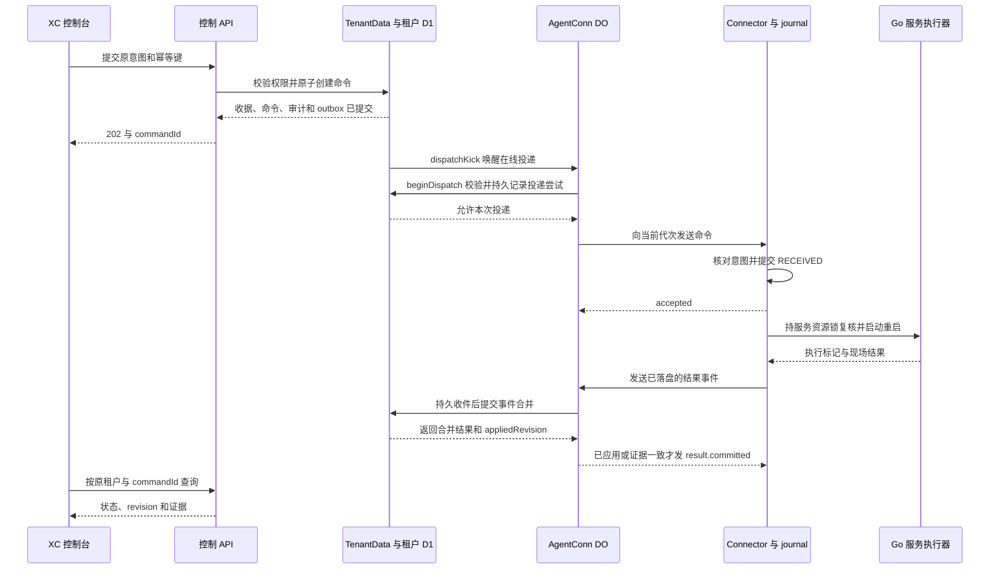

# 技术详细设计

操作员在 XC 控制台点了一次「重启服务」，页面却在收到响应前断了线。再打开任务中心时，怎样找到原任务，判断服务究竟有没有重启？本页以 `service.restart` 贯穿请求、持久化、节点执行和结果展示，并说明节点注册、终端撤权和分片上传各自依据什么证据恢复。首版保留 Go core/agent，接口示例供 P0 冻结契约使用，真实节点验证安排在后续实施阶段。

# 1. 从服务详情页提交重启

操作员在租户 `tenant-a`、节点 `node-a` 的服务详情页选中 `nginx`。页面在确认时固定租户、节点、服务名和读到的 `resourceVersion`，为这一业务意图生成一次 `Idempotency-Key`。服务端核验当前成员的节点授权、`service.manage` 操作权限、节点能力和允许操作的服务名。资源版本作为不透明字符串原样传递。

```http
POST /v1/tenants/tenant-a/nodes/node-a/commands HTTP/1.1
Content-Type: application/json
Idempotency-Key: restart-example-01

{
  "operation": "service.restart",
  "resourceVersion": "17",
  "payload": { "service": "nginx" }
}
```

首次受理的响应示例只列联调所需字段。`202` 表示控制面已持久保存命令意图。客户端保存原始请求和服务端确定的绝对 `expiresAt`，后续按 `commandId` 查询。

```http
HTTP/1.1 202 Accepted
Content-Type: application/json

{
  "commandId": "cmd-example-01",
  "expiresAt": 1794471300000,
  "idempotencyReplay": false
}
```

若响应丢失，客户端按原租户、节点、请求体和 key 重发。服务端先核验请求者此刻的授权，再按 `(tenantId, idempotencyKey)` 查收据，依次处理下表。并发的相同请求由收据唯一约束选出一次创建，其余请求读取已提交收据。

| 收据判定顺序 | 服务端结果 | XC 后续动作 |
|---|---|---|
| 仅余 key guard | `410 IDEMPOTENCY_KEY_EXPIRED` | 停止重试，先从原节点任务记录核对历史结果 |
| 正文存在，`requestFingerprint` 不同 | `409 IDEMPOTENCY_REQUEST_MISMATCH` | 找回原请求。若用户确实变更了操作意图，重新展示目标供确认 |
| 指纹相同，`intentHash` 不同 | `409 IDEMPOTENCY_INTENT_MISMATCH` | 保留原命令，核对资源版本、原业务期限和规范化输入 |
| 两个摘要均一致 | 返回原 `commandId`，`idempotencyReplay=true` | 打开原任务详情，继续跟踪同一次重启 |

首次创建时 `expiresAt` 和执行意图一并固定。若资源已经变更，页面重新读取服务版本，用户确认新意图后才生成新 key。[主方案 A.4 数据模型与对外 API](technical-plan.md#a4-数据模型与对外-api) · [C.3 统一错误与可观测字段](technical-plan.md#c3-统一错误与可观测字段)

# 2. 按持久化边界推进任务

一次在线重启经历三次独立确认。租户 D1 先接受操作意图，节点 journal 随后保存接收记录，最后由租户 D1 合并执行结果。



| 边界 | 此处必须写入的事实 | 中断后由谁接手 |
|---|---|---|
| TenantData 提交创建事务 | 同一租户 D1 一次写入 `commands`、幂等收据、初始审计和 outbox。事务提交后才返回 `commandId` | 在线唤醒失败时 dispatcher 经 Queues 再次唤醒同一 AgentConn。通知携带原事件、命令和版本 |
| AgentConn 首次投递 | `beginDispatch` 核对有效期、取消意图和当前 `fenceVersion`，以 CAS 把 `QUEUED` 推进到 `DISPATCHED` 并记录尝试。DO 保存投递记录后才发送 | 已有投递历史但缺少确认时，AgentConn 在有效连接上向 journal 核对。D1 不可写时暂停新的首次投递 |
| Connector 与 Go 启动 | journal 持久保存 `commandId` 和 `intentHash` 后回复 `accepted`。执行器持有该服务资源锁，复核 incarnation、epoch、写入代次、授权、期限和资源版本，关联 `cloudCommandId` 与 `operationMarker` | 已存在相同命令时从 journal 返回进度。若 Go 已启动但任务映射尚未落盘，按标记和现场证据核对 |
| TenantData 合并结果 | DO 保存事件后可回复 `result.received`。TenantData 按事件标识去重，以命令 `revision` 做 CAS，将合并结果和 `appliedRevision` 持久化 | `PENDING` 保留待处理，`CONFLICT` 触发核对。仅 `APPLIED` 或证据一致的 `CONSISTENT_NOOP` 可回 `result.committed`。节点收到后才开始计算结果正文保留期，去重记录独立保留并覆盖允许重投的窗口 |

同一服务可能同时被证书或升级任务占用。资源锁必须在实际 Go 变更入口生效，供云端和本地入口共同遵守。`cloudCommandId` 解决同一命令的重复调用，服务资源锁处理不同命令的竞争。`service.restart` 的源码入口、操作标记和核验 hook 仍须在 P0 对照固定提交补齐。[Go 操作改造台账](operation-ledger.md)

# 3. 在断线、取消与撤权时裁决结果

对账先按原 `commandId` 查执行轨迹，再判断现场证据能否归属于本次重启。服务当前为运行态只能说明它此刻可用。核验需要结合同一节点 incarnation、操作标记、重启前后的进程启动时间、服务状态与版本，排除其他任务或人工操作造成的变化。

| 联调断点 | 恢复动作 | 可对外显示的结论 |
|---|---|---|
| WSS 在发送后、`accepted` 到达前断开 | 新连接先持久化并确认更高 epoch，再按原命令查询 journal。旧代次不能启动新动作 | 暂时显示 `RECONCILING` 并保留最后可信状态。已有投递历史的任务只有取得未启动且已过期的证据，才可收敛为 `EXPIRED` |
| Go 已触发重启，connector 在记录任务映射前退出 | 恢复时只读查询 `operationMarker`、原任务与进程启动记录，核对目标服务版本。保留原 `commandId` | 证据吻合时结算结果。无法判定时为 `UNCERTAIN`。继续核验仍不足时进入 `REVIEW_REQUIRED`，阻止自动再次重启 |
| 取消操作与启动重启同时发生 | 控制面记录取消意图，执行器检查实际启动边界。若已发生重启，继续核验结果并记录副作用范围 | 有未启动且取消生效的证据时，显示 `CANCELLED`。若重启已完成且证据一致，显示 `SUCCEEDED` 和 `cancelIneffective` |
| 操作员的节点授权被撤销 | 重试提交和详情查询均重新校验当前权限。节点按已获知的撤销信息拒绝新启动。尚可信的节点身份可继续回传已执行任务的受限结果 | 已撤权的操作员看到访问被拒。仍有权限的审计人员能核对原任务、提交人和结果 |
| 合并结果的回执丢失，或人工结论之后收到矛盾结果 | 重送同一事件。TenantData 比对事件标识、序号、摘要和当前结论，一致时回复已合并的 revision，矛盾时保留冲突证据 | 人工结论保留，冲突追加到审计。`CONFLICT` 属于事件处理结果，任务中心继续显示已裁决的命令状态 |

`REVIEW_REQUIRED` 的人工处置需要处置权限、依据和审计记录。若决定重新执行，创建关联原任务的新命令，再核验目标与资源版本。[主方案 §7.2 断线后的任务对账](technical-plan.md#72-断线后的任务对账) · [命令状态与允许转移](command-state.json)

# 4. 在 XC 还原用户看到的进度

服务详情页和任务中心用不同的键读取数据。详情页查询键包含 `tenantId`、`nodeId`、资源类型和查询参数。任务详情在原租户上下文调用 `GET /v1/tenants/{tenantId}/commands/{commandId}`，展示创建时绑定的节点与服务。切换节点时取消旧查询和订阅，在回调中再次匹配上下文，防止旧节点的迟到结果覆盖当前详情。

| 用户动作或观测 | 页面行为 |
|---|---|
| 提交后收到 `202`，随后切换到另一节点 | 在原目标下建立任务入口。新节点独立加载同名服务，任务中心仍可追踪原命令 |
| 先后收到同一任务的两个版本 | 以较高 `revision` 更新投影。到达较晚的旧版本不能把已完成任务退回执行中 |
| 用户关闭页面后从深链接返回 | 重新校验会话、租户与资源权限，再读命令详情。显示最后可信执行进度、取消意图及可用操作 |
| 任务进入 `UNCERTAIN` | 同屏展示最后可信状态、目标节点及已有证据，提供核对入口。仅有处置权限的用户能提交人工结论 |

命令详情的 `revision` 标识任务记录的当前版本。服务的 `resourceVersion` 用来检查操作员提交时看到的配置是否仍然有效。[主方案 §13.1 XC 公共前端基础](technical-plan.md#131-xc-公共前端基础)

# 5. 节点接入、终端与文件传输

## 5.1 节点注册后恢复原身份

节点在本地生成密钥，通过 `POST /v1/agents/enroll` 提交一次性注册凭据并证明持有私钥。TenantData 在同一租户 D1 事务中消费凭据、绑定预登记节点与公钥并写入审计。若注册响应丢失，节点用原 `requestId` 和公钥签署新的一次性挑战。服务端核对签名与原消费记录后返回同一节点身份。建链时再申请 `connect-ticket` 并主动连接 AgentConn，只有节点持久化新 epoch 且 `ready` 被接受后才可投递命令。[主方案 §7.1 节点注册与身份建立](technical-plan.md#71-节点注册与身份建立)

## 5.2 由终端执行器关停会话

租户内 `POST /nodes/{nodeId}/terminals` 创建会话。D1 保存会话归属及授权版本，Relay 分别为浏览器和节点签发一次性角色票据，Go 执行器持有实际 PTY。调用 `DELETE /terminals/{terminalId}` 后，TenantData 持久提升 `authorizationVersion` 并发布撤销事件。Relay 收到事件即停止收发，Go 收到撤销即关闭 PTY。若通知丢失，执行器按最近有效 grant 的绝对 `leaseUntil` 在本地关停。重建会话须再次授权，旧连接上送达情况未知的键盘输入不重放。[主方案 §7.3 终端授权撤销](technical-plan.md#73-终端授权撤销)

## 5.3 按制品标识恢复分片上传

租户内 `POST /artifacts/uploads` 创建上传会话，D1 保存 `artifactId`、对象归属和预期摘要，R2 保存分片与对象。`POST /artifacts/{artifactId}/complete` 核对大小和分片清单后进入 `VERIFYING`。若完成响应丢失，客户端复用原 `artifactId` 提交同一清单，服务端核对 `uploadId`、分片及对象条件版本并返回已有进度。验证节点用整份文件的 SHA-256 比对预期摘要，通过后才标记 `READY`。安装或恢复节点使用前独立复核同一摘要。

# 6. 联调场景与交付证据

准备两个租户和两台预登记的 Linux 测试节点。先完成注册场景，再在两台节点上准备允许重启的同名测试服务。至少一个操作员可管理原目标并能切换到另一个合法上下文。记录服务的初始启动时间、版本、节点 incarnation 和授权范围。终端测试需要可检查关闭状态的 PTY，文件测试使用已知整文件摘要的多分片制品。以下场景均待执行。

| 验收项 | 操作与故障时点 | 通过条件 |
|---|---|---|
| AC-CMD、NET-CMD | 重启一次测试服务，查询到终态 | 一条命令关联一次 Go 重启动作。服务启动时间改变且目标版本符合预期。D1 事件、节点 journal 和现场核验可按同一命令串联 |
| FI-CMD | 在 D1 提交后丢弃 HTTP 响应，以同 key 和原请求重发。另用同 key 更换服务名重发 | 第一次重试回放同一 `commandId`，第二次重试得到请求指纹冲突。核对收据与实际启动记录，均只对应一次原始操作 |
| FI-CMD、AC-CMD | 在 Go 启动后、任务映射写入前停止测试 connector，恢复后分别提供完整和缺失的核验证据 | 完整证据可还原实际结果。缺失证据进入未知或人工核对。两组都保留原 `commandId`，恢复后均无第二次启动记录 |
| AC-AUTH、FI-AUTH | 完成一次提交后撤销操作员对该节点的访问，重新打开详情并用原 key 重试 | 两次访问均被拒。授权审计人仍能核验原命令与执行结果，没有新增命令 |
| AC-UI | 在原节点提交后切换到另一合法节点，延迟交付旧查询响应，再刷新原任务深链接 | 目标节点的同名服务保持自身数据，原任务在重新鉴权后可见，状态按 revision 单调更新 |
| DEV02、NET-REG | 在注册事务提交后丢弃响应，用原请求标识、公钥和新挑战的签名恢复 | 返回原 `nodeId` 与 incarnation，节点绑定及成功消费审计各一份。随后以该身份完成连接与 `ready` 握手 |
| AC-TERM、FI-LEASE | 撤销活动终端，分别在通知可达和丢失时记录 D1 提交、Relay 停止收发和本地 PTY 关闭时间 | 收到撤销的端点立即关停。未获通知的端点按绝对租约到期关停。旧授权版本无法续租，两种情况下均可核验 PTY 已关闭 |
| AC-FILE、FI-FILE | 完成多分片上传后丢弃响应，按同一 `artifactId` 和清单重提。另用预期摘要不匹配的制品复测 | 重试指向同一制品及对象版本。只有整文件摘要核验通过的制品可进入 `READY`，失败样本不会分发安装命令 |

每次运行把代码与构建版本、节点环境、原始断点、期望与实际结果写入同一 `runId`。用 `traceId` 串联请求及链路日志，用 `commandId` 串联租户命令、节点 journal 和 Go 执行证据。单独标明直连投递或 outbox 补偿。单租户 10,000 节点、连续 72 小时的混合负载按 CAP-01 独立执行。[验收编号注册表](acceptance-ids.json) · [主方案 §15.1 单租户容量与证据门禁](technical-plan.md#151-单租户容量与证据门禁)
