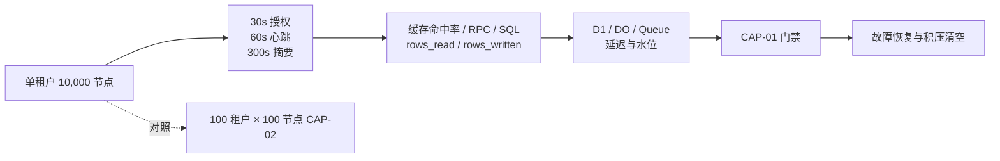
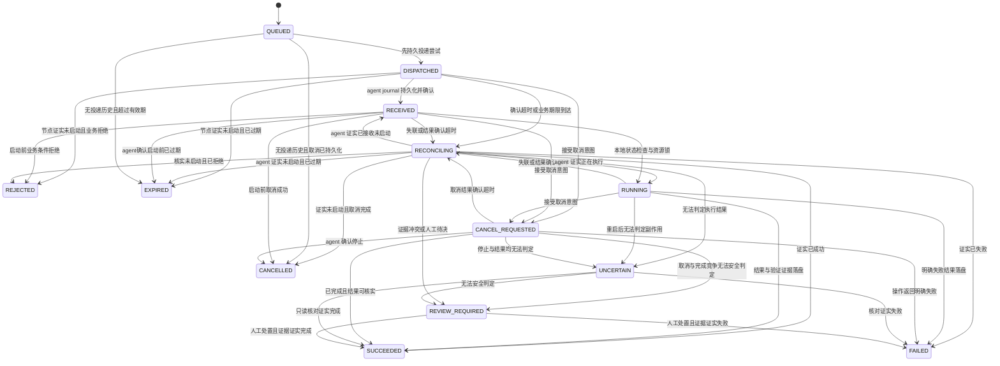
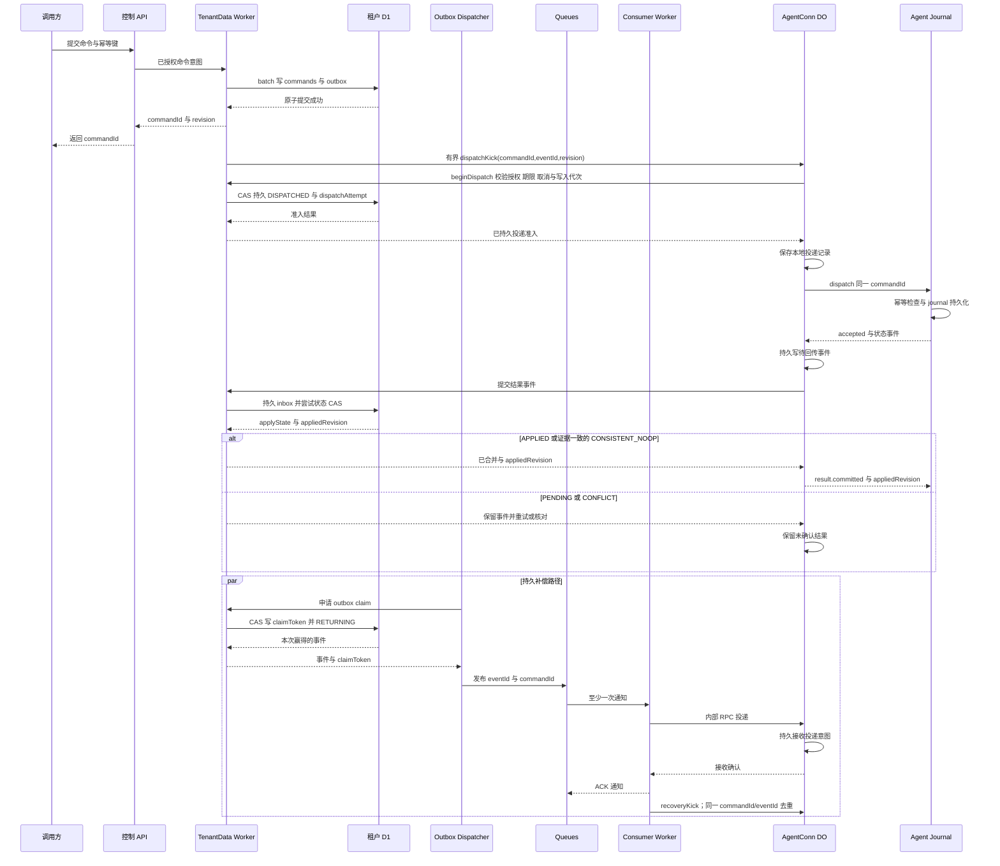
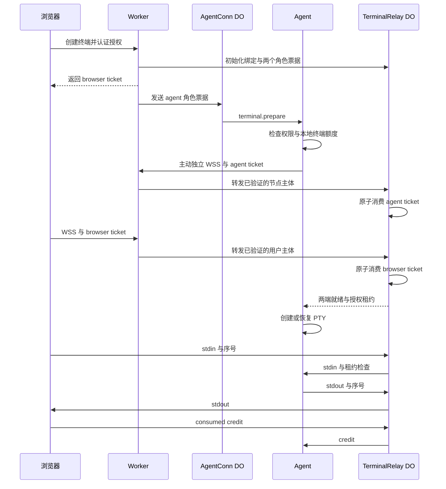
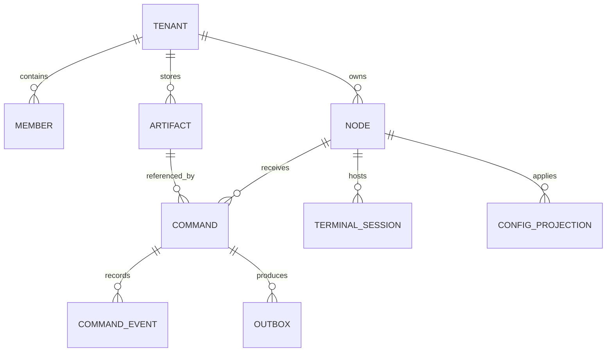

# AngelFleet 技术规格与验收附录

本附录保留 SQL、协议状态图、端点源码矩阵、参数测算和需求编号。实施说明已归入[技术方案](technical-design.md)、[节点接口契约](go-agent-interface-contract.md)及[节点操作与权限](operation-ledger.md)。

# 13. 选定功能的迁移与 Go 复用

本节保留端点盘点的字段模板。每条记录关联固定源码、实现路径及验收证据。范围由[产品 PRD](product-prd.md#哪些-1panel-功能分批迁移)定义。

## 13.6 逐功能迁移台账

[技术方案 · 云端部署与接口兼容](technical-design.md#云端部署与接口兼容)

端点盘点字段模板

```text
requirementId,endpointId,routeGroupId,method,path,sourceCommit,routerFile,handlerSymbol,
provider,providerImplemented,reactPage,operation,permission,resourceScope,capability,
executorKind,usesCoreDB,usesTaskDB,localPaths,interfaceType,profile,
inputSchemaRef,outputSchemaRef,idempotencyClass,reconcileRef,cancelBoundary,
disposition,targetStage,workPackageId,acceptanceIds,status,evidenceRefs,gapDecision
```

# 15. 功能、容量验收与架构决策

| 验收包 | 必须覆盖的场景 | 输出 |
|---|---|---|
| AC-UI 权限与上下文 | 登录、节点切换、深链接、缓存隔离、任务跨页、各入口越权 | React 与真实 API 端到端证据 |
| AC-CMD / FI-CMD 可靠命令 | outbox 中断、重复、Go 已执行但响应/taskId丢失、节点崩溃、确定拒绝与未知结果 | command/journal/本地操作及现场关联；未知不重放 |
| AC-STREAM / FI-LEASE 流与文件 | 各类会话、慢消费者、撤销丢失、connector崩溃、Go执行器租约、分片/取消/续传 | 关闭时限、缓冲水位、缺口、摘要和清理 |
| AC-DOMAIN 业务 | 按[产品范围](product-prd.md#哪些-1panel-功能分批迁移)已选操作及适用环境对照附录 B 源码，逐项核验 Go 执行与业务结果 | 当期分母、失败、缺口与复测，另列排除及条件能力 |
| AC-LIFE / FI-RESTORE 首版生命周期 | 保留 core 的安装/重启/升级回滚、旧数据/快照恢复、身份轮换退役、跨存储水位不一致 | 节点前后版本、恢复点、任务对账和单写者 |
| AC-SEC / FI-SEC 安全对抗性验收 | 路径与命令注入、票据伪造/重放、爆破限流、WSS Origin/CSRF、预签名 URL 越权、跨租户引用和日志泄密 | 攻击输入、拒绝结果、限流、审计和脱敏证据 |
| NET 链路 | 海外/国内浏览器与节点、API/Relay/R2/包源、代理切换 | 分方向可达性、绝对延迟、断开与恢复 |
| P6-AC 后续退役 | 无 core 安装/启动/升级/恢复及附录 B 退役条件 | 单独报告与接受依据 |

## 15.1 单租户容量与证据门禁

[技术方案 · 容量实验与放行](technical-design.md#容量实验与放行)

| 10,000 个节点的基础负载 | 逻辑频次 | 72 小时 | 30 天 |
|---|---|---:|---:|
| 授权检查 | 每节点每 30 秒一次，平均约 333 次/秒 | 86,400,000 | 864,000,000 |
| 业务心跳 | 每节点每 60 秒一次 | 43,200,000 | 432,000,000 |
| 错峰摘要覆盖 | 每节点每 300 秒一次 | 8,640,000 | 86,400,000 |

这些是逻辑请求和覆盖次数。按每批 500–1,000 节点作为压测起点，另计 Worker／RPC 调用、批内实际 SQL、索引、重复执行与恢复写放大。D1 批调用和内部 SQL 分别计量。[D1 官方限制](https://developers.cloudflare.com/d1/platform/limits/)



## 15.2 ADR 决策记录

| 编号 | 当前决定 | 复审触发条件 |
|---|---|---|
| ADR-01 | XC React + Workers + connector + 原 Go core/agent 首版 | 某保留业务无法在受控本机入口安全适配 |
| ADR-02 | Go 业务内核复用，接入与可靠执行边界新增 | 某操作无法恢复关联或核验副作用，需执行器 hook |
| ADR-03 | 控制 DO 与每会话 Relay 分开 | 流恢复、隔离或代理链路无法满足功能要求 |
| ADR-04 | 租户 D1 与数据 Worker，统一数据权威 | 分库供给、迁移或热租户出现实测瓶颈 |
| ADR-05 | outbox + 至少一次通知 + 节点 journal | 某操作缺少可验证幂等或结果核对方法 |
| ADR-06 | R2 文件制品，独立分片与验证 | 链路或数据驻留要求无法满足 |
| ADR-07 | 统一终端租约、单次角色票据 | 撤销、恢复或节点执行器关闭机制不成立 |
| ADR-08 | core 退役为 P6 独立交付 | 共享数据、updater、快照转换及无 core 验收全部就绪 |

每包交接登记需求、端点、契约版本、可改目录、检查命令及退出码、源码与构建、dirtyPatchHash、未决任务和回退边界。复审 ADR 时记录原因、受影响阶段与需要重验的用例。保留未运行、失败、不适用及私有能力缺口的处置记录。[验收记录](spaces/implementation-review.md)

## 15.3 实施门禁与参数冻结

本节是实施门禁索引，数据与状态约束维护在附录 A/C，操作登记维护在[节点操作与权限](operation-ledger.md#操作登记与执行边界)，验收编号以 [`docs/acceptance-ids.json`](acceptance-ids.json) 为唯一注册表，避免同一契约在多处独立演进。本轮业务验收以[产品 PRD 的分批范围](product-prd.md#哪些-1panel-功能分批迁移)为准；新增参数和状态在 P0 通过真实代码、Cloudflare 配置与实验结果冻结前，均保持 `待 PoC` 或 `PLANNED`。

### 15.3.1 R1 命令状态、并发事件与证据裁决

命令的执行事实、取消意图和对账状态不能由一个字段互相覆盖。规范状态记录至少包含 `state`、`lastKnownExecutionState`、`cancelIntent`、`reconcileState`、`sideEffectExtent`、`evidenceRefs` 和 `revision`。`sideEffectExtent=UNKNOWN` 表示已有执行或副作用证据，但当前无法安全判断范围，不能按 `NONE` 进入过期、取消完成或清理路径。完整状态集合与 39 条允许边以版本化 [`docs/command-state.json`](command-state.json) 为唯一机器可读权威；下表是实现评审使用的异常与竞争事件索引，不得据此推导未列出的正常路径。CAS 合并函数和状态图必须逐边对照该 fixture。

| 事件索引 | 允许来源 | 目标 | 守卫与证据 |
|---|---|---|---|
| 投递确认超时/失联 | DISPATCHED、RECEIVED、RUNNING、CANCEL_REQUESTED | RECONCILING | 保留最后可信状态；必须生成对账请求，不得直接判失败 |
| 取消请求已接受 | DISPATCHED、RECEIVED、RUNNING | CANCEL_REQUESTED | 记录取消意图和操作者；不得覆盖已经确认的副作用 |
| 证实未启动且取消完成 | CANCEL_REQUESTED、RECONCILING | CANCELLED | 节点 journal 或现场证据证明未启动；`sideEffectExtent=NONE` |
| 取消与执行结果竞争 | CANCEL_REQUESTED、RECONCILING | SUCCEEDED、FAILED 或 REVIEW_REQUIRED | 按已核实的执行结果合并，证据冲突转人工。取消生效前已产生副作用时记 `cancel_ineffective=1`，保留取消请求的生命周期值 |
| 证实未启动且过期 | DISPATCHED、RECEIVED、RECONCILING | EXPIRED | 只能依据可信未启动证据；已启动任务不得标为过期 |
| 核对证实完成/失败 | UNCERTAIN、REVIEW_REQUIRED | SUCCEEDED 或 FAILED | 只读核验、checkpoint 或现场事实满足操作契约 |
| 核对后仍无法安全判定 | UNCERTAIN | REVIEW_REQUIRED | 保留冲突证据并交人工。已有人工待决记录可追加证据，保持当前状态 |
| 人工或最终结论后的晚到结果 | 已有结论 | 保留原命令状态 | 按事件 ID 和节点事件序号去重。证据一致记 `CONSISTENT_NOOP` 并保存已应用 revision；冲突记 `CONFLICT`、追加审计并核对 |

终态集合为 `{SUCCEEDED, FAILED, CANCELLED, EXPIRED, REJECTED, REVIEW_REQUIRED}`。`CANCELLED` 表示停止后续执行，不表示已回滚；`sideEffectExtent` 取 `NONE/PARTIAL/FULL/UNKNOWN`。只有可信未启动证据才能把未知收敛为 `NONE`。实际回滚必须是操作契约声明的补偿步骤并创建关联的新 `commandId`。人工处置记录处置人、时间、权限、依据证据和结论；`UNRESOLVED` 保留 `REVIEW_REQUIRED`。AC-CMD/FI-CMD 增加取消/完成竞争、部分副作用、未知副作用、人工未决、人工后晚到结果一致与冲突、RUNNING 失联六类用例。

### 15.3.2 R2 云端幂等记录与节点去重分层

FI-CMD 分开验证云端收据和节点去重记录。覆盖收据正文、仅存 key guard 和 guard 已清理，并分别验证节点 tombstone 存在与清理时的结果。撤权后重试应被拒绝；修改资源版本或延长时限须按新意图处理。HTTP 判定顺序及保留窗口见 [A.4](#a4-数据模型与对外-api)，节点重复投递与效果去重见 [A.5](#a5-命令状态幂等与本地-journal)。

### 15.3.5 R5–R6 容量实验与 Cloudflare 硬约束

命令投递不能把 Queues 当作有界低延迟通道。官方默认 `max_batch_size=10`、`max_batch_timeout=5s`，单条失败默认可能导致批次重投；即使设置 `max_batch_timeout=0`，官方 Workflows 示例也说明队列交付通常需要数秒，偶尔可能超过一分钟。因此 `online command persistent receive p95≤2s` 只绑定提交后的控制面直连快路径：TenantData/控制 API 在 D1 提交成功后，以有界超时调用对应 AgentConn 的 `dispatchKick(commandId, eventId, revision)` RPC；DO 再执行 `beginDispatch`、持久化准入并通过已建立的 WSS 投递。直连失败不丢失意图，持久 outbox 仍经 Queues 消费者补偿，补偿路径单独报告分位数和 `oldestOutboxAge`，不得与 2 秒目标混算。命令 Queue 在 P0 冻结 `max_batch_size=1`、`max_batch_timeout=0`，逐条 `ack()`；低负载、峰值、队列交付延迟、直连失败、重复 kick 和故障恢复分别压测。[Queues 批处理与重试](https://developers.cloudflare.com/queues/configuration/batching-retries/)、[Queues 触发 Workflows 示例](https://developers.cloudflare.com/workflows/examples/trigger-from-webhook/)

CAP-01 以单租户 D1 和每节点 AgentConn 为主要容量风险。平台限制、套餐、抓取日期和官方链接集中见 [`docs/platform-constraints.md`](platform-constraints.md)；本节只规定实验口径：记录授权缓存命中率、真实 SQL/批次数、排队时延、`rows_read/rows_written`、事件和审计增长、归档阈值与恢复余量。负载预算不能把 333 次逻辑授权检查直接当成 333 条 SQL；必须证明缓存命中和 batch 后的串行时间总和低于 1 秒并留有恢复余量。

实现层面仍要逐项压测平台负向边界，具体数字以 [`docs/platform-constraints.md`](platform-constraints.md) 的快照为准；记录 `overloaded`、`SQLITE_FULL`、队列限流、排队时延和清空时间。AgentConn 的 64MiB 只是应用层未确认结果预算，不是平台上限；10,000 个对象同时达到该预算约 625GiB/671.09GB，是积压容量压力测试的理论值，不是正常内存占用。高水位 48MiB 时暂停新普通任务，保留结果确认、撤销、取消、健康恢复和对账通道；DO 达到存储上限时写入失败但读与 DELETE 仍可用，故障矩阵必须验证清理与恢复。摘要为每节点覆盖一行，存储增长预算应单算 commands、events、audit、tombstone、索引和故障积压，不把摘要写次数当新增行数。费用模型仍不属于本文。

### 15.3.6 R7 Go 操作台账、R8 术语与 R9 参数冻结

[节点操作与权限](operation-ledger.md#操作登记与执行边界)定义每项操作的权限、执行前提与恢复约束，并逐项登记源码提交与符号、适配范围、taskId 或 operationMarker、取消边界、只读核验、跨入口锁和 AC/FI/CAP/NET 证据。已核对上游入口的操作仍需完成产品适配和联调。

版本/代次含义集中如下，正文中的同名字段必须遵循这一表：

| 名称 | 语义 | 权威存储/校验点 |
|---|---|---|
| `nodeIncarnation` | 节点身份代次；重装、克隆或 journal 丢失后改变 | 节点身份与 journal；建链、任务和事件 |
| `connectionEpoch` | 节点连接代次；旧连接不得投递新命令 | AgentConn DO 与 agent journal；ready 激活 |
| `revision` / `entityRevision` | 行或实体的 CAS 版本 | 租户 D1；每次条件写入 |
| `authorizationVersion` | 成员、节点或会话撤销代次 | TenantData 与 Relay/agent grant |
| `credentialVersion` / `keyVersion` | 节点凭据或密钥轮换代次 | 节点目录与密钥元数据 |
| `leaseSequence` | 同一终端租约的单调续租序号 | Relay 与 agent；续租/每帧 |
| `agentEventSequence` | 单节点身份、命令域内的结果序号 | journal 与 command_events |
| `schemaVersion` / `capabilityVersion` | 数据结构或节点能力契约版本 | DO attachment、节点目录、握手 |
| `routingVersion` / `roleGeneration` | 数据分片路由或终端角色代次 | 目录库、Relay；建链和票据消费 |

参数冻结表由 P0 维护；当前只列初始值和状态：

| 参数 | 初始值 | 状态 | 验证实验 |
|---|---:|---|---|
| 连接授权租约上限 | 90s | 待 PoC | CAP-03 |
| 续租周期 | 30s + jitter | 待 PoC | CAP-03 |
| `maxAuthorizationStaleness` | 待定 | 待 PoC | CAP-03 |
| 命令队列 batch size/timeout | 1 / 0s | P0 冻结候选 | CAP-01、CAP-04 |
| HTTP 幂等收据 / key guard | ≥14d；破坏性操作 ≥30d | 待 P0 冻结 | FI-CMD |
| 节点 command tombstone | ≥30d | 待 PoC | FI-CMD |
| 补偿扫描周期 | 60s | 待 PoC | CAP-04 |
| AgentConn 结果高水位 | 48MiB / 上限 64MiB | 待 PoC | CAP-01、CAP-04 |
| 终端并发上限 | 8 / 节点 | 待 PoC | CAP-02、NET |
| 终端二进制帧 | 16–32KiB | 待 PoC | CAP-02 |
| 终端方向未确认窗口 | 256KiB | 待 PoC | CAP-02 |
| 终端总缓冲 | 1MiB / 会话 | 待 PoC | CAP-02 |
| 终端断线保留 | 1MiB 或 30s | 待 PoC | CAP-02 |
| 待投递上限 | 1,000 条或 8MiB / 节点 | 待 PoC | CAP-01、CAP-04 |
| journal 应急磁盘余量 | 50MiB | 待 PoC | CAP-04 |
| R2 分片大小 | 16–64MiB | 待 PoC | CAP-02、NET |
| R2 分片 URL 有效期 | 15min | 待 PoC | CAP-02 |
| 节点 enrollment ticket 有效期 | 10min | 待 PoC | DEV01、DEV02 |
| 终端角色 ticket 有效期 | 60s | 待 PoC | AC-TERM、FI-LEASE |
| 终端建立预留超时 | 30s | 待 PoC | AC-TERM、FI-LEASE |
| 连接凭证有效期 | 5min | 待 PoC | CAP-03 |
| 节点业务心跳 | 60s | 待 PoC | CAP-01、CAP-04 |
| WebSocket 协议 ping | 30s | 待 PoC | NET |
| D1 摘要覆盖写周期 | 300s | 待 PoC | CAP-01、CAP-04 |
| 订阅监控频率 | 按页面订阅短时提高 | 待 PoC | NET |
| 重连退避 | 1–60s + full jitter | 待 PoC | CAP-04、NET |
| 每 TenantData Worker 绑定预算 | 200 租户 | P0 爆炸半径预算，不是平台上限 | CAP-01、CAP-04 |
| 控制消息内联上限 | 64KiB | 待 PoC | CAP-01 |
| 单条结果内联上限 | 64KiB | 待 PoC | CAP-01 |
| 命令入场有效期 | 7d | 待 PoC | FI-CMD、CAP-04 |
| 命令交付重投窗口 | 14d | 待 PoC | FI-CMD、CAP-04 |
| 策略离线最大窗口 | 待定 | P0 冻结 | FI-CONFIG、NET-POLICY、CAP-04 |

### 15.3.7 R10–R12 追踪与兼容边界

需求矩阵包含 `REQ11 容量与恢复余量`，覆盖 CAP-01、CAP-02、CAP-03、CAP-04、D1/DO/Queue 水位、归档与恢复；包含 `REQ12 链路可达性与延迟`，覆盖 NET、国内/海外路径、API/Relay/R2/包源切换。区域链路按 `NET-CN` 和 `NET-GLOBAL` 分别记录 `wssHandshakeSuccessRate`、`connectedDuration`、`heartbeatRtt`、`commandDispatchRtt`、`resultReturnRtt`、`reconnectDuration`、`regionFailoverDuration`、旧 epoch 拒绝率以及 `r2TransferSuccessRate`，并按主/备 Relay 分组。Relay ACK 与命令业务完成必须分别计量。每个 AC、FI、CAP 和 NET 项必须在需求矩阵中有至少一个 REQ，反向也必须有验收证据。协议兼容包含 `minSupportedProtocol`、最低安全版本、最大允许离线窗口和不兼容节点的最小恢复/签名升级路径；不能因旧节点无法接收普通升级命令而形成升级死锁。

实施门禁、参数冻结和验收注册表共同构成当前交付基线。任何契约变更必须同步更新附录 A/C、机器可读 fixture、验收 ID 和对应检查；未通过真实代码、Cloudflare 配置、真实节点或容量实验的内容保持 `PLANNED`、`待 PoC` 或 `IMPLEMENTED_UNVERIFIED`，不因文档存在而自动升级状态。

# 附录 A · 协议、数据与可靠性细则

附录 A 规定目标控制协议。首版的「节点执行端」由 connector、操作适配器、本地 journal 和原 Go core/agent 组成；P6 由 managed-agent 承接相同职责。身份验证、去重、启动前检查和 PTY 关闭分别在实际负责组件留证。34 组迁移矩阵基线与首批操作的较新源码核对范围见 [B.1](#b1-基线与验证范围)。

## A.4. 数据模型与对外 API

[租户数据服务、路由与存储归属](technical-design.md#数据归属与租户隔离)

| 表或集合 | 主要字段与约束 |
|---|---|
| tenant_members | tenantId、userId、role、authorizationVersion，成员唯一键 |
| nodes | tenantId、nodeId、incarnation、credentialVersion、publicKeyFingerprint、status、capabilities、connectorBuild、adapterVersion、executionMode、coreVersion、agentVersion、managementMode、maintenanceState、fenceVersion、revision |
| enrollments | enrollmentId、ticketHash、requestId、publicKeyHash、expiresAt、consumedAt、nodeId |
| commands | commandId、nodeId、nodeIncarnation、actorId、authorizationVersion、executionPrincipal、fenceVersion、idempotencyKey、requestFingerprint、intentHash、operation、resolvedResource、resourceVersion、sampleOrder、state、lastKnownExecutionState、cancelIntent、reconcileState、sideEffectExtent、evidenceRefs、cancelIneffective、revision、expiresAt、resultRef |
| command_start_grants | grantId、commandId、actorId、authorizationVersion、fenceVersion、nodeIncarnation、resolvedResource、resourceVersion、intentHash、nonce、issuedAt、expiresAt、consumedAt、status；一次性消费并受条件版本校验 |
| node_metric_heads / node_metric_values | 每个租户、节点和 incarnation 有独立受理水位、最近已合并的采样尝试和投影版本。每项指标另存本次有效性及最后好值的来源，C.1 给出约束。 |
| idempotency_receipts | tenantId、idempotencyKey、requestFingerprint、intentHash、commandId、expiresAt、retainedUntil、guardUntil、replayCount、status；正文可清理但 guardUntil 前禁止复用同 key |
| outbox | eventId、entityId、entityRevision、kind、availableAt、attempts、claimToken、claimUntil、publishedAt、lastError；C.1 使用 `last_error` |
| command_events | eventId 唯一、commandId、nodeIncarnation、agentSequence、contentHash、eventJson、applyState、appliedRevision、receivedAt；事件不另设 `state` 或 `evidenceHash` 列，状态从 `eventJson` 解析并按合并结果写入命令，内容摘要统一使用 `contentHash` |
| terminal_sessions | terminalId、nodeId、userId、authSessionId、authorizationVersion、relayId、state、revision、createdAt |
| artifacts | artifactId、tenantId、nodeId、objectKey、bytes、sha256、state、retentionUntil |
| audit_events | auditId、actorId、authMethod、tenantId、nodeId、operation、targetId、outcome、traceId |

AgentConn SQLite 保存 activeEpoch、activeConnection、dispatchCursor、pendingCommands、dispatchAttempts 与 pendingResultEvents。Relay SQLite 保存 immutableBinding、roleTickets、activeRoleGeneration、leaseSequence、leaseUntil 与 revokeVersion。agent journal 保存 commandId、intentHash、operationClass、acceptEpoch、state、checkpoint、processIdentity、resultHash、effectGuardUntil 和回执确认状态；对非幂等或破坏性操作，在 `effectGuardUntil` 前以 `(operation, intentHash)` 做节点侧效果去重。事件序号在 `(nodeIncarnation, commandId)` 域内单调递增，同域同序号的摘要必须一致。command_events 的 applyState 区分 PENDING、APPLIED、CONSISTENT_NOOP 与 CONFLICT。

节点 journal 另存 executorKind、localTaskId、operationMarker、dispatchPhase 和执行器版本，用唯一 cloudCommandId 关联原 Go 任务。优先将稳定操作标识传入执行器，或增加可按标识查询的 hook。Go 已启动、但 connector 尚未持久保存 taskId 就退出时，恢复只能查询任务与现场；证据不足进入 UNCERTAIN，不再次调用原非幂等接口。

注册、建连、`node.inspect` 与逐指标查询的字段、报文和错误响应见[节点接口契约](go-agent-interface-contract.md)。以下是后续新增接口的候选清单。除已注册设备的专用入口外，租户路径以 `/v1/tenants/{tenantId}` 为前缀。P0 生成完整 OpenAPI，冻结请求、错误码与幂等约束。

| 后续接口 | 候选业务结果 |
|---|---|
| `GET /nodes` | 在当前授权范围内列出节点档案和状态 |
| `POST /nodes/{nodeId}/disable` | 停止新授权、提升相关版本并触发撤销；保留既有任务对账 |
| `POST /nodes/{nodeId}/retire` | 创建可追踪退役流程，执行任务核对与保留清理策略 |
| `POST /commands/{commandId}/cancel` | 提交取消意图，返回可追踪状态 |
| `POST /nodes/{nodeId}/terminals` | 创建终端会话并返回浏览器角色 ticket |
| `POST /terminals/{terminalId}/lease` | 重新校验授权，续期终端租约 |
| `GET /terminals/{terminalId}/connect` | 角色限定 WSS Upgrade，身份与 URL 上下文必须一致 |
| `DELETE /terminals/{terminalId}` | 持久撤销会话并通知 Relay 与执行器 |
| `POST /artifacts/uploads` | 创建对象与分片上传会话 |
| `POST /artifacts/{artifactId}/complete` | 核对分片并进入校验；READY 后才可安装或恢复 |

密钥轮换、停用恢复和重装恢复分别定义接口与权限，P0 冻结后纳入 DEV04/DEV06。不得通过修改 tenantId、公钥或 SN 直接覆盖旧身份；吊销后的恢复使用新鲜身份验证与受控恢复凭证，并先核对原节点未决任务。

**创建命令与重试。** 当前身份、租户、节点归属及权限校验通过后，服务端按 `(tenantId, Idempotency-Key)` 查询收据。`requestFingerprint` 覆盖规范化的 method、path、body 和该 key；`intentHash` 覆盖 [技术方案](technical-design.md#跨入口互斥与维护切换)定义的不可变业务意图。首次创建时确定绝对 `expiresAt`，与两个摘要、原 `commandId` 一起持久化。

| 按顺序判断 | HTTP 与返回结果 |
|---|---|
| 仅剩 `KEY_GUARD_ONLY` | 410 / `IDEMPOTENCY_KEY_EXPIRED` |
| 收据正文存在，`requestFingerprint` 不同 | 409 / `IDEMPOTENCY_REQUEST_MISMATCH` |
| 指纹相同，`intentHash` 不同 | 409 / `IDEMPOTENCY_INTENT_MISMATCH` |
| 两个摘要均相同 | 回放原 `commandId` 与截止时间，`idempotencyReplay=true` |
| 首次使用或 key guard 已按策略清理 | 按当前资源版本与能力重新准入，创建成功返回 202，`idempotencyReplay=false` |

C.1 的示例 SQL 还预留了收据状态 `REVOKED`。其触发条件、HTTP 响应及清理策略需在启用该状态前由控制面与 Go 负责人共同冻结。在已冻结的首次采样流程中，只签发有效收据，并按上表处理保留期和重试。

客户端保存原始请求、资源版本和服务端返回的截止时间。重试用首次保存的不可变命令内容和资源快照核对 `intentHash`。当前别名即使已变更，回放也只定位原任务。变更目标、版本或期限时提交新意图与新 key。实际启动前按当前绑定和版本另行核验。

收据保留期须覆盖客户端最大重试窗口和 14 天交付重投窗口。`retainedUntil` 前保留收据正文；清理正文后保留紧凑记录至 `guardUntil`，破坏性操作至少覆盖节点 tombstone 保留期。

## A.5. 命令状态、幂等与本地 journal

云端持久化命令意图后可以显示 QUEUED。AgentConn 首次发送前调用 TenantData.beginDispatch，原子校验命令仍可投递、有效期、取消状态、命令 `fenceVersion` 与节点当前写入代次，将租户 D1 状态推进 DISPATCHED 并记录 dispatchAttempt。取得这一持久准入后，再保存 DO 本地投递记录并发送。D1 不可用时暂停新的首次投递，已准入命令按原 commandId 对账。QUEUED 的取消与过期操作通过同一状态 CAS 竞争，防止 DO 已发送而云端仍按未投递结束任务。agent 在 journal 事务中写入 RECEIVED 并确保持久化后才回复 accepted。重复 commandId 先核对完整 intentHash，然后返回已记录状态。相同 ID 携带不同 intentHash 时拒绝并产生审计。agent 使用状态 CAS 与资源锁保证同一命令只有一个本地 dispatcher 启动，取得资源锁后再次核对当前资源版本、节点 incarnation、epoch、授权与业务有效期，前置条件冲突时停止启动并返回证据。

准入前的权限或参数失败直接返回 4xx。命令已持久化后，节点只有在确认未启动且业务前置条件不满足时，才能持久回传 REJECTED，附错误码、拒绝原因和未执行证据；可从 DISPATCHED、RECEIVED 或 RECONCILING 合并到该终态。旧 epoch、乱序帧等传输拒绝仅结束该投递尝试，不能自动终结仍可在当前有效连接执行的业务命令。执行适配器与实际 Go 启动入口共同落实校验、锁和操作标记。

对会改变主机状态的操作，执行适配器取得资源锁后向 TenantData 申请短时 `startGrant`。TenantData 在主库事务内检查当前 actor 授权、commandId、intentHash、资源、fence、节点代次、取消状态和业务期限，持久记录一次性签发。Go 入口校验同一命令、目标、当前连接代次、nonce 和绝对期限，将消费与启动标记一并持久记录。授权服务不可用、期限耗尽或本地消费无法确定时停止启动并对账。撤权先于主库准入时必须拒绝。准入后另由短窗口和已知撤销版本限制本地启动，不承诺断网下物理即时撤销。GA-11 冻结消息和窗口，AC-CONTRACT 验收。M1 的只读采样继续使用 GA-01 已冻结的授权与投递流程。



图中每条边由构建检查与 [command-state.json](command-state.json) 核对。`REVIEW_REQUIRED` 停止自动推进，人工转为成功或失败须具备权限、依据和审计记录。`CONFLICT` 记录在事件的 `apply_state` 列。取消、执行完成与晚到结果的冲突处理见 [§15.3.1 异常与竞争事件索引](#1531-r1-命令状态并发事件与证据裁决)。

节点以 `(nodeIncarnation, commandId)` 查原 journal 记录，再比较 `intentHash`。同一命令摘要变化时拒绝并审计，重复投递沿用原记录。对 `backup.restore`、`disk.format` 等非幂等或破坏性操作，还要在 `effectGuardUntil` 前按 `(operation, intentHash)` 去重，避免云端更换命令 ID 后重复产生同一副作用。

执行器将操作分为只读、可验证的目标状态变更、带外部幂等键的操作、非幂等或破坏性操作。每类声明恢复策略、可核对证据、取消边界和补偿能力。创建目录可核对目标状态，服务重启可核对运行状态与进程证据，数据库恢复或磁盘操作可能需要检查专属 checkpoint。进程身份同时记录启动时间或操作标记，避免仅凭复用的 PID 判断。

系统副作用与 journal 提交无法组成同一个数据库事务。journal 的 SQLite 初始化必须显式冻结 WAL、连接池每个连接的 `busy_timeout` 和 `synchronous=FULL` 或经过实测等价的掉电耐久等级。应用崩溃、进程 kill、系统重启和目标存储掉电分别测试，临时文件替换还要同步文件和父目录。若 agent 在副作用发生后、结果落盘前退出，恢复流程先查询现场和 checkpoint。无法确认的破坏性动作进入 UNCERTAIN 或 REVIEW_REQUIRED，保留原 commandId 与证据，等待明确处置。人工批准再次尝试时创建关联原任务的新 commandId，并重新检查资源前置条件。该门禁由 `FI-DURABILITY` 覆盖。

已有投递尝试但尚无可靠接收确认的命令到期后进入 RECONCILING，通过 agent journal 与现场核对是否执行。只有无投递历史，或 agent 提供可信的未启动证据，才能转为 EXPIRED。开始执行后的任务采用独立执行期限，业务入场期限到达不能据此把已执行任务标成未执行。

建议命令最长入场有效期为创建后 7 天，最大交付重投窗口为创建后 14 天。超过业务期限后仅发送状态查询与结果对账请求。完成结果正文与去重 tombstone 分开保留，tombstone 至少保留 30 天且覆盖所有允许重投窗口，包含 commandId、intentHash、incarnation、绝对 expiresAt 与最终状态。清理前必须收到已合并结果确认并超过保留期。无论 tombstone 是否仍在，agent 启动前都拒绝超过不可变 expiresAt 的旧命令，不能通过传输重试或新 epoch 延长有效期。时间无法可信校验时暂停新执行并重认证。

## A.6. D1 outbox、至少一次通知与跨服务一致性

控制 Worker 调用 TenantData Worker，将 commands、初始审计和 outbox 事件放入同一租户 D1 的 `batch()`。任何 SQL 失败时整批回滚。 读取的自动重试不替代业务恢复：D1 读重试上限由运行时控制，写入重试由应用以指数退避和 jitter 负责，并始终携带幂等的 (commandId,eventId,revision)。条件更新零行不触发回滚，凡涉及 revision CAS、取消或撤销的派生 outbox 与审计，都使用同一赢家请求与新 revision guard 的条件 INSERT SELECT，并验证结果行数，确保只有胜出状态转换生成事件。提交成功后返回 commandId，并尝试以有界超时直接调用对应 AgentConn 的 `dispatchKick` 快路径；该调用只负责唤醒和触发 `beginDispatch`，不取代 D1 中已经提交的 outbox。直连失败或超时不改变命令意图，outbox dispatcher 仍经 Queues 发布以完成持久补偿。发布成功但 publishedAt 尚未更新就退出时允许重复发布，消费者按 eventId、commandId 和 DO 侧投递版本去重。[D1 事务批处理](https://developers.cloudflare.com/d1/worker-api/d1-database/)、[Queues 交付语义](https://developers.cloudflare.com/queues/reference/delivery-guarantees/)



outbox 领取由 TenantData Worker 执行带 claimUntil 条件的原子 UPDATE，写入随机 claimToken，并使用 RETURNING 只返回本次赢得的事件。发布成功、失败计数、重试时间与释放 claim 都必须匹配同一 claimToken，已过期的旧 dispatcher 不能覆盖新持有者状态。超时后可以重新领取，发布重复仍由下游去重。正常路径在提交后立即唤醒投递；建议每 60 秒运行一次有界补偿扫描，按 availableAt 和主键游标分片，恢复超时 claim。发布失败指数退避，达到阈值进入可见异常列表和死信处理，D1 中的未完成意图继续保留。Queues 消费 Worker 通过内部 RPC 调用 AgentConn，ACK 表示消费端已可靠接受通知或确认事件已完成，业务完成由 agent 结果和核验推进。队列保留时间以部署时的套餐配置为准，设备长期离线任务仍保存在 D1。 Queue 的 100 次是平台重试上限，不是业务默认值；命令补偿显式设置 max_retries、逐条 ack/retry，达到阈值进入 DLQ，毒消息隔离并可审计 replay。Queue 保留最长 14 天，必须在到期前告警并由 D1 outbox 重建交付；CAP-04 分开统计 retry、DLQ、retention 删除和 backlog 清空。[Queues 确认与重试](https://developers.cloudflare.com/queues/configuration/batching-retries/)

AgentConn 对已接受的 pendingCommand 在 DO storage 中持久化，节点恢复连接后与 agent journal 对账。agent 结果携带稳定 eventId 和 `(nodeIncarnation, commandId)` 域内的 eventSequence，DO 保存后可回复 result.received，表示已进入持久收件箱。TenantData Worker 先写 command_events 的 PENDING 记录，再通过状态 CAS 合并命令并更新 applyState 与 appliedRevision。事件唯一键存在只代表已收件，不能作为已合并的证明。

如果状态 CAS 影响零行，事件保持待处理，数据 Worker 重读当前状态与 revision。与已有状态及证据一致的重复或晚到进度可记录 CONSISTENT_NOOP，仍需写入所依据的 appliedRevision。存在矛盾的最终结果记录 CONFLICT 并触发对账，其余合法转换重新以最新 revision 尝试。只有 APPLIED 或证据一致的 CONSISTENT_NOOP 才发送 result.committed，失败与冲突路径保留事件并继续核对。agent 收到这一确认后方可进入结果保留倒计时。所有结果回写经 TenantData Worker，DO alarm 重试与后台扫描同时覆盖未应用事件，防止事件已去重而结果永远丢失。

人工对 CONFLICT 或 REVIEW_REQUIRED 作出结论后，必须先写入 `evidenceHandoff`，包含处置人、证据摘要、原始事件位置、保留责任、允许回收时间和释放条件。该确认表示证据已可靠归档并由指定组件继续承担保留责任，不改变原命令的业务结论。只有完成 handoff 且满足保留条件，DO pendingResult、节点 journal 临时回执和 D1 事件才可按策略回收，原始证据引用必须继续可查询。该闭环由 `FI-CONFLICT` 注入并验证。

多 D1、多 DO、Queues 和 R2 之间采用显式状态机及补偿。终端预留失败会过期回收，未完成 R2 multipart 会按生命周期清理，已发出的系统操作仅按操作类型声明的补偿步骤处理。Workflows 负责多阶段编排、事件等待和超时，使用 waitForEvent/sleep 等待节点结果，D1 仍为长期任务记录权威。完成实例保留策略显式配置，不依赖默认保留期满足业务恢复要求。step 重试复用既有 commandId，并先查询执行状态。每个步骤分别声明安全重试条件与结果未知时的停点。[Workflows API](https://developers.cloudflare.com/workflows/build/workers-api/)

## A.7. Relay 角色票据与独立终端连接

终端创建首先校验用户会话、角色、节点归属和能力。TenantData Worker 在 D1 记录 PREPARING 会话，Relay 初始化不可变 tenant、node、terminal、authSession 与授权版本，再生成两个不同随机 ticket，分别绑定 browser 与 agent 角色。browser ticket 只返回当前已授权用户，agent ticket 经 AgentConn 控制通道发送到该节点。建议票据有效期 60 秒，服务端保存摘要，每个角色的代次分别递增。

角色 ticket 在 Relay SQLite 中使用条件更新原子消费，匹配 tokenHash、role、terminalId、roleGeneration、expiresAt、未消费状态和未撤销状态。消费成功才执行 WS Upgrade。两个并发请求最多一个成功。升级响应丢失后，客户端通过认证 API 申请新角色代次，旧 ticket 保持已消费，旧角色连接被替换或明确关闭。Relay 拒绝客户端自行切换角色和越过终端绑定。



两侧连接均由 Relay 使用 `ctx.acceptWebSocket()` 接受。建议 attachment 仅放角色、会话、代次和租约摘要，正式归属与撤销版本持久保存。 attachment 序列化上限按 16,384 bytes 设计，不能把完整授权、历史输出或大结果塞入连接附件；超过上限的状态写 DO SQLite/D1/R2，并在 constructor 按 schemaVersion 恢复。attach 数据在连接关闭后消失，DO constructor 重建只恢复现存连接和持久元数据。终端建立存在超时，建议两端等待 30 秒后释放未进入 ACTIVE 的预留。[DO WebSockets 与休眠](https://developers.cloudflare.com/durable-objects/best-practices/websockets/)

## A.8. 全端租约、撤销与续租

浏览器、Relay 和 agent 共享同一终端 authorizationVersion、leaseSequence 与绝对 leaseUntil。建议租期上限 90 秒，每 30 秒发起续租并附加少量抖动。TenantData Worker 重新验证用户会话、权限版本、节点状态及终端状态，通过授权版本与旧 leaseSequence 的 CAS 发出递增序号的新 grant。grant 绑定 tenant、node、incarnation、terminal、authSession、authorizationVersion、leaseSequence、issuedAt、leaseUntil 和续租请求 nonce。Relay 与 agent 仅接受当前有效授权版本下更高的 leaseSequence，并把最新序号持久化，乱序或重复 grant 不能延长截止时间。租期同时受用户会话、节点授权及 API 凭证剩余有效期限制。

首版由 connector 传递 grant，持有 PTY/SSH/exec 的 Go 会话执行器负责强制到期关闭；connector 退出、断网或停止转发不能使终端绕过租约继续存活。需要的本地 hook 属于首版适配范围。

撤销通过 TenantData Worker 在 D1 中提高 authorizationVersion 并写 outbox，再主动通知 Relay 和 AgentConn。Relay 持久撤销并停止输入输出，agent 收到撤销立即关闭终端。主动通知不可达时，agent 本地单调计时器在租约截止时关闭 PTY，Relay 在每个业务事件与到期 alarm 中关闭连接。浏览器收到撤销进入只读结果页并清除会话票据。撤销与续租通过同一授权版本 CAS 竞争，撤销后的旧版本 grant 始终被拒绝。租约续期只能在旧租约仍有效时成功，已过期会话按新授权重新建立。普通心跳、终端输入和浏览器自行发送的时间值均不延长授权。

每帧只检查本地绑定、代次、角色、撤销版本和租约截止时间。完整授权查询在建链及续租时执行。agent 以认证时间交换和往返时间估计相对云端时间的有界偏差，用区间上界计算当前云端时间，再从绝对 leaseUntil 扣除已消耗时间，保守换算为本地单调截止时间。延迟到达的 grant 只能获得其剩余有效期，不能在接收时重新获得完整 90 秒。建议偏差区间或同步不确定度超过 15 秒时暂停新授权并重同步，阈值需通过网络测量确认。进程重启后旧单调时钟映射作废，重新认证前停止终端 I/O。设备休眠恢复也先验证绝对截止和时钟映射，防止不计休眠的单调时钟延长授权。Relay 休眠恢复后从持久绝对期限恢复状态。

当前 Go 源码中，90 秒租约由 API_AUTH 分支创建，浏览器 session 分支只返回用户与会话身份。保留原 Go 终端实现时，需要扩展统一云端租约、授权版本、撤销和异常退出关闭能力；不能只在 React 或 connector 检查期限。[当前身份生成](https://github.com/1Panel-dev/1Panel/blob/cedb8ddda9254bdef0fddba96b7fa59c6ab8c633/core/utils/terminal_session/identity.go)、[Go 到期关闭](https://github.com/1Panel-dev/1Panel/blob/cedb8ddda9254bdef0fddba96b7fa59c6ab8c633/agent/utils/terminal/auth_lease.go)

## A.9. 流控、休眠、在线状态与默认容量参数

每个终端使用独立输入序号和输出序号，浏览器在渲染消费后回传 credit，agent 按信用额度读取并发送 PTY 输出。建议二进制数据帧 16–32 KiB，每方向最大未确认数据 256 KiB，每会话总缓冲上限 1 MiB，初版每节点最多 8 个并发终端。达到额度时暂停生产与读取，持续无法消费时关闭该会话并记录原因。终端 stdin 优先发送，输出可短时间聚合，指标上报使用独立低频批次。

agent 保存最近 1 MiB 或 30 秒的终端输出用于短暂断线恢复，先到上限者优先。恢复请求携带最后已消费输出序号。超出保留窗口时显示明确的历史缺口，由用户选择重绘、重新进入全屏程序或新建终端，产品不能保证自动恢复 vim 等程序的完整屏幕状态。对于确认状态未知的输入，客户端不会自动重放按键或整条 shell 命令，以免重复执行。终端恢复与任务执行恢复分别处理。

建议增加以下应用容量边界，并在压测中调整。单条结果内联正文上限 64 KiB，较大输出写 R2 或 agent 日志对象；每节点待投递上限为 1,000 条或 8 MiB；AgentConn 未确认结果持久缓存上限 64 MiB，高水位 48 MiB 时暂停新普通任务。这些是应用预算，不是平台上限。Cloudflare DO、WebSocket、SQL 和出站连接限制集中见 [`docs/platform-constraints.md`](platform-constraints.md)，结果按平台边界分块保存。agent 为 journal 维护至少 50 MiB 的应急磁盘余量，接近阈值时拒绝新副作用任务并继续保存已有任务的最终状态。容量不足不能通过删除未确认结果或未过期 tombstone 来释放空间；正文、恢复元数据与去重 tombstone 分开设置保留策略。

控制连接建议由 agent 每 30 秒发送 WebSocket 协议 ping，Cloudflare 自动应答且不唤醒 DO。固定字符串应用 ping/pong 可用 `setWebSocketAutoResponse`。业务健康建议每 60 秒汇报一次摘要，用户打开监控页时按订阅短时提高频率。在线状态区分 transportConnected、agentHealthy、lastSeenAt 和 stale，平台自动 pong 只代表连接通路可用。区域 Relay 还需分别记录主入口、备用入口、Relay 健康状态、跨 Relay 切换次数和 `connectionEpoch`，不能把 Relay 在线解释为节点业务已就绪。[DO 心跳与休眠](https://developers.cloudflare.com/durable-objects/best-practices/websockets/)、[自动应答 API](https://developers.cloudflare.com/durable-objects/api/state/)

重连采用指数退避与 full jitter，起点 1 秒、上限 60 秒，稳定后重置。DO 不保持等待节点完成的长生命周期 promise，不用周期 setInterval 保活，Relay 到期检查使用 alarm。休眠与连接重建均需恢复固定身份、代次、租约和待处理事件。[DO 生命周期](https://developers.cloudflare.com/durable-objects/concepts/durable-object-lifecycle/)

## A.10. R2 数据路径、区域与敏感数据

R2 对象 key 由服务端生成，包含租户与用途前缀。上传先创建 metadata 与 multipart 会话，返回限定对象、HTTP 操作和有效期的预签名地址。完成接口核对对象大小和 multipart 清单，将对象从 UPLOADING 推进到 VERIFYING。该状态允许向指定验证节点发送 `artifact.verify` 下载校验任务，预期 SHA-256 来自上传会话记录或可信发布清单，验证通过才推进 READY。安装或恢复节点在使用前还要独立核对同一 SHA-256，校验失败停止后续动作。multipart ETag 不替代整文件 SHA-256。重复 complete 依据 artifactId 返回既有结果。

建议分片大小 16–64 MiB，单个分片 URL 有效期 15 分钟，失败时重新授权该分片，最终数值按对象大小和网络测量调整。 R2 预签名 URL 是 bearer token，在过期前可重复使用，服务端无法即时撤销已发 URL；仅支持 S3 API 域名和 GET/HEAD/PUT/DELETE，HTML form POST 不支持。完成/取消依赖短 TTL、artifact 状态、唯一版本化 key、对象轮换和条件写入（If-None-Match/If-Match），不能把状态变更写成 URL 立即失效。multipart complete 超时重试时重新核对 uploadId、part list、SHA-256 和条件版本。对象元数据未 READY 时禁止分发安装命令。清理作业处理过期 multipart、孤立对象与已删除租户对象，并留存审计。[R2 multipart](https://developers.cloudflare.com/r2/objects/upload-objects/)、[R2 预签名 URL](https://developers.cloudflare.com/r2/api/s3/presigned-urls/)

租户 D1 以主要写入区域选择创建位置，节点 AgentConn 与 TerminalRelay 按实际连接区域给 locationHint。jurisdiction 用于 eu、us 或 fedramp 等区域约束，DO 与 D1 同区域仍需测量往返延迟。终端数据路径不依赖逐帧数据库查询。区域要求同时覆盖 R2、Queues、Workflows 与日志的实际配置，不能由某一个 D1 或 DO 的 jurisdiction 推导整个平台数据驻留。[DO 位置](https://developers.cloudflare.com/durable-objects/reference/data-location/)、[D1 位置](https://developers.cloudflare.com/d1/configuration/data-location/)

节点私钥和执行所需的长期主机凭据优先保留在 agent。云端保存权限、引用与必要的密文，审计记录操作主体、资源、结果和版本。终端录制需显式产品配置及保留策略，日志默认脱敏凭证、终端敏感输入和连接 ticket。租户删除流程采用状态化清理任务，能报告每个存储层的完成与失败。

## A.12. 验证门槛与失败处理矩阵

| 场景 | 必须观察到的行为 |
|---|---|
| 同一 enrollment ticket 并发消费 | 仅 CAS 赢家产生节点与审计，失败者无派生写入 |
| 仅知 requestId 与公钥的注册恢复 | 未能证明私钥持有时拒绝返回节点凭证 |
| browser ticket 被用于 agent 角色 | Upgrade 被拒绝并产生审计 |
| Relay ticket 并发使用与升级响应丢失 | 单次消费成立，重新申请票据提高角色代次 |
| 旧 AgentConn 继续下发命令 | agent 在启动前拒绝旧 epoch |
| D1 已提交但 Queue 发布失败 | outbox 补偿扫描重新发布 |
| Queue 重复投递 | 已存在命令保持同一 commandId 与 journal 状态 |
| 副作用后 agent 断电 | 恢复核对现场，无法判定的动作进入 REVIEW_REQUIRED |
| agent 完成但 D1 暂时不可用 | 结果保留在 agent 与 DO，恢复后合并并确认 |
| 结果事件已入箱而命令状态 CAS 失败 | PENDING 事件继续重试，应用前不发送 result.committed |
| DISPATCHED 确认丢失并超过业务期限 | 进入 RECONCILING，依据 agent 证据判断是否执行 |
| outbox 旧领取者超时后继续回写 | claimToken 不匹配时更新被拒绝 |
| 用户撤销时控制消息丢失 | 两端租约到期停止终端输入、输出与 PTY |
| 节点身份吊销但控制 WSS 仍在线 | 主动断开或节点授权期限到达后停止投递 |
| 旧 lease grant 乱序抵达或 agent 重启 | leaseSequence 拒旧，重启后重认证才恢复 I/O |
| pending 高水位或 journal 磁盘不足 | 拒绝新普通工作并保留确认、撤销与恢复通道 |
| 慢浏览器与高速输出 | 有界缓冲与 credit 生效，控制命令延迟保持在目标范围 |
| DO 休眠、部署或连接断开 | 恢复身份与绑定，按序号恢复可用输出 |
| 快照恢复与旧 epoch | agent 拒绝代次回退，完成对账后恢复投递 |
| 原 Go 已启动但 taskId 响应丢失 | 查询操作标记、任务和现场，不能再次启动未知副作用 |
| 节点证实未启动且业务拒绝 | 持久 REJECTED 与原因，云端任务进入确定终态 |
| 旧 epoch 投递被拒绝 | 仅拒绝旧投递尝试，不错误终结仍有效的业务意图 |
| connector 退出而 PTY 仍存在 | Go 执行器在租约到期强制关闭，恢复后重新认证 |
| SSH host key 未登记或发生变化 | 阻止连接并展示核验流程；不得退回忽略主机密钥 |
| 停用节点仍有未决任务 | 禁止新操作，仅凭尚可信身份提交既有结果和核对 |
| 已吊销密钥尝试结果上报 | 拒绝旧身份，保留本地证据，受控身份恢复后再合并 |
| 创建者撤权与待执行任务竞争 | 高风险任务启动前重新授权，未获准者不启动 |
| 灰度批次出现未知副作用 | 暂停未启动后续任务，保留在途结果并对账 |
| 文件路径含 `..`、符号链接或越界挂载 | 规范化后拒绝越界目标；不跟随未授权链接；写入前后保留路径与 inode 证据 |
| cron、常用命令、脚本参数含 shell 注入片段 | operation schema 拒绝未允许字段或字符；执行器使用参数化 argv；审计记录拒绝原因 |
| enrollment ticket、角色票据或结果事件伪造/重放 | 签名、绑定的 tenant/node/incarnation、过期时间和消费状态均校验；重放拒绝且不产生派生写入 |
| 注册与票据验证遭受爆破 | 按主体、节点、来源和 ticket 维度限流；失败退避；不泄露 ticket 是否存在 |
| 跨站提交或 WSS `Origin` 不受信 | CSRF token、同站会话和允许 Origin 同时校验；不接受仅靠 URL 参数的角色授权 |
| 预签名 URL 被换租户、换对象或重复使用 | URL 绑定 tenant、artifact、分片、动作和过期时间；短 TTL、artifact 状态、唯一 key 和条件写入共同阻断继续使用，不能宣称已发 URL 即时撤销；越权返回统一错误 |
| 请求路径、节点 ID、artifact ID 指向其他租户 | 服务端从认证主体解析归属并再次核对资源；不能信任客户端 tenantId 或任意 binding 名称 |
| 密钥、票据、命令参数和终端内容进入日志 | 统一脱敏与结构化字段 allowlist；审计可追溯但不可恢复秘密；脱敏规则纳入回归样例 |

先按 GA-10 验收两个租户和两台节点的只读链路。写命令、升级、恢复和区域切换随对应工作包执行。扩容前独立执行 CAP-01、CAP-02，分别保留真实功能验收、模拟规模和目标网络证据。

# 附录 B · v2 源码基线与完整迁移矩阵

## B.1. 基线与验证范围

本附录是上游源码盘点。34 个路由组用于定位现有能力与兼容依赖。本期实际迁移端点和验收以[产品范围](product-prd.md#哪些-1panel-功能分批迁移)与对应工单为准。

全量路由迁移矩阵保留 1Panel `dev-v2@cedb8dd` 的核对范围。本轮在 `aaba86d` 复核启动、采样、OpenResty 重启、网站备份创建与恢复，并核对两次提交间相关实现的差异。早期方案将前端复用来源记为 XCtechResource，当前实施以 `AngelFleetConsole main@df715b3` 的实际路由、权限和测试宿主为准。三个仓库的完整提交见[工单源码基线](go-agent-development-plan.md#源码基线与本次修订)。每次联调另记实际构建及本地补丁。[1Panel 矩阵基线](https://github.com/1Panel-dev/1Panel/commit/cedb8ddda9254bdef0fddba96b7fa59c6ab8c633) · [1Panel 本轮核对提交](https://github.com/1Panel-dev/1Panel/commit/aaba86d0ef71a31ee319e74998ffe83c64abf4b6)

源码盘点覆盖 9 个 core 与 25 个 agent 路由组，共 34 组，并保留组外入口及生命周期。本期范围由[产品 PRD](product-prd.md#哪些-1panel-功能分批迁移)确定。混合组仅按纳入的端点实施，排除或只作兼容依赖的行留在本表以便核查。两节点真机验收、单租户容量验收及后续 core 退役分别取证。

矩阵的“现有功能”来自固定提交的入口和选定实现。“云端职责”“节点职责”“迁移验收”属于本方案设计。存在路由或前端菜单只能证明该入口出现在源码中，实际能力还需结合处理器与社区/企业 provider 判断。

**盘点口径。** 本次核对本地 1Panel `dev-v2@aaba86d` 与 Console `main@df715b3`。当前上游 `frontend/src/routers/modules/` 有 13 个 TypeScript 文件，首页和扩展另有注册；附录 B 的 34 个 core/agent 路由组是源码盘点基线。验收以产品 PRD 选入的具体能力、适用环境和证据逐项计数。数据盘点按配置的安装根目录和实际文件执行；除 core、agent、task、alert 等库，上游还打开监控数据库。core 与 agent 的备份服务各有账号加密写入路径；迁移时按实际账号归属验证备份可读、样本可恢复。[core 备份账号](https://github.com/1Panel-dev/1Panel/blob/aaba86d0ef71a31ee319e74998ffe83c64abf4b6/core/app/service/backup.go#L90-L98) · [agent 备份账号](https://github.com/1Panel-dev/1Panel/blob/aaba86d0ef71a31ee319e74998ffe83c64abf4b6/agent/app/service/backup.go#L197-L205)。[前端路由组装](https://github.com/1Panel-dev/1Panel/blob/aaba86d0ef71a31ee319e74998ffe83c64abf4b6/frontend/src/routers/router.ts) · [core 数据库初始化](https://github.com/1Panel-dev/1Panel/blob/aaba86d0ef71a31ee319e74998ffe83c64abf4b6/core/init/db/db.go) · [agent 数据库初始化](https://github.com/1Panel-dev/1Panel/blob/aaba86d0ef71a31ee319e74998ffe83c64abf4b6/agent/init/db/db.go)

补充源码定位

- [当前 Go 异步执行](https://github.com/1Panel-dev/1Panel/blob/cedb8ddda9254bdef0fddba96b7fa59c6ab8c633/agent/app/service/app_install.go)
- [当前 SSH 客户端](https://github.com/1Panel-dev/1Panel/blob/cedb8ddda9254bdef0fddba96b7fa59c6ab8c633/agent/utils/ssh/ssh.go)
- [API 环境接口](https://github.com/XCAngelWatch/AngelFleetConsole/blob/df715b38d174b2bdad7a5ab58150c05ead6c5d36/cloudflare/api/src/env.ts)
- [Console 现有 API](https://github.com/XCAngelWatch/AngelFleetConsole/tree/df715b38d174b2bdad7a5ab58150c05ead6c5d36/cloudflare/api/src/routes)
- [容器执行入口](https://github.com/1Panel-dev/1Panel/blob/aaba86d0ef71a31ee319e74998ffe83c64abf4b6/agent/app/service/container.go#L776-L806)
- [数据库路由](https://github.com/1Panel-dev/1Panel/blob/aaba86d0ef71a31ee319e74998ffe83c64abf4b6/agent/router/ro_database.go)
- [本地配置依赖](https://github.com/1Panel-dev/1Panel/blob/aaba86d0ef71a31ee319e74998ffe83c64abf4b6/agent/app/service/database_common.go#L92-L111)
- [快照创建](https://github.com/1Panel-dev/1Panel/blob/aaba86d0ef71a31ee319e74998ffe83c64abf4b6/agent/app/service/snapshot_create.go)
- [任务分派](https://github.com/1Panel-dev/1Panel/blob/aaba86d0ef71a31ee319e74998ffe83c64abf4b6/agent/app/service/cronjob_helper.go#L97-L139)
- [社区通知实现](https://github.com/1Panel-dev/1Panel/blob/aaba86d0ef71a31ee319e74998ffe83c64abf4b6/agent/utils/xpack/helper/alert.go)
- [虚拟机入口与配额](https://github.com/1Panel-dev/1Panel/blob/aaba86d0ef71a31ee319e74998ffe83c64abf4b6/agent/app/api/v2/vm.go)
- [MySQL 恢复实现](https://github.com/1Panel-dev/1Panel/blob/aaba86d0ef71a31ee319e74998ffe83c64abf4b6/agent/app/service/backup_mysql.go#L112-L226)

### B.1.1 Go 复用和改造分类

| 分类 | 范围 | 实施边界 |
|---|---|---|
| 保留业务实现 | 主机、容器、数据库、文件、备份及计划任务；KVM 依环境选入 | 保留上游 Go 执行器与数据库归属，依赖记录随业务验证 |
| 适配调用边界 | DTO、错误封装、节点 ID、任务进度、本地 taskId、文件和实时流 | 由 operation adapter 转换；云端命令与本地任务建立持久映射 |
| 新增运行能力 | connector、节点身份、WSS、epoch、journal、回执重发、取消和未知结果核对 | 形成可靠节点协议，不把现有 Unix socket 暴露为任意 HTTP 隧道 |
| 后续 core 解耦 | 共享数据库、配置来源、身份注入、启动、升级和快照 | 首版保留兼容栈；满足 B.8 条件后再退役 core |

Go 业务复用与原二进制零改动是不同目标。只读查询可先通过受控适配接入；涉及持久任务、终端、文件和副作用恢复的操作，需要补充执行上下文、journal 或任务关联。功能迁移以端点、流程及恢复语义为单位，不以历史 LOC 差额推算改造量。

当前路由注册与 Go 初始化边界见固定源码：[core 路由](https://github.com/1Panel-dev/1Panel/blob/cedb8ddda9254bdef0fddba96b7fa59c6ab8c633/core/router/common.go)、[agent 路由](https://github.com/1Panel-dev/1Panel/blob/cedb8ddda9254bdef0fddba96b7fa59c6ab8c633/agent/router/common.go)、[agent 初始化](https://github.com/1Panel-dev/1Panel/blob/cedb8ddda9254bdef0fddba96b7fa59c6ab8c633/agent/server/server.go)。

## B.2. 当前进程与路由边界

core 提供静态前端、统一中间件、`/api/v2/core/*` 控制接口及 `/mcp` 入口。普通 `/api/v2/*` 请求经 core 认证与策略处理后转发 agent。agent 注册 `/api/v2` 下的业务组，并另有内部 MCP 入口。[core/init/router/router.go](https://github.com/1Panel-dev/1Panel/blob/cedb8ddda9254bdef0fddba96b7fa59c6ab8c633/core/init/router/router.go) [core/middleware/helper.go](https://github.com/1Panel-dev/1Panel/blob/cedb8ddda9254bdef0fddba96b7fa59c6ab8c633/core/middleware/helper.go) [agent/init/router/router.go](https://github.com/1Panel-dev/1Panel/blob/cedb8ddda9254bdef0fddba96b7fa59c6ab8c633/agent/init/router/router.go)

本地链路通过 `/etc/1panel/agent.sock`。社区 provider 初始化时将 `global.IsMaster` 设为 true；非 master 路径为入站 HTTPS mTLS，均不是现成的反向 WSS 云管模式。首版新增独立 connector，按 operation registry 调用 agent socket 或受控的本地 core 适配入口，保留原 Go 执行栈。后续 managed 模式再独立配置来源和生命周期。节点只允许一个常规管理写入主体，不能同时保留无协调的本地与云端变更入口。[本地代理](https://github.com/1Panel-dev/1Panel/blob/cedb8ddda9254bdef0fddba96b7fa59c6ab8c633/core/init/proxy/proxy.go)、[社区初始化](https://github.com/1Panel-dev/1Panel/blob/cedb8ddda9254bdef0fddba96b7fa59c6ab8c633/agent/utils/xpack/helper/multi_node.go)、[agent 服务](https://github.com/1Panel-dev/1Panel/blob/cedb8ddda9254bdef0fddba96b7fa59c6ab8c633/agent/server/server.go)。

## B.3. core 全量路由组迁移矩阵

下列上游路径拼接 `/api/v2/core`。表中职责描述用于对照历史设计。排除项只保留源码，云端账号、RBAC 和审计由 AngelFleetConsole 承接。

| 路由组与功能 | 云端职责 | agent / connector 职责 | 关键迁移验收 | 固定源码 |
|---|---|---|---|---|
| BaseRouter · auth | 验证码、登录、MFA、passkey、API Key、当前用户、密码过期、会话与租户权限 | 接收经验证的短期操作身份，支持终端撤销 | React 登录和 API 契约正确，用户/节点授权隔离，登出和密钥撤销能影响已建立会话 | [入口](https://github.com/1Panel-dev/1Panel/blob/cedb8ddda9254bdef0fddba96b7fa59c6ab8c633/core/router/ro_base.go) |
| BackupRouter · backups | 公共备份账户、OAuth/token、账户版本与授权分配 | 保留存储服务访问和节点备份执行，接收受控凭据或短期授权 | 账户更新/删除传播及节点仍使用账户时的处理 | [入口](https://github.com/1Panel-dev/1Panel/blob/cedb8ddda9254bdef0fddba96b7fa59c6ab8c633/core/router/ro_backup.go) |
| LogRouter · logs | 登录审计、操作审计、检索和保留策略 | 执行回执和本地证据上传，持续关联 operation_id | 云端请求、节点执行和结果可关联，清理权限隔离 | [入口](https://github.com/1Panel-dev/1Panel/blob/cedb8ddda9254bdef0fddba96b7fa59c6ab8c633/core/router/ro_log.go) |
| SettingRouter · settings | 租户/个人设置、菜单、终端偏好、发布编排；商店策略排除 | 首版保留节点设置与原升级执行，隔离本机管理入口；managed 阶段调整端口、本地 SSL 与 updater | 平台配置与节点配置拆分，升级/证书/代理变更可追踪和恢复 | [入口](https://github.com/1Panel-dev/1Panel/blob/cedb8ddda9254bdef0fddba96b7fa59c6ab8c633/core/router/ro_setting.go) |
| CommandRouter · commands | 命令模板、分组、导入导出与共享权限 | 按已授权操作执行选定命令并记录输出，导出文件改为响应流或对象存储 | 模板归属和参数验证，导入幂等，导出不依赖core本地路径 | [入口](https://github.com/1Panel-dev/1Panel/blob/cedb8ddda9254bdef0fddba96b7fa59c6ab8c633/core/router/command.go) |
| GroupRouter · groups | 租户范围的全局资源分组与成员关系 | 保留必要的节点本地资源分组映射 | 全局组ID与节点资源ID区别处理，删除依赖检查 | [入口](https://github.com/1Panel-dev/1Panel/blob/cedb8ddda9254bdef0fddba96b7fa59c6ab8c633/core/router/ro_group.go) |
| ScriptRouter · script | 脚本目录、内容版本、同步计划、执行授权 | 缓存已授权脚本，执行与本地定时任务引用，确认版本和摘要 | 首版验证脚本版本与执行关联；core 退役前移除共享 core.db 读取，离线执行使用已确认版本 | [入口](https://github.com/1Panel-dev/1Panel/blob/cedb8ddda9254bdef0fddba96b7fa59c6ab8c633/core/router/ro_script_library.go) |
| RuntimeDiagnosticsRouter · hosts/diagnostics | 新控制面运行指标、trace、请求/连接诊断 | core 存续期间保留 core 与 agent 的 Go profile、goroutine 诊断，受限导出 | 界面区分云端与节点诊断，访问与保留控制 | [入口](https://github.com/1Panel-dev/1Panel/blob/cedb8ddda9254bdef0fddba96b7fa59c6ab8c633/core/router/ro_runtime_diagnostics.go) |
| PanelMCPRouter · mcp（本轮排除） | 本轮无入口 | runtime安装与状态、Docker进程和网站绑定执行 | 排除，仅保留上游源码定位 | [入口](https://github.com/1Panel-dev/1Panel/blob/cedb8ddda9254bdef0fddba96b7fa59c6ab8c633/core/router/ro_mcp.go) |

## B.4. agent 全量路由组迁移矩阵

以下 25 组记录上游路由与原候选改造，本轮按[产品范围](product-prd.md#哪些-1panel-功能分批迁移)选入端点。保留操作复用本机 Go；云端按租户和节点授权，对异步操作维护 `cloudCommandId ↔ nodeId ↔ localTaskId` 并查询最终状态。表中排除或依赖项的上游行为仅用于核对来源。

| 路由组与功能 | 云端职责 | 节点职责及适配 | 关键迁移验收 | 固定源码 |
|---|---|---|---|---|
| VMRouter · vms（条件项） | VM/ISO/模板/网络/存储索引、配额与操作授权 | 复用VM环境检测、创建/启停、磁盘、快照、ISO、虚拟网络与console桥 | 创建去重，磁盘/快照失败恢复，console续租与断线重附着，硬件能力呈现 | [入口](https://github.com/1Panel-dev/1Panel/blob/cedb8ddda9254bdef0fddba96b7fa59c6ab8c633/agent/router/ro_vm.go) |
| DashboardRouter · dashboard | 节点列表、汇总状态、视图偏好和权限 | 保留 OS、资源和 Top 进程采集与受控重启；应用启动器退出 | 节点离线与旧指标显式标注，重启受控并产生恢复确认 | [入口](https://github.com/1Panel-dev/1Panel/blob/cedb8ddda9254bdef0fddba96b7fa59c6ab8c633/agent/router/ro_dashboard.go) |
| HostRouter · hosts | 主机档案、终端授权、监控查询、风险操作审计 | 保留SSH、PTY、firewall、监控、磁盘分区/挂载、supervisor与内部终端能力 | 所有流有node_id绑定，防火墙变更可回退，终端续租/撤销可靠 | [入口](https://github.com/1Panel-dev/1Panel/blob/cedb8ddda9254bdef0fddba96b7fa59c6ab8c633/agent/router/ro_host.go) |
| ContainerRouter · containers | 容器/镜像/仓库/compose/网络/卷的授权与任务编排 | 复用Docker调用、compose、日志流、容器文件、daemon配置和镜像任务 | 重试不会重复创建，流背压和取消，大镜像与文件走节点数据通道 | [入口](https://github.com/1Panel-dev/1Panel/blob/cedb8ddda9254bdef0fddba96b7fa59c6ab8c633/agent/router/ro_container.go) |
| LogRouter · logs | 日志查询入口、任务索引与长期对象归档 | 系统日志、service列表、task.db和日志文件分页读取 | 游标稳定，断线续读，日志权限与限速 | [入口](https://github.com/1Panel-dev/1Panel/blob/cedb8ddda9254bdef0fddba96b7fa59c6ab8c633/agent/router/ro_log.go) |
| FileRouter · files | 路径操作授权、传输票据、分享入口和审计 | 复用文件树、内容编辑、压缩、下载、权限、回收站、历史和分享验证，排除 AI 搜索 | 分片续传、摘要校验、路径边界、取消清理、分享票据租户隔离 | [入口](https://github.com/1Panel-dev/1Panel/blob/cedb8ddda9254bdef0fddba96b7fa59c6ab8c633/agent/router/ro_file.go) |
| ToolboxRouter · toolbox | 系统工具操作策略、调度和审计 | 保留主机参数/密码/swap/DNS、清理、fail2ban、FTP及公开扫描入口，逐项核验provider能力 | 重启或失联恢复，清理范围确认，企业stub能力明确标记 | [入口](https://github.com/1Panel-dev/1Panel/blob/cedb8ddda9254bdef0fddba96b7fa59c6ab8c633/agent/router/ro_toolbox.go) |
| CronjobRouter · cronjobs | 计划模板与下发、跨节点汇总、作业授权 | 保留本地调度、备份/脚本执行与运行记录，接收版本化配置 | 断网仍按已确认策略执行，更新与重试不重复调度 | [入口](https://github.com/1Panel-dev/1Panel/blob/cedb8ddda9254bdef0fddba96b7fa59c6ab8c633/agent/router/ro_cronjob.go) |
| BackupRouter · backups | 账户与记录索引、任务编排、R2或其他目标的授权 | 复用桶检查、备份、恢复、上传、记录下载删除和存储适配 | 全量上传恢复演练、摘要验证、断线恢复、账户变更协调 | [入口](https://github.com/1Panel-dev/1Panel/blob/cedb8ddda9254bdef0fddba96b7fa59c6ab8c633/agent/router/backup.go) |
| SettingRouter · settings | 租户/节点设置的版本与下发、快照/恢复策略 | 首版保留 agent 设置、SSH 配置（AI 配置排除）、文件历史和旧快照执行；managed 阶段拆除 core 依赖 | 配置版本与离线缓存；首版旧栈恢复成立，managed 阶段完成旧快照转换 | [入口](https://github.com/1Panel-dev/1Panel/blob/cedb8ddda9254bdef0fddba96b7fa59c6ab8c633/agent/router/ro_setting.go) |
| AppRouter · apps（产品入口排除；既有依赖按需兼容） | 商店目录与安装流程已退出 | 仅保留已运行容器、已有数据库所需的安装记录与 Compose 依赖 | 从保留域核验原资源和共享卷 | [入口](https://github.com/1Panel-dev/1Panel/blob/cedb8ddda9254bdef0fddba96b7fa59c6ab8c633/agent/router/ro_app.go) |
| WebsiteRouter · websites（本轮排除） | 本轮无入口 | 建站、反代、重写、HTTPS、CORS、认证、目录权限、缓存和nginx配置 | 排除，仅保留上游源码定位 | [入口](https://github.com/1Panel-dev/1Panel/blob/cedb8ddda9254bdef0fddba96b7fa59c6ab8c633/agent/router/ro_website.go) |
| WebsiteDnsAccountRouter · websites/dns（本轮排除） | 本轮无入口 | DNS provider适配及节点所需短期凭据缓存 | 排除，仅保留上游源码定位 | [入口](https://github.com/1Panel-dev/1Panel/blob/cedb8ddda9254bdef0fddba96b7fa59c6ab8c633/agent/router/ro_website_dns_account.go) |
| WebsiteAcmeAccountRouter · websites/acme（本轮排除） | 本轮无入口 | ACME签发交互与节点挑战执行 | 排除，仅保留上游源码定位 | [入口](https://github.com/1Panel-dev/1Panel/blob/cedb8ddda9254bdef0fddba96b7fa59c6ab8c633/agent/router/ro_website_acme_account.go) |
| WebsiteSSLRouter · websites/ssl（本轮排除） | 本轮无入口 | 证书获取/导入/部署，替换原master同步依赖 | 排除，仅保留上游源码定位 | [入口](https://github.com/1Panel-dev/1Panel/blob/cedb8ddda9254bdef0fddba96b7fa59c6ab8c633/agent/router/ro_website_ssl.go) |
| WebsiteTemplateRouter · websites/templates（本轮排除） | 本轮无入口 | 导入、预览、渲染输出与节点文件生成 | 排除，仅保留上游源码定位 | [入口](https://github.com/1Panel-dev/1Panel/blob/cedb8ddda9254bdef0fddba96b7fa59c6ab8c633/agent/router/ro_website_template.go) |
| DatabaseRouter · databases | 数据库资源索引、凭据权限、变更和备份任务编排 | 保留MySQL/PostgreSQL/MongoDB/Redis服务访问、配置、用户与权限管理 | 变更结果验证、凭据轮换、长任务状态，数据库大备份绕开交互API | [入口](https://github.com/1Panel-dev/1Panel/blob/cedb8ddda9254bdef0fddba96b7fa59c6ab8c633/agent/router/ro_database.go) |
| NginxRouter · openresty（本轮排除） | 本轮无入口 | OpenResty配置、状态、模块编译、默认HTTPS操作 | 排除，仅保留上游源码定位 | [入口](https://github.com/1Panel-dev/1Panel/blob/cedb8ddda9254bdef0fddba96b7fa59c6ab8c633/agent/router/ro_nginx.go) |
| RuntimeRouter · runtimes（产品入口排除；既有依赖按需兼容） | 网站运行环境入口已退出 | 核对存量 runtime 依赖，Supervisor 经保留的主机工具接入 | 保留域逐项核查实际依赖 | [入口](https://github.com/1Panel-dev/1Panel/blob/cedb8ddda9254bdef0fddba96b7fa59c6ab8c633/agent/router/ro_runtime.go) |
| ProcessRouter · process | 进程信息授权和实时订阅入口 | 保留进程列表流、终止、端口监听与PID详情 | 订阅背压、重连、进程实例识别与终止权限 | [入口](https://github.com/1Panel-dev/1Panel/blob/cedb8ddda9254bdef0fddba96b7fa59c6ab8c633/agent/router/ro_process.go) |
| WebsiteCARouter · websites/ca（本轮排除） | 本轮无入口 | CA导入、签发、续期和节点部署，私钥存放单独设计 | 排除，仅保留上游源码定位 | [入口](https://github.com/1Panel-dev/1Panel/blob/cedb8ddda9254bdef0fddba96b7fa59c6ab8c633/agent/router/ro_website_ca.go) |
| AIToolsRouter · ai（本轮排除） | 本轮无入口 | Ollama、GPU 分组与监控、vLLM、AI MCP、AI agents/插件/skills/渠道实现，按最新 DTO 适配 | 排除，仅保留上游源码定位 | [入口](https://github.com/1Panel-dev/1Panel/blob/cedb8ddda9254bdef0fddba96b7fa59c6ab8c633/agent/router/ro_ai.go) |
| GroupRouter · groups | 租户与节点资源组映射和权限 | 保留本地分组CRUD，显式映射云端组 | 同名组与本地ID不跨租户混用 | [入口](https://github.com/1Panel-dev/1Panel/blob/cedb8ddda9254bdef0fddba96b7fa59c6ab8c633/agent/router/ro_group.go) |
| AlertRouter · alert | 跨节点规则/事件汇总、分发策略与通知审计 | 保留本地条件评估、配置与日志，适配云端上报/可用通知provider | 去重与恢复事件、离线积压补报、各通知渠道能力核验 | [入口](https://github.com/1Panel-dev/1Panel/blob/cedb8ddda9254bdef0fddba96b7fa59c6ab8c633/agent/router/ro_alert.go) |
| RuntimeDiagnosticsRouter · hosts/diagnostics | 受控诊断入口、trace关联和文件索引 | 保留agent summary、goroutines与profile采集 | 受限采集和导出，敏感诊断内容访问控制 | [入口](https://github.com/1Panel-dev/1Panel/blob/cedb8ddda9254bdef0fddba96b7fa59c6ab8c633/agent/router/ro_runtime_diagnostics.go) |

当前公开路由注册已删除 `ModelDownloaderRouter`，模型准备迁入 XPack；不能继续将旧 `ai/model/downloader` 与 `xpack/model/downloader` 兼容路由列为当前可直接复用能力。模型准备若在产品范围内，需明确可用授权实现或自研工作包。AI、GPU 监控与两类 MCP 均排除；这些源码记录不产生本轮页面或验收任务。[当前 agent 路由](https://github.com/1Panel-dev/1Panel/blob/cedb8ddda9254bdef0fddba96b7fa59c6ab8c633/agent/router/common.go)、[当前 AI 路由](https://github.com/1Panel-dev/1Panel/blob/cedb8ddda9254bdef0fddba96b7fa59c6ab8c633/agent/router/ro_ai.go)、[Panel MCP 路由](https://github.com/1Panel-dev/1Panel/blob/cedb8ddda9254bdef0fddba96b7fa59c6ab8c633/core/router/ro_mcp.go)。

## B.5. 组外入口与跨层硬依赖

### B.5.1 组外入口

- 原静态前端、安全入口、favicon/assets、动态主题图片和静态 JSON 由 core 提供。XC React 发布接管产品界面；主题、登录入口和静态资源分别迁移，未知节点深链接无需重新构建也能打开和刷新。core 存续期的本地入口仅承担受控兼容或恢复职责。[原静态入口](https://github.com/1Panel-dev/1Panel/blob/cedb8ddda9254bdef0fddba96b7fa59c6ab8c633/core/init/router/router.go)。

- `/mcp` 入口接受多种HTTP方法，先做MCP认证并签发access proof，再转发本机runtime。本轮不发布云端 MCP 入口。[core/init/router/mcp.go](https://github.com/1Panel-dev/1Panel/blob/cedb8ddda9254bdef0fddba96b7fa59c6ab8c633/core/init/router/mcp.go)

- agent的 `/internal/mcp/docker` 与 `/internal/mcp/website` 限定 master 模式及 Unix transport，另有独立capabilities入口。本轮不从 connector 暴露这些 MCP 接口。[agent MCP runtime 入口](https://github.com/1Panel-dev/1Panel/blob/cedb8ddda9254bdef0fddba96b7fa59c6ab8c633/agent/init/router/mcp_runtime.go)

- agent另注册 `/api/v2/health/check` 和内部终端capabilities/revoke。健康检查、能力探测、撤销命令属于节点控制协议。[agent/init/router/router.go](https://github.com/1Panel-dev/1Panel/blob/cedb8ddda9254bdef0fddba96b7fa59c6ab8c633/agent/init/router/router.go) [agent/router/ro_host.go](https://github.com/1Panel-dev/1Panel/blob/cedb8ddda9254bdef0fddba96b7fa59c6ab8c633/agent/router/ro_host.go)

- 文件分享包含匿名 `info/check/download` 入口，需要保留密码、过期、对象范围与撤销规则。local/SSH/container 终端、进程 WS、VM console 与脚本运行流使用各自适配器，不能仅迁移普通 JSON 路由。[文件分享](https://github.com/1Panel-dev/1Panel/blob/cedb8ddda9254bdef0fddba96b7fa59c6ab8c633/agent/router/ro_file.go)、[终端](https://github.com/1Panel-dev/1Panel/blob/cedb8ddda9254bdef0fddba96b7fa59c6ab8c633/agent/router/ro_host.go)、[进程流](https://github.com/1Panel-dev/1Panel/blob/cedb8ddda9254bdef0fddba96b7fa59c6ab8c633/agent/router/ro_process.go)、[VM console](https://github.com/1Panel-dev/1Panel/blob/cedb8ddda9254bdef0fddba96b7fa59c6ab8c633/agent/router/ro_vm.go)。

- 安装器、systemd、1pctl、本轮 Cron、告警、运维清理、升级回滚和系统快照恢复纳入节点生命周期验收。排除站点续证和商店同步的云端管理。离线策略与恢复补报分开验证。

### B.5.2 数据所有权与共享数据库

当前 core 打开 core、task、agent、alert 四库。agent 显式打开 agent、task、monitor、gpu_monitor、alert 五库，存在 core.db 时再打开它；这两个初始化入口合计涉及 6 个不同数据库文件，当前已不再打开旧 vllm_monitor.db。首版保留本机兼容访问，云端不得直接共享节点 SQLite；后续按下表逐项拆分。

| 数据 | 当前耦合 | 首版与 managed 阶段的归属 |
|---|---|---|
| core.db | 用户、设置、脚本等由 core 维护，agent 部分路径直接读取 | 云端平台身份和策略为权威；首版经受控适配投影到本机，退役前迁走所需字段 |
| agent.db | 节点资源事实，core 读取部分设置、CA 和 SSL 等数据 | 节点保持事实权威，云端通过查询与事件建立索引 |
| task.db | core 与 agent 共享本地任务 | 保留 Go 任务，云端 commandId 与 localTaskId 持久关联；journal 补执行恢复语义 |
| alert.db | 两进程使用告警相关状态 | 节点保留检测与执行记录，云端维护策略版本和事件汇总，明确去重键 |
| monitor.db 与 gpu_monitor.db | 节点监控历史 | 采用前者的主机监控数据；GPU 历史不迁入云端，可在原机保留 |

数据库初始化与共享读取依据如下。[core/init/db/db.go](https://github.com/1Panel-dev/1Panel/blob/cedb8ddda9254bdef0fddba96b7fa59c6ab8c633/core/init/db/db.go) [agent/init/db/db.go](https://github.com/1Panel-dev/1Panel/blob/cedb8ddda9254bdef0fddba96b7fa59c6ab8c633/agent/init/db/db.go) [core/app/repo/agent.go](https://github.com/1Panel-dev/1Panel/blob/cedb8ddda9254bdef0fddba96b7fa59c6ab8c633/core/app/repo/agent.go)

脚本、证书关联、防火墙端口与部分告警配置依赖 core.db。首版保留本机兼容访问并限定配置写入主体；core 退役阶段统一迁入版本化投影，携带摘要、应用结果和回退所需旧值。按保留的面板/节点端口核对防火墙 ServerPort；网站 SSL/SSLID 作为既有本机引用保留于兼容数据。[脚本](https://github.com/1Panel-dev/1Panel/blob/cedb8ddda9254bdef0fddba96b7fa59c6ab8c633/agent/app/repo/script.go)、[网站证书](https://github.com/1Panel-dev/1Panel/blob/cedb8ddda9254bdef0fddba96b7fa59c6ab8c633/agent/app/service/website_utils.go)、[防火墙端口](https://github.com/1Panel-dev/1Panel/blob/cedb8ddda9254bdef0fddba96b7fa59c6ab8c633/agent/app/service/firewall_utils.go)、[告警依赖](https://github.com/1Panel-dev/1Panel/blob/cedb8ddda9254bdef0fddba96b7fa59c6ab8c633/agent/app/service/alert_helper.go)。

### B.5.3 身份、授权与终端

core当前负责会话/API认证、CSRF、密码过期、操作日志和代理策略。代理前清理终端/MCP身份头，再从已认证上下文注入身份，并阻断内部接口。新边缘认证层及connector需要完整承接这一信任链。设计上将 tenant_id、node_id、principal_id、session_id、operation_id、action、expiry 绑定到授权票据，节点校验目标及权限。[core router](https://github.com/1Panel-dev/1Panel/blob/cedb8ddda9254bdef0fddba96b7fa59c6ab8c633/core/init/router/router.go)、[proxy handler](https://github.com/1Panel-dev/1Panel/blob/cedb8ddda9254bdef0fddba96b7fa59c6ab8c633/core/init/router/proxy.go)

现有会话由进程内map保存，最大条目数1024。新控制面需将会话状态迁至可持久且可撤销的存储。现有API Key HMAC签名内容只包含固定前缀和timestamp，连接协议若需要绑定method/path/body、目标节点和防重放信息，应设计独立的规范化签名或短期票据。[core/init/session/psession/psession.go](https://github.com/1Panel-dev/1Panel/blob/cedb8ddda9254bdef0fddba96b7fa59c6ab8c633/core/init/session/psession/psession.go) [core/app/auth/api_auth.go](https://github.com/1Panel-dev/1Panel/blob/cedb8ddda9254bdef0fddba96b7fa59c6ab8c633/core/app/auth/api_auth.go)

API_AUTH 分支当前创建上限 90 秒的终端授权租约，并可受 API Key 到期时间进一步截断；浏览器 Cookie 分支只生成用户与会话身份，未设置同样的 lease。保留 Go PTY、SSH、exec 与会话执行能力，新增云端用户、Relay、节点统一的续租和撤销绑定。登出、权限移除、API Key 撤销、connector 换代与节点重启均需验证。[身份与租约](https://github.com/1Panel-dev/1Panel/blob/cedb8ddda9254bdef0fddba96b7fa59c6ab8c633/core/utils/terminal_session/identity.go)、[节点到期关闭](https://github.com/1Panel-dev/1Panel/blob/cedb8ddda9254bdef0fddba96b7fa59c6ab8c633/agent/utils/terminal/auth_lease.go)、[终端处理器](https://github.com/1Panel-dev/1Panel/blob/cedb8ddda9254bdef0fddba96b7fa59c6ab8c633/agent/app/api/v2/terminal.go)。

### B.5.4 任务、日志与可恢复执行

原 Go 任务保存本地记录、执行子任务并记录状态，日志仍在节点。新适配层必须持久保存 commandId 与 localTaskId 的关联；HTTP 200、返回 taskId、传输 ACK 和业务成功分别解释。恢复时先查询原任务和现场，不能重发一次创建请求。新 journal 记录接收、执行前置条件、checkpoint、结果与云端确认；启动前拒绝、取消、过期和结果未知均有明确状态。若已有处理器在副作用前无法绑定稳定任务 ID，应在该处理器边界补充 Go 改造。[原任务执行](https://github.com/1Panel-dev/1Panel/blob/cedb8ddda9254bdef0fddba96b7fa59c6ab8c633/agent/app/task/task.go)、[任务查询](https://github.com/1Panel-dev/1Panel/blob/cedb8ddda9254bdef0fddba96b7fa59c6ab8c633/agent/app/service/task.go)、[业务响应](https://github.com/1Panel-dev/1Panel/blob/cedb8ddda9254bdef0fddba96b7fa59c6ab8c633/core/app/api/v2/helper/helper.go)。

### B.5.5 升级、快照和安装生命周期

core 当前负责更新 core、agent、1pctl 和本机安装变量。首版可保留其执行逻辑，但由受控升级任务追踪版本、断链恢复和健康结果，同时处理 connector 的协议兼容及回退。managed 阶段使用独立 updater 执行已签名 manifest、摘要与架构校验、版本切换、健康确认和失败回滚，升级不再依赖正在退役的 core。[升级实现](https://github.com/1Panel-dev/1Panel/blob/cedb8ddda9254bdef0fddba96b7fa59c6ab8c633/core/app/service/upgrade.go)。

原快照包含数据库目录，并在相关路径读取 core.db、复制 core 二进制和服务。首版继续支持旧栈备份恢复，同时加入 connector 身份、journal 与云端任务的恢复对账；不得把备份文件生成当作恢复验证完成。managed 阶段定义独立 manifest 和旧快照转换，克隆恢复重新注册节点，原机恢复核对 incarnation 与任务水位。[快照创建](https://github.com/1Panel-dev/1Panel/blob/cedb8ddda9254bdef0fddba96b7fa59c6ab8c633/agent/app/service/snapshot_create.go)、[快照恢复](https://github.com/1Panel-dev/1Panel/blob/cedb8ddda9254bdef0fddba96b7fa59c6ab8c633/agent/app/service/snapshot_recover.go)。

### B.5.6 MCP 拆分

本轮不提供 MCP 入口。既有 Panel MCP 依赖 core 进程内分发与本机 runtime，保留下列源码用于历史追溯。[core/app/service/mcp_execute.go](https://github.com/1Panel-dev/1Panel/blob/cedb8ddda9254bdef0fddba96b7fa59c6ab8c633/core/app/service/mcp_execute.go) [core/utils/mcpapi/dispatch.go](https://github.com/1Panel-dev/1Panel/blob/cedb8ddda9254bdef0fddba96b7fa59c6ab8c633/core/utils/mcpapi/dispatch.go) [core/app/service/mcp_runtime.go](https://github.com/1Panel-dev/1Panel/blob/cedb8ddda9254bdef0fddba96b7fa59c6ab8c633/core/app/service/mcp_runtime.go)

上游还有 Docker controller、网站绑定与能力探测等内部 MCP 路径，本轮直接适配选入的容器、数据库和主机业务入口。[agent MCP 入口](https://github.com/1Panel-dev/1Panel/blob/cedb8ddda9254bdef0fddba96b7fa59c6ab8c633/agent/init/router/mcp_runtime.go)、[core 授权适配](https://github.com/1Panel-dev/1Panel/blob/cedb8ddda9254bdef0fddba96b7fa59c6ab8c633/core/utils/xpack/helper/auth_helper.go)、[core 启动](https://github.com/1Panel-dev/1Panel/blob/cedb8ddda9254bdef0fddba96b7fa59c6ab8c633/core/server/server.go)。

## B.6. XC React 前端复用与接口契约

[技术方案 · 云端部署与接口兼容](technical-design.md#云端部署与接口兼容)

原 Go 契约参照：[API 客户端](https://github.com/1Panel-dev/1Panel/blob/cedb8ddda9254bdef0fddba96b7fa59c6ab8c633/frontend/src/api/index.ts)、[响应 DTO](https://github.com/1Panel-dev/1Panel/blob/cedb8ddda9254bdef0fddba96b7fa59c6ab8c633/frontend/src/api/interface/index.ts)、[业务响应](https://github.com/1Panel-dev/1Panel/blob/cedb8ddda9254bdef0fddba96b7fa59c6ab8c633/core/app/api/v2/helper/helper.go)、[原终端流程](https://github.com/1Panel-dev/1Panel/blob/cedb8ddda9254bdef0fddba96b7fa59c6ab8c633/frontend/src/components/terminal/index.vue)。

## B.7. 社区版与企业版边界

- 当前core和agent通过 `!xpack && !enterprise` 选择社区provider，公开树内未发现正向xpack/enterprise构建实现。具体私有构建流程仍需独立资料确认。[core/utils/xpack/community.go](https://github.com/1Panel-dev/1Panel/blob/cedb8ddda9254bdef0fddba96b7fa59c6ab8c633/core/utils/xpack/community.go) [agent/utils/xpack/community.go](https://github.com/1Panel-dev/1Panel/blob/cedb8ddda9254bdef0fddba96b7fa59c6ab8c633/agent/utils/xpack/community.go)

- 社区core的RBAC中间件返回nil。SaaS用户、租户、角色、资源授权和跨节点权限均为新增控制面能力。[core/utils/xpack/helper/auth_helper.go](https://github.com/1Panel-dev/1Panel/blob/cedb8ddda9254bdef0fddba96b7fa59c6ab8c633/core/utils/xpack/helper/auth_helper.go)

- 社区MultiNodeProvider只代理local，其他节点路径继续路由，多个同步和节点查询方法为空实现。公开node mTLS骨架可作为实现材料，完整注册、证书颁发/撤销、远端节点授权和同步机制仍需建设。[core/utils/xpack/helper/multi_node_helper.go](https://github.com/1Panel-dev/1Panel/blob/cedb8ddda9254bdef0fddba96b7fa59c6ab8c633/core/utils/xpack/helper/multi_node_helper.go) [agent/utils/xpack/helper/multi_node.go](https://github.com/1Panel-dev/1Panel/blob/cedb8ddda9254bdef0fddba96b7fa59c6ab8c633/agent/utils/xpack/helper/multi_node.go) [agent/server/server.go](https://github.com/1Panel-dev/1Panel/blob/cedb8ddda9254bdef0fddba96b7fa59c6ab8c633/agent/server/server.go)

- LDAP路径常量与前端OIDC/SAML接口名称存在，当前社区路由表提供的登录能力为密码、MFA和passkey。企业SSO集成需作为独立需求与实现验收项。[core/constant/common.go](https://github.com/1Panel-dev/1Panel/blob/cedb8ddda9254bdef0fddba96b7fa59c6ab8c633/core/constant/common.go) [core/router/ro_base.go](https://github.com/1Panel-dev/1Panel/blob/cedb8ddda9254bdef0fddba96b7fa59c6ab8c633/core/router/ro_base.go) [frontend/src/api/index.ts](https://github.com/1Panel-dev/1Panel/blob/cedb8ddda9254bdef0fddba96b7fa59c6ab8c633/frontend/src/api/index.ts)

- 社区VMCountLimit返回1。新产品的配额与授权策略需单独确定，并保留对现有版本能力的检测。[core/utils/xpack/community.go](https://github.com/1Panel-dev/1Panel/blob/cedb8ddda9254bdef0fddba96b7fa59c6ab8c633/core/utils/xpack/community.go) [agent/utils/xpack/community.go](https://github.com/1Panel-dev/1Panel/blob/cedb8ddda9254bdef0fddba96b7fa59c6ab8c633/agent/utils/xpack/community.go)

- 告警路由已公开，社区自定义Webhook有实现，而SMS与部分provider方法为空。防篡改和部分扫描provider也保留stub。迁移矩阵中的告警/扫描功能必须按实际provider逐项列出验收范围。[agent/utils/xpack/helper/alert.go](https://github.com/1Panel-dev/1Panel/blob/cedb8ddda9254bdef0fddba96b7fa59c6ab8c633/agent/utils/xpack/helper/alert.go) [agent/utils/xpack/helper/multi_node.go](https://github.com/1Panel-dev/1Panel/blob/cedb8ddda9254bdef0fddba96b7fa59c6ab8c633/agent/utils/xpack/helper/multi_node.go)

## B.8. 后续 core 退役的源码侧验收条件

P6 单独验收 core 退役。切换时逐节点冻结写入，导出并校验数据，安装配置投影，提高连接代次并移交写入权，然后停 core。回退前核对在途任务与数据兼容性。[整版路线与发布条件](engineering-roadmap.md#整版路线与发布条件)

1. 9 个 core 路由组与 25 个 agent 路由组，以及组外入口和后台生命周期均有明确处置记录；每个保留功能完成 XC React 页面、云端接口和真实节点执行验证。

2. 节点可在没有core进程的情况下安装、启动、重启、升级、回滚与恢复。调用链中需要的旧core.db字段均迁入显式配置投影或兼容迁移层。

3. 所有管理请求经云端身份认证、租户/节点授权和可信连接验证。agent内部端点只允许对应控制操作，用户输入无法选择其他租户节点。

4. 执行任务以持久operation_id/task_id对账，断线、重复投递和云端重启后仍能恢复结果，未知结果进入待确认状态。

5. 终端、进程流、日志、已选的 VM console 等实时功能完成重连、背压、租约与撤销测试。跨境延迟以目标用户实际链路测量。

6. 所有大文件路径覆盖分片、取消、恢复、校验与临时文件清理，浏览器上传、节点拉取、备份和恢复均完成闭环。

7. core和agent共享数据依赖通过API、版本化配置与事件替代，数据库迁移过程有备份、校验、切换点和回退计划。

8. 退役前从运行依赖中清除已排除的 MCP 入口和凭据引用，确认已保留的容器与主机操作可经独立适配器运行。

9. 社区可复用功能、企业缺失能力与新增SaaS能力分别列入交付清单。新增租户/RBAC/连接管理的完成状态独立追踪。

功能迁移与 core 退役分别记录实现和验收状态。保留 Go 业务代码不等于可靠协议已经完成；当前方案中的 connector、云端命令、统一终端租约和 managed 生命周期须以实际实现、故障注入及真实节点结果验收。

# 附录 C · 数据约束与操作契约

以下结构用于实现评审。生产迁移需结合附录 A 的完整字段、实际查询和 D1 集成测试生成版本化 SQL。ER 图展示租户库中的主要关系。



## C.1 核心持久约束示例

`resource_version` 是 API `resourceVersion` 的不透明十进制字符串投影，不能按 JavaScript 数值解析。资源版本按作用域拆分为 `installationRevision`、`bindingRevision`、`configurationRevision` 和 `observationRevision`，operation registry 声明本操作依赖的作用域。命令创建、节点准入和本地启动只比较相关版本，CPU 采样、运行观测或无关证书轮换不能使不依赖它们的命令失效。完整资源引用还保存稳定资源身份、nodeIncarnation、相关 revision、快照时间和缺口修复游标。`cancel_ineffective` 是取消未能消除已发生副作用的唯一持久表示，`cancel_intent` 只记录取消请求生命周期。

```sql
CREATE TABLE nodes (
    tenant_id TEXT NOT NULL,
    node_id TEXT NOT NULL,
    incarnation TEXT,
    credential_version INTEGER NOT NULL DEFAULT 1,
    management_mode TEXT NOT NULL DEFAULT 'CLOUD_MANAGED',
    maintenance_state TEXT NOT NULL DEFAULT 'NORMAL',
    fence_version INTEGER NOT NULL DEFAULT 1,
    revision INTEGER NOT NULL DEFAULT 1,
    public_key_fingerprint TEXT,
    status TEXT NOT NULL,
    capabilities_json TEXT NOT NULL DEFAULT '[]',
    connector_build TEXT,
    adapter_version TEXT,
    execution_mode TEXT,
    core_version TEXT,
    agent_version TEXT,
    PRIMARY KEY (tenant_id, node_id),
    CHECK ((incarnation IS NULL AND public_key_fingerprint IS NULL)
        OR (incarnation IS NOT NULL AND length(incarnation) > 0
            AND public_key_fingerprint IS NOT NULL AND length(public_key_fingerprint) > 0)),
    CHECK (credential_version > 0 AND fence_version > 0 AND revision > 0),
    CHECK (management_mode IN ('CLOUD_MANAGED', 'LOCAL_MAINTENANCE')),
    CHECK (maintenance_state IN ('NORMAL', 'QUIESCING', 'MAINTENANCE'))
);

CREATE TABLE commands (
    tenant_id TEXT NOT NULL,
    command_id TEXT NOT NULL,
    node_id TEXT NOT NULL,
    node_incarnation TEXT NOT NULL,
    actor_id TEXT NOT NULL,
    authorization_version INTEGER NOT NULL,
    execution_principal TEXT NOT NULL DEFAULT 'CLOUD_OPERATOR',
    fence_version INTEGER NOT NULL,
    idempotency_key TEXT NOT NULL,
    request_fingerprint TEXT NOT NULL,
    intent_hash TEXT NOT NULL,
    operation TEXT NOT NULL,
    resolved_resource_json TEXT NOT NULL DEFAULT '{}',
    resource_version TEXT NOT NULL,
    sample_order INTEGER CHECK (sample_order IS NULL OR (operation = 'node.inspect' AND sample_order > 0)),
    payload_json TEXT NOT NULL,
    state TEXT NOT NULL,
    last_known_execution_state TEXT NOT NULL DEFAULT 'NOT_STARTED',
    cancel_intent TEXT NOT NULL DEFAULT 'NONE',
    reconcile_state TEXT NOT NULL DEFAULT 'NOT_REQUIRED',
    side_effect_extent TEXT NOT NULL DEFAULT 'NONE',
    evidence_refs_json TEXT NOT NULL DEFAULT '[]',
    cancel_ineffective INTEGER NOT NULL DEFAULT 0,
    revision INTEGER NOT NULL DEFAULT 1,
    created_at INTEGER NOT NULL,
    expires_at INTEGER NOT NULL,
    dispatch_started_at INTEGER,
    result_ref TEXT,
    PRIMARY KEY (tenant_id, command_id),
    FOREIGN KEY (tenant_id, node_id)
        REFERENCES nodes (tenant_id, node_id),
    CHECK (authorization_version > 0 AND fence_version > 0 AND revision > 0 AND expires_at > created_at),
    CHECK (execution_principal IN ('CLOUD_OPERATOR', 'LOCAL_OPERATOR', 'POLICY_SCHEDULER', 'RECOVERY_AUTOMATION')),
    CHECK (side_effect_extent IN ('NONE', 'PARTIAL', 'FULL', 'UNKNOWN')),
    CHECK (last_known_execution_state IN ('NOT_STARTED', 'RECEIVED', 'RUNNING', 'SUCCEEDED', 'FAILED', 'CANCELLED', 'UNKNOWN')),
    CHECK (cancel_intent IN ('NONE', 'REQUESTED', 'ACCEPTED', 'REJECTED')),
    CHECK (reconcile_state IN ('NOT_REQUIRED', 'PENDING', 'IN_PROGRESS', 'RESOLVED', 'MANUAL')),
    CHECK (cancel_ineffective IN (0, 1))
);
CREATE INDEX commands_by_node_state
    ON commands (tenant_id, node_id, state, created_at, command_id);
CREATE UNIQUE INDEX inspect_by_binding_order
    ON commands (tenant_id, node_id, node_incarnation, sample_order)
    WHERE sample_order IS NOT NULL;

CREATE TABLE node_metric_heads (
    tenant_id TEXT NOT NULL,
    node_id TEXT NOT NULL,
    node_incarnation TEXT NOT NULL,
    issued_order INTEGER NOT NULL DEFAULT 0,
    projection_revision INTEGER NOT NULL DEFAULT 0,
    latest_attempt_order INTEGER,
    latest_attempt_command_id TEXT,
    latest_attempt_state TEXT,
    connection_epoch INTEGER NOT NULL DEFAULT 0,
    connection_state TEXT NOT NULL DEFAULT 'OFFLINE',
    PRIMARY KEY (tenant_id, node_id, node_incarnation),
    FOREIGN KEY (tenant_id, node_id) REFERENCES nodes (tenant_id, node_id),
    FOREIGN KEY (tenant_id, latest_attempt_command_id) REFERENCES commands (tenant_id, command_id),
    CHECK (issued_order >= 0 AND projection_revision >= 0 AND connection_epoch >= 0),
    CHECK (connection_state IN ('ONLINE', 'OFFLINE')),
    CHECK ((latest_attempt_order IS NULL AND latest_attempt_command_id IS NULL AND latest_attempt_state IS NULL)
        OR (latest_attempt_order IS NOT NULL AND latest_attempt_order BETWEEN 1 AND issued_order
            AND latest_attempt_command_id IS NOT NULL AND latest_attempt_state IS NOT NULL
            AND latest_attempt_state IN ('SUCCEEDED', 'FAILED')))
);

CREATE TABLE node_metric_values (
    tenant_id TEXT NOT NULL,
    node_id TEXT NOT NULL,
    node_incarnation TEXT NOT NULL,
    metric TEXT NOT NULL CHECK (metric IN ('cpuUsedPercent', 'memoryUsedBytes')),
    latest_valid INTEGER NOT NULL CHECK (latest_valid IN (0, 1)),
    error_code TEXT,
    good_order INTEGER,
    good_value NUMERIC,
    good_sampled_at INTEGER,
    good_command_id TEXT,
    good_execution_epoch INTEGER CHECK (good_execution_epoch IS NULL OR good_execution_epoch > 0),
    PRIMARY KEY (tenant_id, node_id, node_incarnation, metric),
    FOREIGN KEY (tenant_id, node_id, node_incarnation)
        REFERENCES node_metric_heads (tenant_id, node_id, node_incarnation),
    FOREIGN KEY (tenant_id, good_command_id) REFERENCES commands (tenant_id, command_id),
    CHECK ((latest_valid = 1 AND error_code IS NULL) OR (latest_valid = 0 AND error_code IS NOT NULL)),
    CHECK (latest_valid = 0 OR good_command_id IS NOT NULL),
    CHECK (good_value IS NULL OR
        (metric = 'cpuUsedPercent' AND typeof(good_value) IN ('integer', 'real') AND good_value BETWEEN 0 AND 100) OR
        (metric = 'memoryUsedBytes' AND typeof(good_value) = 'integer' AND good_value >= 0)),
    CHECK ((good_order IS NULL AND good_value IS NULL AND good_sampled_at IS NULL AND good_command_id IS NULL AND good_execution_epoch IS NULL)
        OR (good_order IS NOT NULL AND good_order > 0 AND good_value IS NOT NULL AND good_sampled_at IS NOT NULL AND good_command_id IS NOT NULL))
);

CREATE TABLE command_start_grants (
    tenant_id TEXT NOT NULL,
    grant_id TEXT NOT NULL,
    command_id TEXT NOT NULL,
    actor_id TEXT NOT NULL,
    authorization_version INTEGER NOT NULL,
    fence_version INTEGER NOT NULL,
    node_incarnation TEXT NOT NULL,
    resolved_resource_json TEXT NOT NULL,
    resource_version TEXT NOT NULL,
    intent_hash TEXT NOT NULL,
    nonce TEXT NOT NULL,
    issued_at INTEGER NOT NULL,
    expires_at INTEGER NOT NULL,
    consumed_at INTEGER,
    status TEXT NOT NULL DEFAULT 'ISSUED',
    PRIMARY KEY (tenant_id, grant_id),
    UNIQUE (tenant_id, command_id, nonce),
    FOREIGN KEY (tenant_id, command_id)
        REFERENCES commands (tenant_id, command_id),
    CHECK (authorization_version > 0 AND fence_version > 0 AND expires_at > issued_at),
    CHECK (status IN ('ISSUED', 'CONSUMED', 'REJECTED', 'EXPIRED'))
);
CREATE INDEX command_start_grants_by_command
    ON command_start_grants (tenant_id, command_id, status, expires_at);

CREATE TABLE idempotency_receipts (
    tenant_id TEXT NOT NULL,
    idempotency_key TEXT NOT NULL,
    request_fingerprint TEXT NOT NULL,
    intent_hash TEXT NOT NULL,
    command_id TEXT NOT NULL,
    expires_at INTEGER NOT NULL,
    retained_until INTEGER NOT NULL,
    guard_until INTEGER NOT NULL,
    replay_count INTEGER NOT NULL DEFAULT 0,
    status TEXT NOT NULL DEFAULT 'ACTIVE',
    created_at INTEGER NOT NULL,
    PRIMARY KEY (tenant_id, idempotency_key),
    UNIQUE (tenant_id, command_id),
    FOREIGN KEY (tenant_id, command_id)
        REFERENCES commands (tenant_id, command_id),
    CHECK (retained_until >= expires_at AND guard_until >= retained_until AND replay_count >= 0),
    CHECK (status IN ('ACTIVE', 'KEY_GUARD_ONLY', 'REVOKED'))
);

CREATE TABLE command_events (
    tenant_id TEXT NOT NULL,
    event_id TEXT NOT NULL,
    command_id TEXT NOT NULL,
    node_incarnation TEXT NOT NULL,
    agent_sequence INTEGER NOT NULL,
    content_hash TEXT NOT NULL,
    event_json TEXT NOT NULL,
    apply_state TEXT NOT NULL DEFAULT 'PENDING',
    applied_revision INTEGER,
    received_at INTEGER NOT NULL,
    PRIMARY KEY (tenant_id, event_id),
    UNIQUE (tenant_id, node_incarnation, command_id, agent_sequence),
    FOREIGN KEY (tenant_id, command_id)
        REFERENCES commands (tenant_id, command_id),
    CHECK (apply_state IN ('PENDING', 'APPLIED', 'CONSISTENT_NOOP', 'CONFLICT'))
);
CREATE INDEX events_pending_merge
    ON command_events (tenant_id, apply_state, received_at, event_id);

CREATE TABLE outbox (
    tenant_id TEXT NOT NULL,
    event_id TEXT NOT NULL,
    entity_id TEXT NOT NULL,
    entity_revision INTEGER NOT NULL,
    kind TEXT NOT NULL,
    payload_json TEXT NOT NULL,
    available_at INTEGER NOT NULL,
    claim_token TEXT,
    claim_until INTEGER,
    attempts INTEGER NOT NULL DEFAULT 0,
    last_error TEXT,
    published_at INTEGER,
    PRIMARY KEY (tenant_id, event_id)
);
CREATE INDEX outbox_ready
    ON outbox (tenant_id, published_at, available_at, event_id);
```

时间字段使用 UTC epoch 毫秒，事件顺序使用有界整数。进入 JavaScript API 的序号采用十进制字符串，读取时对序号使用 SQL CAST AS TEXT 投影，避免大整数精度损失。命令状态转换由数据 Worker 的合并函数校验，revision CAS、event applyState 和 outbox 写入置于同一原子批次，并以操作结果断言验证预期转换。

首次受理采样命令时，从当前绑定的 `issued_order` 原子分配 `commands.sample_order`。首次 ready 即创建或更新该绑定的连接摘要，投影版本仍可为零；在线节点还没有采样时，读取返回 ONLINE 和两个空指标。没有已就绪连接也没有采样时，可按 OFFLINE、版本零读取空视图。首次合并符合契约的终态探测结果时成对创建指标行，包括两项探测均失败的情况。按指标类型校验值域与单位，内存按非负整数字节保存；每次写入都验证来源命令属于相同租户、节点、incarnation 和序号。保留投影引用的原命令和已合并结果，或提供可按原 ID 授权查询的归档；只读视图不扫描任务历史。[竞争、重放和恢复规则](technical-design.md#逐指标读取与乱序合并)

`commands` 记录在其关联 `idempotency_receipts` 或破坏性效果去重窗口结束前不得物理删除；归档只能转入保留状态并保留原 `commandId`、`intentHash`、`expiresAt` 和最终状态。这样既保留外键和唯一 key guard，也避免收据清理后旧请求被静默当作新命令。

外键的删除策略采用显式业务清理，节点进入退役状态后先完成命令、终端和审计保留处理。eventId 相同而 contentHash 不同属于协议冲突，进入审计与核对。applyState 为 PENDING 或 CONFLICT 时继续保留事件并重试或人工核验，只有 APPLIED 或经过验证的一致 CONSISTENT_NOOP 才产生 result.committed。

## C.3 统一错误与可观测字段

| errorCode | HTTP 或流行为 | 客户端处理 |
|---|---|---|
| AUTH_EXPIRED | 有时限的票据或租约过期返回 401，现有流按租约关闭 | 重新申请票据或授权 |
| UNAUTHORIZED | 逐指标 GET 缺少有效登录会话（含过期 Cookie）返回 401 | 清除当前上下文并重新登录 |
| INVALID_REQUEST | 逐指标 GET 缺少或提供空的 nodeIncarnation 返回 400 | 从已授权的节点详情取得代次后再查 |
| NODE_FORBIDDEN | 403 | 显示无权操作，停止重试 |
| CAPABILITY_UNSUPPORTED | 409 | 展示所需 agent 版本与能力 |
| IDEMPOTENCY_REQUEST_MISMATCH | 409 | 同 key 的 method、path 或规范化 body 不同；停止重试并生成新 key |
| IDEMPOTENCY_INTENT_MISMATCH | 409 | 指纹相同但 intentHash 或 resourceVersion 不同；报告 canonicalization 或版本不一致，不创建新命令 |
| IDEMPOTENCY_KEY_EXPIRED | 410 | key guard 尚存；不能复用旧 key，等待清理策略或生成新 key |
| RESOURCE_REVISION_CONFLICT | 409 | 重新查询资源，用户确认新意图 |
| NODE_INCARNATION_MISMATCH | 逐指标查询在通过授权后发现绑定代次已变，返回 409 | 清空旧绑定数据，重新获取节点详情后按当前代次读取 |
| NODE_OFFLINE | 必须从节点实时取值的查询返回 503；持久化的逐指标读取仍返回 200，离线允许排队的命令返回 202 | 节点概览显示离线，各项最后成功值标记过期 |
| COMMAND_REJECTED | 已有任务查询返回200，state为REJECTED | 显示确定未执行的业务原因，修改意图后创建新命令 |
| RESULT_UNCERTAIN | 任务状态接口200，state为UNCERTAIN或REVIEW_REQUIRED | 进入核对流程，停止盲目重试 |
| BACKPRESSURE | 429或受控关闭流 | 按retryAfter退避，显示容量限制 |
| STORAGE_UNAVAILABLE | 503 | 逐指标接口无法取得授权快照时显示读取失败。仅允许离线缓存的其他视图可在其既有授权范围内显示过期数据；停止新的高风险变更 |

traceId 贯穿 React 请求、控制 API、TenantData、Queue、DO、connector 与原 Go 执行器。统一观测 apiLatency、commandAcceptLatency、commandCompletionLatency、oldestOutboxAge、pendingResultBytes、reconnectCount、terminalInputRTT、leaseRejectCount、命令与本地任务映射完整率及待核对任务数。审计与运行日志分别设置访问权限和保留期限。

# 附录 D · 产品需求与设备生命周期

本矩阵按 REQ 编号关联实施阶段、验收包与故障用例。DEV01–08 的操作和阶段入口见[产品 PRD](product-prd.md#节点的后续维护与退役)。

## D.3 聚合需求与迁移追踪

REQ 与验收编号用于跨版本追踪。按[产品 PRD 的分批范围](product-prd.md#哪些-1panel-功能分批迁移)和本表的适用条件确定当期分母。

| 需求 | 产品交付与完成条件 | 对应范围 / 阶段 | AC / FI / CAP / NET 证据 |
|---|---|---|---|
| REQ01 身份与权限 | 登录、会话、成员和节点授权可撤销；深链接同样鉴权；安全对抗输入不越权、不泄密 | [会话与授权](technical-design.md#安全边界如何验收)、B.3、A.12 / P0–P1、P3 | AC-AUTH、AC-UI、FI-AUTH、AC-SEC、FI-SEC、CAP-03、NET-AUTH |
| REQ02 设备生命周期 | DEV01、DEV02、DEV03、DEV04、DEV05、DEV06、DEV07、DEV08 可操作、可诊断；连接与健康分开展示 | [注册契约](go-agent-interface-contract.md#3-节点预登记与注册)、[节点生命周期](product-prd.md#节点的后续维护与退役)、B.5.1 / P1–P5 | AC-LIFE、FI-LIFE、CAP-04、NET-REG |
| REQ03 任务与审计 | commandId 跨页追踪，关联本地 taskId；失败、取消与未知结果不混用 | [命令投递与对账](technical-design.md#命令投递执行与对账)、A.5、B.5.4 / P2–P3 | AC-CMD、AC-CONTRACT、FI-CMD、FI-CONFLICT、CAP-01、NET-CMD |
| REQ04 终端与实时流 | 主机、SSH、容器 exec、日志及 console 按能力开放；租约与断线行为可验证 | [终端与实时流](technical-design.md#终端制品与长任务)、B.5.3 / P3–P4 | AC-TERM、AC-STREAM、FI-TERM、FI-LEASE、CAP-02、NET-TERM |
| REQ05 文件与资源传输 | 文件操作、分片传输、分享和备份制品可校验、取消及清理 | [制品与传输](technical-design.md#终端制品与长任务)、[核心功能](product-prd.md#核心运维--core)、B.4 / P3–P4 | AC-FILE、FI-FILE、CAP-02、NET-R2 |
| REQ06 主机可观测与工具 | 概览、监控、日志、进程、防火墙和系统工具保留适用能力 | [概览与监控](technical-design.md#逐指标读取与乱序合并)、[工具箱范围](product-prd.md#运行保障--ops)、B.4 / P2、P4 | AC-HOST、FI-HOST、FI-VERSION、CAP-01、NET-AGENT |
| REQ07 应用与运行资源 | 对纳入的容器、数据库及其已存在运行依赖验证操作、失败与恢复 | [核心运维范围](product-prd.md#核心运维--core)、[操作登记](operation-ledger.md#操作登记与执行边界)、B.4 / P4 | AC-APP、AC-DOMAIN、FI-APP、CAP-01、NET-AGENT |
| REQ08 计划与配置 | 脚本、常用命令、计划和告警有配置版本与应用回执；离线策略明确 | [策略与离线调度](technical-design.md#策略版本与离线调度)、B.3–B.4 / P3–P4 | AC-LIFE、FI-CONFIG、CAP-04、NET-POLICY |
| REQ09 VM、AI 与 MCP | VM 按 KVM 能力及配额选入；AI、GPU、两类 MCP 排除，保留原编号追溯 | [适用环境与范围](product-prd.md#如何选择节点能力)、B.5.6–B.7 / P4 | FI-AUTH、CAP-01（已选 VM）；AC-MCP、NET-MCP（历史，不计本轮） |
| REQ10 安装与恢复 | 保留 core 的安装、升级、回滚、快照、数据迁移和退役闭环 | [发布与灾备](technical-design.md#发布故障演练与恢复)、B.5.5 / P5 | AC-RECOVERY、FI-RECOVERY、FI-RESTORE、FI-DURABILITY、CAP-04、NET-R2 |
| REQ11 容量与恢复余量 | 单租户 10,000 节点、D1/DO/Queue 水位、归档和恢复余量分别有实测门禁 | [容量实验与放行](technical-design.md#容量实验与放行)、§15.1、§15.3.5 / P0–P5 | AC-CAP、FI-CAP、CAP-01、CAP-02、CAP-03、CAP-04、NET-CAP |
| REQ12 链路可达性与延迟 | API、Relay、R2、包源及国内/海外路径按可达性、延迟和失败切换验收 | [区域接入](technical-design.md#终端制品与长任务)、§15.3.7 / P0–P4 | AC-NET、FI-NET、CAP-02、NET-01、NET-02、NET-03、NET-04、NET-CN、NET-GLOBAL |

# 附录 E · 可选系统 OTA 与 Yocto 扩展

## E.1 范围与选入条件

本附录是候选扩展，不自动成为 P0–P5 首版或 P6 core 退役的发布门禁。产品选入时，须明确设备型号、镜像、适用 profile、SDK/bootloader 能力和验收目标。普通 Linux 的 1Panel/connector 自更新、应用升级与系统镜像 OTA 分开；没有适配 SDK 或可信系统更新机制的服务器，不能仅因装有 connector 就显示支持系统 OTA。Yocto 还需验证架构、libc、持久目录、只读根文件系统、init、时间同步、SSH/PTY、供电与现场恢复条件。

## E.2 复用与进程边界

候选复用现有 Go OTA 的下载、校验、状态机、持久账本和 SDK 适配逻辑。选入后的基线盘点须固定实际仓库提交、工作树差异、构建、SDK 版本及接口；压缩包中的历史提交和旧设备报告不作为当前实现已通过的证明。目标能力独立运行，不依赖 TMS 账号、注册、配置、回执或 MQTT 连接。

同进程模块与受限 Unix socket 服务均为候选，依据故障恢复验证确定。独立服务应校验本机调用主体，限制目录/socket 权限，不向公网开放刷写入口。connector 和执行器以 commandId、intentHash、nodeIncarnation 持久关联；不伪造旧平台消息复用接入层。

## E.3 发布、预检与不可重复提交

发布清单至少包括用途、型号/硬件版本、架构、目标版本、允许来源版本、包格式、大小、SHA-256、签名及 keyVersion、最低执行器/SDK 版本、空间和重启要求。发布后内容不可替换；设备重新验证签名、摘要、真实当前版本、兼容性、空间、授权期限和单升级锁。同版本可返回 ALREADY_INSTALLED，不能冒充本次安装或重启成功。

先持久接受，再下载与校验；调用 SDK 前持久写入 SUBMITTING 和操作标记。重复 commandId 同意图返回既有任务，不同意图拒绝。SDK 提交可能生效但响应丢失时进入 RECONCILING，仅查询状态、版本和启动证据，不自动再次 POST。connector 重启或本机查询 404 均不能证明未刷写。账本损坏、缺失或 SDK 状态不明时保留现场并阻止新升级。云端确认结果合并前不清理最终证据。

## E.4 结果、重启与灰度

TARGET_CONFIRMED 表示已观察到目标版本；REBOOT_VERIFIED 表示已核实此次发布所需的启动切换与恢复，两者独立记录。需要重启的发布，只有目标版本、可信 boot identity/启动槽位证据及恢复健康探针均满足，才可标记该发布成功。每种设备先冻结可获得的启动证据；无法证明所需重启的型号不得承诺自动完成发布。仅版本匹配、SDK idle、短暂断连或 WAITING_REBOOT 不足；缺证据保持核对，记录 TARGET_CONFIRMED 而不显示成功。无需重启的发布按已冻结的 SDK、版本与健康条件判断。不得为补证据重新刷写。回滚仅在设备机制支持且真实验证后开放。

灰度冻结目标设备集合，每节点稳定子命令、独立结果和排他锁。出现 UNCERTAIN 默认暂停尚未启动的后续波次，继续接收在途结果和核对；人工恢复须有有效策略、revision 和审计。暂停不能撤销已刷写动作。OS OTA 与可能破坏升级的自更新、主机重启、恢复操作协调互斥。

## E.5 扩展验收与阶段关系

选入的每类 profile 均需真实设备验证正常升级、同版本跳过、坏包、断网、提交响应丢失、执行器重启、重启证据缺失和恢复；记录 SDK 提交次数、版本、boot/槽位、账本、云端结果与健康证据。未测型号、回滚、断电及长稳分别保留缺口，模拟成功不替代设备验收。

扩展可与 P0–P5 并行或后续实施；只有明确选入某次交付的设备/profile 才增加相应发布门禁。P6 仍单独验收 core 退役，系统 OTA 成功不证明 core 已退役，core 退役也不证明系统 OTA 已具备。
