# 1Panel v2 Cloudflare 控制面详细技术方案

AngelFleetConsole 负责控制台和云端 API。Linux 节点保留 1Panel Go core/agent，新增独立 connector 接入 Cloudflare。本文的「XC React」指 AngelFleetConsole 的 React/Next.js 前端。

**设计版本 2.4 · 实施状态：实施设计，待 P0–P6 分阶段验收**

## 执行摘要

**本轮迁移范围已调整。** 网站管理、应用商店和 AI 相关能力移出。容器、已有或远端数据库、通用备份与面板快照继续保留。[查看 12 个功能域的迁移清单](#137-本轮非-ai-功能迁移清单) · [查看派工变化](go-agent-development-plan.md#分阶段里程碑)

**2026-11-19 更新 · GA-08 至 GA-10 的逐指标读取方案已定稿。** 第二次采样只有 CPU 成功时，清空缓存后，控制台应显示第二次的 CPU，以及第一次的内存值、采样时间和来源命令。联调样例已验证，真机验收待执行。[接口请求与响应](go-agent-interface-contract.md#53-逐指标读取与冷启动展示) · [两次采样的真机验收](spaces/implementation-review.md#两次采样后的无缓存验收)

| 决策 | 对交付的影响 |
|---|---|
| 首个里程碑 M1 | 在两个租户各自的控制台看到本节点 Go 采集的 CPU、内存与采样时间，断线后能辨认最后好值。GA-01 已验证契约和样例，真机结果由 GA-10 验收。[Go Agent 派工单](go-agent-development-plan.md) |
| 首版产品 P0–P5 | 保留主机运维、容器与数据库等非 AI 业务，移除网站管理及应用商店。各域的接入、复用和退出范围见[本轮非 AI 功能迁移清单](#137-本轮非-ai-功能迁移清单)。单租户 10,000 节点单独压测。[功能完成标准](#5-功能完成标准与容量边界) |
| 可靠执行 | D1 先记录命令，AgentConn 通过已连接的 WSS 投递，Queues 补偿漏投。节点 journal 保存执行事实，响应丢失时按原命令对账。[断线对账](#72-断线后的任务对账) |
| 后续交付 P6 | 配置、升级和快照恢复可脱离 core 后，独立验收 managed-agent。[退役条件](#b8-后续-core-退役的源码侧验收条件) |

## 一页架构总览

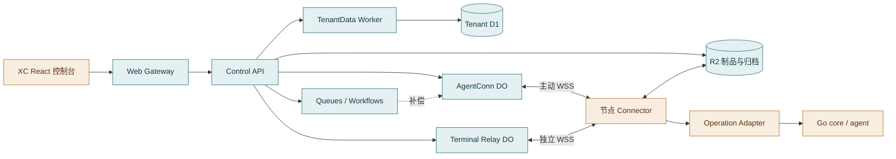

## 架构图索引

| 阅读主题 | 图示 |
|---|---|
| 架构与数据 | [首版演进](#3-首版架构与后续演进) · [部署拓扑](#一页架构总览) · [数据归属](#62-数据分层) · [持久约束](#附录-c--数据约束与操作契约) |
| 节点与命令 | [节点注册](#71-节点注册与身份建立) · [断线对账](#72-断线后的任务对账) · [命令生命周期](#8-api-兼容任务执行与-mcp) · [状态图](#a5-命令状态幂等与本地-journal) · [outbox 补偿](#a6-d1-outbox至少一次通知与跨服务一致性) |
| 终端 | [授权撤销](#73-终端授权撤销) · [实时流](#9-终端实时流与国内链路) · [会话建立](#a7-relay-角色票据与独立终端连接) |
| 交付 | [迁移阶段与依赖](#13-xc-前端与-go-完整功能迁移) · [单租户容量实验](#151-单租户容量与证据门禁) |

## 阅读路径与权威来源

| 要完成的工作 | 去哪里查 |
|---|---|
| 排期、派工、交接 | [§14 阶段退出条件](#14-迁移路线与任务级工作包)和 [Go Agent 研发计划](go-agent-development-plan.md)给出依赖、责任角色和工期。 |
| 开始 Go / Console 联调 | [GA-01 契约](go-agent-interface-contract.md)确定仓库目录和节点协议。对接注册、建连用[首次采样 JSON](examples/go-agent-first-sample.json)，对接清缓存后的概览用[逐指标读取 JSON](examples/node-metric-read.v1.json)。实测结果填入[联调验收记录](spaces/implementation-review.md)。 |
| 把一次操作从设计落实到源码 | [技术详细设计](technical-design.md)以一次重启串起三端；[Go 操作台账](operation-ledger.md)登记执行入口、取消边界和现场核验方法。 |
| 查协议、数据和迁移范围 | [附录 A](#附录-a--协议数据与可靠性细则)规定协议，[附录 B](#附录-b--v2-源码基线与完整迁移矩阵)登记源码范围，[附录 C](#附录-c--数据约束与操作契约)列数据约束和操作注册表。状态机转移取自 [command-state.json](command-state.json)。 |
| 追踪需求和发布证据 | [附录 D](#附录-d--产品需求与设备生命周期)关联产品旅程、权限与验收编号，[acceptance-ids.json](acceptance-ids.json)登记有效编号。容量口径见 [§15.1](#151-单租户容量与证据门禁)及[平台约束](platform-constraints.md)，安全边界见[威胁模型](angelfleetprd-threat-model.md)。 |
| 判断系统 OTA 和 Yocto 是否适用 | [附录 E](#附录-e--可选系统-ota-与-yocto-扩展)规定选入条件和单独验收要求。 |

# 1. 架构决策与交付边界

首版采用 XC React 前端 → Cloudflare 控制面 → connector → 本地原 core/agent。Workers 负责身份、租户、节点授权、命令准入、编排和审计；Go 继续执行 Linux、Docker、PTY、文件系统、数据库备份等主机操作。connector 首先作为独立进程接入，优先复用受控 Unix socket 路由，少量 core 专属能力通过明确的本机适配入口访问。现有业务 service/repo/utils 保留在其原有初始化与数据库环境中，不为迁移界面而整体重写。

| 决策 | 首版交付 | 后续独立演进 |
|---|---|---|
| 前端 | 复用 XC React/Next.js 工程、布局、组件、账号权限页面；逐域重建运维页面 | 1Panel Vue 只作为流程、DTO 与功能参照 |
| 云端 | TypeScript Workers、租户数据服务、审计、统一任务中心 | 按领域拆分服务，保持接口版本 |
| 节点执行 | 原 Go core/agent + connector + 操作适配器 | managed-agent 模式，逐项清除 core 依赖 |
| 控制连接 | 每节点 AgentConn DO，connector 主动 WSS | 重连代次、能力协商和持久回执保持兼容 |
| 实时流 | 每会话 Relay，两端主动 WSS | 共用会话生命周期，各业务采用独立流适配器 |
| 租户数据 | 目录库 + 租户 D1 + TenantData Worker | 分库供给、迁移与写入隔离按统一协议演进 |
| 任务 | D1 命令意图、AgentConn dispatchKick 快路径、outbox/Queues 补偿、本地 journal | 多阶段任务使用 Workflows，结果仍可从 D1 对账 |
| 文件 | R2 制品与对象通道，节点负责落盘和校验 | 分片、续传、恢复与清理完整闭环 |
| 国内接入 | 受控 CONNECT/L4 代理 | 分别验证控制、终端、文件和升级路径 |

保留 core 的首版与无 core 的 managed-agent 版本是两个交付层。换用 XC 前端不要求先删除 core；保留 core 也不免除租户隔离、可靠执行、终端撤销和生命周期验证。首版由云端接管常规管理写入，旧本地入口保留为受控兼容或恢复渠道，避免两套管理端同时修改同一资源。

上游取证覆盖 9 个 core、25 个 agent 路由组以及终端、文件分享、安装、调度等组外入口。本轮按[本轮非 AI 功能迁移清单](#137-本轮非-ai-功能迁移清单)选择具体操作。混合路由组按端点拆分，私有实现及条件能力保留处置记录。[逐端点台账要求](#136-逐功能迁移台账)

# 2. 当前 v2 与目标系统的差异

方案复用 Go 的主机业务执行内核，新增 React 运维页面、Cloudflare 控制服务与节点接入层。行数、页面数量和已有菜单不作为复用完成率。每项功能按页面、操作、权限、执行器、数据归属、任务或流协议以及验收证据建立对应关系。

| 当前事实 | 首版处理 | core 退役时的处理 |
|---|---|---|
| core 认证后通过 Unix socket 代理 agent | connector 使用白名单操作映射，云端承担租户与节点授权 | 保留受控 agent 入口，去除旧公网面板身份依赖 |
| agent 读取 core.db，core 读取节点数据库 | 保留原本机兼容栈，云端通过 API 与事件访问 | 用版本化配置投影与显式数据所有权替代共享读取 |
| core 替换 core、agent、1pctl 二进制 | 受控升级任务记录版本、恢复与结果 | 独立 updater，健康确认与回滚不依赖 core |
| 快照包含 core.db、core 二进制和服务 | 验证原快照的创建、恢复和节点身份重建 | managed manifest 与旧快照转换 |
| MCP 存在进程内 HTTP 分发 | Panel MCP、AI MCP 均退出本轮，非 AI 的容器操作直接接入受控业务适配器 | 旧实现仅作源码追溯 |
| 社区 RBAC、多节点部分方法为空 | 基于 XC 权限基础新增 SaaS 与节点授权 | 不以企业菜单或空 provider 推导能力 |
| XC 是 React，原 1Panel 是 Vue | 在 XC 组件体系中迁移业务流程和 DTO | 不混入依赖旧登录与路由语义的 Vue 页面 |

现有 agent 的内部 MCP Docker 与 website 入口列入上游盘点，本轮无对应云端入口。当前 90 秒终端租约出现在 API_AUTH 分支，浏览器 session 的统一续租需要新增。上述源码位置与前端契约在附录 B 逐项链接。

# 3. 首版架构与后续演进

首版保留本机 Go 执行栈，云端与节点之间只传递已授权操作。控制、终端和文件采用独立通道。后续 core 退役替换节点内部依赖，不改变 React 使用的领域接口。

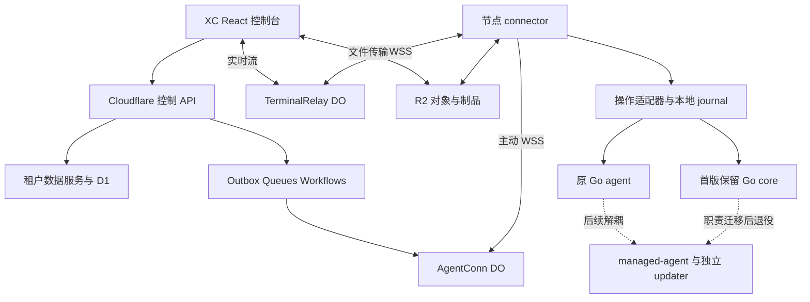

# 4. 组件职责与部署拓扑

首版部署单元同时包含云端服务、XC 静态前端和本地兼容执行栈。下表中的能力均需要真实接入与验收；保留原 core/agent 只减少业务执行器的重写范围。

| 部署单元 | 负责内容 | 关键边界 |
|---|---|---|
| xc-console | XC React 布局、账号权限、运维页面、节点上下文、任务中心 | 页面使用统一领域 API，未知节点深链接无需重新构建 |
| web-gateway | 静态资源、同域会话、CSRF、Origin、API 与 WSS 入口 | Upgrade 在普通 JSON/CORS 包装前分流 |
| control-api | 租户与节点授权、命令准入、资源目录、配置、审计 | 提交命令意图后返回稳定 ID |
| node-session | AgentConn DO、节点握手、代次、投递和结果缓冲 | 连接与执行状态分别恢复 |
| terminal-relay | 角色票据、租约、会话绑定、credit | 每会话隔离，支持撤销和受控重附着 |
| tenant-data-N | 目录映射、已绑定租户 D1 的领域接口 | 不接收客户端 SQL 或数据库标识 |
| event-consumer | Queue 通知、重试和持久接收确认 | ACK 不代表主机操作已完成 |
| orchestrator | 安装、恢复、升级、批量任务等多阶段流程 | 每步保留稳定 commandId，重试前查询结果 |
| maintenance | outbox 修复、状态对账、分库迁移、保留清理 | 游标与检查点可恢复 |
| connector | 注册、节点身份、主动 WSS、重连、文件和流桥接 | 本地密钥、固定节点归属与协议能力 |
| execution-adapter | operation 映射、journal、资源锁、本地任务关联和结果核验 | 不开放任意 HTTP 隧道；不把未知结果当可重试失败 |
| 原 core/agent | 本机业务服务、原数据库、调度与执行环境 | 首版保留；常规管理写入由云端接管 |
| managed-agent/updater | 无 core 配置来源、独立安装升级和恢复 | 作为后续 core 退役阶段交付 |

组件连接关系见[一页架构总览](#一页架构总览)。控制指令、终端流和文件传输使用各自的通道。

Worker 之间使用 Service Binding，DO 通过 namespace binding 访问，D1 通过数据 Worker 已部署的 binding 访问。Service Binding RPC 是对象能力，不等于租户授权；调用方必须等待每次调用，provider 只暴露显式领域方法并再次核对主体、tenant、角色和 command scope，记录每次 binding invocation。单次请求的 Worker-to-Worker 调用预算（官方上限 32 次）进入 CAP 指标；provider 先发布、调用方后切换，删除方法前先完成调用方迁移。公网传入的身份头在入口统一清理，服务层根据已验证主体重建调用上下文。日志中统一携带 traceId、tenantId、nodeId、commandId 或 terminalId。[Service Binding RPC](https://developers.cloudflare.com/workers/runtime-apis/bindings/service-bindings/)

DO 使用服务端 `ctx.acceptWebSocket()` 接受连接以支持休眠。connector 主动连接 Relay，使终端两端均为 DO 接受的 WebSocket。构造函数恢复附件与必要持久状态；业务按事件处理，不保持等待节点任务完成的长生命周期请求。[DO WebSocket 设计](https://developers.cloudflare.com/durable-objects/best-practices/websockets/)、[DO 生命周期](https://developers.cloudflare.com/durable-objects/concepts/durable-object-lifecycle/)

# 5. 功能完成标准与容量边界

首轮以两个租户、两台真实 Linux 节点验证完整调用链。每个功能同时核对 React 操作、云端记录与节点最终状态；页面绘制、HTTP 成功或消息已接收均不等于业务完成。功能验收和容量验收分别出具结果：两节点联调或多租户压测通过，不能证明单租户 1 万节点可用。

| 维度 | 完成条件 | 证据 |
|---|---|---|
| 功能覆盖 | 对 §13.7 纳入本轮的端点逐项核对页面、权限、operation、执行器和恢复策略。条件项须先确认目标环境 | 分别列出纳入、待条件确认、共享依赖及排除项；仅纳入项参加功能验收 |
| 节点上下文与权限 | 切租户/节点不串数据，REST、WSS、文件、分享及后台任务越权均拒绝 | 缓存、旧响应、资源归属与撤权测试 |
| 可靠执行 | 重复投递复用 commandId，响应丢失后关联原 Go 任务或进入核对 | journal、taskId/操作标记、云端结果与现场事实 |
| 实时流与文件 | 终端/日志/进程/console可撤销，有界背压；文件可分片、取消、续传、校验和清理 | 租约关闭、输出缺口、摘要与真实恢复记录 |
| 首版生命周期 | 保留 core 的安装、重启、升级、回滚、恢复和节点退役成立 | 版本、健康探针、身份与任务水位 |
| 容量 | 单租户 10k 与多租户对照分别达到冻结的混合负载和持续运行门禁 | CAP 独立报告，模拟与真实节点覆盖分开 |
| 后续 core 退役 | P6 独立完成无 core 的安装、启动、升级和恢复 | 附录 B 清单，另行接受 |

控制消息初始上限为 64 KiB，D1 保存控制元数据和索引，资源事实留在节点，原始日志和大文件走独立通道。流式处理须限定总量、时长与缓冲。容量实验分别验证热租户库、授权路径、故障积压及恢复余量。应用预算与平台套餐上限分别核对。[参数冻结表](#1536-r7-go-操作台账r8-术语与-r9-参数冻结) · [平台约束与复核日期](platform-constraints.md)

# 6. 租户分库、数据归属与一致性

## 6.1 租户供给和数据路由

目录库记录 tenantId、dataShardId、bindingAlias、regionPolicy、schemaVersion、routingVersion、status。登录身份与全局租户目录分离，租户成员权限及业务数据在租户库中。请求先确定主体有权进入的租户，再从服务端目录解析到预部署的数据 Worker。该 Worker 再确认租户与 binding 的映射，执行预定义领域方法。

租户库供给状态依次为 REQUESTED、DB_CREATED、MIGRATED、BOUND、VERIFIED、ACTIVE。自动化先建库和执行迁移，再发布含该 D1 binding 的数据 Worker，并发布上游到该数据 Worker 的 Service Binding。BOUND 同时确认这两层绑定，通过完整调用路径的读写探针后才发布目录路由。失败停留在可见状态并重试。删除按 QUIESCING、EXPORTED、UNBOUND、DELETED 推进，目录保留墓碑。Cloudflare 管理 API 凭据只供给服务和发布流水线持有。

初版建议每数据 Worker 最多 200 个租户绑定，作为可调整的发布批次预算。超过预算新增分片 Worker。所有写事务检查库内持久化 write-fence 与 routingVersion，覆盖 API、DO 结果回写、消费者和 maintenance。迁移时先关闭旧库写权限，排空在途写入并对账 outbox，再复制数据、校验行数/摘要/事件水位。目录更新新版本后启用新库对应代次的写权限，旧库保持冻结。旧 Worker 与旧缓存请求因版本或 fence 不匹配而失败。单个大租户的事件历史可按时间归档至 R2，达到热度阈值后再评审按节点组分片。 200 是应用爆炸半径预算，不是平台上限；P0 冻结 accountWorkerCount、workerTenantBindingCount、directoryShardCount、每租户节点/命令/终端配额和超额策略。Paid 账户默认 500 个 Worker、每脚本约 5,000 个 bindings，超过时进入账号池或跨账号 ADR。完成 1、200、1,000 绑定规模的真实部署、路由切换、旧 Worker drain、写 fence、发布窗口和失败回滚实验后，才允许扩大分片。

## 6.2 数据分层

| 层 | 保存内容 | 建议保留与访问方式 |
|---|---|---|
| 租户 D1 | 权限、节点、配置版本、命令、审计、索引 | 关键记录持久，历史按租户策略清理，分页使用游标 |
| AgentConn DO SQLite | 当前代次、待投递任务引用、待落库结果 | 以未完成意图为主，结果提交后按短期策略清理 |
| Relay DO SQLite | 会话绑定、票据摘要、撤销版本、租约 | 会话结束后保留最小审计关联和去重窗口 |
| 节点执行 journal | 已接收命令、本地任务映射、执行状态、checkpoint、结果 | 初始完成结果保留 30 天，清理前确认云端持久化 |
| agent 配置投影 | 已应用脚本、账户引用、告警与节点策略 | version + digest + appliedAt，保留可回退版本 |
| R2 | 备份、安装包、导出、归档日志 | 按用途设置保留、清理、完整性和下载授权 |

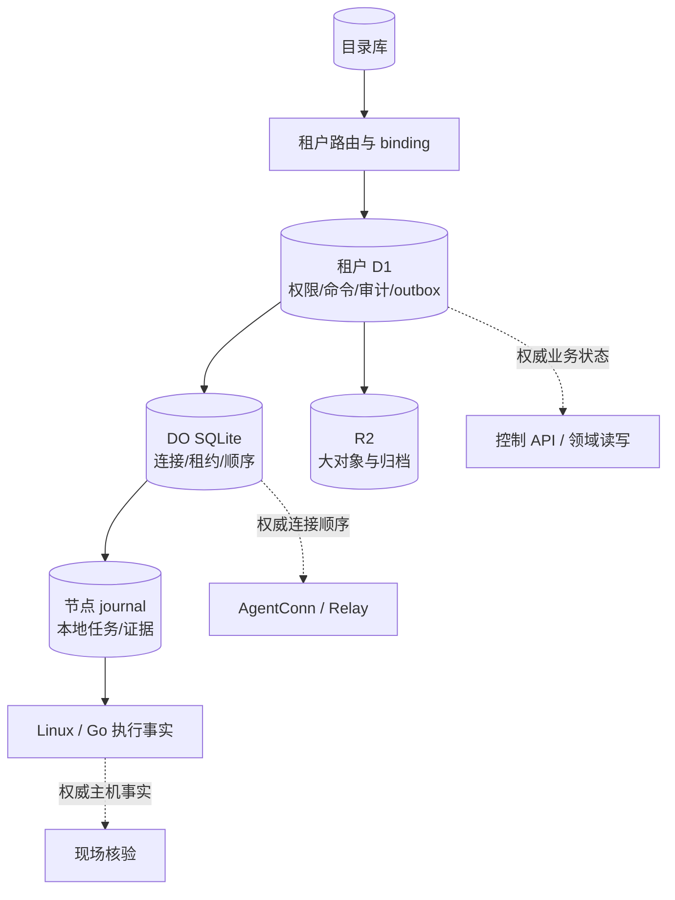

数据沿着“目录路由 → 租户状态 → 节点协调 → 主机事实”方向流动；任何一层都不能用展示缓存或客户端字段替代上游权威。

权限撤销、任务状态推进及配置修改采用主库权威读取与条件写入。目录或展示缓存具有版本与 TTL，缓存过期或授权版本不确定时重新查询。D1 read replication 仍是异步副本能力，复制延迟没有硬上界；Sessions/bookmark 只提供顺序一致读取，不把副本变成强一致主库。授权、撤销、命令状态、resourceVersion、配额和恢复读一律走 primary 或同一 Sessions；只有报表/展示查询在声明 maxStaleness、返回 served_by_region/served_by_primary 并具备 primary fallback 后才允许走副本。bookmark 丢失、lag 超阈值或复制开关关闭时回主库。[D1 read replication](https://developers.cloudflare.com/d1/best-practices/read-replication/)

## 6.3 索引与约束设计

commands 以 tenantId + commandId 为主键；幂等 key 的唯一保护由 `idempotency_receipts` 的 key guard 承担，另建 nodeId/state/createdAt 的任务查询索引。command_events 对 eventId 唯一，并按 commandId + agentEventSequence 去重。outbox 按 publishedAt/availableAt/eventId 查待发布事件。terminal_sessions 按 authSessionId/state 查撤销范围。每个索引均以实际查询和 `rows_read/rows_written` 测量评审，避免在高频摘要上无差别增加索引。

同一 D1 的 commands、初始审计与 outbox 通过 batch 原子提交。条件 UPDATE 返回零行仍属于成功 SQL，派生 INSERT 必须使用相同的赢家标识和条件，服务端读取操作结果后才返回成功。跨 D1、DO、Queues 和 R2 的状态通过幂等事件与补偿推进。关键表、字段、API 与消息示例见附录 A。[D1 批处理语义](https://developers.cloudflare.com/d1/worker-api/d1-database/)

# 7. 关键流程

以下流程展示节点注册、任务断线恢复和终端授权撤销，将持久化确认、消息确认与业务结果分开。详细协议以附录 A 为准。

## 7.1 节点注册与身份建立

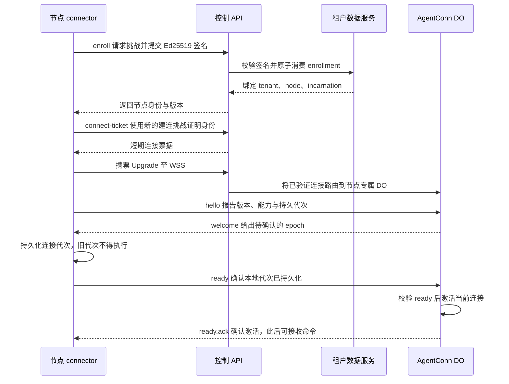

## 7.2 断线后的任务对账

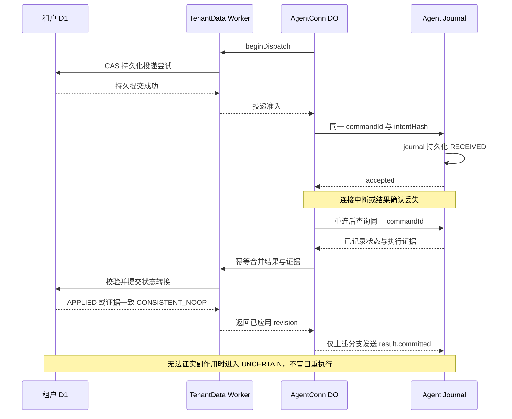

## 7.3 终端授权撤销

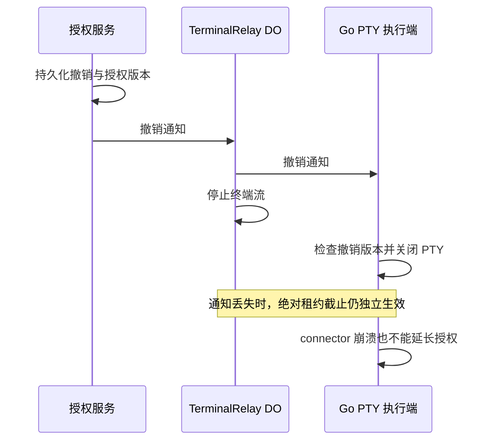

这些图是协议阅读辅助，不代表节点注册、任务执行或终端链路已通过实现验收。

# 8. API 兼容、任务执行与 MCP

XC React 页面使用新的领域 API，显式携带稳定 tenantId、nodeId、commandId 和 artifactId。服务端适配层复用原 `/api/v2/core/*` 与 `/api/v2/*` 的 DTO 和业务规则，并按需提供旧调用方兼容 facade。CurrentNode、operateNode 与 local 只在适配层解析，不能直接作为云端授权依据。原 Vue 请求拦截器、Pinia 状态和路由不迁入 React。

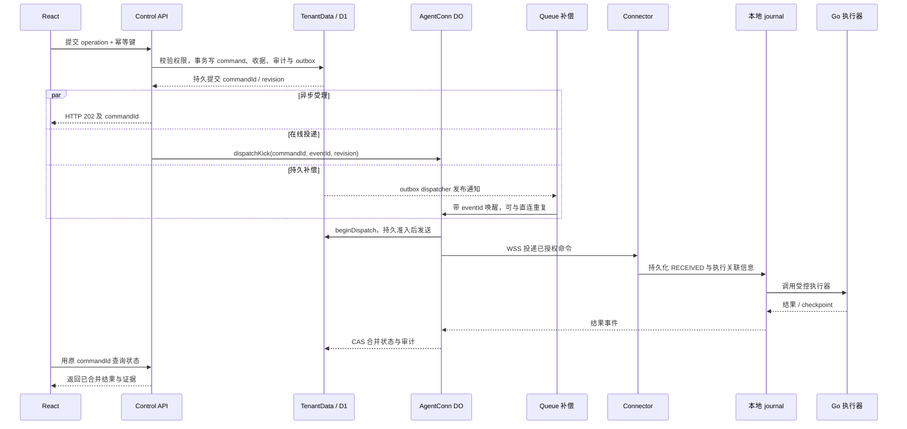

命令链路的完成条件是云端状态、节点 journal 和主机事实一致；HTTP 202、Queue ACK 或 WSS 已发送都只是中间确认。

每个操作维护版本化 registry，包含 operationName、capability、input/output schema、权限点、资源范围、nodeProfile、风险等级、离线策略、入场有效期、执行期限、幂等类别、资源锁、现场前置条件、恢复核对方法、取消边界、秘密处理和审计字段。connector 将操作映射到明确的 Go 执行器或受控 Unix socket 路由，用户不能指定任意内部 HTTP method/path、身份头或 SQL。下载源、升级包和制品安装使用受控 release/artifact 引用；文件路径、服务名和脚本等正常业务参数按各 operation schema 接收，并落实路径边界、资源授权和输入校验，不能将制品规则扩大为所有变更只能传对象引用。

查询返回数据、采样时间和 stale 状态，并设置短超时。新 React 变更操作提交持久意图后返回 HTTP 202 与 commandId，由全局任务中心展示结果。确需保留的 v2 同步接口维持旧成功 DTO，超时返回可查询 operationId，调用方重试复用幂等键。原本返回本地 taskId 的安装、恢复、升级接口映射到 cloudCommandId，不把本地任务创建成功当作业务完成；适配器同时检查 HTTP 状态和 `code/message/data` 中的业务结果。

本轮移除 Panel MCP 和 AI MCP 的用户入口、目录与调用链。纳入范围的容器、数据库和主机操作直接使用受控业务 API 和节点适配器。原进程内分发保留源码索引。[现有 MCP dispatch](https://github.com/1Panel-dev/1Panel/blob/cedb8ddda9254bdef0fddba96b7fa59c6ab8c633/core/utils/mcpapi/dispatch.go)

任务状态、幂等、取消、未知结果和恢复以附录 A.5–A.6、C.1–C.3 为唯一执行语义。本节只保留适配边界：适配器必须持久保存 `cloudCommandId`、`nodeIncarnation`、`intentHash`、`localTaskId` 或 `operationMarker`、checkpoint 和结果摘要；调用前先记录意图，响应丢失时查询原任务或现场证据，不能自动创建第二个未知副作用。无稳定关联的非幂等入口必须补 Go hook，并覆盖调用前、Go 已启动但回执丢失、结果已生成但云端未确认三个故障点。[当前 Go 异步执行](https://github.com/1Panel-dev/1Panel/blob/cedb8ddda9254bdef0fddba96b7fa59c6ab8c633/agent/app/service/app_install.go)

# 9. 终端、实时流与国内链路

每次终端创建产生独立 terminalId 和 Relay。connector 经控制连接收到 prepare 后主动建立另一条 WSS，浏览器使用独立角色票据加入。两端就绪后，由节点适配器创建或重附着原 Go PTY/SSH/容器 exec。日志尾随、进程流与 VM console 共用授权和会话生命周期，但采用各自的数据适配器。

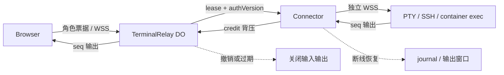

终端图只描述流通道；控制连接负责 prepare、能力和撤销通知，实时流负责字节、序号和 credit，二者不能共享无界缓冲。

SSH 保留原 Go SSH/PTY 实现及终端交互语义，界面使用 XC React 与适用的终端底层库。当前客户端使用 `InsecureIgnoreHostKey()`，因此在 P0 完成可信 host key 登记、固定校验、变更阻断和恢复 UI 前，SSH 适配不得标记为 `ACCEPTED`；未知主机密钥必须 fail-closed。维护账户与凭据使用 accountRef，长期私钥不进入浏览器。local PTY、到本机 SSH、跨主机 SSH 和容器 exec 分别声明目标、账户与权限。[当前 SSH 客户端](https://github.com/1Panel-dev/1Panel/blob/cedb8ddda9254bdef0fddba96b7fa59c6ab8c633/agent/utils/ssh/ssh.go)

终端并发、帧大小、credit、缓冲和断线恢复参数集中见附录 A.9；本节只强调控制连接与实时流分离，慢浏览器不得拖垮节点控制通道，未确认输入不得自动重放。

国内代理建立受控 CONNECT/L4 转发，海外节点直接接入。代理需覆盖长连接空闲超时、并发配额、连接速率、DNS、TLS与故障切换。R2 与安装包下载另设 egress 路由和带宽预算。代理可以改善可达性，终端体验仍由浏览器、Cloudflare 边缘、DO 所在区域、代理和 agent 的完整路径决定。

若国内用户与节点具备可达的安全 WSS 入口，PoC 同时评估短期角色票据的直连路径。直连需要可达地址、证书、Origin 校验、节点授权和租约撤销闭环，NAT 后的节点仍需入口或代理。触发条件以实际路径探测和延迟策略决定，用户界面显示当前链路并保留 Relay 回退。是否进入 v1 由第 15 节链路验收结果决定。

DO locationHint 是尽力而为的位置提示，不能据此保证城市级位置或迁移既有对象。D1 与 DO jurisdiction 可用于支持范围内的地域约束，R2、Queues、Workflows、日志和代理需要分别核对地域要求。[DO 数据位置](https://developers.cloudflare.com/durable-objects/reference/data-location/)、[D1 数据位置](https://developers.cloudflare.com/d1/configuration/data-location/)

# 10. 身份、权限与敏感数据

XC 复用账号、组织、租户、权限树与登录页面，认证实现适配为同域 Cookie 会话，配置 HttpOnly、Secure、SameSite，并实施服务端 CSRF、Origin 和会话撤销校验。当前 XC 的浏览器 Bearer/sessionStorage 实现不视为该目标已经完成。密码、MFA、passkey、API Key、账号恢复与应急管理均列入功能迁移。角色与资源权限基于服务端权限点，扩展到节点组、具体节点、容器、文件、终端和备份；原本地 1Panel 用户不直接等同于 SaaS 租户用户。

用户会话撤销、成员移除、API Key 撤销、节点停用分别提升授权或凭据版本并写入 outbox；建链和续租必须核验有效版本，无法验证时停止新授权。节点注册、短期连接凭证、终端角色票据、密钥轮换和租约以附录 A.2、A.7、A.8 为协议权威；本节只保留产品边界：停用禁止新命令和终端，已发生主机动作不能被改写成取消，票据和秘密不得进入日志。

主机私钥与节点执行所需秘密优先留在节点。确需云端保存的 DNS、备份或通知凭据采用版本化信封加密，KEK 由受控 secrets 配置持有，密文携带 keyVersion，轮换按批次重包裹。密钥取用记录主体、用途和资源，前端仅回显掩码。审计保留时间、终端录制与导出权限由租户策略明确设置。

# 11. 文件、监控与日志

上传流程为创建 artifact → 分片授权 → R2 上传 → complete → 校验 → READY。对象 key 由服务端生成，关联 tenantId、artifactId 和用途。agent 使用前检查 SHA-256、大小与操作目标，先写临时文件，完成校验后再原子替换。路径类操作复用并补测 agent 的目录边界、符号链接、权限和并发修改处理。取消操作清理分片与节点临时文件。

R2 预签名 URL、CORS、multipart 和 SHA-256 校验的协议细节以附录 A.10 为准；本节只要求浏览器直传严格绑定租户与对象，备份恢复覆盖云端索引、R2 对象和真实节点三段闭环。

监控分为链路存活、agent 健康、业务指标和长期历史。协议 ping 或自动应答维护传输，60 秒业务心跳更新 DO 当前健康，连接存续期间使用 WebSocket attachment 保存 lastSeenAt 与健康摘要，休眠重建时恢复。连接关闭后重新握手与采样，持久存储只记录必要的状态变化和业务事件。D1 默认每 300 秒按 tenantId/nodeId 覆盖更新一行最新摘要，并将各节点写入时间打散；状态变化事件独立保存。60 秒业务上报不等于每次都写入 D1。用户打开实时页面时建立有期限的高频订阅，关闭页面即降频。节点列表同时显示 lastSeenAt、sampledAt 和 stale，避免把缓存摘要误判为在线。

高频原始采样继续保留在节点。云端保存查询需要的摘要和事件，长期日志与批量时序归档 R2。状态变化与离线告警优先记录；日志正文按游标分页或独立流读取，设置上限、脱敏与保留策略。React 页面区分连接状态、健康状态和采样时间。 Workers Logs 只作短期诊断：Paid 默认保留 7 天、单条日志上限 256 KB，量大时会采样。长期审计和容量指标通过 OTel/Logpush/Tail 导出到受控存储，日志中禁止密钥、ticket、终端输入和源码映射文件。

显式 `node.inspect` 命令另有持久化时限。TenantData 将符合契约的终态探测结果与指标状态一起提交，只有有效项且来源序号较新时才更新该项最后成功值、采样时刻和来源命令，提交后再确认结果，无需等候周期遥测的 300 秒汇总。[逐指标合并规则](technical-design.md#72-节点采样怎样进入-xc-仪表盘) · [冷启动读取契约](go-agent-interface-contract.md#53-逐指标读取与冷启动展示)

# 12. 发布、升级、备份与恢复

dev、staging、prod 使用独立 Worker、DO namespace、D1、Queues、Workflow 和 R2，凭据按环境分离。CI 固定运行时兼容日期与依赖锁文件，执行类型检查、构建、协议 schema 校验、前端契约、数据库迁移和最小真实节点回归。发布先迁移兼容结构，再发布消费者和服务端，再升级 agent，最后开放新功能。 CI 还必须锁定 compatibility_date/flags、D1/DO/Queues/R2 bindings、DO migrations、Queue consumer batch/CPU、Workflow concurrency、环境/区域和 spending limits；执行 wrangler dry-run、staging binding/namespace smoke、迁移前后校验、SBOM/签名/secret scan 与部署 provenance。Service Binding provider 先发，调用方后发；更新期间按 schema 兼容和旧 epoch 重连验证。

DO namespace 按环境保持稳定，对类和存储 schema 做显式迁移。D1 使用 expand/backfill/switch/contract，前后版本兼容窗口覆盖允许离线的 agent。灰度按租户与节点队列推进，初始顺序建议内部节点、1%、10%、全量，阶段门槛包含连接成功率、任务错误、终端撤销、CPU 与写入量。 发布前冻结目标快照、并发、观察窗口、失败阈值及恢复条件，运行中不隐式加入新节点。涉及不可逆操作的批次出现 UNCERTAIN 时，默认暂停尚未启动的后续任务并继续接收已运行结果；恢复需先完成核对、更新策略版本和审计。云端回滚不代表节点副作用已撤销。

保留 core 的首版将现有节点升级包装为受控任务，记录旧/新版本、备份、执行标记、断线恢复与最终健康状态；不因连接断开就判失败或再次启动升级。connector 的版本与重启单独管理，保持与执行适配器的兼容窗口。后续 core 退役阶段再交付独立 updater：验证签名 manifest、摘要、架构、版本和磁盘空间，切换二进制与 systemd 配置，检查 agent、journal、控制连接和只读探针，失败回退到兼容版本。

首版继续支持原 core/agent 快照并验证真实恢复，额外保存 connector 身份恢复策略、执行 journal 和云端任务关联清单。恢复后先核对 incarnation、任务水位和未决操作；克隆恢复重新注册身份。core 退役阶段使用 managed 快照，包含业务数据、配置投影、journal schema、agent/connector 版本和对象 manifest，并提供旧快照提取与转换流程。

D1 Paid 提供 30 天 Time Travel，另按业务恢复要求定期导出长期副本至 R2。恢复点按组件时间、水位和 manifest 记录，恢复后先冻结新写操作，对账 outbox、DO pending 状态和 agent journal，再恢复投递。建议 PoC 验证 60 分钟内恢复控制 API 与目录，跨服务任务对账完成时间单列。RPO 按最后一致水位和节点回执实测。[D1 Time Travel](https://developers.cloudflare.com/d1/reference/time-travel/)

P0 必须冻结组件级 RPO/RTO，而不是只给控制 API 一个恢复时间：D1 primary/Time Travel、DO 状态从 D1+journal 重建、Queues/DLQ 重放、Workflows queued/state、R2 manifest 和节点 journal 分别记录最后一致水位、目标 RPO、目标 RTO、演练命令与证据。至少演练 D1/DO/Queue/R2 故障、区域不可用、账号级 Cloudflare outage 和 spending limit；恢复顺序为冻结新写、恢复权威数据、重建 DO、对账 outbox/journal、再放量。

| 故障 | 预期行为 | 运维动作 |
|---|---|---|
| D1 暂不可写 | 新变更返回明确失败，已执行结果在 agent/DO 有界保留 | 观察积压和存储水位，恢复后对账 |
| DO 部署或连接中断 | agent 抖动重连，恢复 epoch 与 journal | 检查 reconnect、旧代次拒绝和积压时延 |
| Queues 重复/延迟 | 同 commandId 去重，outbox 保留意图 | 监控 oldestPendingAge、DLQ 并可审计重放 |
| agent 断电 | 读取 journal，核对执行现场 | 对 UNCERTAIN 操作进行只读核验或人工处置 |
| 国内代理中断 | agent 保留任务与结果，切换预配置链路 | 同时验证 R2 和升级下载恢复 |
| R2 上传未完成 | artifact 维持 UPLOADING，分片重授权 | 到期清理，READY 前阻止分发 |
| 凭据被撤销 | 新请求和续租拒绝，现有终端在租期内关闭 | 审计撤销事件与所有连接结果 |
| 本地磁盘逼近上限 | 限制新任务、日志和输出，保留未确认 journal | 显示具体容量错误并清理可安全删除的数据 |

# 13. XC 前端与 Go 完整功能迁移

前端和现有管理 API 的实施仓库为 AngelFleetConsole。在 `df715b3`，React 已有管理页面、权限树和审计查询，API 已注册身份、机构、租户、角色、账号、权限和审计路由。节点域 API、AgentConn 和 Go 执行回执需要开发。1Panel Vue 用于核对业务流程、DTO、枚举和校验规则。[Console 路由](https://github.com/XCAngelWatch/AngelFleetConsole/blob/df715b38d174b2bdad7a5ab58150c05ead6c5d36/cloudflare/api/src/router.ts)

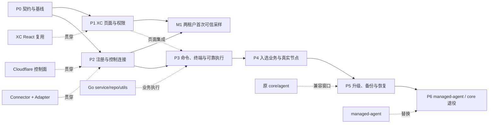

迁移按“页面 → 领域 API → operation → connector → Go 执行器 → 结果与恢复”纵切推进。前端复用不等于后端语义复用，Go 二进制保留也不等于可靠云端控制已经完成。

## 13.1 XC 公共前端基础

| 基础模块 | 可复用内容 | 必须补齐 |
|---|---|---|
| 应用壳 | 侧栏、顶栏、面包屑、主题、中英文、通知 | 节点切换、全局任务入口、运维菜单 |
| 表格表单 | 基础 UI、表单弹窗、确认框、表格样式 | 服务端分页、批量选择、日志游标、必要的大列表虚拟化 |
| 账号权限 | 用户、机构、租户、角色、权限树 | 节点和资源范围、能力检测、统一权限组件 |
| 数据访问 | API 客户端、React Query、Zustand | 查询键包含 tenantId/nodeId/资源/参数，旧请求与订阅取消 |
| 任务交互 | 通知与任务展示组件模式 | 非阻塞任务中心，关闭页面后任务继续，刷新后可查 |
| 实时与传输 | 复用通用 UI 外观 | 新建 React 终端、日志/指标订阅、VM console、可恢复文件组件 |
| 构建与测试 | 静态前端、Playwright Mock、本地 API 与 SQLite 测试宿主 | 验证新节点的深链接和权限，补充 Worker/DO 与 Linux connector 的真实联调 |

复用 Console 的 `PERMISSION_CATALOG`、`PermissionGuard` 和服务端权限检查，新增节点归属及资源范围。前端提交操作后记录固定目标节点，允许继续导航。切换节点只改变当前视图。节点本地数字资源 ID 与 nodeId 共同标识资源。

当前浏览器使用 Bearer/sessionStorage，API 普通 CORS 包装会重建 Response。节点接入需单独处理 WSS Upgrade 与 AgentConn 绑定，浏览器同域会话迁移按 §10 实施。当前 API 的数据绑定声明为 DB 和可选的登录限流 KV。可靠命令 outbox、Queues 补偿和 R2 分片校验均作为新工作包估算。[Token 存储](https://github.com/XCAngelWatch/AngelFleetConsole/blob/df715b38d174b2bdad7a5ab58150c05ead6c5d36/src/lib/utils/token-storage.ts) · [HTTP 包装](https://github.com/XCAngelWatch/AngelFleetConsole/blob/df715b38d174b2bdad7a5ab58150c05ead6c5d36/cloudflare/api/src/lib/http.ts) · [API 环境接口](https://github.com/XCAngelWatch/AngelFleetConsole/blob/df715b38d174b2bdad7a5ab58150c05ead6c5d36/cloudflare/api/src/env.ts)

## 13.2 运维页面与业务功能

本轮逐域范围、保留的数据和验收条件见[本轮非 AI 功能迁移清单](#137-本轮非-ai-功能迁移清单)。接入依据为一条完整用户操作：例如容器查看、数据库导出或文件恢复，分别连接 React 页面、授权、Go 执行与结果核验。同一路由组的其他入口仍按各自的产品范围判断。

| 界面或依赖 | 实施边界 |
|---|---|
| 控制台与节点 | 沿用 Console 的账号、租户、角色与平台审计。节点注册、连接、授权、运行命令、撤权和回执单独实施。 |
| 节点日常运维 | 保留 CPU、内存、磁盘、网络、进程、主机工具、终端和文件等面向节点的功能。同一 Supervisor 管理入口由一处实现。 |
| 容器、数据库与数据保护 | 通过 Docker/Compose、具体数据库引擎和受控归档任务操作原资源。已有安装记录与共享库仅按保留能力访问，独立管理现有容器及数据库。 |
| 条件能力 | KVM、可选主机工具和特定通知 provider 依据主机能力、版本及授权纳入，逐项留证。 |
| 排除项 | 网站、OpenResty 专项、站点证书/运行环境/备份链、应用商店、AI、GPU 监控、AI MCP 及 Panel MCP 不提供产品入口，不纳入本轮业务验收。面板或节点连接自身的 TLS、签发与轮换继续纳入安全设计。 |

组外仍需验收的入口包括健康探针、文件分享、终端与进程流、已选脚本运行、安装器、systemd、1pctl 和运维清理。VM console 随 KVM 范围验收。前端主题与发布由 AngelFleetConsole 承接。

## 13.3 Go 复用边界

首版在原 Go 进程和初始化环境中执行现有业务。connector、操作适配器和 journal 承接云端协议；SSH 适配须校验主机密钥，会话执行器强制租约。常用命令目录保存用户脚本，任务记录保存每次获准执行的状态与结果。

[附录 B.1.1](#b11-go-复用和改造分类)按保留、适配、新增和后续解耦列出改造范围；[操作台账](operation-ledger.md)逐项标明 Go 入口、关联标识、资源锁和核验方法。

## 13.4 数据归属与后台调度

| 数据 | 权威来源与同步 |
|---|---|
| 用户、租户、角色、节点权限、API Key | 云端 |
| 节点登记、公钥、能力与版本 | 云端目录；节点保管私钥 |
| 容器、数据库、主机和文件实际状态 | 节点；云端保存查询投影 |
| 命令意图与平台审计 | 云端 |
| 执行开始、checkpoint、实际结果 | 节点 journal 与现场证据 |
| 脚本、模板、Cron 和告警策略 | 云端版本，节点保存已应用投影 |
| 备份与安装制品 | 对象存储，云端索引与授权 |
| 执行秘密 | 优先留节点，必要云端副本受保护 |

保留的备份、脚本与告警计划默认由节点调度器执行。退出范围的站点续证与商店同步不接入云端调度。云端下发配置版本、展示下一次执行与历史，恢复联网后补报；同一策略不能由云端与节点同时调度。离线期间允许执行的主体是绑定已签名策略版本的 `POLICY_SCHEDULER`，它只执行此前已确认的计划，不等同于本地交互管理写入；未获策略授权的本地 API、MCP、1pctl 和人工维护写入仍受 `CLOUD_MANAGED` fence 拒绝。

## 13.5 四类接口与执行对账

| 类型 | React 契约 | 节点契约 |
|---|---|---|
| 查询 | 数据、sampledAt、stale 与明确错误 | 短超时，复用 Go 查询 |
| 变更 | HTTP 202、commandId、状态订阅 | journal 持久接收，关联本地任务，最终结果回执 |
| 实时流 | 申请 session/ticket 后建立 WSS | 固定用途、角色、节点、租约，撤销和受控恢复 |
| 文件 | artifact/transfer 状态、进度、取消、校验 | 分片、临时落盘、摘要核验、原子安装或恢复 |

网络超时展示状态待确认，不能直接宣布业务失败，也不能自动创建新命令。启动前确定拒绝使用 REJECTED，副作用是否发生不明使用 UNCERTAIN/REVIEW_REQUIRED。

## 13.6 逐功能迁移台账

逐端点台账以固定源码为盘点基线，从 §13.7 纳入的操作形成当期交付分母。取证覆盖 router、middleware、handler、前端调用、provider、动态入口、内部接口和后台生命周期；同一路由的不同方法及不同 provider 分开记录。每条绑定需求 ID、React 页面、operation、权限、资源范围、capability、Go 执行器、数据归属、接口类型、恢复/取消方式、旧数据迁移及验收证据。来源路由全部登记处置后，可复核盘点覆盖率。功能完成率仅统计当期纳入的操作；条件项获选后才加入分母，共享依赖在其所属流程内核验。

处置分类与实施状态分开保存。disposition 使用 REUSE、ADAPT、NEW、UNSUPPORTED、GAP_PRIVATE、RETIRED；status 使用 PLANNED、IN_PROGRESS、BLOCKED、IMPLEMENTED_UNVERIFIED、VERIFIED、ACCEPTED。UNSUPPORTED 必须有适用性证据，GAP_PRIVATE 保留实现缺口，RETIRED 必须记录范围决定和替代入口，均不能自动计为功能通过。已实现但缺少目标环境验证为 IMPLEMENTED_UNVERIFIED；阻塞保留原因、责任和解除条件；ACCEPTED 需要验收记录。

```text
requirementId,endpointId,routeGroupId,method,path,sourceCommit,routerFile,handlerSymbol,
provider,providerImplemented,reactPage,operation,permission,resourceScope,capability,
executorKind,usesCoreDB,usesTaskDB,localPaths,interfaceType,profile,
inputSchemaRef,outputSchemaRef,idempotencyClass,reconcileRef,cancelBoundary,
disposition,targetStage,workPackageId,acceptanceIds,status,evidenceRefs,gapDecision
```

## 13.7 本轮非 AI 功能迁移清单

本轮将日常运维入口迁至 AngelFleetConsole。Console 管用户、租户、节点授权、操作意图与审计，节点上的 Go core/agent 继续操作本机资源。**范围从原清单的 14 个业务域收窄到 12 个，其中虚拟机按 KVM 环境选入。** 网站管理、应用商店及其专用流程退出。按原清单末尾的排除项，GPU 监控与 AI、MCP 一同排除。下表给出各域的交付边界；“首批”用于首个可联调版本，“后续”表示仍在迁移范围内，具体排期取决于能力和依赖。

| 保留的功能域 | 需要迁移到 Console 的能力 | Go 与数据边界、验收重点 |
|---|---|---|
| 概览 / 仪表盘 | 首批交付节点注册、连接状态、CPU/内存及最后成功时间。后续加系统信息、磁盘 I/O、网络和 Top 进程。快捷目录归入文件管理。 | Go 在采集点产生数值与时间，云端保存逐指标最后有效值；重连、零值、部分失败和跨租户隔离分别验证。主机或面板重启走受控写命令。移除推荐应用、已装应用入口和启动器。[首采契约](go-agent-interface-contract.md#53-逐指标读取与冷启动展示) |
| 日志与审计 | 首批把登录、授权和命令结果串起来。后续接系统/主机日志、异步任务日志、查询与清理。 | 长日志留节点按授权读取，云端留事件和来源引用。越权读、撤权及清理审计可追溯；站点访问/错误日志随网站域退出。 |
| 面板设置与安全 | 复用 Console 账号、组织、租户、角色和审计。首批补节点范围与服务端授权；会话、API 凭据及证书策略按目标安全模型适配。主题、语言、菜单、备忘录仅迁实际需要的入口。 | 面板升级、回滚、设备凭据轮换和救援 CLI 保留节点能力；MFA/Passkey、旧配置及凭据兼容需逐项核验。保留面板 TLS 与节点身份认证。历史许可证与上游商业授权分别处理。[Console 现有 API](https://github.com/XCAngelWatch/AngelFleetConsole/tree/df715b38d174b2bdad7a5ab58150c05ead6c5d36/cloudflare/api/src/routes) |
| 主机管理 | 文件浏览、传输、编辑、权限、回收站/分享；监控、进程、SSH、防火墙、磁盘和挂载分批接入。 | 路径、挂载、主机账户和原始文件留节点。先读后写；停止进程、改防火墙/SSH、改磁盘须单独授权和审计。分享须验证节点归属、失效及撤销。 |
| 终端 | 本机、SSH 和容器终端；连接配置、常用命令及导入导出。 | Go 持有 PTY 或 SSH 连接。云端发限时授权并审计；续租、撤权和断线应关闭原会话。容器终端与容器管理共用目标 ID。 |
| 容器管理 | 保留 Docker 容器、镜像、registry、Compose/模板、网络、卷和 daemon 设置。先做清单与状态，再接日志、监控、构建与受控变更。 | Go 调本机 Docker。卷、Compose 文件和 daemon 配置保留原位；共享镜像、网络、卷不能按商店或站点标签批量清除。可靠写操作候选验收为独立测试容器重启，按原容器 ID 对账。[容器执行入口](https://github.com/1Panel-dev/1Panel/blob/aaba86d0ef71a31ee319e74998ffe83c64abf4b6/agent/app/service/container.go#L776-L806) |
| 数据库 | 保留已有或已登记实例的管理及远端同步。MySQL、PostgreSQL、MongoDB、Redis 分开核对库/用户、权限、状态、配置、CLI 或持久化；每个引擎只开放它实际支持的操作。 | 原面板托管实例可能依赖本机安装记录和 Compose 配置；远端实例按授权连接管理，数据留远端。取消“从商店一键装库”。验收分本机托管与已登记远端，变更按引擎核验。[数据库路由](https://github.com/1Panel-dev/1Panel/blob/aaba86d0ef71a31ee319e74998ffe83c64abf4b6/agent/router/ro_database.go) · [本地配置依赖](https://github.com/1Panel-dev/1Panel/blob/aaba86d0ef71a31ee319e74998ffe83c64abf4b6/agent/app/service/database_common.go#L92-L111) |
| 备份与快照 | 保留数据库与目录备份、备份记录、备份目标/桶和面板快照。对象存储按实际 provider、账号与还原验证逐个开放。 | Go 产出归档，保留来源、摘要和实际任务。单库恢复须回读已知数据；面板快照须另测所含内容、恢复及回滚。历史档可含站点/应用，须可识别依赖和提示，移出站点/应用专用的新建备份与恢复入口。[快照创建](https://github.com/1Panel-dev/1Panel/blob/aaba86d0ef71a31ee319e74998ffe83c64abf4b6/agent/app/service/snapshot_create.go) |
| 计划任务 | 定时命令/脚本、保留域的数据库和目录备份、通用日志任务、脚本库、导入导出、执行日志与分组。 | 明确云端配置版本和节点调度责任；断网仍按约定执行，重连核对漏跑/重复。历史网站或应用备份、站点日志切割任务列出待处置，禁止自动转成其他作业。[任务分派](https://github.com/1Panel-dev/1Panel/blob/aaba86d0ef71a31ee319e74998ffe83c64abf4b6/agent/app/service/cronjob_helper.go#L97-L139) |
| 告警通知 | 保留规则、记录、测试和投递结果。先接邮件及已验证的社区自定义 Webhook；短信等渠道按实际 provider 与授权选入。 | 规则可由控制台管理，节点采集和执行；记录触发来源、去重与投递结果。不能把一次测试请求成功计为真实告警已送达。[社区通知实现](https://github.com/1Panel-dev/1Panel/blob/aaba86d0ef71a31ee319e74998ffe83c64abf4b6/agent/utils/xpack/helper/alert.go) |
| 工具箱 | DNS/Hosts、主机名、时区/NTP、Swap、系统凭据设置和清理分批接入。Supervisor 在主机与工具箱共用一个入口；ClamAV、Fail2Ban、FTP 按节点能力开放。 | 复用本机服务和配置；先探测组件与权限。变更后回读状态，提供错误及可恢复证据。移除组件缺失时的商店安装引导。 |
| 虚拟机（可选） | 有 KVM 且版本/许可满足时，接入 VM 生命周期、镜像、盘、虚拟网络、快照和控制台。 | 单独核对 KVM、存储池、磁盘镜像和 noVNC 会话；用真实来宾及磁盘数据验证恢复。普通节点通过能力探测说明缺项。[虚拟机入口与配额](https://github.com/1Panel-dev/1Panel/blob/aaba86d0ef71a31ee319e74998ffe83c64abf4b6/agent/app/api/v2/vm.go) |

**退出边界。** 网站域移出站点 CRUD、域名、站点 HTTPS/ACME/DNS 账号、站点模板、各语言网站运行环境、反向代理、OpenResty 配置/模块、WAF、站点专用备份/恢复及日志。商店域移出应用目录、推荐、商店同步、安装/升级/卸载、参数配置、应用级备份和自定义商店。已经运行的容器、数据库和挂载卷可从保留域按权限运维。移交时记录原安装关联、历史作业和档案，原资源及历史数据保留。云端需要自有多租户和节点授权；迁入上游企业集群、商业 RBAC、SSO 或私有 provider 须另立范围。

**派工顺序。** 先做 GA-01 至 GA-10 的注册、建连、概览、授权与真机验收。随后用独立测试容器验证可靠写入，再用已登记的隔离测试库验证备份、恢复及回滚。后两项是替代原 OpenResty/网站样板的候选，实施前核定目标权限、操作名、证据和工时；可复用原协议，须重新取得目标场景的执行证据。一个可复现的 MySQL 场景是在同一隔离库写入 A、备份、改为 B，再恢复并回读 A。远端来源也须验证节点上的客户端镜像；快照恢复另验。[当前派工状态](go-agent-development-plan.md) · [MySQL 实例来源](https://github.com/1Panel-dev/1Panel/blob/aaba86d0ef71a31ee319e74998ffe83c64abf4b6/agent/app/service/database_mysql.go#L1628-L1668) · [MySQL 恢复实现](https://github.com/1Panel-dev/1Panel/blob/aaba86d0ef71a31ee319e74998ffe83c64abf4b6/agent/app/service/backup_mysql.go#L112-L226)

**盘点口径。** 本次核对本地 1Panel `dev-v2@aaba86d` 与 Console `main@df715b3`。当前上游 `frontend/src/routers/modules/` 有 13 个 TypeScript 文件，首页和扩展另有注册；附录 B 的 34 个 core/agent 路由组是源码盘点基线。验收以本节保留的具体能力、适用环境和证据逐项计数。数据盘点按配置的安装根目录和实际文件执行；除 core、agent、task、alert 等库，上游还打开监控数据库。core 与 agent 的备份服务各有账号加密写入路径；迁移时按实际账号归属验证备份可读、样本可恢复。[core 备份账号](https://github.com/1Panel-dev/1Panel/blob/aaba86d0ef71a31ee319e74998ffe83c64abf4b6/core/app/service/backup.go#L90-L98) · [agent 备份账号](https://github.com/1Panel-dev/1Panel/blob/aaba86d0ef71a31ee319e74998ffe83c64abf4b6/agent/app/service/backup.go#L197-L205)。[前端路由组装](https://github.com/1Panel-dev/1Panel/blob/aaba86d0ef71a31ee319e74998ffe83c64abf4b6/frontend/src/routers/router.ts) · [core 数据库初始化](https://github.com/1Panel-dev/1Panel/blob/aaba86d0ef71a31ee319e74998ffe83c64abf4b6/core/init/db/db.go) · [agent 数据库初始化](https://github.com/1Panel-dev/1Panel/blob/aaba86d0ef71a31ee319e74998ffe83c64abf4b6/agent/init/db/db.go)

# 14. 迁移路线与任务级工作包

2026-11-19 核对本地源码后，P1 与 P2 的首个联合交付定为注册后首次可信采样。先做可在两租户、两台 Linux 节点复验的只读链路，再开放可能改变主机状态的命令。近期工作按[Go Agent 研发计划](go-agent-development-plan.md)逐项派工，通用命令、备份和恢复按保留目标派工。旧 OpenResty 重启与网站备份/恢复仅保留历史设计记录，不能凭原工单计入本轮成绩。[操作台账](operation-ledger.md)

| 阶段 | 可交付结果 | 依赖与退出条件 |
|---|---|---|
| P0 基线与契约 | 固定源码版本，按 34 组及组外入口补齐盘点，对照 §13.7 逐项定范围 | 冻结当期操作、适用环境、协议和证据口径，另列未选与依赖项 |
| P1 XC 公共前端 | React 身份/权限、租户节点上下文、任务中心、领域 API | 依赖 P0；可与 P2 并行，最终用真实接口验证隔离、深链接和任务跨页 |
| P2 Go 兼容接入 | 原 core/agent + connector、节点身份、注册与只读纵切 | 依赖 P0；两租户两节点联调、越权拒绝、断线恢复 |
| P3 公共协议 | 可靠命令、Go 任务关联、取消/核对、终端/流/文件 | 依赖 P2 和冻结契约；与 P1 集成，重复、失联、撤销及校验通过 |
| P4 本轮业务迁移 | 按 §13.7 确认的运维、容器、数据库和数据保护等业务域开发 | 依赖所需 P1/P3 能力；各域可并行，真实正常、失败及恢复逐项验收 |
| P5 首版生命周期与集成 | 保留 core 的安装、升级回滚、旧数据/快照恢复、轮换退役与运维交接 | 底座可在 P0/P2 后开工；最终汇合 P1–P4，完成功能、容量和恢复门禁 |
| P6 后续 core 退役 | managed-agent、配置投影、独立 updater、快照转换 | 独立范围与版本；无 core 生命周期及附录 B 条件全部通过 |

P0–P5 的首版保留本机 core/agent。P6 切换时逐节点冻结写入、导出并校验数据、安装配置投影、提高连接代次、移交写入权，再停 core。回退前核对在途任务与数据兼容性。普通服务器的首版退出条件独立于系统 OTA 和 Yocto。

**派工。** 每包绑定需求、端点、验收及故障用例，明确仓库和可改目录、依赖、契约版本、检查命令及预期结果。按功能覆盖涉及的 React、云端权限、Go 适配、迁移和恢复。首轮直接使用[Go Agent 研发计划中的工单](go-agent-development-plan.md)，进度和处置枚举统一使用 [§13.6](#136-逐功能迁移台账)。

**交接。** 记录源码和构建版本、dirtyPatchHash、实际检查命令与退出码、证据位置、未决任务、现场状态、回退边界及下一包的可改目录。契约变化后需重验受影响用例。三端联调按[验收记录](spaces/implementation-review.md)填写。

# 15. 功能、容量验收与架构决策

| 验收包 | 必须覆盖的场景 | 输出 |
|---|---|---|
| AC-UI 权限与上下文 | 登录、节点切换、深链接、缓存隔离、任务跨页、各入口越权 | React 与真实 API 端到端证据 |
| AC-CMD / FI-CMD 可靠命令 | outbox 中断、重复、Go 已执行但响应/taskId丢失、节点崩溃、确定拒绝与未知结果 | command/journal/本地操作及现场关联；未知不重放 |
| AC-STREAM / FI-LEASE 流与文件 | 各类会话、慢消费者、撤销丢失、connector崩溃、Go执行器租约、分片/取消/续传 | 关闭时限、缓冲水位、缺口、摘要和清理 |
| AC-DOMAIN 业务 | 按 §13.7 已入选操作及适用环境对照附录 B 源码，逐项核验 Go 执行与业务结果 | 当期分母、失败、缺口与复测，另列排除及条件能力 |
| AC-LIFE / FI-RESTORE 首版生命周期 | 保留 core 的安装/重启/升级回滚、旧数据/快照恢复、身份轮换退役、跨存储水位不一致 | 节点前后版本、恢复点、任务对账和单写者 |
| AC-SEC / FI-SEC 安全对抗性验收 | 路径与命令注入、票据伪造/重放、爆破限流、WSS Origin/CSRF、预签名 URL 越权、跨租户引用和日志泄密 | 攻击输入、拒绝结果、限流、审计和脱敏证据 |
| NET 链路 | 海外/国内浏览器与节点、API/Relay/R2/包源、代理切换 | 分方向可达性、绝对延迟、断开与恢复 |
| P6-AC 后续退役 | 无 core 安装/启动/升级/恢复及附录 B 退役条件 | 单独报告与接受依据 |

## 15.1 单租户容量与证据门禁

固定基础负载为每节点 30s 授权复核、60s 业务上报、300s 摘要落库，使用分散相位；突发恢复另测。1 万节点平均约 333 次逻辑授权检查/秒，不等于 333 条 SQL；必须记录实际缓存、RPC、SQL、DO事件与延迟。业务上报不要求每次写 D1，摘要覆盖写和状态事件分别计量。

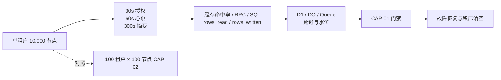

CAP-01 的单租户热库实验与 CAP-02 的多租户对照实验分别报告。

容量预算先写成可复算基线：30 天、10,000 节点对应逻辑授权复核 864,000,000 次、60 秒心跳 432,000,000 次、300 秒摘要覆盖 86,400,000 次；72 小时对应 86,400,000、43,200,000、8,640,000 次。摘要覆盖不是同等数量的新行，但 UPDATE、索引、审计、故障积压和重试的写放大必须单独计量。单次 30 秒复核拆成 tenant/node shard 批次，初始每批不超过 500–1,000 节点，受 1,000 queries/invocation、10,000 subrequests 和 32 次 Worker invocation 预算约束，最终数值由 CAP-01 冻结。 CAP-01 必须同时跑稳定负载、10k 节点随机重连风暴、授权撤销风暴、D1/DO/Queue 限流、R2 管理操作受限和 Workflow 排队；冻结 p95/p99、错误率、D1 query duration/queue wait/overloaded、rows_read/rows_written、oldestOutboxAge、DO 高水位、Workflow oldestQueuedAge、DLQ 进入率、积压清空时间和回滚阈值。未冻结前只能标记设计目标，不能宣称容量通过。

| ID | 独立实验 | 必须证明 |
|---|---|---|
| CAP-01 | 一个租户 10,000 节点，连续 72h 混合负载 | 热库/授权吞吐、API与投递延迟、错误率、积压年龄、资源水位及恢复 |
| CAP-02 | 100 租户×100 节点，连续 72h，同总负载 | 多租户对照与隔离；不得替代 CAP-01 |
| CAP-03 | 10k 重连、错误凭据、撤权/租约消息丢失 | 恢复分布、旧epoch拒绝、撤销时限、重试预算与控制通道可用性 |
| CAP-04 | D1不可写、消费减速、限流及恢复 | 显式overload、背压、不丢关键结果；解除故障后积压可在冻结时限内清空 |

P0 在压测前冻结负载文件与摘要：命令/秒及操作比例、突发幅度/时长、每命令事件和审计量、列表查询并发、终端并发/输出速率/慢消费者比例、文件并发/大小/分片。CAP-01/02 均叠加这些负载，不能以空闲 socket 或零任务通过。API 云端 p95≤300ms、在线命令持久接收 p95≤2s、95%有效节点120s内重连，作为待 P0 确认的设计目标；错误率、p99、最大积压和清空时限也须预先明确。目标未冻结不得宣告容量通过；失败后不能通过放宽参数追认本轮结果。必要调整走 ADR、影响说明和新一轮验收。

延迟区分云端处理、持久接收与业务完成；平台错误、超时、容量拒绝及预期权限拒绝分别统计，不能删除超时样本改善分位数。记录故障开始、解除与积压清空时间，明确恢复前后水位。

证据按 `evidence/<stage>/<runId>/` 或 P0 映射的等价目录保存：manifest（源码/dirtyPatchHash/构建/拓扑/负载摘要）、checks（实际命令/退出码）、assertions（AC/FI/CAP/NET预期/实际/状态）、metrics原始样本、脱敏logs、恢复artifacts和limitations。模拟连接、Cloudflare实测、真实Linux及真实设备覆盖分别报告；保留失败与复测版本。

功能验证通过可形成待验收候选，不代表 P5 已 ACCEPTED。若 CAP-01 未验证，候选必须标注容量未验证；按单租户 1 万节点范围接受和发布，必须通过 CAP-01 及其余适用门禁。首版接受、生产发布授权和上线后的月度观测分别记录；72h不能证明月度SLO。

## 15.2 ADR 决策记录

| 编号 | 当前决定 | 复审触发条件 |
|---|---|---|
| ADR-01 | XC React + Workers + connector + 原 Go core/agent 首版 | 某保留业务无法在受控本机入口安全适配 |
| ADR-02 | Go 业务内核复用，接入与可靠执行边界新增 | 某操作无法恢复关联或核验副作用，需执行器 hook |
| ADR-03 | 控制 DO 与每会话 Relay 分开 | 流恢复、隔离或代理链路无法满足功能要求 |
| ADR-04 | 租户 D1 与数据 Worker，统一数据权威 | 分库供给、迁移或热租户出现实测瓶颈 |
| ADR-05 | outbox + 至少一次通知 + 节点 journal | 某操作缺少可验证幂等或结果核对方法 |
| ADR-06 | R2 文件制品，独立分片与验证 | 链路或数据驻留要求无法满足 |
| ADR-07 | 统一终端租约、单次角色票据 | 撤销、恢复或节点执行器关闭机制不成立 |
| ADR-08 | core 退役为 P6 独立交付 | 共享数据、updater、快照转换及无 core 验收全部就绪 |

复审 ADR 时记录原因、受影响阶段与需要重验的用例。保留未运行、失败、不适用及私有能力缺口的处置记录。[验收记录](spaces/implementation-review.md)

## 15.3 实施门禁与参数冻结

本节是实施门禁索引，字段、状态和 SQL 实现以附录 A/C 为权威，验收编号以 [`docs/acceptance-ids.json`](acceptance-ids.json) 为唯一注册表，避免同一契约在多处独立演进。本轮业务验收以 §13.7 的范围处置为准；新增参数和状态在 P0 通过真实代码、Cloudflare 配置与实验结果冻结前，均保持 `待 PoC` 或 `PLANNED`。

### 15.3.1 R1 命令状态、并发事件与证据裁决

命令的执行事实、取消意图和对账状态不能由一个字段互相覆盖。规范状态记录至少包含 `state`、`lastKnownExecutionState`、`cancelIntent`、`reconcileState`、`sideEffectExtent`、`evidenceRefs` 和 `revision`。完整状态集合与 39 条允许边以版本化 [`docs/command-state.json`](command-state.json) 为唯一机器可读权威；下表是实现评审使用的异常与竞争事件索引，不得据此推导未列出的正常路径。CAS 合并函数和状态图必须逐边对照该 fixture。

| 事件索引 | 允许来源 | 目标 | 守卫与证据 |
|---|---|---|---|
| 投递确认超时/失联 | DISPATCHED、RECEIVED、RUNNING、CANCEL_REQUESTED | RECONCILING | 保留最后可信状态；必须生成对账请求，不得直接判失败 |
| 取消请求已接受 | DISPATCHED、RECEIVED、RUNNING | CANCEL_REQUESTED | 记录取消意图和操作者；不得覆盖已经确认的副作用 |
| 证实未启动且取消完成 | CANCEL_REQUESTED、RECONCILING | CANCELLED | 节点 journal 或现场证据证明未启动；`sideEffectExtent=NONE` |
| 取消与执行结果竞争 | CANCEL_REQUESTED、RECONCILING | SUCCEEDED、FAILED 或 REVIEW_REQUIRED | 按已核实的执行结果合并，证据冲突转人工。取消生效前已产生副作用时记 `cancel_ineffective=1`，保留取消请求的生命周期值 |
| 证实未启动且过期 | DISPATCHED、RECEIVED、RECONCILING | EXPIRED | 只能依据可信未启动证据；已启动任务不得标为过期 |
| 核对证实完成/失败 | UNCERTAIN、REVIEW_REQUIRED | SUCCEEDED 或 FAILED | 只读核验、checkpoint 或现场事实满足操作契约 |
| 核对后仍无法安全判定 | UNCERTAIN | REVIEW_REQUIRED | 保留冲突证据并交人工。已有人工待决记录可追加证据，保持当前状态 |
| 人工或最终结论后的晚到结果 | 已有结论 | 保留原命令状态 | 按事件 ID 和节点事件序号去重。证据一致记 `CONSISTENT_NOOP` 并保存已应用 revision；冲突记 `CONFLICT`、追加审计并核对 |

终态集合为 `{SUCCEEDED, FAILED, CANCELLED, EXPIRED, REJECTED, REVIEW_REQUIRED}`。`CANCELLED` 表示停止后续执行，不表示已回滚；`sideEffectExtent` 取 `NONE/PARTIAL/FULL`，实际回滚必须是操作契约声明的补偿步骤并创建关联的新 `commandId`。人工处置记录处置人、时间、权限、依据证据和结论；`UNRESOLVED` 保留 `REVIEW_REQUIRED`。AC-CMD/FI-CMD 增加取消/完成竞争、部分副作用、人工未决、人工后晚到结果一致与冲突、RUNNING 失联六类用例。

### 15.3.2 R2 云端幂等记录与节点去重分层

FI-CMD 分开验证云端收据和节点去重记录。覆盖收据正文、仅存 key guard 和 guard 已清理，并分别验证节点 tombstone 存在与清理时的结果。撤权后重试应被拒绝；修改资源版本或延长时限须按新意图处理。HTTP 判定顺序及保留窗口见 [A.4](#a4-数据模型与对外-api)，节点重复投递与效果去重见 [A.5](#a5-命令状态幂等与本地-journal)。

### 15.3.3 R3 授权缓存、撤销传播与租约上界

90 秒租约和 30 秒续租是失联兜底设计，不是已验证的撤销 SLO。授权缓存必须携带 `verifiedAt`、tenant、node、incarnation、credentialVersion、authorizationVersion 和硬过期时间。缓存命中不得重新签发滑动的 `now + 90s` grant；每次续租满足：

```text
leaseUntil <= min(
  issuedAt + 90s,
  verifiedAt + maxAuthorizationStaleness,
  sessionExpiresAt,
  credentialExpiresAt,
  nodeAuthorizationExpiresAt
)
```

`maxAuthorizationStaleness`、正常撤销传播目标和故障上界均待 PoC 冻结；`p95≤5s` 只能作为候选目标。当前参数可推导通知丢失时的保守硬边界为 `90s + 15s clockUncertainty = 105s`，若实测时钟不确定度或调度延迟更高，必须取更大值并更新参数冻结表。撤销观测从 D1 授权版本提交开始，分别测量拒绝新准入、停止投递和关闭 PTY。已获知撤销版本的端点立即拒绝旧 grant；网络隔离且尚未知撤销的执行端只能依靠绝对 `leaseUntil` 停止，不能宣称即时拒绝。CAP-03 分通知可达与通知丢失两种条件报告，并验证缓存命中不会延长旧授权。

### 15.3.4 R4 节点写入控制与跨入口互斥

首版在节点实际 Go service 变更入口强制 `managementMode ∈ {CLOUD_MANAGED, LOCAL_MAINTENANCE, POLICY_SCHEDULER}` 与持久 `fenceVersion`，而不是只在 connector 或 React 层隐藏入口。覆盖 core API、agent socket、1pctl、保留的 Cron 与维护任务。旧站点、商店或 MCP 入口若能修改同一保留资源，核验该入口与本轮写操作之间的隔离。`POLICY_SCHEDULER` 仅允许已签名且已确认的策略版本、到期时间和资源锁，不允许临时人工参数；`LOCAL_MAINTENANCE` 是本地交互恢复主体，进入后暂停云端新写入。维护进入、超时和离线回切由节点本地 watchdog 根据持久 deadline 执行，恢复联网后再由云端核对 fence 和水位。本机 root 能绕过 fence 属于运维信任边界，应记录为已知限制并通过漂移检测发现，不能宣称由协议防住。

命令创建时保存当时的 `fenceVersion`；`beginDispatch` 和本地 Go 入口必须同时核对节点当前 fence，维护期间冻结旧 fence 的新写入，回切后重新授权或进入核对。进入 `LOCAL_MAINTENANCE` 前排空或标记在途任务、提升 fence、记录操作者和原因；维护超时自动回切并重新核对水位。资源锁矩阵覆盖容器配置变更与重启的实例锁、数据库恢复与容器更新的 volume 锁、快照恢复与 Cron 备份的节点/数据锁、升级与所有破坏性操作的节点锁。`commandId` 去重只解决同一命令重复，不能替代不同入口对同一资源的互斥。AC-LIFE 核对云端写入与 Cron、容器配置变更与重启、恢复与备份三组并发用例。

### 15.3.5 R5–R6 容量实验与 Cloudflare 硬约束

命令投递不能把 Queues 当作有界低延迟通道。官方默认 `max_batch_size=10`、`max_batch_timeout=5s`，单条失败默认可能导致批次重投；即使设置 `max_batch_timeout=0`，官方 Workflows 示例也说明队列交付通常需要数秒，偶尔可能超过一分钟。因此 `online command persistent receive p95≤2s` 只绑定提交后的控制面直连快路径：TenantData/控制 API 在 D1 提交成功后，以有界超时调用对应 AgentConn 的 `dispatchKick(commandId, eventId, revision)` RPC；DO 再执行 `beginDispatch`、持久化准入并通过已建立的 WSS 投递。直连失败不丢失意图，持久 outbox 仍经 Queues 消费者补偿，补偿路径单独报告分位数和 `oldestOutboxAge`，不得与 2 秒目标混算。命令 Queue 在 P0 冻结 `max_batch_size=1`、`max_batch_timeout=0`，逐条 `ack()`；低负载、峰值、队列交付延迟、直连失败、重复 kick 和故障恢复分别压测。[Queues 批处理与重试](https://developers.cloudflare.com/queues/configuration/batching-retries/)、[Queues 触发 Workflows 示例](https://developers.cloudflare.com/workflows/examples/trigger-from-webhook/)

CAP-01 以单租户 D1 和每节点 AgentConn 为主要容量风险。平台限制、套餐、抓取日期和官方链接集中见 [`docs/platform-constraints.md`](platform-constraints.md)；本节只规定实验口径：记录授权缓存命中率、真实 SQL/批次数、排队时延、`rows_read/rows_written`、事件和审计增长、归档阈值与恢复余量。负载预算不能把 333 次逻辑授权检查直接当成 333 条 SQL；必须证明缓存命中和 batch 后的串行时间总和低于 1 秒并留有恢复余量。

实现层面仍要逐项压测平台负向边界，具体数字以 [`docs/platform-constraints.md`](platform-constraints.md) 的快照为准；记录 `overloaded`、`SQLITE_FULL`、队列限流、排队时延和清空时间。AgentConn 的 64MiB 只是应用层未确认结果预算，不是平台上限；10,000 个对象同时达到该预算约 625GiB/671.09GB，是积压容量压力测试的理论值，不是正常内存占用。高水位 48MiB 时暂停新普通任务，保留结果确认、撤销、取消、健康恢复和对账通道；DO 达到存储上限时写入失败但读与 DELETE 仍可用，故障矩阵必须验证清理与恢复。摘要为每节点覆盖一行，存储增长预算应单算 commands、events、audit、tombstone、索引和故障积压，不把摘要写次数当新增行数。费用模型仍不属于本文。

### 15.3.6 R7 Go 操作台账、R8 术语与 R9 参数冻结

[C.2 操作注册表](#c2-operation-registry-初始示例)定义每项操作的权限、执行前提与恢复约束；[Go 操作台账](operation-ledger.md)逐项登记源码提交与符号、适配范围、taskId 或 operationMarker、取消边界、只读核验、跨入口锁和 AC/FI/CAP/NET 证据。已核对上游入口的操作仍需完成产品适配和联调。

版本/代次含义集中如下，正文中的同名字段必须遵循这一表：

| 名称 | 语义 | 权威存储/校验点 |
|---|---|---|
| `nodeIncarnation` | 节点身份代次；重装、克隆或 journal 丢失后改变 | 节点身份与 journal；建链、任务和事件 |
| `connectionEpoch` | 节点连接代次；旧连接不得投递新命令 | AgentConn DO 与 agent journal；ready 激活 |
| `revision` / `entityRevision` | 行或实体的 CAS 版本 | 租户 D1；每次条件写入 |
| `authorizationVersion` | 成员、节点或会话撤销代次 | TenantData 与 Relay/agent grant |
| `credentialVersion` / `keyVersion` | 节点凭据或密钥轮换代次 | 节点目录与密钥元数据 |
| `leaseSequence` | 同一终端租约的单调续租序号 | Relay 与 agent；续租/每帧 |
| `agentEventSequence` | 单节点身份、命令域内的结果序号 | journal 与 command_events |
| `schemaVersion` / `capabilityVersion` | 数据结构或节点能力契约版本 | DO attachment、节点目录、握手 |
| `routingVersion` / `roleGeneration` | 数据分片路由或终端角色代次 | 目录库、Relay；建链和票据消费 |

参数冻结表由 P0 维护；当前只列初始值和状态：

| 参数 | 初始值 | 状态 | 验证实验 |
|---|---:|---|---|
| 连接授权租约上限 | 90s | 待 PoC | CAP-03 |
| 续租周期 | 30s + jitter | 待 PoC | CAP-03 |
| `maxAuthorizationStaleness` | 待定 | 待 PoC | CAP-03 |
| 命令队列 batch size/timeout | 1 / 0s | P0 冻结候选 | CAP-01、CAP-04 |
| HTTP 幂等收据 / key guard | ≥14d；破坏性操作 ≥30d | 待 P0 冻结 | FI-CMD |
| 节点 command tombstone | ≥30d | 待 PoC | FI-CMD |
| 补偿扫描周期 | 60s | 待 PoC | CAP-04 |
| AgentConn 结果高水位 | 48MiB / 上限 64MiB | 待 PoC | CAP-01、CAP-04 |
| 终端并发上限 | 8 / 节点 | 待 PoC | CAP-02、NET |
| 终端二进制帧 | 16–32KiB | 待 PoC | CAP-02 |
| 终端方向未确认窗口 | 256KiB | 待 PoC | CAP-02 |
| 终端总缓冲 | 1MiB / 会话 | 待 PoC | CAP-02 |
| 终端断线保留 | 1MiB 或 30s | 待 PoC | CAP-02 |
| 待投递上限 | 1,000 条或 8MiB / 节点 | 待 PoC | CAP-01、CAP-04 |
| journal 应急磁盘余量 | 50MiB | 待 PoC | CAP-04 |
| R2 分片大小 | 16–64MiB | 待 PoC | CAP-02、NET |
| R2 分片 URL 有效期 | 15min | 待 PoC | CAP-02 |
| 节点 enrollment ticket 有效期 | 10min | 待 PoC | DEV01、DEV02 |
| 终端角色 ticket 有效期 | 60s | 待 PoC | AC-TERM、FI-LEASE |
| 终端建立预留超时 | 30s | 待 PoC | AC-TERM、FI-LEASE |
| 连接凭证有效期 | 5min | 待 PoC | CAP-03 |
| 节点业务心跳 | 60s | 待 PoC | CAP-01、CAP-04 |
| WebSocket 协议 ping | 30s | 待 PoC | NET |
| D1 摘要覆盖写周期 | 300s | 待 PoC | CAP-01、CAP-04 |
| 订阅监控频率 | 按页面订阅短时提高 | 待 PoC | NET |
| 重连退避 | 1–60s + full jitter | 待 PoC | CAP-04、NET |
| 每 TenantData Worker 绑定预算 | 200 租户 | P0 爆炸半径预算，不是平台上限 | CAP-01、CAP-04 |
| 控制消息内联上限 | 64KiB | 待 PoC | CAP-01 |
| 单条结果内联上限 | 64KiB | 待 PoC | CAP-01 |
| 命令入场有效期 | 7d | 待 PoC | FI-CMD、CAP-04 |
| 命令交付重投窗口 | 14d | 待 PoC | FI-CMD、CAP-04 |
| 策略离线最大窗口 | 待定 | P0 冻结 | FI-CONFIG、NET-POLICY、CAP-04 |

### 15.3.7 R10–R12 追踪与兼容边界

需求矩阵包含 `REQ11 容量与恢复余量`，覆盖 CAP-01、CAP-02、CAP-03、CAP-04、D1/DO/Queue 水位、归档与恢复；包含 `REQ12 链路可达性与延迟`，覆盖 NET、国内/海外路径、API/Relay/R2/包源切换。每个 AC、FI、CAP 和 NET 项必须在需求矩阵中有至少一个 REQ，反向也必须有验收证据。协议兼容包含 `minSupportedProtocol`、最低安全版本、最大允许离线窗口和不兼容节点的最小恢复/签名升级路径；不能因旧节点无法接收普通升级命令而形成升级死锁。

实施门禁、参数冻结和验收注册表共同构成当前交付基线。任何契约变更必须同步更新附录 A/C、机器可读 fixture、验收 ID 和对应检查；未通过真实代码、Cloudflare 配置、真实节点或容量实验的内容保持 `PLANNED`、`待 PoC` 或 `IMPLEMENTED_UNVERIFIED`，不因文档存在而自动升级状态。

## 15.4 P0 发布阻断项

P0 确定下表的发布标准，各实施阶段逐项提供证据，P5 汇总生产就绪结论。M1 的退出条件是 GA-10 的两租户两节点实测。单租户容量、供应链和灾备由对应发布门禁另行验收。

| 阻断项 | 必须有的证据 |
|---|---|
| Cloudflare staging smoke | Worker/DO/D1/Queues/R2/Workflow 真实绑定、迁移、回滚和环境隔离 |
| 单租户 CAP-01 | 10k 稳态、重连风暴、撤销风暴、限流与积压恢复，指标阈值冻结 |
| 跨存储对账 | D1 command/outbox、AgentConn DO、节点 journal 的重复、迟到、孤儿和撤销胜负规则与修复扫描 |
| Connector 供应链 | 签名 manifest、root of trust、anti-downgrade、崩溃回滚、版本兼容矩阵和密钥轮换 |
| 灾备演练 | D1/DO/Queue/Workflow/R2/节点 journal 的 RPO/RTO，区域、账号和 spending-limit 故障 |
| 端点覆盖 | route registry 生成 endpoint→page→permission→operation→adapter→evidence 清单；破坏性、恢复、升级、文件、终端和配置操作逐项映射 |
| 安全边界 | SSH host-key pinning、命令参数边界、日志脱敏回归、租户配额、导出/删除和审计保留策略 |

Hyperdrive、OTA/Yocto、managed-agent 退役以及本轮已排除的网站、应用商店、AI 和 MCP 不列入 P0–P5 的当期交付分母；若后续接入外部 Postgres/MySQL，必须另建 ADR，且不能成为授权、命令或审计的第二权威。

# 附录 A · 协议、数据与可靠性细则

附录 A 规定目标控制协议。首版的「节点执行端」由 connector、操作适配器、本地 journal 和原 Go core/agent 组成；P6 由 managed-agent 承接相同职责。身份验证、去重、启动前检查和 PTY 关闭分别在实际负责组件留证。34 组迁移矩阵基线与首批操作的较新源码核对范围见 [B.1](#b1-基线与验证范围)。

## A.1. 服务职责与状态归属

控制面包括入口 Worker、租户数据 Worker、AgentConn DO、TerminalRelay DO、D1、R2、Queues 与按需启用的 Workflows。connector 主动连接 AgentConn，终端建立时再主动连接对应 Relay。控制操作经 operation registry 映射到受控本机接口或执行器 hook。首版保留 core/agent 的初始化和本地数据库；云端不直接打开这些 SQLite 文件，也不接受浏览器选择任意本地 HTTP 路径。

| 状态 | 权威存储与唯一职责 |
|---|---|
| 租户归属、成员权限、节点登记、命令意图、审计 | 租户 D1，控制 API 维护版本化状态 |
| 当前节点连接、连接代次、投递游标、待写回事件 | AgentConn DO SQLite，按节点串行推进 |
| 终端归属、角色票据、租约、撤销版本、连接代次 | TerminalRelay DO SQLite，按终端协调 |
| 操作是否已接收或开始、进程与本地执行结果 | 节点执行层 SQLite journal、原 Go 本地任务与实际系统状态 |
| 备份、安装包、导出、批量日志 | R2 对象与 D1 元数据 |
| 异步通知 | Queues，消息携带事件 ID 和实体 ID |

DO 通过 Worker 或其他 DO 的 binding 访问。入口 Worker 负责公网认证与授权，DO 在内部接口上验证传入主体与自身资源归属。DO ID 用于寻址。每个逻辑实体维护自己的状态版本和幂等键，多实体变更通过持久事件推进。[Cloudflare DO 入门](https://developers.cloudflare.com/durable-objects/get-started/)、[DO 设计规则](https://developers.cloudflare.com/durable-objects/best-practices/rules-of-durable-objects/)

## A.2. 一次性注册与节点身份

拥有节点注册权限的用户创建 enrollment 记录。建议 ticket 使用 256 位随机值，有效期 10 分钟，绑定 tenant、节点预登记 ID、允许安装范围和创建者，服务端只保存摘要。agent 首次启动在本机生成节点密钥对，持有 ticket 完成注册挑战签名，云端将公钥指纹绑定到 node。ticket 消费、节点身份写入和注册审计在同一租户 D1 的事务批处理中提交。

消费使用带未消费状态与有效期条件的原子更新，同时写入胜出的 consumeRequestId 与 publicKeyHash。D1 中条件 UPDATE 影响零行仍属于成功执行，`batch()` 不会因此自动回滚。节点和审计派生写入必须使用带同一胜出 requestId、公钥摘要与消费状态条件的 `INSERT ... SELECT`，并为节点与注册审计设置唯一键，或采用能够在事务内失败的断言机制。所有派生 SQL 共用同一赢家 guard，批后只检查行数无法撤销已经提交的错误写入。网络丢失响应时，agent 使用原 requestId、公钥及对新鲜单次挑战的签名申请恢复，挑战绑定 enrollment、原请求和公钥摘要。服务端验证私钥持有证明后，核对已提交的赢家记录并返回原结果。知道公钥、requestId 或已消费 ticket 的其他调用方不能据此领取节点凭证。不同请求或不同公钥返回冲突。

长期节点密钥用于挑战签名或短期凭证交换。GA-01 固定 Ed25519、原始公钥与签名的无填充 base64url 编码。Go 和本地 workerd 已通过样例互验，部署环境仍需核验绑定、兼容日期和真实连接。每次建链先取得有效期 5 分钟的连接凭证，绑定 node、tenant、keyVersion、协议版本和用途。已连接 AgentConn 维持上限 90 秒的节点授权租约，建议每 30 秒经 TenantData 重验节点状态与 credentialVersion。吊销节点时提高版本并持久写 outbox，停止投递、断开已有连接及关联终端并拒绝续租。若通知丢失，授权到期后停止使用连接，普通 ping 不续授权。轮换由旧凭证批准新公钥，云端确认后短时重叠并撤销旧版。私钥只存节点受限文件。注册和建连凭证仅通过专用 HTTPS 发放响应交付，使用 no-store；常规查询和日志省略完整凭证、私钥与预签名 URL。[GA-01 节点注册及建连接口](go-agent-interface-contract.md) · [Workers Web Crypto](https://developers.cloudflare.com/workers/runtime-apis/web-crypto/)

国内接入优先采用 L4 或 CONNECT 转发，保持 agent 到 Cloudflare 的 TLS 会话。若代理终止 TLS，再连接 Cloudflare，则继续以应用层节点挑战和短期连接凭证验证 node。代理身份、来源 IP 与节点身份分别记录。[RFC 9110 CONNECT](https://www.rfc-editor.org/rfc/rfc9110.html#section-9.3.6)

入站 mTLS 可作为节点身份的附加选择。Workers 的 mTLS binding 用于出站呈现客户端证书。入站证书验证应配置 zone-level mTLS 或 Access mTLS，并读取可信 `request.cf.tlsClientAuth`，同时核验各产品的独立套餐与证书额度。[Workers mTLS](https://developers.cloudflare.com/workers/runtime-apis/bindings/mtls/)、[入站证书信息](https://developers.cloudflare.com/learning-paths/mtls/mtls-workers/)

## A.3. 控制协议与 agent 本地连接代次隔离

控制通道使用 TLS/WSS 上的版本化消息封装。握手交换 protocolMin、protocolMax、connectorBuild、adapterVersion、executionMode、coreVersion、agentVersion、journalSchema、capabilities、nodeIncarnation 与已持久化 highestEpoch。Worker 从已验证节点身份确定租户与节点，再访问固定 AgentConn DO。能力按整个节点执行组合验证；客户端声明的租户、角色和 HTTP 身份头不能替代授权。

AgentConn 在本地事务中创建递增 epoch。agent 验证云端身份、nodeIncarnation 和协议版本后，将新 epoch 写入本地 journal 并持久化，再发送 ready。DO 仅在 ready 与当前待确认的最高代次一致时激活新连接并投递业务消息，较旧的 ready 被拒绝。agent 本地使用单实例锁和串行 dispatcher，在入队以及真正启动操作前检查 incarnation 与 epoch，拒绝旧代次的新命令。新连接建立后，旧连接上的已运行进程按 commandId 继续核对，连接代次变化不会自动终止已经发生的业务动作。

agent 重启读取已持久化 epoch。云端快照恢复若回退了 epoch，agent 拒绝较小值，重新建链时 AgentConn 在可信节点身份下将代次提高到双方已记录值之上。已知 journal 丢失、磁盘克隆或旧快照恢复必须通过运维恢复流程重新注册，生成新密钥与 incarnation，撤销旧身份并核对未决任务。完整复制私钥和 journal 的克隆无法仅凭这套 journal 自动可靠识别，连接代次冲突只能作为异常线索。持久 journal 丢失后不能沿用原有执行去重承诺。

```json
{
  "version": 1,
  "type": "command.dispatch",
  "messageId": "msg_01J_SAMPLE",
  "tenantId": "tenant_example",
  "nodeId": "node_example",
  "nodeIncarnation": "incarnation_example",
  "connectionEpoch": "42",
  "sequence": "108",
  "commandId": "cmd_01J_SAMPLE",
  "issuedAt": 1794470400000,
  "expiresAt": 1794471300000,
  "operation": "service.restart",
  "resourceVersion": "17",
  "intentHash": "sha256-example",
  "payload": {
    "service": "nginx"
  },
  "traceId": "trace_example"
}
```

intentHash 覆盖 tenantId、nodeId、nodeIncarnation、operation、规范化业务参数、resourceVersion 和不可变业务过期策略，包括绝对 expiresAt。协议固定 JSON 字段排序、数值和 Unicode 编码规范，并用跨 Go 与 TypeScript 测试向量验证。传输 connectionEpoch、messageId、重传次数和 traceId 排除在意图摘要之外。重发保持 commandId、intentHash 与完整业务意图不变，跨节点、变更操作或延长业务有效期需要新命令。建议 sequence 与 epoch 使用十进制字符串传递，避免 JavaScript 大整数精度问题。初版控制消息建议限制在 64 KiB，超出部分通过 R2 对象引用传递。TLS 保护通道完整性，应用级防重放集中在注册、建链、角色票据、命令去重与代次校验上。

## A.4. 数据模型与对外 API

租户数据按 tenant 选择 D1，不把节点数量等同于租户数量。建议一租户一库用于隔离需求明确的租户，公共目录库仅保存 tenant 到数据分片、主区域和 binding 别名的映射。租户较多时通过预绑定 D1 的 TenantData Worker 分片路由。控制 API、DO、outbox dispatcher、Workflows 和后台扫描的所有 D1 读写均经该数据服务，统一执行租户校验、事务、CAS 与事件合并。内部调用携带经过认证的主体和作用域，数据服务再次核对归属。目录只提供路由信息，调用方无法提交任意数据库 ID 或 binding 名称。

| 表或集合 | 主要字段与约束 |
|---|---|
| tenant_members | tenantId、userId、role、authorizationVersion，成员唯一键 |
| nodes | tenantId、nodeId、incarnation、credentialVersion、publicKeyFingerprint、status、capabilities、connectorBuild、adapterVersion、executionMode、coreVersion、agentVersion、managementMode、fenceVersion、revision |
| enrollments | enrollmentId、ticketHash、requestId、publicKeyHash、expiresAt、consumedAt、nodeId |
| commands | commandId、nodeId、nodeIncarnation、fenceVersion、idempotencyKey、requestFingerprint、intentHash、operation、resourceVersion、sampleOrder、state、lastKnownExecutionState、cancelIntent、reconcileState、sideEffectExtent、evidenceRefs、cancelIneffective、revision、expiresAt、resultRef |
| node_metric_heads / node_metric_values | 每个租户、节点和 incarnation 有独立受理水位、最近已合并的采样尝试和投影版本。每项指标另存本次有效性及最后好值的来源，C.1 给出约束。 |
| idempotency_receipts | tenantId、idempotencyKey、requestFingerprint、intentHash、commandId、expiresAt、retainedUntil、guardUntil、replayCount、status；正文可清理但 guardUntil 前禁止复用同 key |
| outbox | eventId、entityId、entityRevision、kind、availableAt、attempts、claimToken、claimUntil、publishedAt、lastError；C.1 使用 `last_error` |
| command_events | eventId 唯一、commandId、nodeIncarnation、agentSequence、contentHash、eventJson、applyState、appliedRevision、receivedAt；事件不另设 `state` 或 `evidenceHash` 列，状态从 `eventJson` 解析并按合并结果写入命令，内容摘要统一使用 `contentHash` |
| terminal_sessions | terminalId、nodeId、userId、authSessionId、authorizationVersion、relayId、state、revision、createdAt |
| artifacts | artifactId、tenantId、nodeId、objectKey、bytes、sha256、state、retentionUntil |
| audit_events | auditId、actorId、authMethod、tenantId、nodeId、operation、targetId、outcome、traceId |

AgentConn SQLite 保存 activeEpoch、activeConnection、dispatchCursor、pendingCommands、dispatchAttempts 与 pendingResultEvents。Relay SQLite 保存 immutableBinding、roleTickets、activeRoleGeneration、leaseSequence、leaseUntil 与 revokeVersion。agent journal 保存 commandId、intentHash、operationClass、acceptEpoch、state、checkpoint、processIdentity、resultHash、effectGuardUntil 和回执确认状态；对非幂等或破坏性操作，在 `effectGuardUntil` 前以 `(operation, intentHash)` 做节点侧效果去重。事件序号在 `(nodeIncarnation, commandId)` 域内单调递增，同域同序号的摘要必须一致。command_events 的 applyState 区分 PENDING、APPLIED、CONSISTENT_NOOP 与 CONFLICT。

节点 journal 另存 executorKind、localTaskId、operationMarker、dispatchPhase 和执行器版本，用唯一 cloudCommandId 关联原 Go 任务。优先将稳定操作标识传入执行器，或增加可按标识查询的 hook。Go 已启动、但 connector 尚未持久保存 taskId 就退出时，恢复只能查询任务与现场；证据不足进入 UNCERTAIN，不再次调用原非幂等接口。

以下为 XC 新前端的目标 API。租户操作统一以 `/v1/tenants/{tenantId}` 为前缀，表中设备接口使用完整路径。路径中的 tenantId 仅选择上下文，服务端仍须核验成员、节点和资源归属；设备端 tenant/node 从认证身份取得。P0 生成完整 OpenAPI，并冻结请求、错误码与幂等约束。

| API | 业务结果 |
|---|---|
| `POST /nodes` | 预登记稳定节点身份；重复请求返回同一记录 |
| `GET /nodes`、`GET /nodes/{nodeId}` | 授权范围内的档案、注册/连接/能力状态与采样时间 |
| `GET /nodes/{nodeId}/metrics/latest?nodeIncarnation={incarnation}` | 凭当前会话、`node.read` 及目标节点授权，从租户 D1 读取此绑定的 CPU 和内存；各项自带最后好值、Go 采样时间和来源命令。[请求和响应](go-agent-interface-contract.md#53-逐指标读取与冷启动展示) |
| `POST /enrollments` | 为预登记节点创建一次可见 ticket；禁止覆盖已绑定身份 |
| `POST /v1/agents/enroll` | 私钥挑战证明，原子消费 ticket 或恢复原请求结果 |
| `POST /v1/agents/connect-ticket` | 验证节点挑战，签发短期连接凭证 |
| `GET /v1/agents/connect` | WSS Upgrade，路由到已绑定节点的 AgentConn |
| `POST /nodes/{nodeId}/disable` | 停止新授权、提升相关版本并触发撤销；保留既有任务对账 |
| `POST /nodes/{nodeId}/retire` | 创建可追踪退役流程，执行任务核对与保留清理策略 |
| `POST /nodes/{nodeId}/commands` | 接受命令意图，返回 HTTP 202、commandId 与 `idempotencyReplay` |
| `GET /commands/{commandId}` | 返回状态、revision、证据和可用操作 |
| `POST /commands/{commandId}/cancel` | 提交取消意图，返回可追踪状态 |
| `POST /nodes/{nodeId}/terminals` | 创建终端会话并返回浏览器角色 ticket |
| `POST /terminals/{terminalId}/lease` | 重新校验授权，续期终端租约 |
| `GET /terminals/{terminalId}/connect` | 角色限定 WSS Upgrade，身份与 URL 上下文必须一致 |
| `DELETE /terminals/{terminalId}` | 持久撤销会话并通知 Relay 与执行器 |
| `POST /artifacts/uploads` | 创建对象与分片上传会话 |
| `POST /artifacts/{artifactId}/complete` | 核对分片并进入校验；READY 后才可安装或恢复 |

密钥轮换、停用恢复和重装恢复分别定义接口与权限，P0 冻结后纳入 DEV04/DEV06。不得通过修改 tenantId、公钥或 SN 直接覆盖旧身份；吊销后的恢复使用新鲜身份验证与受控恢复凭证，并先核对原节点未决任务。

**创建命令与重试。** 当前身份、租户、节点归属及权限校验通过后，服务端按 `(tenantId, Idempotency-Key)` 查询收据。`requestFingerprint` 覆盖规范化的 method、path、body 和该 key；`intentHash` 覆盖 [A.3](#a3-控制协议与-agent-本地连接代次隔离) 定义的不可变业务意图。首次创建时确定绝对 `expiresAt`，与两个摘要、原 `commandId` 一起持久化。

| 按顺序判断 | HTTP 与返回结果 |
|---|---|
| 仅剩 `KEY_GUARD_ONLY` | 410 / `IDEMPOTENCY_KEY_EXPIRED` |
| 收据正文存在，`requestFingerprint` 不同 | 409 / `IDEMPOTENCY_REQUEST_MISMATCH` |
| 指纹相同，`intentHash` 不同 | 409 / `IDEMPOTENCY_INTENT_MISMATCH` |
| 两个摘要均相同 | 回放原 `commandId` 与截止时间，`idempotencyReplay=true` |
| 首次使用或 key guard 已按策略清理 | 按当前资源版本与能力重新准入，创建成功返回 202，`idempotencyReplay=false` |

C.1 的示例 SQL 还预留了收据状态 `REVOKED`。其触发条件、HTTP 响应及清理策略需在启用该状态前由控制面与 Go 负责人共同冻结。在已冻结的首次采样流程中，只签发有效收据，并按上表处理保留期和重试。

客户端保存原始 body、resourceVersion 和服务端返回的 expiresAt。变更资源版本或延长有效期须提交新意图和新 key。敏感操作的资源版本冲突须返回当前 revision；操作须同时在服务端与节点能力集合内。

收据保留期须覆盖客户端最大重试窗口和 14 天交付重投窗口。`retainedUntil` 前保留收据正文；清理正文后保留紧凑记录至 `guardUntil`，破坏性操作至少覆盖节点 tombstone 保留期。

## A.5. 命令状态、幂等与本地 journal

云端持久化命令意图后可以显示 QUEUED。AgentConn 首次发送前调用 TenantData.beginDispatch，原子校验命令仍可投递、有效期、取消状态、命令 `fenceVersion` 与节点当前写入代次，将租户 D1 状态推进 DISPATCHED 并记录 dispatchAttempt。取得这一持久准入后，再保存 DO 本地投递记录并发送。D1 不可用时暂停新的首次投递，已准入命令按原 commandId 对账。QUEUED 的取消与过期操作通过同一状态 CAS 竞争，防止 DO 已发送而云端仍按未投递结束任务。agent 在 journal 事务中写入 RECEIVED 并确保持久化后才回复 accepted。重复 commandId 先核对完整 intentHash，然后返回已记录状态。相同 ID 携带不同 intentHash 时拒绝并产生审计。agent 使用状态 CAS 与资源锁保证同一命令只有一个本地 dispatcher 启动，取得资源锁后再次核对当前资源版本、节点 incarnation、epoch、授权与业务有效期，前置条件冲突时停止启动并返回证据。

准入前的权限或参数失败直接返回 4xx。命令已持久化后，节点只有在确认未启动且业务前置条件不满足时，才能持久回传 REJECTED，附错误码、拒绝原因和未执行证据；可从 DISPATCHED、RECEIVED 或 RECONCILING 合并到该终态。旧 epoch、乱序帧等传输拒绝仅结束该投递尝试，不能自动终结仍可在当前有效连接执行的业务命令。执行适配器与实际 Go 启动入口共同落实校验、锁和操作标记。

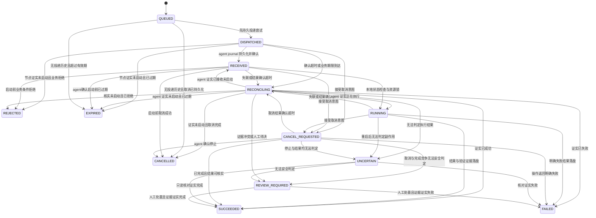

图中每条边由构建检查与 [command-state.json](command-state.json) 核对。`REVIEW_REQUIRED` 停止自动推进，人工转为成功或失败须具备权限、依据和审计记录。`CONFLICT` 记录在事件的 `apply_state` 列。取消、执行完成与晚到结果的冲突处理见 [§15.3.1 异常与竞争事件索引](#1531-r1-命令状态并发事件与证据裁决)。

节点按 `commandId + intentHash` 检查重复投递。对 `backup.restore`、`disk.format` 等非幂等或破坏性操作，还要在 `effectGuardUntil` 前按 `(operation, intentHash)` 去重，避免云端更换命令 ID 后重复产生同一副作用。

执行器将操作分为只读、可验证的目标状态变更、带外部幂等键的操作、非幂等或破坏性操作。每类声明恢复策略、可核对证据、取消边界和补偿能力。创建目录可核对目标状态，服务重启可核对运行状态与进程证据，数据库恢复或磁盘操作可能需要检查专属 checkpoint。进程身份同时记录启动时间或操作标记，避免仅凭复用的 PID 判断。

系统副作用与 journal 提交无法组成同一个数据库事务。若 agent 在副作用发生后、结果落盘前退出，恢复流程先查询现场和 checkpoint。无法确认的破坏性动作进入 UNCERTAIN 或 REVIEW_REQUIRED，保留原 commandId 与证据，等待明确处置。人工批准再次尝试时创建关联原任务的新 commandId，并重新检查资源前置条件。

已有投递尝试但尚无可靠接收确认的命令到期后进入 RECONCILING，通过 agent journal 与现场核对是否执行。只有无投递历史，或 agent 提供可信的未启动证据，才能转为 EXPIRED。开始执行后的任务采用独立执行期限，业务入场期限到达不能据此把已执行任务标成未执行。

建议命令最长入场有效期为创建后 7 天，最大交付重投窗口为创建后 14 天。超过业务期限后仅发送状态查询与结果对账请求。完成结果正文与去重 tombstone 分开保留，tombstone 至少保留 30 天且覆盖所有允许重投窗口，包含 commandId、intentHash、incarnation、绝对 expiresAt 与最终状态。清理前必须收到已合并结果确认并超过保留期。无论 tombstone 是否仍在，agent 启动前都拒绝超过不可变 expiresAt 的旧命令，不能通过传输重试或新 epoch 延长有效期。时间无法可信校验时暂停新执行并重认证。

## A.6. D1 outbox、至少一次通知与跨服务一致性

控制 Worker 调用 TenantData Worker，将 commands、初始审计和 outbox 事件放入同一租户 D1 的 `batch()`。任何 SQL 失败时整批回滚。 读取的自动重试不替代业务恢复：D1 读重试上限由运行时控制，写入重试由应用以指数退避和 jitter 负责，并始终携带幂等的 (commandId,eventId,revision)。条件更新零行不触发回滚，凡涉及 revision CAS、取消或撤销的派生 outbox 与审计，都使用同一赢家请求与新 revision guard 的条件 INSERT SELECT，并验证结果行数，确保只有胜出状态转换生成事件。提交成功后返回 commandId，并尝试以有界超时直接调用对应 AgentConn 的 `dispatchKick` 快路径；该调用只负责唤醒和触发 `beginDispatch`，不取代 D1 中已经提交的 outbox。直连失败或超时不改变命令意图，outbox dispatcher 仍经 Queues 发布以完成持久补偿。发布成功但 publishedAt 尚未更新就退出时允许重复发布，消费者按 eventId、commandId 和 DO 侧投递版本去重。[D1 事务批处理](https://developers.cloudflare.com/d1/worker-api/d1-database/)、[Queues 交付语义](https://developers.cloudflare.com/queues/reference/delivery-guarantees/)

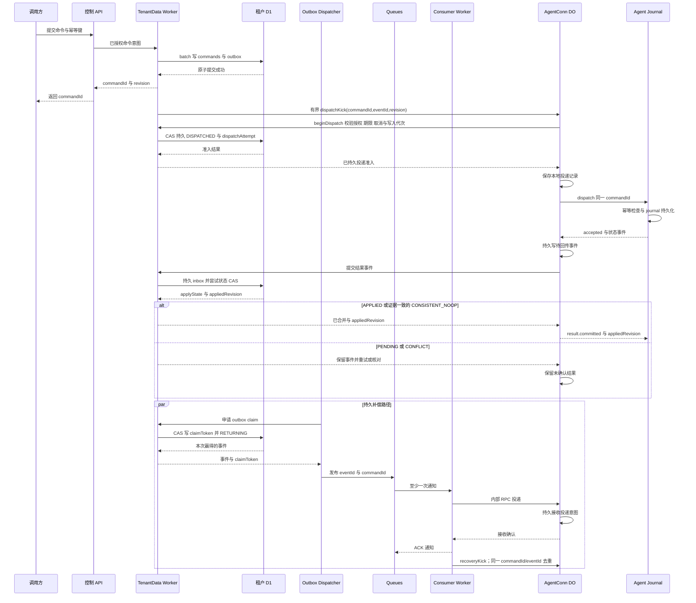

outbox 领取由 TenantData Worker 执行带 claimUntil 条件的原子 UPDATE，写入随机 claimToken，并使用 RETURNING 只返回本次赢得的事件。发布成功、失败计数、重试时间与释放 claim 都必须匹配同一 claimToken，已过期的旧 dispatcher 不能覆盖新持有者状态。超时后可以重新领取，发布重复仍由下游去重。正常路径在提交后立即唤醒投递；建议每 60 秒运行一次有界补偿扫描，按 availableAt 和主键游标分片，恢复超时 claim。发布失败指数退避，达到阈值进入可见异常列表和死信处理，D1 中的未完成意图继续保留。Queues 消费 Worker 通过内部 RPC 调用 AgentConn，ACK 表示消费端已可靠接受通知或确认事件已完成，业务完成由 agent 结果和核验推进。队列保留时间以部署时的套餐配置为准，设备长期离线任务仍保存在 D1。 Queue 的 100 次是平台重试上限，不是业务默认值；命令补偿显式设置 max_retries、逐条 ack/retry，达到阈值进入 DLQ，毒消息隔离并可审计 replay。Queue 保留最长 14 天，必须在到期前告警并由 D1 outbox 重建交付；CAP-04 分开统计 retry、DLQ、retention 删除和 backlog 清空。[Queues 确认与重试](https://developers.cloudflare.com/queues/configuration/batching-retries/)

AgentConn 对已接受的 pendingCommand 在 DO storage 中持久化，节点恢复连接后与 agent journal 对账。agent 结果携带稳定 eventId 和 `(nodeIncarnation, commandId)` 域内的 eventSequence，DO 保存后可回复 result.received，表示已进入持久收件箱。TenantData Worker 先写 command_events 的 PENDING 记录，再通过状态 CAS 合并命令并更新 applyState 与 appliedRevision。事件唯一键存在只代表已收件，不能作为已合并的证明。

如果状态 CAS 影响零行，事件保持待处理，数据 Worker 重读当前状态与 revision。与已有状态及证据一致的重复或晚到进度可记录 CONSISTENT_NOOP，仍需写入所依据的 appliedRevision。存在矛盾的最终结果记录 CONFLICT 并触发对账，其余合法转换重新以最新 revision 尝试。只有 APPLIED 或证据一致的 CONSISTENT_NOOP 才发送 result.committed，失败与冲突路径保留事件并继续核对。agent 收到这一确认后方可进入结果保留倒计时。所有结果回写经 TenantData Worker，DO alarm 重试与后台扫描同时覆盖未应用事件，防止事件已去重而结果永远丢失。

多 D1、多 DO、Queues 和 R2 之间采用显式状态机及补偿。终端预留失败会过期回收，未完成 R2 multipart 会按生命周期清理，已发出的系统操作仅按操作类型声明的补偿步骤处理。Workflows 负责多阶段编排、事件等待和超时，使用 waitForEvent/sleep 等待节点结果，D1 仍为长期任务记录权威。完成实例保留策略显式配置，不依赖默认保留期满足业务恢复要求。step 重试复用既有 commandId，并先查询执行状态。每个步骤分别声明安全重试条件与结果未知时的停点。[Workflows API](https://developers.cloudflare.com/workflows/build/workers-api/)

## A.7. Relay 角色票据与独立终端连接

终端创建首先校验用户会话、角色、节点归属和能力。TenantData Worker 在 D1 记录 PREPARING 会话，Relay 初始化不可变 tenant、node、terminal、authSession 与授权版本，再生成两个不同随机 ticket，分别绑定 browser 与 agent 角色。browser ticket 只返回当前已授权用户，agent ticket 经 AgentConn 控制通道发送到该节点。建议票据有效期 60 秒，服务端保存摘要，每个角色的代次分别递增。

角色 ticket 在 Relay SQLite 中使用条件更新原子消费，匹配 tokenHash、role、terminalId、roleGeneration、expiresAt、未消费状态和未撤销状态。消费成功才执行 WS Upgrade。两个并发请求最多一个成功。升级响应丢失后，客户端通过认证 API 申请新角色代次，旧 ticket 保持已消费，旧角色连接被替换或明确关闭。Relay 拒绝客户端自行切换角色和越过终端绑定。

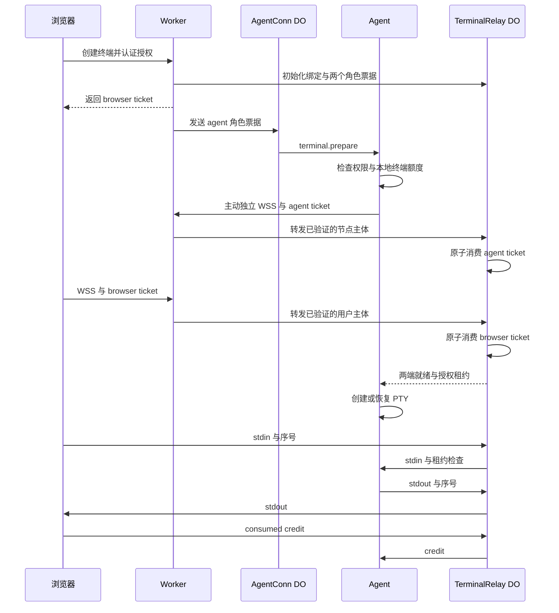

两侧连接均由 Relay 使用 `ctx.acceptWebSocket()` 接受。建议 attachment 仅放角色、会话、代次和租约摘要，正式归属与撤销版本持久保存。 attachment 序列化上限按 16,384 bytes 设计，不能把完整授权、历史输出或大结果塞入连接附件；超过上限的状态写 DO SQLite/D1/R2，并在 constructor 按 schemaVersion 恢复。attach 数据在连接关闭后消失，DO constructor 重建只恢复现存连接和持久元数据。终端建立存在超时，建议两端等待 30 秒后释放未进入 ACTIVE 的预留。[DO WebSockets 与休眠](https://developers.cloudflare.com/durable-objects/best-practices/websockets/)

## A.8. 全端租约、撤销与续租

浏览器、Relay 和 agent 共享同一终端 authorizationVersion、leaseSequence 与绝对 leaseUntil。建议租期上限 90 秒，每 30 秒发起续租并附加少量抖动。TenantData Worker 重新验证用户会话、权限版本、节点状态及终端状态，通过授权版本与旧 leaseSequence 的 CAS 发出递增序号的新 grant。grant 绑定 tenant、node、incarnation、terminal、authSession、authorizationVersion、leaseSequence、issuedAt、leaseUntil 和续租请求 nonce。Relay 与 agent 仅接受当前有效授权版本下更高的 leaseSequence，并把最新序号持久化，乱序或重复 grant 不能延长截止时间。租期同时受用户会话、节点授权及 API 凭证剩余有效期限制。

首版由 connector 传递 grant，持有 PTY/SSH/exec 的 Go 会话执行器负责强制到期关闭；connector 退出、断网或停止转发不能使终端绕过租约继续存活。需要的本地 hook 属于首版适配范围。

撤销通过 TenantData Worker 在 D1 中提高 authorizationVersion 并写 outbox，再主动通知 Relay 和 AgentConn。Relay 持久撤销并停止输入输出，agent 收到撤销立即关闭终端。主动通知不可达时，agent 本地单调计时器在租约截止时关闭 PTY，Relay 在每个业务事件与到期 alarm 中关闭连接。浏览器收到撤销进入只读结果页并清除会话票据。撤销与续租通过同一授权版本 CAS 竞争，撤销后的旧版本 grant 始终被拒绝。租约续期只能在旧租约仍有效时成功，已过期会话按新授权重新建立。普通心跳、终端输入和浏览器自行发送的时间值均不延长授权。

每帧只检查本地绑定、代次、角色、撤销版本和租约截止时间。完整授权查询在建链及续租时执行。agent 以认证时间交换和往返时间估计相对云端时间的有界偏差，用区间上界计算当前云端时间，再从绝对 leaseUntil 扣除已消耗时间，保守换算为本地单调截止时间。延迟到达的 grant 只能获得其剩余有效期，不能在接收时重新获得完整 90 秒。建议偏差区间或同步不确定度超过 15 秒时暂停新授权并重同步，阈值需通过网络测量确认。进程重启后旧单调时钟映射作废，重新认证前停止终端 I/O。设备休眠恢复也先验证绝对截止和时钟映射，防止不计休眠的单调时钟延长授权。Relay 休眠恢复后从持久绝对期限恢复状态。

当前 Go 源码中，90 秒租约由 API_AUTH 分支创建，浏览器 session 分支只返回用户与会话身份。保留原 Go 终端实现时，需要扩展统一云端租约、授权版本、撤销和异常退出关闭能力；不能只在 React 或 connector 检查期限。[当前身份生成](https://github.com/1Panel-dev/1Panel/blob/cedb8ddda9254bdef0fddba96b7fa59c6ab8c633/core/utils/terminal_session/identity.go)、[Go 到期关闭](https://github.com/1Panel-dev/1Panel/blob/cedb8ddda9254bdef0fddba96b7fa59c6ab8c633/agent/utils/terminal/auth_lease.go)

## A.9. 流控、休眠、在线状态与默认容量参数

每个终端使用独立输入序号和输出序号，浏览器在渲染消费后回传 credit，agent 按信用额度读取并发送 PTY 输出。建议二进制数据帧 16–32 KiB，每方向最大未确认数据 256 KiB，每会话总缓冲上限 1 MiB，初版每节点最多 8 个并发终端。达到额度时暂停生产与读取，持续无法消费时关闭该会话并记录原因。终端 stdin 优先发送，输出可短时间聚合，指标上报使用独立低频批次。

agent 保存最近 1 MiB 或 30 秒的终端输出用于短暂断线恢复，先到上限者优先。恢复请求携带最后已消费输出序号。超出保留窗口时显示明确的历史缺口，由用户选择重绘、重新进入全屏程序或新建终端，产品不能保证自动恢复 vim 等程序的完整屏幕状态。对于确认状态未知的输入，客户端不会自动重放按键或整条 shell 命令，以免重复执行。终端恢复与任务执行恢复分别处理。

建议增加以下应用容量边界，并在压测中调整。单条结果内联正文上限 64 KiB，较大输出写 R2 或 agent 日志对象；每节点待投递上限为 1,000 条或 8 MiB；AgentConn 未确认结果持久缓存上限 64 MiB，高水位 48 MiB 时暂停新普通任务。这些是应用预算，不是平台上限。Cloudflare DO、WebSocket、SQL 和出站连接限制集中见 [`docs/platform-constraints.md`](platform-constraints.md)，结果按平台边界分块保存。agent 为 journal 维护至少 50 MiB 的应急磁盘余量，接近阈值时拒绝新副作用任务并继续保存已有任务的最终状态。容量不足不能通过删除未确认结果或未过期 tombstone 来释放空间；正文、恢复元数据与去重 tombstone 分开设置保留策略。

控制连接建议由 agent 每 30 秒发送 WebSocket 协议 ping，Cloudflare 自动应答且不唤醒 DO。固定字符串应用 ping/pong 可用 `setWebSocketAutoResponse`。业务健康建议每 60 秒汇报一次摘要，用户打开监控页时按订阅短时提高频率。在线状态区分 transportConnected、agentHealthy、lastSeenAt 和 stale，平台自动 pong 只代表连接通路可用。[DO 心跳与休眠](https://developers.cloudflare.com/durable-objects/best-practices/websockets/)、[自动应答 API](https://developers.cloudflare.com/durable-objects/api/state/)

重连采用指数退避与 full jitter，起点 1 秒、上限 60 秒，稳定后重置。DO 不保持等待节点完成的长生命周期 promise，不用周期 setInterval 保活，Relay 到期检查使用 alarm。休眠与连接重建均需恢复固定身份、代次、租约和待处理事件。[DO 生命周期](https://developers.cloudflare.com/durable-objects/concepts/durable-object-lifecycle/)

## A.10. R2 数据路径、区域与敏感数据

R2 对象 key 由服务端生成，包含租户与用途前缀。上传先创建 metadata 与 multipart 会话，返回限定对象、HTTP 操作和有效期的预签名地址。完成接口核对对象大小和 multipart 清单，将对象从 UPLOADING 推进到 VERIFYING。该状态允许向指定验证节点发送 `artifact.verify` 下载校验任务，预期 SHA-256 来自上传会话记录或可信发布清单，验证通过才推进 READY。安装或恢复节点在使用前还要独立核对同一 SHA-256，校验失败停止后续动作。multipart ETag 不替代整文件 SHA-256。重复 complete 依据 artifactId 返回既有结果。

建议分片大小 16–64 MiB，单个分片 URL 有效期 15 分钟，失败时重新授权该分片，最终数值按对象大小和网络测量调整。 R2 预签名 URL 是 bearer token，在过期前可重复使用，服务端无法即时撤销已发 URL；仅支持 S3 API 域名和 GET/HEAD/PUT/DELETE，HTML form POST 不支持。完成/取消依赖短 TTL、artifact 状态、唯一版本化 key、对象轮换和条件写入（If-None-Match/If-Match），不能把状态变更写成 URL 立即失效。multipart complete 超时重试时重新核对 uploadId、part list、SHA-256 和条件版本。对象元数据未 READY 时禁止分发安装命令。清理作业处理过期 multipart、孤立对象与已删除租户对象，并留存审计。[R2 multipart](https://developers.cloudflare.com/r2/objects/upload-objects/)、[R2 预签名 URL](https://developers.cloudflare.com/r2/api/s3/presigned-urls/)

租户 D1 以主要写入区域选择创建位置，节点 AgentConn 与 TerminalRelay 按实际连接区域给 locationHint。jurisdiction 用于 eu、us 或 fedramp 等区域约束，DO 与 D1 同区域仍需测量往返延迟。终端数据路径不依赖逐帧数据库查询。区域要求同时覆盖 R2、Queues、Workflows 与日志的实际配置，不能由某一个 D1 或 DO 的 jurisdiction 推导整个平台数据驻留。[DO 位置](https://developers.cloudflare.com/durable-objects/reference/data-location/)、[D1 位置](https://developers.cloudflare.com/d1/configuration/data-location/)

节点私钥和执行所需的长期主机凭据优先保留在 agent。云端保存权限、引用与必要的密文，审计记录操作主体、资源、结果和版本。终端录制需显式产品配置及保留策略，日志默认脱敏凭证、终端敏感输入和连接 ticket。租户删除流程采用状态化清理任务，能报告每个存储层的完成与失败。

## A.11. 协议升级、快照、迁移与回滚边界

协议支持当前版和上一版，握手选择共同版本。capabilities 来自 connector、适配器和原 Go 执行器的经过验证的组合；具备 journal、去重和恢复 hook 的组合可以承接云端写操作，具备执行器到期关闭机制的组合才能开放终端。仅能转发 HTTP 的旧组合不授予这些能力。每个任务记录协议、connector/adapter/core/agent 版本，升级期间沿用原 commandId，未知必需能力明确拒绝。

数据库采用 expand、backfill、switch、contract 阶段。先增加兼容字段与新表，再回填和双版本读取，确认所有在线实例与允许离线回归的 agent 已兼容后删除旧结构。DO attachment 带 schemaVersion，constructor 能读取保留窗口内的旧版本，异常数据进入明确关闭与重新认证流程。D1 与 DO 的 schemaVersion 独立记录，迁移器按分片和租户推进并持久化检查点。

发布前保存 D1 恢复标识或备份、各 DO 关键状态导出版本、R2 manifest、节点 journal schema、cloudCommandId/localTaskId 映射、connector/adapter/core/agent 构建版本及 executionMode。快照明确 legacy-core 与 managed 模式；清单记录全局 snapshotId、各组件捕获时间和事件水位。不同服务快照可能具有时间差，恢复后通过 outbox、command_events 和 agent journal 重新对账。journal 或 DO 存储回退可能改变去重与连接代次，因此恢复时先关闭新写入、恢复最高已知 epoch 与 incarnation，再核对未完成动作。

应用回滚只在新旧 schema 和协议兼容范围内执行。已落地的系统变更、已发送通知、已运行数据库迁移以及已经恢复到主机的数据分别使用操作声明的补偿流程。发布回滚不会推导这些外部动作已撤销。破坏性数据迁移进入不可自动回滚阶段前需完成可恢复副本与恢复演练，并记录具体恢复时间点。

## A.12. 验证门槛与失败处理矩阵

| 场景 | 必须观察到的行为 |
|---|---|
| 同一 enrollment ticket 并发消费 | 仅 CAS 赢家产生节点与审计，失败者无派生写入 |
| 仅知 requestId 与公钥的注册恢复 | 未能证明私钥持有时拒绝返回节点凭证 |
| browser ticket 被用于 agent 角色 | Upgrade 被拒绝并产生审计 |
| Relay ticket 并发使用与升级响应丢失 | 单次消费成立，重新申请票据提高角色代次 |
| 旧 AgentConn 继续下发命令 | agent 在启动前拒绝旧 epoch |
| D1 已提交但 Queue 发布失败 | outbox 补偿扫描重新发布 |
| Queue 重复投递 | 已存在命令保持同一 commandId 与 journal 状态 |
| 副作用后 agent 断电 | 恢复核对现场，无法判定的动作进入 REVIEW_REQUIRED |
| agent 完成但 D1 暂时不可用 | 结果保留在 agent 与 DO，恢复后合并并确认 |
| 结果事件已入箱而命令状态 CAS 失败 | PENDING 事件继续重试，应用前不发送 result.committed |
| DISPATCHED 确认丢失并超过业务期限 | 进入 RECONCILING，依据 agent 证据判断是否执行 |
| outbox 旧领取者超时后继续回写 | claimToken 不匹配时更新被拒绝 |
| 用户撤销时控制消息丢失 | 两端租约到期停止终端输入、输出与 PTY |
| 节点身份吊销但控制 WSS 仍在线 | 主动断开或节点授权期限到达后停止投递 |
| 旧 lease grant 乱序抵达或 agent 重启 | leaseSequence 拒旧，重启后重认证才恢复 I/O |
| pending 高水位或 journal 磁盘不足 | 拒绝新普通工作并保留确认、撤销与恢复通道 |
| 慢浏览器与高速输出 | 有界缓冲与 credit 生效，控制命令延迟保持在目标范围 |
| DO 休眠、部署或连接断开 | 恢复身份与绑定，按序号恢复可用输出 |
| 快照恢复与旧 epoch | agent 拒绝代次回退，完成对账后恢复投递 |
| 原 Go 已启动但 taskId 响应丢失 | 查询操作标记、任务和现场，不能再次启动未知副作用 |
| 节点证实未启动且业务拒绝 | 持久 REJECTED 与原因，云端任务进入确定终态 |
| 旧 epoch 投递被拒绝 | 仅拒绝旧投递尝试，不错误终结仍有效的业务意图 |
| connector 退出而 PTY 仍存在 | Go 执行器在租约到期强制关闭，恢复后重新认证 |
| SSH host key 未登记或发生变化 | 阻止连接并展示核验流程；不得退回忽略主机密钥 |
| 停用节点仍有未决任务 | 禁止新操作，仅凭尚可信身份提交既有结果和核对 |
| 已吊销密钥尝试结果上报 | 拒绝旧身份，保留本地证据，受控身份恢复后再合并 |
| 创建者撤权与待执行任务竞争 | 高风险任务启动前重新授权，未获准者不启动 |
| 灰度批次出现未知副作用 | 暂停未启动后续任务，保留在途结果并对账 |
| 文件路径含 `..`、符号链接或越界挂载 | 规范化后拒绝越界目标；不跟随未授权链接；写入前后保留路径与 inode 证据 |
| cron、常用命令、脚本参数含 shell 注入片段 | operation schema 拒绝未允许字段或字符；执行器使用参数化 argv；审计记录拒绝原因 |
| enrollment ticket、角色票据或结果事件伪造/重放 | 签名、绑定的 tenant/node/incarnation、过期时间和消费状态均校验；重放拒绝且不产生派生写入 |
| 注册与票据验证遭受爆破 | 按主体、节点、来源和 ticket 维度限流；失败退避；不泄露 ticket 是否存在 |
| 跨站提交或 WSS `Origin` 不受信 | CSRF token、同站会话和允许 Origin 同时校验；不接受仅靠 URL 参数的角色授权 |
| 预签名 URL 被换租户、换对象或重复使用 | URL 绑定 tenant、artifact、分片、动作和过期时间；短 TTL、artifact 状态、唯一 key 和条件写入共同阻断继续使用，不能宣称已发 URL 即时撤销；越权返回统一错误 |
| 请求路径、节点 ID、artifact ID 指向其他租户 | 服务端从认证主体解析归属并再次核对资源；不能信任客户端 tenantId 或任意 binding 名称 |
| 密钥、票据、命令参数和终端内容进入日志 | 统一脱敏与结构化字段 allowlist；审计可追溯但不可恢复秘密；脱敏规则纳入回归样例 |

验收先覆盖两租户两节点的 React、Cloudflare 与原 Go 完整链路，再逐域执行协议故障注入和真实业务回归，最后完成部署、重启、升级、恢复与国内代理链路验证。保留 core 首版与后续 managed-agent 分别记录结果。模拟连接、浏览器测试与真实节点证据分开归档；功能台账保留所有失败、修复和复测记录。 功能纵切通过后，按第 15 节分别完成单租户 10,000 节点与多租户对照的持续混合负载验证；真实功能验收、模拟规模和目标 Cloudflare 部署证据分别标注。

# 附录 B · v2 源码基线与完整迁移矩阵

## B.1. 基线与验证范围

全量路由迁移矩阵保留 1Panel `dev-v2@cedb8dd` 的核对范围。本轮在 `aaba86d` 复核启动、采样、OpenResty 重启、网站备份创建与恢复，并核对两次提交间相关实现的差异。早期方案将前端复用来源记为 XCtechResource，当前实施以 `AngelFleetConsole main@df715b3` 的实际路由、权限和测试宿主为准。三个仓库的完整提交、工作树状态及变更影响见[研发计划的源码基线](go-agent-development-plan.md)。[1Panel 矩阵基线](https://github.com/1Panel-dev/1Panel/commit/cedb8ddda9254bdef0fddba96b7fa59c6ab8c633) · [1Panel 本轮核对提交](https://github.com/1Panel-dev/1Panel/commit/aaba86d0ef71a31ee319e74998ffe83c64abf4b6)

源码盘点覆盖 9 个 core 与 25 个 agent 路由组，共 34 组，并保留组外入口及生命周期。§13.7 确定当前选择。混合组仅按纳入的端点实施，排除或只作兼容依赖的行留在本表以便核查。两节点真机验收、单租户容量验收及后续 core 退役分别取证。

矩阵的“现有功能”来自固定提交的入口和选定实现。“云端职责”“节点职责”“迁移验收”属于本方案设计。存在路由或前端菜单只能证明该入口出现在源码中，实际能力还需结合处理器与社区/企业 provider 判断。

### B.1.1 Go 复用和改造分类

| 分类 | 范围 | 实施边界 |
|---|---|---|
| 保留业务实现 | 主机、容器、数据库、文件、备份及计划任务；KVM 依环境选入 | 保留上游 Go 执行器与数据库归属，依赖记录随业务验证 |
| 适配调用边界 | DTO、错误封装、节点 ID、任务进度、本地 taskId、文件和实时流 | 由 operation adapter 转换；云端命令与本地任务建立持久映射 |
| 新增运行能力 | connector、节点身份、WSS、epoch、journal、回执重发、取消和未知结果核对 | 形成可靠节点协议，不把现有 Unix socket 暴露为任意 HTTP 隧道 |
| 后续 core 解耦 | 共享数据库、配置来源、身份注入、启动、升级和快照 | 首版保留兼容栈；满足 B.8 条件后再退役 core |

Go 业务复用与原二进制零改动是不同目标。只读查询可先通过受控适配接入；涉及持久任务、终端、文件和副作用恢复的操作，需要补充执行上下文、journal 或任务关联。功能迁移以端点、流程及恢复语义为单位，不以历史 LOC 差额推算改造量。

当前路由注册与 Go 初始化边界见固定源码：[core 路由](https://github.com/1Panel-dev/1Panel/blob/cedb8ddda9254bdef0fddba96b7fa59c6ab8c633/core/router/common.go)、[agent 路由](https://github.com/1Panel-dev/1Panel/blob/cedb8ddda9254bdef0fddba96b7fa59c6ab8c633/agent/router/common.go)、[agent 初始化](https://github.com/1Panel-dev/1Panel/blob/cedb8ddda9254bdef0fddba96b7fa59c6ab8c633/agent/server/server.go)。

## B.2. 当前进程与路由边界

core 提供静态前端、统一中间件、`/api/v2/core/*` 控制接口及 `/mcp` 入口。普通 `/api/v2/*` 请求经 core 认证与策略处理后转发 agent。agent 注册 `/api/v2` 下的业务组，并另有内部 MCP 入口。[core/init/router/router.go](https://github.com/1Panel-dev/1Panel/blob/cedb8ddda9254bdef0fddba96b7fa59c6ab8c633/core/init/router/router.go) [core/middleware/helper.go](https://github.com/1Panel-dev/1Panel/blob/cedb8ddda9254bdef0fddba96b7fa59c6ab8c633/core/middleware/helper.go) [agent/init/router/router.go](https://github.com/1Panel-dev/1Panel/blob/cedb8ddda9254bdef0fddba96b7fa59c6ab8c633/agent/init/router/router.go)

本地链路通过 `/etc/1panel/agent.sock`。社区 provider 初始化时将 `global.IsMaster` 设为 true；非 master 路径为入站 HTTPS mTLS，均不是现成的反向 WSS 云管模式。首版新增独立 connector，按 operation registry 调用 agent socket 或受控的本地 core 适配入口，保留原 Go 执行栈。后续 managed 模式再独立配置来源和生命周期。节点只允许一个常规管理写入主体，不能同时保留无协调的本地与云端变更入口。[本地代理](https://github.com/1Panel-dev/1Panel/blob/cedb8ddda9254bdef0fddba96b7fa59c6ab8c633/core/init/proxy/proxy.go)、[社区初始化](https://github.com/1Panel-dev/1Panel/blob/cedb8ddda9254bdef0fddba96b7fa59c6ab8c633/agent/utils/xpack/helper/multi_node.go)、[agent 服务](https://github.com/1Panel-dev/1Panel/blob/cedb8ddda9254bdef0fddba96b7fa59c6ab8c633/agent/server/server.go)。

## B.3. core 全量路由组迁移矩阵

下列上游路径拼接 `/api/v2/core`。表中职责描述用于对照历史设计。排除项只保留源码，云端账号、RBAC 和审计由 AngelFleetConsole 承接。

| 路由组与功能 | 云端职责 | agent / connector 职责 | 关键迁移验收 | 固定源码 |
|---|---|---|---|---|
| BaseRouter · auth | 验证码、登录、MFA、passkey、API Key、当前用户、密码过期、会话与租户权限 | 接收经验证的短期操作身份，支持终端撤销 | React 登录和 API 契约正确，用户/节点授权隔离，登出和密钥撤销能影响已建立会话 | [入口](https://github.com/1Panel-dev/1Panel/blob/cedb8ddda9254bdef0fddba96b7fa59c6ab8c633/core/router/ro_base.go) |
| BackupRouter · backups | 公共备份账户、OAuth/token、账户版本与授权分配 | 保留存储服务访问和节点备份执行，接收受控凭据或短期授权 | 账户更新/删除传播及节点仍使用账户时的处理 | [入口](https://github.com/1Panel-dev/1Panel/blob/cedb8ddda9254bdef0fddba96b7fa59c6ab8c633/core/router/ro_backup.go) |
| LogRouter · logs | 登录审计、操作审计、检索和保留策略 | 执行回执和本地证据上传，持续关联 operation_id | 云端请求、节点执行和结果可关联，清理权限隔离 | [入口](https://github.com/1Panel-dev/1Panel/blob/cedb8ddda9254bdef0fddba96b7fa59c6ab8c633/core/router/ro_log.go) |
| SettingRouter · settings | 租户/个人设置、菜单、终端偏好、发布编排；商店策略排除 | 首版保留节点设置与原升级执行，隔离本机管理入口；managed 阶段调整端口、本地 SSL 与 updater | 平台配置与节点配置拆分，升级/证书/代理变更可追踪和恢复 | [入口](https://github.com/1Panel-dev/1Panel/blob/cedb8ddda9254bdef0fddba96b7fa59c6ab8c633/core/router/ro_setting.go) |
| CommandRouter · commands | 命令模板、分组、导入导出与共享权限 | 按已授权操作执行选定命令并记录输出，导出文件改为响应流或对象存储 | 模板归属和参数验证，导入幂等，导出不依赖core本地路径 | [入口](https://github.com/1Panel-dev/1Panel/blob/cedb8ddda9254bdef0fddba96b7fa59c6ab8c633/core/router/command.go) |
| GroupRouter · groups | 租户范围的全局资源分组与成员关系 | 保留必要的节点本地资源分组映射 | 全局组ID与节点资源ID区别处理，删除依赖检查 | [入口](https://github.com/1Panel-dev/1Panel/blob/cedb8ddda9254bdef0fddba96b7fa59c6ab8c633/core/router/ro_group.go) |
| ScriptRouter · script | 脚本目录、内容版本、同步计划、执行授权 | 缓存已授权脚本，执行与本地定时任务引用，确认版本和摘要 | 首版验证脚本版本与执行关联；core 退役前移除共享 core.db 读取，离线执行使用已确认版本 | [入口](https://github.com/1Panel-dev/1Panel/blob/cedb8ddda9254bdef0fddba96b7fa59c6ab8c633/core/router/ro_script_library.go) |
| RuntimeDiagnosticsRouter · hosts/diagnostics | 新控制面运行指标、trace、请求/连接诊断 | core 存续期间保留 core 与 agent 的 Go profile、goroutine 诊断，受限导出 | 界面区分云端与节点诊断，访问与保留控制 | [入口](https://github.com/1Panel-dev/1Panel/blob/cedb8ddda9254bdef0fddba96b7fa59c6ab8c633/core/router/ro_runtime_diagnostics.go) |
| PanelMCPRouter · mcp（本轮排除） | 凭据、节点授权、目录投影、admission、调用审计和控制配置 | runtime安装与状态、Docker进程和网站绑定执行 | 云端身份与节点目标绑定，调用去重和结果确认，跨版本能力协商 | [入口](https://github.com/1Panel-dev/1Panel/blob/cedb8ddda9254bdef0fddba96b7fa59c6ab8c633/core/router/ro_mcp.go) |

## B.4. agent 全量路由组迁移矩阵

以下 25 组记录上游路由与原候选改造，§13.7 决定本轮纳入的端点。保留操作复用本机 Go；云端按租户和节点授权，对异步操作维护 `cloudCommandId ↔ nodeId ↔ localTaskId` 并查询最终状态。表中排除或依赖项的上游行为仅用于核对来源。

| 路由组与功能 | 云端职责 | 节点职责及适配 | 关键迁移验收 | 固定源码 |
|---|---|---|---|---|
| VMRouter · vms（条件项） | VM/ISO/模板/网络/存储索引、配额与操作授权 | 复用VM环境检测、创建/启停、磁盘、快照、ISO、虚拟网络与console桥 | 创建去重，磁盘/快照失败恢复，console续租与断线重附着，硬件能力呈现 | [入口](https://github.com/1Panel-dev/1Panel/blob/cedb8ddda9254bdef0fddba96b7fa59c6ab8c633/agent/router/ro_vm.go) |
| DashboardRouter · dashboard | 节点列表、汇总状态、视图偏好和权限 | 保留 OS、资源和 Top 进程采集与受控重启；应用启动器退出 | 节点离线与旧指标显式标注，重启受控并产生恢复确认 | [入口](https://github.com/1Panel-dev/1Panel/blob/cedb8ddda9254bdef0fddba96b7fa59c6ab8c633/agent/router/ro_dashboard.go) |
| HostRouter · hosts | 主机档案、终端授权、监控查询、风险操作审计 | 保留SSH、PTY、firewall、监控、磁盘分区/挂载、supervisor与内部终端能力 | 所有流有node_id绑定，防火墙变更可回退，终端续租/撤销可靠 | [入口](https://github.com/1Panel-dev/1Panel/blob/cedb8ddda9254bdef0fddba96b7fa59c6ab8c633/agent/router/ro_host.go) |
| ContainerRouter · containers | 容器/镜像/仓库/compose/网络/卷的授权与任务编排 | 复用Docker调用、compose、日志流、容器文件、daemon配置和镜像任务 | 重试不会重复创建，流背压和取消，大镜像与文件走节点数据通道 | [入口](https://github.com/1Panel-dev/1Panel/blob/cedb8ddda9254bdef0fddba96b7fa59c6ab8c633/agent/router/ro_container.go) |
| LogRouter · logs | 日志查询入口、任务索引与长期对象归档 | 系统日志、service列表、task.db和日志文件分页读取 | 游标稳定，断线续读，日志权限与限速 | [入口](https://github.com/1Panel-dev/1Panel/blob/cedb8ddda9254bdef0fddba96b7fa59c6ab8c633/agent/router/ro_log.go) |
| FileRouter · files | 路径操作授权、传输票据、分享入口和审计 | 复用文件树、内容编辑、压缩、下载、权限、回收站、历史和分享验证，排除 AI 搜索 | 分片续传、摘要校验、路径边界、取消清理、分享票据租户隔离 | [入口](https://github.com/1Panel-dev/1Panel/blob/cedb8ddda9254bdef0fddba96b7fa59c6ab8c633/agent/router/ro_file.go) |
| ToolboxRouter · toolbox | 系统工具操作策略、调度和审计 | 保留主机参数/密码/swap/DNS、清理、fail2ban、FTP及公开扫描入口，逐项核验provider能力 | 重启或失联恢复，清理范围确认，企业stub能力明确标记 | [入口](https://github.com/1Panel-dev/1Panel/blob/cedb8ddda9254bdef0fddba96b7fa59c6ab8c633/agent/router/ro_toolbox.go) |
| CronjobRouter · cronjobs | 计划模板与下发、跨节点汇总、作业授权 | 保留本地调度、备份/脚本执行与运行记录，接收版本化配置 | 断网仍按已确认策略执行，更新与重试不重复调度 | [入口](https://github.com/1Panel-dev/1Panel/blob/cedb8ddda9254bdef0fddba96b7fa59c6ab8c633/agent/router/ro_cronjob.go) |
| BackupRouter · backups | 账户与记录索引、任务编排、R2或其他目标的授权 | 复用桶检查、备份、恢复、上传、记录下载删除和存储适配 | 全量上传恢复演练、摘要验证、断线恢复、账户变更协调 | [入口](https://github.com/1Panel-dev/1Panel/blob/cedb8ddda9254bdef0fddba96b7fa59c6ab8c633/agent/router/backup.go) |
| SettingRouter · settings | 租户/节点设置的版本与下发、快照/恢复策略 | 首版保留 agent 设置、SSH 配置（AI 配置排除）、文件历史和旧快照执行；managed 阶段拆除 core 依赖 | 配置版本与离线缓存；首版旧栈恢复成立，managed 阶段完成旧快照转换 | [入口](https://github.com/1Panel-dev/1Panel/blob/cedb8ddda9254bdef0fddba96b7fa59c6ab8c633/agent/router/ro_setting.go) |
| AppRouter · apps（产品入口排除；既有依赖按需兼容） | 应用目录视图、安装授权、发布编排与状态汇总 | 保留应用源同步、安装/升级/卸载、端口、配置与依赖判断 | 安装任务幂等，升级回滚和依赖检查，失联后状态对账 | [入口](https://github.com/1Panel-dev/1Panel/blob/cedb8ddda9254bdef0fddba96b7fa59c6ab8c633/agent/router/ro_app.go) |
| WebsiteRouter · websites（本轮排除） | 网站资源索引、域名/证书关联、操作授权 | 保留建站、反代、重写、HTTPS、CORS、认证、目录权限、缓存和nginx配置 | 配置校验后生效、失败回滚、域名与节点权限正确关联 | [入口](https://github.com/1Panel-dev/1Panel/blob/cedb8ddda9254bdef0fddba96b7fa59c6ab8c633/agent/router/ro_website.go) |
| WebsiteDnsAccountRouter · websites/dns（本轮排除） | DNS账户授权、密钥托管选择和发放审计 | 保留DNS provider适配及节点所需短期凭据缓存 | 账户隔离，密钥轮换，ACME任务读取一致版本 | [入口](https://github.com/1Panel-dev/1Panel/blob/cedb8ddda9254bdef0fddba96b7fa59c6ab8c633/agent/router/ro_website_dns_account.go) |
| WebsiteAcmeAccountRouter · websites/acme（本轮排除） | ACME账户归属、授权和续期政策 | 保留ACME签发交互与节点挑战执行 | 签发/续期重试和冲突处理，私钥生命周期明确 | [入口](https://github.com/1Panel-dev/1Panel/blob/cedb8ddda9254bdef0fddba96b7fa59c6ab8c633/agent/router/ro_website_acme_account.go) |
| WebsiteSSLRouter · websites/ssl（本轮排除） | 证书库存、分发授权、到期策略 | 保留证书获取/导入/部署，替换原master同步依赖 | 跨节点分发新实现，证书应用确认、回滚和到期监控 | [入口](https://github.com/1Panel-dev/1Panel/blob/cedb8ddda9254bdef0fddba96b7fa59c6ab8c633/agent/router/ro_website_ssl.go) |
| WebsiteTemplateRouter · websites/templates（本轮排除） | 模板版本、租户授权与发布索引 | 保留导入、预览、渲染输出与节点文件生成 | 模板包校验，输出路径限制，上传传输可恢复 | [入口](https://github.com/1Panel-dev/1Panel/blob/cedb8ddda9254bdef0fddba96b7fa59c6ab8c633/agent/router/ro_website_template.go) |
| DatabaseRouter · databases | 数据库资源索引、凭据权限、变更和备份任务编排 | 保留MySQL/PostgreSQL/MongoDB/Redis服务访问、配置、用户与权限管理 | 变更结果验证、凭据轮换、长任务状态，数据库大备份绕开交互API | [入口](https://github.com/1Panel-dev/1Panel/blob/cedb8ddda9254bdef0fddba96b7fa59c6ab8c633/agent/router/ro_database.go) |
| NginxRouter · openresty（本轮排除） | 配置版本、操作权限、编译任务索引 | 保留OpenResty配置、状态、模块编译、默认HTTPS操作 | 配置测试、原子生效与回滚，编译任务断线不丢失 | [入口](https://github.com/1Panel-dev/1Panel/blob/cedb8ddda9254bdef0fddba96b7fa59c6ab8c633/agent/router/ro_nginx.go) |
| RuntimeRouter · runtimes（产品入口排除；既有依赖按需兼容） | 运行环境目录、操作授权和状态汇总 | 保留语言runtime、Node包、PHP扩展/FPM、supervisor与配置执行 | 安装过程可恢复，配置与资源依赖验证 | [入口](https://github.com/1Panel-dev/1Panel/blob/cedb8ddda9254bdef0fddba96b7fa59c6ab8c633/agent/router/ro_runtime.go) |
| ProcessRouter · process | 进程信息授权和实时订阅入口 | 保留进程列表流、终止、端口监听与PID详情 | 订阅背压、重连、进程实例识别与终止权限 | [入口](https://github.com/1Panel-dev/1Panel/blob/cedb8ddda9254bdef0fddba96b7fa59c6ab8c633/agent/router/ro_process.go) |
| WebsiteCARouter · websites/ca（本轮排除） | CA归属、签发政策和分发审计 | 保留CA导入、签发、续期和节点部署，私钥存放单独设计 | 私钥授权、证书链校验、轮换和撤销流程 | [入口](https://github.com/1Panel-dev/1Panel/blob/cedb8ddda9254bdef0fddba96b7fa59c6ab8c633/agent/router/ro_website_ca.go) |
| AIToolsRouter · ai（本轮排除） | AI账户与节点资源视图、授权、任务索引 | 保留当前公开 Ollama、GPU 分组与监控、vLLM、AI MCP、AI agents/插件/skills/渠道实现，按最新 DTO 适配 | AI 进程与渠道凭据隔离，长任务可恢复；模型准备及私有能力按 provider 单列 | [入口](https://github.com/1Panel-dev/1Panel/blob/cedb8ddda9254bdef0fddba96b7fa59c6ab8c633/agent/router/ro_ai.go) |
| GroupRouter · groups | 租户与节点资源组映射和权限 | 保留本地分组CRUD，显式映射云端组 | 同名组与本地ID不跨租户混用 | [入口](https://github.com/1Panel-dev/1Panel/blob/cedb8ddda9254bdef0fddba96b7fa59c6ab8c633/agent/router/ro_group.go) |
| AlertRouter · alert | 跨节点规则/事件汇总、分发策略与通知审计 | 保留本地条件评估、配置与日志，适配云端上报/可用通知provider | 去重与恢复事件、离线积压补报、各通知渠道能力核验 | [入口](https://github.com/1Panel-dev/1Panel/blob/cedb8ddda9254bdef0fddba96b7fa59c6ab8c633/agent/router/ro_alert.go) |
| RuntimeDiagnosticsRouter · hosts/diagnostics | 受控诊断入口、trace关联和文件索引 | 保留agent summary、goroutines与profile采集 | 受限采集和导出，敏感诊断内容访问控制 | [入口](https://github.com/1Panel-dev/1Panel/blob/cedb8ddda9254bdef0fddba96b7fa59c6ab8c633/agent/router/ro_runtime_diagnostics.go) |

当前公开路由注册已删除 `ModelDownloaderRouter`，模型准备迁入 XPack；不能继续将旧 `ai/model/downloader` 与 `xpack/model/downloader` 兼容路由列为当前可直接复用能力。模型准备若在产品范围内，需明确可用授权实现或自研工作包。AI、GPU 监控与两类 MCP 均排除；这些源码记录不产生本轮页面或验收任务。[当前 agent 路由](https://github.com/1Panel-dev/1Panel/blob/cedb8ddda9254bdef0fddba96b7fa59c6ab8c633/agent/router/common.go)、[当前 AI 路由](https://github.com/1Panel-dev/1Panel/blob/cedb8ddda9254bdef0fddba96b7fa59c6ab8c633/agent/router/ro_ai.go)、[Panel MCP 路由](https://github.com/1Panel-dev/1Panel/blob/cedb8ddda9254bdef0fddba96b7fa59c6ab8c633/core/router/ro_mcp.go)。

## B.5. 组外入口与跨层硬依赖

### B.5.1 组外入口

- 原静态前端、安全入口、favicon/assets、动态主题图片和静态 JSON 由 core 提供。XC React 发布接管产品界面；主题、登录入口和静态资源分别迁移，未知节点深链接无需重新构建也能打开和刷新。core 存续期的本地入口仅承担受控兼容或恢复职责。[原静态入口](https://github.com/1Panel-dev/1Panel/blob/cedb8ddda9254bdef0fddba96b7fa59c6ab8c633/core/init/router/router.go)。

- `/mcp` 入口接受多种HTTP方法，先做MCP认证并签发access proof，再转发本机runtime。本轮不发布云端 MCP 入口。[core/init/router/mcp.go](https://github.com/1Panel-dev/1Panel/blob/cedb8ddda9254bdef0fddba96b7fa59c6ab8c633/core/init/router/mcp.go)

- agent的 `/internal/mcp/docker` 与 `/internal/mcp/website` 限定 master 模式及 Unix transport，另有独立capabilities入口。本轮不从 connector 暴露这些 MCP 接口。[agent MCP runtime 入口](https://github.com/1Panel-dev/1Panel/blob/cedb8ddda9254bdef0fddba96b7fa59c6ab8c633/agent/init/router/mcp_runtime.go)

- agent另注册 `/api/v2/health/check` 和内部终端capabilities/revoke。健康检查、能力探测、撤销命令属于节点控制协议。[agent/init/router/router.go](https://github.com/1Panel-dev/1Panel/blob/cedb8ddda9254bdef0fddba96b7fa59c6ab8c633/agent/init/router/router.go) [agent/router/ro_host.go](https://github.com/1Panel-dev/1Panel/blob/cedb8ddda9254bdef0fddba96b7fa59c6ab8c633/agent/router/ro_host.go)

- 文件分享包含匿名 `info/check/download` 入口，需要保留密码、过期、对象范围与撤销规则。local/SSH/container 终端、进程 WS、VM console 与脚本运行流使用各自适配器，不能仅迁移普通 JSON 路由。[文件分享](https://github.com/1Panel-dev/1Panel/blob/cedb8ddda9254bdef0fddba96b7fa59c6ab8c633/agent/router/ro_file.go)、[终端](https://github.com/1Panel-dev/1Panel/blob/cedb8ddda9254bdef0fddba96b7fa59c6ab8c633/agent/router/ro_host.go)、[进程流](https://github.com/1Panel-dev/1Panel/blob/cedb8ddda9254bdef0fddba96b7fa59c6ab8c633/agent/router/ro_process.go)、[VM console](https://github.com/1Panel-dev/1Panel/blob/cedb8ddda9254bdef0fddba96b7fa59c6ab8c633/agent/router/ro_vm.go)。

- 安装器、systemd、1pctl、本轮 Cron、告警、运维清理、升级回滚和系统快照恢复纳入节点生命周期验收。排除站点续证和商店同步的云端管理。离线策略与恢复补报分开验证。

### B.5.2 数据所有权与共享数据库

当前 core 打开 core、task、agent、alert 四库。agent 显式打开 agent、task、monitor、gpu_monitor、alert 五库，存在 core.db 时再打开它；这两个初始化入口合计涉及 6 个不同数据库文件，当前已不再打开旧 vllm_monitor.db。首版保留本机兼容访问，云端不得直接共享节点 SQLite；后续按下表逐项拆分。

| 数据 | 当前耦合 | 首版与 managed 阶段的归属 |
|---|---|---|
| core.db | 用户、设置、脚本等由 core 维护，agent 部分路径直接读取 | 云端平台身份和策略为权威；首版经受控适配投影到本机，退役前迁走所需字段 |
| agent.db | 节点资源事实，core 读取部分设置、CA 和 SSL 等数据 | 节点保持事实权威，云端通过查询与事件建立索引 |
| task.db | core 与 agent 共享本地任务 | 保留 Go 任务，云端 commandId 与 localTaskId 持久关联；journal 补执行恢复语义 |
| alert.db | 两进程使用告警相关状态 | 节点保留检测与执行记录，云端维护策略版本和事件汇总，明确去重键 |
| monitor.db 与 gpu_monitor.db | 节点监控历史 | 采用前者的主机监控数据；GPU 历史不迁入云端，可在原机保留 |

数据库初始化与共享读取依据如下。[core/init/db/db.go](https://github.com/1Panel-dev/1Panel/blob/cedb8ddda9254bdef0fddba96b7fa59c6ab8c633/core/init/db/db.go) [agent/init/db/db.go](https://github.com/1Panel-dev/1Panel/blob/cedb8ddda9254bdef0fddba96b7fa59c6ab8c633/agent/init/db/db.go) [core/app/repo/agent.go](https://github.com/1Panel-dev/1Panel/blob/cedb8ddda9254bdef0fddba96b7fa59c6ab8c633/core/app/repo/agent.go)

脚本、证书关联、防火墙端口与部分告警配置依赖 core.db。首版保留本机兼容访问并限定配置写入主体；core 退役阶段统一迁入版本化投影，携带摘要、应用结果和回退所需旧值。按保留的面板/节点端口核对防火墙 ServerPort；网站 SSL/SSLID 作为既有本机引用保留于兼容数据。[脚本](https://github.com/1Panel-dev/1Panel/blob/cedb8ddda9254bdef0fddba96b7fa59c6ab8c633/agent/app/repo/script.go)、[网站证书](https://github.com/1Panel-dev/1Panel/blob/cedb8ddda9254bdef0fddba96b7fa59c6ab8c633/agent/app/service/website_utils.go)、[防火墙端口](https://github.com/1Panel-dev/1Panel/blob/cedb8ddda9254bdef0fddba96b7fa59c6ab8c633/agent/app/service/firewall_utils.go)、[告警依赖](https://github.com/1Panel-dev/1Panel/blob/cedb8ddda9254bdef0fddba96b7fa59c6ab8c633/agent/app/service/alert_helper.go)。

### B.5.3 身份、授权与终端

core当前负责会话/API认证、CSRF、密码过期、操作日志和代理策略。代理前清理终端/MCP身份头，再从已认证上下文注入身份，并阻断内部接口。新边缘认证层及connector需要完整承接这一信任链。设计上将 tenant_id、node_id、principal_id、session_id、operation_id、action、expiry 绑定到授权票据，节点校验目标及权限。[core router](https://github.com/1Panel-dev/1Panel/blob/cedb8ddda9254bdef0fddba96b7fa59c6ab8c633/core/init/router/router.go)、[proxy handler](https://github.com/1Panel-dev/1Panel/blob/cedb8ddda9254bdef0fddba96b7fa59c6ab8c633/core/init/router/proxy.go)

现有会话由进程内map保存，最大条目数1024。新控制面需将会话状态迁至可持久且可撤销的存储。现有API Key HMAC签名内容只包含固定前缀和timestamp，连接协议若需要绑定method/path/body、目标节点和防重放信息，应设计独立的规范化签名或短期票据。[core/init/session/psession/psession.go](https://github.com/1Panel-dev/1Panel/blob/cedb8ddda9254bdef0fddba96b7fa59c6ab8c633/core/init/session/psession/psession.go) [core/app/auth/api_auth.go](https://github.com/1Panel-dev/1Panel/blob/cedb8ddda9254bdef0fddba96b7fa59c6ab8c633/core/app/auth/api_auth.go)

API_AUTH 分支当前创建上限 90 秒的终端授权租约，并可受 API Key 到期时间进一步截断；浏览器 Cookie 分支只生成用户与会话身份，未设置同样的 lease。保留 Go PTY、SSH、exec 与会话执行能力，新增云端用户、Relay、节点统一的续租和撤销绑定。登出、权限移除、API Key 撤销、connector 换代与节点重启均需验证。[身份与租约](https://github.com/1Panel-dev/1Panel/blob/cedb8ddda9254bdef0fddba96b7fa59c6ab8c633/core/utils/terminal_session/identity.go)、[节点到期关闭](https://github.com/1Panel-dev/1Panel/blob/cedb8ddda9254bdef0fddba96b7fa59c6ab8c633/agent/utils/terminal/auth_lease.go)、[终端处理器](https://github.com/1Panel-dev/1Panel/blob/cedb8ddda9254bdef0fddba96b7fa59c6ab8c633/agent/app/api/v2/terminal.go)。

### B.5.4 任务、日志与可恢复执行

原 Go 任务保存本地记录、执行子任务并记录状态，日志仍在节点。新适配层必须持久保存 commandId 与 localTaskId 的关联；HTTP 200、返回 taskId、传输 ACK 和业务成功分别解释。恢复时先查询原任务和现场，不能重发一次创建请求。新 journal 记录接收、执行前置条件、checkpoint、结果与云端确认；启动前拒绝、取消、过期和结果未知均有明确状态。若已有处理器在副作用前无法绑定稳定任务 ID，应在该处理器边界补充 Go 改造。[原任务执行](https://github.com/1Panel-dev/1Panel/blob/cedb8ddda9254bdef0fddba96b7fa59c6ab8c633/agent/app/task/task.go)、[任务查询](https://github.com/1Panel-dev/1Panel/blob/cedb8ddda9254bdef0fddba96b7fa59c6ab8c633/agent/app/service/task.go)、[业务响应](https://github.com/1Panel-dev/1Panel/blob/cedb8ddda9254bdef0fddba96b7fa59c6ab8c633/core/app/api/v2/helper/helper.go)。

### B.5.5 升级、快照和安装生命周期

core 当前负责更新 core、agent、1pctl 和本机安装变量。首版可保留其执行逻辑，但由受控升级任务追踪版本、断链恢复和健康结果，同时处理 connector 的协议兼容及回退。managed 阶段使用独立 updater 执行已签名 manifest、摘要与架构校验、版本切换、健康确认和失败回滚，升级不再依赖正在退役的 core。[升级实现](https://github.com/1Panel-dev/1Panel/blob/cedb8ddda9254bdef0fddba96b7fa59c6ab8c633/core/app/service/upgrade.go)。

原快照包含数据库目录，并在相关路径读取 core.db、复制 core 二进制和服务。首版继续支持旧栈备份恢复，同时加入 connector 身份、journal 与云端任务的恢复对账；不得把备份文件生成当作恢复验证完成。managed 阶段定义独立 manifest 和旧快照转换，克隆恢复重新注册节点，原机恢复核对 incarnation 与任务水位。[快照创建](https://github.com/1Panel-dev/1Panel/blob/cedb8ddda9254bdef0fddba96b7fa59c6ab8c633/agent/app/service/snapshot_create.go)、[快照恢复](https://github.com/1Panel-dev/1Panel/blob/cedb8ddda9254bdef0fddba96b7fa59c6ab8c633/agent/app/service/snapshot_recover.go)。

### B.5.6 MCP 拆分

本轮不提供 MCP 入口。既有 Panel MCP 依赖 core 进程内分发与本机 runtime，保留下列源码用于历史追溯。[core/app/service/mcp_execute.go](https://github.com/1Panel-dev/1Panel/blob/cedb8ddda9254bdef0fddba96b7fa59c6ab8c633/core/app/service/mcp_execute.go) [core/utils/mcpapi/dispatch.go](https://github.com/1Panel-dev/1Panel/blob/cedb8ddda9254bdef0fddba96b7fa59c6ab8c633/core/utils/mcpapi/dispatch.go) [core/app/service/mcp_runtime.go](https://github.com/1Panel-dev/1Panel/blob/cedb8ddda9254bdef0fddba96b7fa59c6ab8c633/core/app/service/mcp_runtime.go)

上游还有 Docker controller、网站绑定与能力探测等内部 MCP 路径，本轮直接适配选入的容器、数据库和主机业务入口。[agent MCP 入口](https://github.com/1Panel-dev/1Panel/blob/cedb8ddda9254bdef0fddba96b7fa59c6ab8c633/agent/init/router/mcp_runtime.go)、[core 授权适配](https://github.com/1Panel-dev/1Panel/blob/cedb8ddda9254bdef0fddba96b7fa59c6ab8c633/core/utils/xpack/helper/auth_helper.go)、[core 启动](https://github.com/1Panel-dev/1Panel/blob/cedb8ddda9254bdef0fddba96b7fa59c6ab8c633/core/server/server.go)。

## B.6. XC React 前端复用与接口契约

上线界面采用 AngelFleetConsole 的应用壳、导航、主题、账号机构权限页面、React Query、Zustand 和 API 客户端。容器、数据库、文件和终端页面按 1Panel Vue 的流程及 Go DTO 在 Console 中实现。

| 契约 | 现有输入 | XC React 迁移要求 |
|---|---|---|
| 页面与路由 | Console 静态导出、管理与审计页面，1Panel Vue 业务页面 | 新建运维领域页面，验证新节点深链接和刷新 |
| 租户与节点 | XC 现有机构上下文；Go CurrentNode、operateNode、local | 新增稳定 tenantId/nodeId；请求、缓存键和订阅均绑定上下文，旧响应不能覆盖新节点 |
| 身份与会话 | XC access/refresh token 位于 sessionStorage；1Panel 有 Cookie/CSRF 契约 | 复用账号权限 UI，落实目标同域会话及服务端 CSRF/Origin；终端使用独立短期角色票据 |
| 查询与响应 | Go code/message/data、items/total；业务失败可能为 HTTP 200 | 领域客户端统一解析业务状态与分页，返回采样时间和 stale |
| 变更任务 | Go 部分异步操作使用本地 taskId，Console 已有审计 CSV 导出交互 | 新增非阻塞任务中心，commandId 绑定原租户节点，页面关闭或刷新后继续追踪 |
| 实时流 | 本机/SSH/container 终端、日志、进程、VM console、脚本流 | 共用会话生命周期，各协议独立适配；租约、撤销、重连、背压与历史缺口可见 |
| 文件 | Go files、容器文件、ISO、模型和恢复包 | 新增 artifact 分片、续传、取消和校验，下载与匿名分享分别授权 |
| 权限与能力 | Console 权限目录、菜单守卫与服务端鉴权，Go 社区/企业 provider | 增加节点与资源范围，后端校验当前授权与节点 capabilities |
| HTTP 与 WSS | XC API 统一 CORS Response 包装 | Upgrade 请求在 JSON 包装前分流，保留 DO 的 webSocket 响应，真实验证完整链路 |

原 Go 契约参照：[API 客户端](https://github.com/1Panel-dev/1Panel/blob/cedb8ddda9254bdef0fddba96b7fa59c6ab8c633/frontend/src/api/index.ts)、[响应 DTO](https://github.com/1Panel-dev/1Panel/blob/cedb8ddda9254bdef0fddba96b7fa59c6ab8c633/frontend/src/api/interface/index.ts)、[业务响应](https://github.com/1Panel-dev/1Panel/blob/cedb8ddda9254bdef0fddba96b7fa59c6ab8c633/core/app/api/v2/helper/helper.go)、[原终端流程](https://github.com/1Panel-dev/1Panel/blob/cedb8ddda9254bdef0fddba96b7fa59c6ab8c633/frontend/src/components/terminal/index.vue)。Console 从 `src/lib/stores/auth-store.ts` 读取身份，通过 `src/lib/navigation/dashboard-pages.ts` 注册路由，租户和节点查询键需扩展到 `src/lib/api/`。具体鉴权与 API 入口见[技术详细设计](technical-design.md)。

每个功能的 React 页面、云端 operation 和 Go 执行器一一关联。验收同时覆盖正常路径、权限拒绝、业务失败、断线、取消与恢复，并核对真实节点状态。完成标准是目标能力端到端可用，不是 Vue 页面文件已转换、React 组件已绘制或接口返回 HTTP 200。

## B.7. 社区版与企业版边界

- 当前core和agent通过 `!xpack && !enterprise` 选择社区provider，公开树内未发现正向xpack/enterprise构建实现。具体私有构建流程仍需独立资料确认。[core/utils/xpack/community.go](https://github.com/1Panel-dev/1Panel/blob/cedb8ddda9254bdef0fddba96b7fa59c6ab8c633/core/utils/xpack/community.go) [agent/utils/xpack/community.go](https://github.com/1Panel-dev/1Panel/blob/cedb8ddda9254bdef0fddba96b7fa59c6ab8c633/agent/utils/xpack/community.go)

- 社区core的RBAC中间件返回nil。SaaS用户、租户、角色、资源授权和跨节点权限均为新增控制面能力。[core/utils/xpack/helper/auth_helper.go](https://github.com/1Panel-dev/1Panel/blob/cedb8ddda9254bdef0fddba96b7fa59c6ab8c633/core/utils/xpack/helper/auth_helper.go)

- 社区MultiNodeProvider只代理local，其他节点路径继续路由，多个同步和节点查询方法为空实现。公开node mTLS骨架可作为实现材料，完整注册、证书颁发/撤销、远端节点授权和同步机制仍需建设。[core/utils/xpack/helper/multi_node_helper.go](https://github.com/1Panel-dev/1Panel/blob/cedb8ddda9254bdef0fddba96b7fa59c6ab8c633/core/utils/xpack/helper/multi_node_helper.go) [agent/utils/xpack/helper/multi_node.go](https://github.com/1Panel-dev/1Panel/blob/cedb8ddda9254bdef0fddba96b7fa59c6ab8c633/agent/utils/xpack/helper/multi_node.go) [agent/server/server.go](https://github.com/1Panel-dev/1Panel/blob/cedb8ddda9254bdef0fddba96b7fa59c6ab8c633/agent/server/server.go)

- LDAP路径常量与前端OIDC/SAML接口名称存在，当前社区路由表提供的登录能力为密码、MFA和passkey。企业SSO集成需作为独立需求与实现验收项。[core/constant/common.go](https://github.com/1Panel-dev/1Panel/blob/cedb8ddda9254bdef0fddba96b7fa59c6ab8c633/core/constant/common.go) [core/router/ro_base.go](https://github.com/1Panel-dev/1Panel/blob/cedb8ddda9254bdef0fddba96b7fa59c6ab8c633/core/router/ro_base.go) [frontend/src/api/index.ts](https://github.com/1Panel-dev/1Panel/blob/cedb8ddda9254bdef0fddba96b7fa59c6ab8c633/frontend/src/api/index.ts)

- 社区VMCountLimit返回1。新产品的配额与授权策略需单独确定，并保留对现有版本能力的检测。[core/utils/xpack/community.go](https://github.com/1Panel-dev/1Panel/blob/cedb8ddda9254bdef0fddba96b7fa59c6ab8c633/core/utils/xpack/community.go) [agent/utils/xpack/community.go](https://github.com/1Panel-dev/1Panel/blob/cedb8ddda9254bdef0fddba96b7fa59c6ab8c633/agent/utils/xpack/community.go)

- 告警路由已公开，社区自定义Webhook有实现，而SMS与部分provider方法为空。防篡改和部分扫描provider也保留stub。迁移矩阵中的告警/扫描功能必须按实际provider逐项列出验收范围。[agent/utils/xpack/helper/alert.go](https://github.com/1Panel-dev/1Panel/blob/cedb8ddda9254bdef0fddba96b7fa59c6ab8c633/agent/utils/xpack/helper/alert.go) [agent/utils/xpack/helper/multi_node.go](https://github.com/1Panel-dev/1Panel/blob/cedb8ddda9254bdef0fddba96b7fa59c6ab8c633/agent/utils/xpack/helper/multi_node.go)

## B.8. 后续 core 退役的源码侧验收条件

保留 core/agent 的本轮业务按正文阶段验收交付；以下条件用于最终 core 退役阶段，不作为首版替换 XC 前端的前置条件。

1. 9 个 core 路由组与 25 个 agent 路由组，以及组外入口和后台生命周期均有明确处置记录；每个保留功能完成 XC React 页面、云端接口和真实节点执行验证。

2. 节点可在没有core进程的情况下安装、启动、重启、升级、回滚与恢复。调用链中需要的旧core.db字段均迁入显式配置投影或兼容迁移层。

3. 所有管理请求经云端身份认证、租户/节点授权和可信连接验证。agent内部端点只允许对应控制操作，用户输入无法选择其他租户节点。

4. 执行任务以持久operation_id/task_id对账，断线、重复投递和云端重启后仍能恢复结果，未知结果进入待确认状态。

5. 终端、进程流、日志、已选的 VM console 等实时功能完成重连、背压、租约与撤销测试。跨境延迟以目标用户实际链路测量。

6. 所有大文件路径覆盖分片、取消、恢复、校验与临时文件清理，浏览器上传、节点拉取、备份和恢复均完成闭环。

7. core和agent共享数据依赖通过API、版本化配置与事件替代，数据库迁移过程有备份、校验、切换点和回退计划。

8. 退役前从运行依赖中清除已排除的 MCP 入口和凭据引用，确认已保留的容器与主机操作可经独立适配器运行。

9. 社区可复用功能、企业缺失能力与新增SaaS能力分别列入交付清单。新增租户/RBAC/连接管理的完成状态独立追踪。

功能迁移与 core 退役分别记录实现和验收状态。保留 Go 业务代码不等于可靠协议已经完成；当前方案中的 connector、云端命令、统一终端租约和 managed 生命周期须以实际实现、故障注入及真实节点结果验收。

# 附录 C · 数据约束与操作契约

以下结构用于实现评审。生产迁移需结合附录 A 的完整字段、实际查询和 D1 集成测试生成版本化 SQL。ER 图展示租户库中的主要关系。

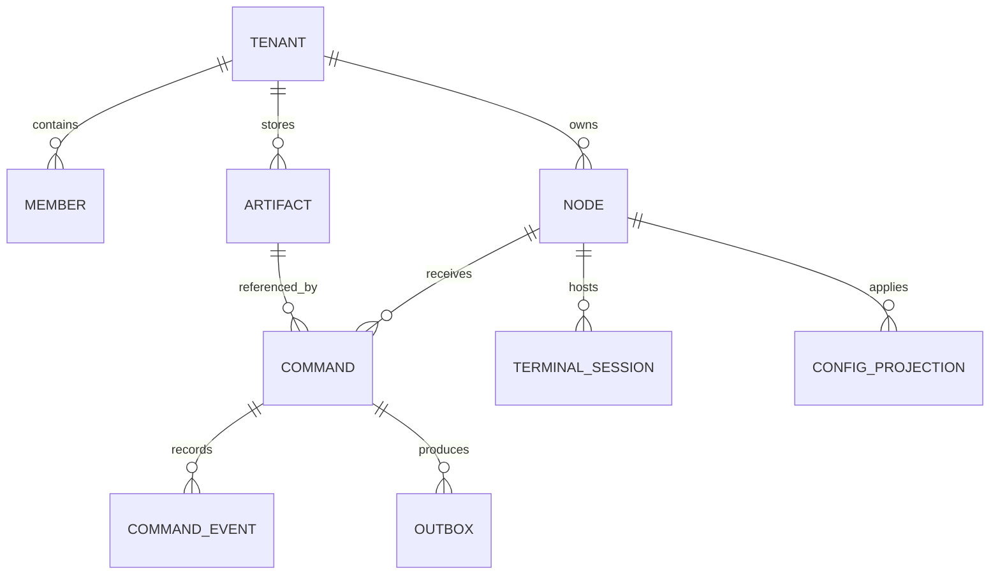

## C.1 核心持久约束示例

`resource_version` 是 API `resourceVersion` 的不透明十进制字符串投影，不能按 JavaScript 数值解析；命令创建、节点准入和本地启动均须按原值做前置条件比较。`cancel_ineffective` 是取消未能消除已发生副作用的唯一持久表示，`cancel_intent` 只记录取消请求生命周期。

```sql
CREATE TABLE nodes (
    tenant_id TEXT NOT NULL,
    node_id TEXT NOT NULL,
    incarnation TEXT NOT NULL,
    credential_version INTEGER NOT NULL DEFAULT 1,
    management_mode TEXT NOT NULL DEFAULT 'CLOUD_MANAGED',
    fence_version INTEGER NOT NULL DEFAULT 1,
    revision INTEGER NOT NULL DEFAULT 1,
    public_key_fingerprint TEXT,
    status TEXT NOT NULL,
    capabilities_json TEXT NOT NULL DEFAULT '[]',
    connector_build TEXT,
    adapter_version TEXT,
    execution_mode TEXT,
    core_version TEXT,
    agent_version TEXT,
    PRIMARY KEY (tenant_id, node_id),
    CHECK (credential_version > 0 AND fence_version > 0 AND revision > 0),
    CHECK (management_mode IN ('CLOUD_MANAGED', 'LOCAL_MAINTENANCE', 'POLICY_SCHEDULER'))
);

CREATE TABLE commands (
    tenant_id TEXT NOT NULL,
    command_id TEXT NOT NULL,
    node_id TEXT NOT NULL,
    node_incarnation TEXT NOT NULL,
    fence_version INTEGER NOT NULL,
    idempotency_key TEXT NOT NULL,
    request_fingerprint TEXT NOT NULL,
    intent_hash TEXT NOT NULL,
    operation TEXT NOT NULL,
    resource_version TEXT NOT NULL,
    sample_order INTEGER CHECK (sample_order IS NULL OR (operation = 'node.inspect' AND sample_order > 0)),
    payload_json TEXT NOT NULL,
    state TEXT NOT NULL,
    last_known_execution_state TEXT NOT NULL DEFAULT 'NOT_STARTED',
    cancel_intent TEXT NOT NULL DEFAULT 'NONE',
    reconcile_state TEXT NOT NULL DEFAULT 'NOT_REQUIRED',
    side_effect_extent TEXT NOT NULL DEFAULT 'NONE',
    evidence_refs_json TEXT NOT NULL DEFAULT '[]',
    cancel_ineffective INTEGER NOT NULL DEFAULT 0,
    revision INTEGER NOT NULL DEFAULT 1,
    created_at INTEGER NOT NULL,
    expires_at INTEGER NOT NULL,
    dispatch_started_at INTEGER,
    result_ref TEXT,
    PRIMARY KEY (tenant_id, command_id),
    FOREIGN KEY (tenant_id, node_id)
        REFERENCES nodes (tenant_id, node_id),
    CHECK (fence_version > 0 AND revision > 0 AND expires_at > created_at),
    CHECK (side_effect_extent IN ('NONE', 'PARTIAL', 'FULL')),
    CHECK (last_known_execution_state IN ('NOT_STARTED', 'RECEIVED', 'RUNNING', 'SUCCEEDED', 'FAILED', 'CANCELLED', 'UNKNOWN')),
    CHECK (cancel_intent IN ('NONE', 'REQUESTED', 'ACCEPTED', 'REJECTED')),
    CHECK (reconcile_state IN ('NOT_REQUIRED', 'PENDING', 'IN_PROGRESS', 'RESOLVED', 'MANUAL')),
    CHECK (cancel_ineffective IN (0, 1))
);
CREATE INDEX commands_by_node_state
    ON commands (tenant_id, node_id, state, created_at, command_id);
CREATE UNIQUE INDEX inspect_by_binding_order
    ON commands (tenant_id, node_id, node_incarnation, sample_order)
    WHERE sample_order IS NOT NULL;

CREATE TABLE node_metric_heads (
    tenant_id TEXT NOT NULL,
    node_id TEXT NOT NULL,
    node_incarnation TEXT NOT NULL,
    issued_order INTEGER NOT NULL DEFAULT 0,
    projection_revision INTEGER NOT NULL DEFAULT 0,
    latest_attempt_order INTEGER,
    latest_attempt_command_id TEXT,
    latest_attempt_state TEXT,
    connection_epoch INTEGER NOT NULL DEFAULT 0,
    connection_state TEXT NOT NULL DEFAULT 'OFFLINE',
    PRIMARY KEY (tenant_id, node_id, node_incarnation),
    FOREIGN KEY (tenant_id, node_id) REFERENCES nodes (tenant_id, node_id),
    FOREIGN KEY (tenant_id, latest_attempt_command_id) REFERENCES commands (tenant_id, command_id),
    CHECK (issued_order >= 0 AND projection_revision >= 0 AND connection_epoch >= 0),
    CHECK (connection_state IN ('ONLINE', 'OFFLINE')),
    CHECK ((latest_attempt_order IS NULL AND latest_attempt_command_id IS NULL AND latest_attempt_state IS NULL)
        OR (latest_attempt_order IS NOT NULL AND latest_attempt_order BETWEEN 1 AND issued_order
            AND latest_attempt_command_id IS NOT NULL AND latest_attempt_state IS NOT NULL
            AND latest_attempt_state IN ('SUCCEEDED', 'FAILED')))
);

CREATE TABLE node_metric_values (
    tenant_id TEXT NOT NULL,
    node_id TEXT NOT NULL,
    node_incarnation TEXT NOT NULL,
    metric TEXT NOT NULL CHECK (metric IN ('cpuUsedPercent', 'memoryUsedBytes')),
    latest_valid INTEGER NOT NULL CHECK (latest_valid IN (0, 1)),
    error_code TEXT,
    good_order INTEGER,
    good_value NUMERIC,
    good_sampled_at INTEGER,
    good_command_id TEXT,
    good_execution_epoch INTEGER CHECK (good_execution_epoch IS NULL OR good_execution_epoch > 0),
    PRIMARY KEY (tenant_id, node_id, node_incarnation, metric),
    FOREIGN KEY (tenant_id, node_id, node_incarnation)
        REFERENCES node_metric_heads (tenant_id, node_id, node_incarnation),
    FOREIGN KEY (tenant_id, good_command_id) REFERENCES commands (tenant_id, command_id),
    CHECK ((latest_valid = 1 AND error_code IS NULL) OR (latest_valid = 0 AND error_code IS NOT NULL)),
    CHECK (latest_valid = 0 OR good_command_id IS NOT NULL),
    CHECK (good_value IS NULL OR
        (metric = 'cpuUsedPercent' AND typeof(good_value) IN ('integer', 'real') AND good_value BETWEEN 0 AND 100) OR
        (metric = 'memoryUsedBytes' AND typeof(good_value) = 'integer' AND good_value >= 0)),
    CHECK ((good_order IS NULL AND good_value IS NULL AND good_sampled_at IS NULL AND good_command_id IS NULL AND good_execution_epoch IS NULL)
        OR (good_order IS NOT NULL AND good_order > 0 AND good_value IS NOT NULL AND good_sampled_at IS NOT NULL AND good_command_id IS NOT NULL))
);

CREATE TABLE idempotency_receipts (
    tenant_id TEXT NOT NULL,
    idempotency_key TEXT NOT NULL,
    request_fingerprint TEXT NOT NULL,
    intent_hash TEXT NOT NULL,
    command_id TEXT NOT NULL,
    expires_at INTEGER NOT NULL,
    retained_until INTEGER NOT NULL,
    guard_until INTEGER NOT NULL,
    replay_count INTEGER NOT NULL DEFAULT 0,
    status TEXT NOT NULL DEFAULT 'ACTIVE',
    created_at INTEGER NOT NULL,
    PRIMARY KEY (tenant_id, idempotency_key),
    UNIQUE (tenant_id, command_id),
    FOREIGN KEY (tenant_id, command_id)
        REFERENCES commands (tenant_id, command_id),
    CHECK (retained_until >= expires_at AND guard_until >= retained_until AND replay_count >= 0),
    CHECK (status IN ('ACTIVE', 'KEY_GUARD_ONLY', 'REVOKED'))
);

CREATE TABLE command_events (
    tenant_id TEXT NOT NULL,
    event_id TEXT NOT NULL,
    command_id TEXT NOT NULL,
    node_incarnation TEXT NOT NULL,
    agent_sequence INTEGER NOT NULL,
    content_hash TEXT NOT NULL,
    event_json TEXT NOT NULL,
    apply_state TEXT NOT NULL DEFAULT 'PENDING',
    applied_revision INTEGER,
    received_at INTEGER NOT NULL,
    PRIMARY KEY (tenant_id, event_id),
    UNIQUE (tenant_id, node_incarnation, command_id, agent_sequence),
    FOREIGN KEY (tenant_id, command_id)
        REFERENCES commands (tenant_id, command_id),
    CHECK (apply_state IN ('PENDING', 'APPLIED', 'CONSISTENT_NOOP', 'CONFLICT'))
);
CREATE INDEX events_pending_merge
    ON command_events (tenant_id, apply_state, received_at, event_id);

CREATE TABLE outbox (
    tenant_id TEXT NOT NULL,
    event_id TEXT NOT NULL,
    entity_id TEXT NOT NULL,
    entity_revision INTEGER NOT NULL,
    kind TEXT NOT NULL,
    payload_json TEXT NOT NULL,
    available_at INTEGER NOT NULL,
    claim_token TEXT,
    claim_until INTEGER,
    attempts INTEGER NOT NULL DEFAULT 0,
    last_error TEXT,
    published_at INTEGER,
    PRIMARY KEY (tenant_id, event_id)
);
CREATE INDEX outbox_ready
    ON outbox (tenant_id, published_at, available_at, event_id);
```

时间字段使用 UTC epoch 毫秒，事件顺序使用有界整数。进入 JavaScript API 的序号采用十进制字符串，读取时对序号使用 SQL CAST AS TEXT 投影，避免大整数精度损失。命令状态转换由数据 Worker 的合并函数校验，revision CAS、event applyState 和 outbox 写入置于同一原子批次，并以操作结果断言验证预期转换。

首次受理采样命令时，从当前绑定的 `issued_order` 原子分配 `commands.sample_order`。首次 ready 即创建或更新该绑定的连接摘要，投影版本仍可为零；在线节点还没有采样时，读取返回 ONLINE 和两个空指标。没有已就绪连接也没有采样时，可按 OFFLINE、版本零读取空视图。首次合并符合契约的终态探测结果时成对创建指标行，包括两项探测均失败的情况。按指标类型校验值域与单位，内存按非负整数字节保存；每次写入都验证来源命令属于相同租户、节点、incarnation 和序号。保留投影引用的原命令和已合并结果，或提供可按原 ID 授权查询的归档；只读视图不扫描任务历史。[竞争、重放和恢复规则](technical-design.md#72-节点采样怎样进入-xc-仪表盘)

`commands` 记录在其关联 `idempotency_receipts` 或破坏性效果去重窗口结束前不得物理删除；归档只能转入保留状态并保留原 `commandId`、`intentHash`、`expiresAt` 和最终状态。这样既保留外键和唯一 key guard，也避免收据清理后旧请求被静默当作新命令。

外键的删除策略采用显式业务清理，节点进入退役状态后先完成命令、终端和审计保留处理。eventId 相同而 contentHash 不同属于协议冲突，进入审计与核对。applyState 为 PENDING 或 CONFLICT 时继续保留事件并重试或人工核验，只有 APPLIED 或经过验证的一致 CONSISTENT_NOOP 才产生 result.committed。

## C.2 operation registry 初始示例

| operation | 能力与角色 | 执行前置条件 | 恢复与取消 |
|---|---|---|---|
| node.inspect | node.read，Viewer | 节点归属与读取范围 | 可安全重试，结果携带采样时间 |
| service.restart | service.manage，Operator | 允许服务名、配置版本、资源锁 | 核对进程启动时间与服务状态，已发生重启无法撤回 |
| container.ensure | container.manage，Operator | 明确目标配置摘要、资源版本 | 通过受管标签和目标状态核对，取消仅停止后续步骤 |
| file.install | file.write，Operator | READY artifact、SHA-256、目标目录与容量 | 临时文件校验后原子替换，checkpoint记录替换阶段 |
| backup.restore | backup.restore，Admin | 备份可读、目标版本、恢复窗口和资源锁 | 恢复点/checkpoint核对，结果不明时进入人工检查 |
| host.reboot | host.reboot，Admin | 已确认业务影响与任务排空策略 | 以boot identity及恢复健康确认，连接断开显示重启中 |
| disk.format | disk.destructive，受限Admin | 目标设备稳定标识、签名操作意图、二次业务确认 | 不自动重放，断电后核对真实设备与文件系统证据 |
| terminal.open | terminal.open，Operator | 终端角色票据、节点能力、租约和每节点终端配额 | 关闭会话或租约到期；未知 stdin 不自动重放 |

表中的操作标识是拟实施协议登记。本轮只接入 §13.7 的适用目标；service.restart 与 backup.restore 的旧 OpenResty、网站示例不再派工，通用操作仍须取得各自目标的实现和实测证据。真实映射依据附录 B 的 Go 处理器逐项建立，不能用一个通用任意命令代理替代全部业务约束。 每条记录同时指定稳定的 localTaskId 或 operationMarker 接入方式、实际执行前检查位置和结果核对入口。候选系统 OTA 的 operation 仅在附录 E 的适用设备与发布范围冻结后启用，不能通过通用 shell 绕过升级排他与未知结果处理。

## C.3 统一错误与可观测字段

| errorCode | HTTP 或流行为 | 客户端处理 |
|---|---|---|
| AUTH_EXPIRED | 有时限的票据或租约过期返回 401，现有流按租约关闭 | 重新申请票据或授权 |
| UNAUTHORIZED | 逐指标 GET 缺少有效登录会话（含过期 Cookie）返回 401 | 清除当前上下文并重新登录 |
| INVALID_REQUEST | 逐指标 GET 缺少或提供空的 nodeIncarnation 返回 400 | 从已授权的节点详情取得代次后再查 |
| NODE_FORBIDDEN | 403 | 显示无权操作，停止重试 |
| CAPABILITY_UNSUPPORTED | 409 | 展示所需 agent 版本与能力 |
| IDEMPOTENCY_REQUEST_MISMATCH | 409 | 同 key 的 method、path 或规范化 body 不同；停止重试并生成新 key |
| IDEMPOTENCY_INTENT_MISMATCH | 409 | 指纹相同但 intentHash 或 resourceVersion 不同；报告 canonicalization 或版本不一致，不创建新命令 |
| IDEMPOTENCY_KEY_EXPIRED | 410 | key guard 尚存；不能复用旧 key，等待清理策略或生成新 key |
| RESOURCE_REVISION_CONFLICT | 409 | 重新查询资源，用户确认新意图 |
| NODE_INCARNATION_MISMATCH | 逐指标查询在通过授权后发现绑定代次已变，返回 409 | 清空旧绑定数据，重新获取节点详情后按当前代次读取 |
| NODE_OFFLINE | 必须从节点实时取值的查询返回 503；持久化的逐指标读取仍返回 200，离线允许排队的命令返回 202 | 节点概览显示离线，各项最后成功值标记过期 |
| COMMAND_REJECTED | 已有任务查询返回200，state为REJECTED | 显示确定未执行的业务原因，修改意图后创建新命令 |
| RESULT_UNCERTAIN | 任务状态接口200，state为UNCERTAIN或REVIEW_REQUIRED | 进入核对流程，停止盲目重试 |
| BACKPRESSURE | 429或受控关闭流 | 按retryAfter退避，显示容量限制 |
| STORAGE_UNAVAILABLE | 503 | 逐指标接口无法取得授权快照时显示读取失败。仅允许离线缓存的其他视图可在其既有授权范围内显示过期数据；停止新的高风险变更 |

traceId 贯穿 React 请求、控制 API、TenantData、Queue、DO、connector 与原 Go 执行器。统一观测 apiLatency、commandAcceptLatency、commandCompletionLatency、oldestOutboxAge、pendingResultBytes、reconnectCount、terminalInputRTT、leaseRejectCount、命令与本地任务映射完整率及待核对任务数。审计与运行日志分别设置访问权限和保留期限。

# 附录 D · 产品需求与设备生命周期

## D.1 产品范围与使用旅程

本附录供产品、开发和验收人员从用户旅程追到角色、需求、设备状态与适用环境。范围基线见[附录 B](#附录-b--v2-源码基线与完整迁移矩阵)，首版与后续退役的阶段边界见 [§14](#14-迁移路线与任务级工作包)，系统 OTA、OTA-DU 和 Yocto 的选入条件见[附录 E](#附录-e--可选系统-ota-与-yocto-扩展)。

主要旅程：建立租户与授权 → 预登记设备并发放一次性凭证 → 安装注册 → 首次连接与能力探测 → 查看资源 → 发起任务、文件传输或终端 → 跟踪结果与告警 → 核对未知结果 → 升级、恢复与退役。操作页面固定当前租户和节点；切换上下文时取消旧订阅并重新授权，运行任务仍可在任务中心追踪。

## D.2 角色与权限产品规则

| 角色 | 主要工作 | 权限边界 |
|---|---|---|
| 平台运营者 | 租户供给、服务健康、故障恢复 | 平台管理权不默认包含客户终端和秘密读取权 |
| 租户管理员 | 成员、节点组、策略、凭据与资源授权 | 仅管理所属租户，不能授出自己不具备的权限 |
| 运维人员 | 授权节点的资源操作与排障 | 角色、节点范围、operation 范围取交集；资源归属另行校验 |
| 审计或只读人员 | 状态、任务、变更与证据检索 | 默认不能开启终端、下载秘密或执行恢复 |

恢复、磁盘变更、密钥导出和 shell 使用独立权限。SSH 权限对应实际本机账户能力，不能宣称 registry 限制终端中每条命令。创建者撤权后，未启动的高风险任务重新授权；已执行任务按操作契约处理并保留结果。日志默认脱敏，终端内容录制另设明确策略，不随审计功能自动开启。

## D.3 聚合需求与迁移追踪

REQ 与验收 ID 保留跨版本追踪；是否列入当期交付和分母，以 §13.7 和本表的适用条件为准。每条需求关联页面、API、operation、适用环境、验收编号及证据；不能仅凭菜单或页面出现标记完成。

验收记录区分设计、实现未验证、验证通过与正式接受；每次结论标注源码版本、环境和证据。首版至少覆盖两租户两节点的真实业务纵切，模拟器结果与真实节点结果分别记录，范围缺口不得自动解释为已完成。

| 需求 | 产品交付与完成条件 | 对应范围 / 阶段 | AC / FI / CAP / NET 证据 |
|---|---|---|---|
| REQ01 身份与权限 | 登录、会话、成员和节点授权可撤销；深链接同样鉴权；安全对抗输入不越权、不泄密 | §10、§13.1、B.3、A.12 / P0–P1、P3 | AC-AUTH、AC-UI、FI-AUTH、AC-SEC、FI-SEC、CAP-03、NET-AUTH |
| REQ02 设备生命周期 | DEV01、DEV02、DEV03、DEV04、DEV05、DEV06、DEV07、DEV08 可操作、可诊断；连接与健康分开展示 | B.5.1、附录 A.2 / P1–P5 | AC-LIFE、FI-LIFE、CAP-04、NET-REG |
| REQ03 任务与审计 | commandId 跨页追踪，关联本地 taskId；失败、取消与未知结果不混用 | §8、§13.5、B.5.4 / P2–P3 | AC-CMD、FI-CMD、CAP-01、NET-CMD |
| REQ04 终端与实时流 | 主机、SSH、容器 exec、日志及 console 按能力开放；租约与断线行为可验证 | §9、B.5.3 / P3–P4 | AC-TERM、AC-STREAM、FI-TERM、FI-LEASE、CAP-02、NET-TERM |
| REQ05 文件与资源传输 | 文件操作、分片传输、分享和备份制品可校验、取消及清理 | §11、§13.2、B.4 / P3–P4 | AC-FILE、FI-FILE、CAP-02、NET-R2 |
| REQ06 主机可观测与工具 | 概览、监控、日志、进程、防火墙和系统工具保留适用能力 | §13.2、B.4 / P2、P4 | AC-HOST、FI-HOST、CAP-01、NET-AGENT |
| REQ07 应用与运行资源 | 对纳入的容器、数据库及其已存在运行依赖验证操作、失败与恢复 | §13.2、B.4 / P4 | AC-APP、AC-DOMAIN、FI-APP、CAP-01、NET-AGENT |
| REQ08 计划与配置 | 脚本、常用命令、计划和告警有配置版本与应用回执；离线策略明确 | §13.4、B.3–B.4 / P3–P4 | AC-LIFE、FI-CONFIG、CAP-04、NET-POLICY |
| REQ09 VM、AI 与 MCP | VM 按 KVM 能力及配额选入；AI、GPU、两类 MCP 排除，保留原编号追溯 | §13.2、B.5.6–B.7 / P4 | FI-AUTH、CAP-01（已选 VM）；AC-MCP、NET-MCP（历史，不计本轮） |
| REQ10 安装与恢复 | 保留 core 的安装、升级、回滚、快照、数据迁移和退役闭环 | §12、B.5.5 / P5 | AC-RECOVERY、FI-RECOVERY、FI-RESTORE、CAP-04、NET-R2 |
| REQ11 容量与恢复余量 | 单租户 10,000 节点、D1/DO/Queue 水位、归档和恢复余量分别有实测门禁 | §15.1、§15.3.5 / P0–P5 | AC-CAP、FI-CAP、CAP-01、CAP-02、CAP-03、CAP-04、NET-CAP |
| REQ12 链路可达性与延迟 | API、Relay、R2、包源及国内/海外路径按可达性、延迟和失败切换验收 | §9、§15.3.7 / P0–P4 | AC-NET、FI-NET、CAP-02、NET-01、NET-02、NET-03、NET-04 |

## D.4 设备状态与 DEV 验收矩阵

分别保存注册状态（预登记、凭证已发放、身份已绑定）、连接状态（未连接、已连接、离线）、健康/能力状态和生命周期状态（启用、停用、退役）。凭证还需独立记录过期、撤销、已消费；不得用单个 online 字段覆盖这些状态。设备 WSS 已连接不等于 SSH、文件或其他业务已就绪，列表必须显示 lastSeenAt、sampledAt 和 stale。

| 编号 | 产品行为 | 关键负向与恢复验收 | 阶段 |
|---|---|---|---|
| DEV01 预登记 | 授权成员创建节点并发放绑定租户、节点的一次性凭证；无需人工二次审批 | 越权、跨租户、过期、撤销与重复消费拒绝；凭证不入日志 | P1–P2 |
| DEV02 安装注册 | 展示适用安装指引，设备本地产生密钥并证明持有；注册成功显示稳定节点身份 | 注册响应丢失恢复同一结果；不同公钥不得接管；镜像不得预置共享私钥 | P2、P5 |
| DEV03 首次上线 | 注册后建立连接，展示初始化步骤、采样时间与各项能力 | 重连、旧 epoch 和初始化失败可诊断；心跳不能掩盖探测失败 | P2–P3 |
| DEV04 密钥轮换与停用恢复 | 停用时阻断新命令并撤销终端，轮换时保留身份与审计连续性 | 停用后仅允许既有任务受限对账，吊销后须重新证明身份 | P2–P3、P5 |
| DEV05 节点任务与结果对账 | 在原节点追踪 commandId 与执行记录 | 重连或丢回执后核对原任务，结果不明时保留证据并停止重复副作用 | P2–P3、P5 |
| DEV06 重装与克隆恢复 | 重复安装保留有效身份与未决账本，重装或克隆走可信恢复流程 | SN 不能作为认证凭据，journal 丢失后变更 incarnation 并核对旧任务 | P2–P3、P5 |
| DEV07 退役恢复 | 明确退役影响、保留期与数据处置，保护现场数据和未决记录 | 不将已发生操作标成取消；旧快照恢复不能复活已吊销身份或重复执行旧任务 | P5 |
| DEV08 升级、回滚与恢复 | 确认包及版本兼容、升级后健康，失败时回退 | 保留升级前后版本、节点身份与未决账本，旧快照恢复后核查代次和未决命令 | P5 |

设备档案仍展示型号、架构、版本、归属、节点组和最近状态。用 AC-UI、AC-AUTH 核对同名资源隔离与改组撤权。接入诊断沿 DEV02、DEV03、NET-REG、NET-AGENT 核对注册、网络/TLS、时钟、初始化、存储与能力错误，保留首次失败原因。上表编号与[验收注册表](acceptance-ids.json)一致。

停用后，尚可信身份仅可提交既有任务结果及只读核对请求，不允许借此重新获得操作权。吊销身份的节点须通过可信恢复流程重新认证；其旧钥上报不能直接成为任务完成证据。成员移除、节点停用和身份吊销应分别验收，不共用含糊的“禁用”结果。

## D.5 能力配置与范围处置

full-server 代表首版普通 Linux 节点，按 §13.7 纳入的能力及已冻结的发行版、架构和运行环境逐项验证。yocto-managed 属候选扩展，只有确认硬件、镜像、持久分区和运行依赖后才纳入交付。能力使用 SUPPORTED、UNSUPPORTED、NOT_INSTALLED、PROBE_FAILED、UNVERIFIED 分别呈现，并携带 capabilityVersion、reason、sampledAt 和 evidence；超时或权限错误不能被解释为 UNSUPPORTED，也不能据此从验收分母删除功能。

适用功能缺失计为待完成；硬件不支持须有证据与清晰提示；私有 provider 缺失记录替代或范围决定。普通服务器功能不能因某类设备不支持而全局隐藏。不默认增加人工审批、跨租户设备转移、批量资产导入和商业配额需求；后续新增须单列产品范围与验收。

# 附录 E · 可选系统 OTA 与 Yocto 扩展

## E.1 范围与选入条件

本附录是候选扩展，不自动成为 P0–P5 首版或 P6 core 退役的发布门禁。产品选入时，须明确设备型号、镜像、适用 profile、SDK/bootloader 能力和验收目标。普通 Linux 的 1Panel/connector 自更新、应用升级与系统镜像 OTA 分开；没有适配 SDK 或可信系统更新机制的服务器，不能仅因装有 connector 就显示支持系统 OTA。Yocto 还需验证架构、libc、持久目录、只读根文件系统、init、时间同步、SSH/PTY、供电与现场恢复条件。

## E.2 复用与进程边界

候选复用现有 Go OTA 的下载、校验、状态机、持久账本和 SDK 适配逻辑。选入后的基线盘点须固定实际仓库提交、工作树差异、构建、SDK 版本及接口；压缩包中的历史提交和旧设备报告不作为当前实现已通过的证明。目标能力独立运行，不依赖 TMS 账号、注册、配置、回执或 MQTT 连接。

同进程模块与受限 Unix socket 服务均为候选，依据故障恢复验证确定。独立服务应校验本机调用主体，限制目录/socket 权限，不向公网开放刷写入口。connector 和执行器以 commandId、intentHash、nodeIncarnation 持久关联；不伪造旧平台消息复用接入层。

## E.3 发布、预检与不可重复提交

发布清单至少包括用途、型号/硬件版本、架构、目标版本、允许来源版本、包格式、大小、SHA-256、签名及 keyVersion、最低执行器/SDK 版本、空间和重启要求。发布后内容不可替换；设备重新验证签名、摘要、真实当前版本、兼容性、空间、授权期限和单升级锁。同版本可返回 ALREADY_INSTALLED，不能冒充本次安装或重启成功。

先持久接受，再下载与校验；调用 SDK 前持久写入 SUBMITTING 和操作标记。重复 commandId 同意图返回既有任务，不同意图拒绝。SDK 提交可能生效但响应丢失时进入 RECONCILING，仅查询状态、版本和启动证据，不自动再次 POST。connector 重启或本机查询 404 均不能证明未刷写。账本损坏、缺失或 SDK 状态不明时保留现场并阻止新升级。云端确认结果合并前不清理最终证据。

## E.4 结果、重启与灰度

TARGET_CONFIRMED 表示已观察到目标版本；REBOOT_VERIFIED 表示已核实此次发布所需的启动切换与恢复，两者独立记录。需要重启的发布，只有目标版本、可信 boot identity/启动槽位证据及恢复健康探针均满足，才可标记该发布成功。每种设备先冻结可获得的启动证据；无法证明所需重启的型号不得承诺自动完成发布。仅版本匹配、SDK idle、短暂断连或 WAITING_REBOOT 不足；缺证据保持核对，记录 TARGET_CONFIRMED 而不显示成功。无需重启的发布按已冻结的 SDK、版本与健康条件判断。不得为补证据重新刷写。回滚仅在设备机制支持且真实验证后开放。

灰度冻结目标设备集合，每节点稳定子命令、独立结果和排他锁。出现 UNCERTAIN 默认暂停尚未启动的后续波次，继续接收在途结果和核对；人工恢复须有有效策略、revision 和审计。暂停不能撤销已刷写动作。OS OTA 与可能破坏升级的自更新、主机重启、恢复操作协调互斥。

## E.5 扩展验收与阶段关系

选入的每类 profile 均需真实设备验证正常升级、同版本跳过、坏包、断网、提交响应丢失、执行器重启、重启证据缺失和恢复；记录 SDK 提交次数、版本、boot/槽位、账本、云端结果与健康证据。未测型号、回滚、断电及长稳分别保留缺口，模拟成功不替代设备验收。

扩展可与 P0–P5 并行或后续实施；只有明确选入某次交付的设备/profile 才增加相应发布门禁。P6 仍单独验收 core 退役，系统 OTA 成功不证明 core 已退役，core 退役也不证明系统 OTA 已具备。
